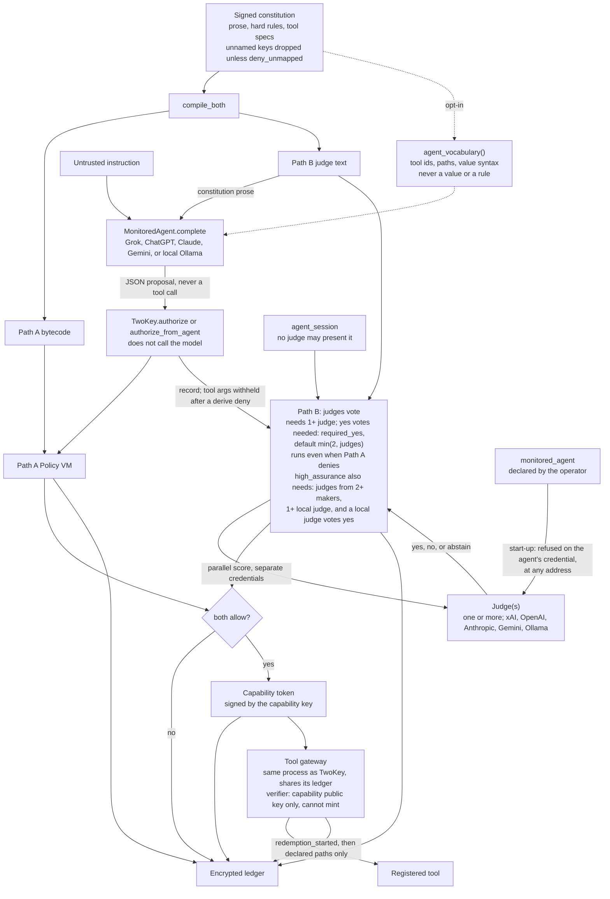
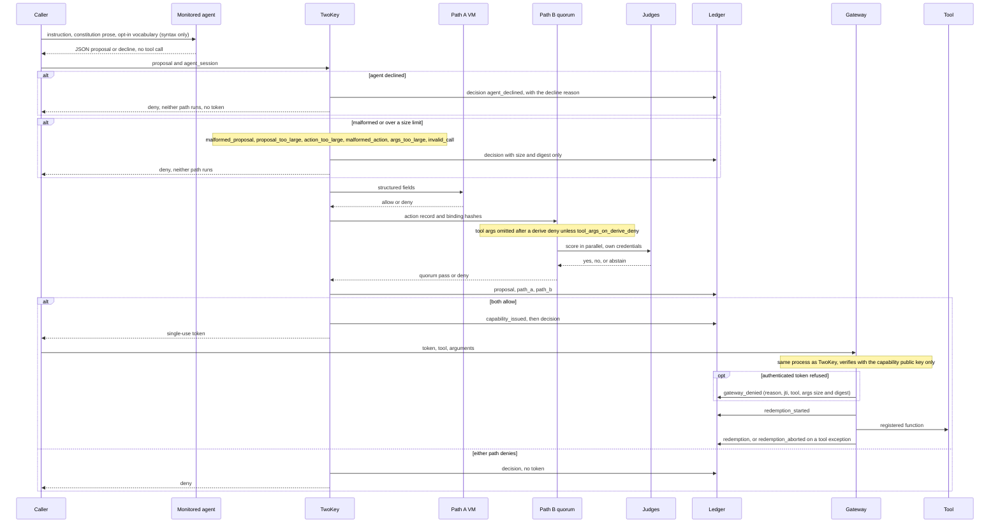
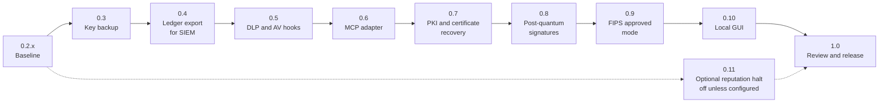

# Two-Key concept

[](https://github.com/Insomniac-VibeLabs/two-key-concept/actions/workflows/tests.yml) [](https://github.com/Insomniac-VibeLabs/two-key-concept/actions/workflows/build.yml) [](https://github.com/Insomniac-VibeLabs/two-key-concept/actions/workflows/coverage.yml) [](https://github.com/Insomniac-VibeLabs/two-key-concept/releases)
[](https://github.com/Insomniac-VibeLabs/two-key-concept/blob/v0.3.0/LICENSE) [](https://github.com/Insomniac-VibeLabs/two-key-concept/actions/workflows/security.yml) [](https://github.com/Insomniac-VibeLabs/two-key-concept/actions/workflows/semgrep.yml) [](https://app.deepsource.com/gh/Insomniac-VibeLabs/two-key-concept/)

Two independent keys must turn before an AI agent can act.

This repository is the initial concept, kept small on purpose. It has a
working ledger, Path A, Path B, and the judge and monitored-agent hooks. It does
not scan payloads and it has no antivirus or DLP hooks today. Hooks for
them, and the rest of the path to a 1.0 release, are on the
[roadmap](#roadmap).

Apache License 2.0. See [LICENSE](LICENSE).

Read [docs/FIT.md](docs/FIT.md) first, then
[docs/COMPARISON.md](docs/COMPARISON.md),
[docs/THREAT_MODEL.md](docs/THREAT_MODEL.md), and
[docs/SCOPE.md](docs/SCOPE.md), before relying on it. For where the project
is going, see [ROADMAP.md](ROADMAP.md).

## Components

- **Constitution**: User/admin-configurable set of signed rules (prose, hard rules, and tool specs). The principal signs it; Two-Key enforces the signed form.
- **Policy Enforcer (Path A)**: Deterministic bytecode policy VM. It evaluates structured fields derived from the argument bytes according to the signed tool specs. It does not read free text or English.
- **Judge (Path B)**: Trusted AI agent (local or cloud, preferably suited to the use case). It scores the normalized action record (and optionally the proposal). It has no direct access to any registered tool.
- **Monitored Agent**: The untrusted agent under constraint. It proposes actions; it has no direct access to any registered tool.
- **Tool Gateway**: Accepts a single-use capability token and invokes the registered tool. It runs in the `TwoKey` process on the `TwoKey` ledger object (`TwoKey.gateway()`); a gateway in another process or on another host is not supported (#45). Its verifier holds only the capability public key, so it cannot mint. That is an API property, not key isolation.
- **Registered Tool**: The tool protected by the dual-path authorization and the capability token.

## Dual-path authorization

1. Path A is a policy VM. Hard rules compile to bytecode. The VM reads five built-in structured fields (tool, amount_usd, data_class, counterparty, and irreversible) and any custom fields the principal declares under `fields:` (boolean, integer, enum, or string; up to 64; see [examples/custom_fields.yaml](examples/custom_fields.yaml) and HOWTO "Custom Path A fields"). It does not read English. A fault is a deny. A field's description is a signed note for people, never a rule. The signed constitution must include tool_specs.  Those fields are read from the
   argument bytes by [two_key/derive.py](two_key/derive.py). A claim that
   disagrees with the bytes is a deny. Omitting `tool_specs` will not sign
   and will not load. A key the spec does not name does not reach the tool.
   `deny_unmapped` defaults off, so the call can still be allowed and that
   key is dropped at the gateway. The ledger records the dropped key names
   (`dropped_keys`), never their values. Set it true to deny the key
   instead. A `payload` path names a value that is not interpreted. It may
   not equal, contain, or sit under an amount, currency, or counterparty
   path; such a spec does not load. With no `shape`, it
   covers that value's children. `shape` may lock it to a string, a number,
   or a list of strings. `max_length` bounds a string or a list. Shape does
   not read the contents. The spec does not list every nested key. A counterparty
   path must list `allow`. A party that is not on that list is
   `counterparty_not_allowed`. The tool receives the canonical party, not
   the raw spelling. A value that cannot be read (for example `10**400`) is
   a `derive_failed` deny, and any other exception in `authorize` is an
   `internal_error:` deny, written to the ledger.
2. Path B is a judge quorum. Judges are hooks for xAI/Grok, OpenAI,
   Anthropic, Gemini, and Ollama. The minimum is one judge, and that judge
   must not be the monitored agent: it may run any model from any vendor,
   but never with the agent's credential, at any address. A missing,
   malformed, errored, or
   timed-out ballot does not count as yes. The default policy has no
   diversity floors. `QuorumPolicy.high_assurance()` (or
   `profile: high_assurance` in judges.yaml) needs judges from at least two
   model makers, at least one local judge, and a yes from a local judge; use
   it for destructive, irreversible, financial, or external-send tools. A
   judge's maker is who made its model, as the operator labels it (`maker:`,
   default: its `provider`). It is not verified, and it is a rule about the
   judges only: it is never compared with the monitored agent. `require_local_yes`
   with no local judge does not start. A judge is local only when it says
   so (`local_weights: true`) and its `base_url` host is on an allowlist:
   loopback, RFC 1918, or IPv6 unique-local. A `:cloud`/`-cloud` model is
   never local, for any judge class. With `required_yes` unset, the approval threshold is `min(2, number_of_judges)`. The default policy permits a one-judge deployment, but the operator must still configure at least one judge; Two-Key does not create or select judges automatically. With one configured judge, one affirmative vote is required. With two or more judges, two affirmative votes are required by default. This is not a general majority rule: for example, a three-judge setup requires two affirmative votes, and a four-judge setup also requires two. Operators who want a different threshold, such as a majority or unanimity, must explicitly configure `required_yes` to the desired number of affirmative votes.
   `require_path_a_first` is not a floor and it is not a skip. After a derive
   deny, judges do not receive the argument bytes unless
   `tool_args_on_derive_deny` is set. Path B still runs. Other denies still
   attach non-empty arguments.
3. A short-lived single-use token is issued only if both paths allow. The
   token is signed by a capability key that lives outside the ledger
   directory, not by handing that private key to the gateway. It is bound
   to the tool, the argument hash, the ledger Merkle root at issuance, the
   constitution hashes, `spec_hash`, and the derived form. It lives
   `ttl_seconds` (default 120, at most 300). Redemption writes an intent before the tool
   runs, so a crash cannot run that token twice.
4. The gateway redeems that token with the public half of the capability
   key. It does not hold the minting key, and it does not inspect file
   contents, mail, or tool output for DLP or malware.

Both paths answer once the call is well-formed and within limits. A Path A deny does
not skip Path B, so the ledger has both results. A malformed or oversized
call (`malformed_proposal`, `proposal_too_large`, `action_too_large`,
`malformed_action:`, `args_too_large`, `invalid_call:`) is denied before
either path runs, and only its size and digest are ledgered.
`authorize_from_agent` does not execute the tool. An agent is untrusted whether it is hosted locally or in
the cloud.

## Architecture

A monitored agent and a Path B judge do not call each other, and neither
calls the gateway. The caller runs the agent. Two-Key then runs both paths
once the call is well-formed and within limits.
Only the gateway runs a tool.



`MonitoredAgent.complete` sends the constitution prose and the instruction.
It does not receive Path A bytecode, judge credentials, or tool
credentials. It receives `tool_specs` only as the opt-in, read-only
`vocabulary=tk.agent_vocabulary(tools=[...])`: tool ids, argument paths,
value syntax, floors, and data classes, never a value (no `allow` list,
enum value, bound, or rule). The exact values a call needs, such as the
payee id, come from the instruction or the prose (HOWTO "Designing a
constitution"). Either way Path A checks every call.
Its reply is data: `tool`, `arguments`, `proposal`, and optional structured
fields, or a decline (`{"decline": "<reason>"}`), which is a ledgered
`agent_declined` deny with no token and neither path run. Omitting
`data_class` means `classified`, whatever the tool's floor is. Classes
combine as a set: `medical` or `financial` on a `personal` tool stays
`medical` or `financial`, both together are `financial+medical`, and only
`classified` is `classified` (HOWTO "Data classes"). Extra keys are rejected. `authorize_from_agent` parses that JSON,
records `agent id`, `hosting`, and `trusted: false`, and does not call the
model again. Those fields are operator/library metadata (str, at most 256
characters after strip); non-str or oversize is a deny. Hosting is local or
cloud. It is not trust, and it does not skip either path.

Path A reads only the structured fields: the five built-in ones and the
declared custom fields, all derived from the argument bytes. Path B judges see the
normalized action record. Non-empty tool arguments are attached on that
record as `tool_args`, except after a derive deny. Set
`tool_args_on_derive_deny: true` on the quorum policy to send those bytes
anyway. Path B still runs either way. A rule deny that is not a derive deny
still attaches the arguments. The proposal string is not sent unless that
judge has `receives_proposal: true`, or the quorum policy is
`judge_inputs: record_and_proposal`. The code default, and
`examples/judges.yaml`, is `record_only`.

Judges are loaded into `TwoKey` from their own config and their own API
keys. The operator declares the monitored agent (`monitored_agent:` in
judges.yaml, or `TwoKey(monitored_agent=...)`): its model, `base_url`, and
credential. The agent's own report is never used. At start-up `TwoKey`
resolves every judge and the agent to a normalized model (Unicode forms
and dashes folded), the endpoint `host:port`, the upstream that serves it
and how that was found (`resolved_by`: `endpoint`, `model_prefix`, or
`declared_upstream`), scoped tenant ids (a `tenant:` mapping of
`organization`, `project`, `account`, or `deployment`, plus what the URL
shows), and a credential fingerprint under a per-install key, whitespace
stripped (HMAC-SHA256 for an API token; PBKDF2-HMAC-SHA256, 600,000
iterations, for a username and password, fingerprinted as one pair, and for
any secret that contains `:`). Every credential a side holds is fingerprinted, sent or not.

A judge may run any model from any vendor. A judge is not the monitored agent, and
`TwoKey` refuses to start (`judge_matches_agent:`), when it holds the monitored
agent's credential (the same API token, or the same username and password),
at any address: a credential identifies its holder wherever it is sent. Two
sides that send no credential are the same agent only on the same address (the
endpoint `host:port`, every alias of this machine folded to `localhost`),
where nothing tells them apart. Everything else starts. Likely accidents
are allowed with a `two-key: WARNING:` line on stderr and recorded in
`constitution_loaded` (`judge_agent_separation.warnings`): the same model
on the same address, the same model through a shared route or a local or
unrecognized proxy with no declared `upstream:`, a shared tenant id, one
side keyless on the same address, and an identity whose upstream cannot be
resolved. Addresses are compared as configured; DNS names are not
resolved. A username and password are sent as HTTP Basic over HTTPS only.
`allow_same_provider_judge` and `allow_same_model_distinct_tenant` are
accepted and have no effect. Without a declaration it refuses with
`monitored_agent_required:`. Provider labels are never compared. HOWTO has
the details.

Judges vote in parallel under one hard deadline. A missing, malformed, or
timed-out ballot is an abstention, and an abstention is not a yes. No
judge, no deadline, or two judges with the same id does not start. Each
ballot is paired with its judge by position and takes its judge id from
the judge; a ballot that names another judge abstains
(`judge_id_mismatch`). A cloud judge makes the round deny when
`agent_session` is missing. A judge is cloud when it is not on a loopback
host, or when its model name ends in `:cloud` or `-cloud`, on any host
(an Ollama cloud model served through `localhost` is still cloud). If that string equals the credential of any judge, local or
cloud, wherever it connects, the ballot abstains with
`cloud_judge_reused_agent_session` and the round denies. The credential
named for the monitored agent is compared the same way on every call, so a
placeholder does not hide that key. The key is not sent to the judge and
not written to the ledger. A session that is not that key is still yours
to pass. `X-Two-Key-Judge-Session` is a call id minted here. It is not a
session at the model host.

Without a local judge, the constitution prose, the action record, and any
attached tool arguments go to the cloud judges' vendors.

Judges do not enforce the `allow` lists or the data class; Path A does.
`judges.yaml` and `agents.yaml` are trusted operator configuration: a
`callback` auth entry imports the module it names, so whoever can write
those files can run code in the `TwoKey` process.

Every `decision` in the ledger records `policy_digest`, the digest of the
quorum policy in effect (opt-outs included, written in full once in
`constitution_loaded`), and `identities_digest`, the digest of the resolved
judge and agent identities written once in `constitution_loaded`: model,
upstream, endpoint, tenant ids, and credential fingerprint, never a key.

Every JSON and YAML input is parsed strictly: a repeated key at any depth
is refused, never last-one-wins, and so is a YAML merge key (`<<`), whose
winning value the text does not show. An integer of more than 4,300 digits
is refused or denied as `invalid_call`. Unknown top-level keys in judges.yaml or
agents.yaml are refused. Tool arguments or a proposal over 256 KiB, or
tool arguments, the action claim, or a structured proposal nested more than
62 levels, are denied before they are ledgered.

One call, in code order:



The token is signed by the capability key (`<ledger>.capability/capability.pem`,
outside the ledger directory). It is bound to the tool, the argument hash,
the ledger Merkle root and size at issuance, the constitution hashes,
`spec_hash`, and the derived form. The gateway is built with
`TwoKey.gateway()` (or `ToolGateway(tk.ledger, tk.issuer.verifier(), ...)`
in the same process); either way it keeps only the public half of the
capability key. It recomputes the form from the same bytes. It checks the
signature, expiry, a lifetime no longer than the TTL (`ttl_too_long`), an
issue time at most 5 s ahead (`issued_in_future`), and that nothing revoked
or reloaded the constitution after issuance. It writes `redemption_started` before the tool runs. It does not
scan the bytes for sensitive text. The principal key still signs the
constitution and the ledger head. A token signed with that principal key
does not redeem, and a capability key equal to the principal key is
refused. The capability key is created once, mode 0600 in a 0700
directory, and, like the witness key, is read only as a regular file that
the group and others cannot read, never through a symlink. Once a token has been issued it is never regenerated: a missing
or changed key refuses to start. Its fingerprint is recorded in
`constitution_loaded` and the gateway checks it.

The gateway runs in the `TwoKey` process, on the ledger object `TwoKey`
uses. Build it with `TwoKey.gateway()`. A gateway in another process or on
another host is not supported
([#45](https://github.com/Insomniac-VibeLabs/two-key-concept/issues/45)):
a `Ledger` opened elsewhere does not see tokens issued after it opened, so
it refuses them, and it would hold the principal, witness, and ledger keys
anyway. A gateway built on a ledger no `TwoKey` in the process opened emits
`TwoKeyDeploymentWarning` once per process.

The gateway's verifier holds only the capability public key, so the
gateway object cannot mint. That is an API property, not key isolation.
The same process holds the capability minting key (`TwoKey.issuer`) and,
on the shared ledger object, the principal, witness, and ledger keys. The
registered tools run in that process too. Python gives no memory isolation
inside one process, so a compromised tool or dependency can read every one
of those keys. Keep tools small and trusted, or put the work they do
behind a service of their own.

## What this repo leaves out

Not in this repository:

- payload scanning, antivirus, and DLP hooks
- enterprise deployment modes and permissioned-chain anchoring
- X.509 / PKI identities and agent assertions
- seed-phrase backup
- hybrid ML-DSA-65

Some of this is planned as optional additions. See the
[roadmap](#roadmap): DLP and antivirus hooks (an interface that calls
external scanners, not a scanning engine), PKI with certificate recovery,
and hybrid ML-DSA-65. Key backup shipped in 0.3.0 and is not seed-phrase
backup. Enterprise deployment modes, permissioned-chain anchoring, and seed
phrases are not planned.

The ledger is encrypted at rest.

Crypto here is Ed25519 and SHA-256 via the `cryptography` package. Ledger
entries and the signed head are AES-256-GCM at rest. The data key is wrapped
by a ledger key outside the ledger directory, not by the principal key. The
head is signed by the principal and by a witness key, also outside the ledger
directory. A stolen principal key alone cannot decrypt the log or sign a new
head. The witness public key is pinned in the ledger (the first entry,
`witness_pinned`), so a replaced `witness.pem` is refused
(`witness_key_changed`). With the ledger key as well, the principal key can
still rewrite the chain from its first entry, pin included, unless the
operator also gives the witness public key as configuration
(`Ledger(..., witness_public_key=...)` or `--witness-public-key`), kept
where whoever writes the ledger directory cannot change it. With that pin,
forging a head needs the principal, witness, and ledger keys together. The
witness key changes only by a ledgered rotation (`two-key rotate-witness`).
It is a prototype. It is not a FIPS 140-3 validated module.

## Known limits

- No independent review and no production deployment.
- No external anchor for the ledger. Someone holding the principal and
  ledger keys can rewrite a ledger that never leaves the machine, unless
  the witness public key is configured outside the ledger
  (`--witness-public-key`); then the witness key is needed too (#58).
  A head anchor outside the ledger directory
  (`<ledger>.ledger-key/head.anchor`, or `--head-anchor`) refuses a rollback
  or a wipe of the ledger directory alone (#62). It does not refuse them if
  that anchor is deleted or rolled back with the ledger. Someone who can
  write the anchor file can still do both. It is not an external anchor.
- Not FIPS 140-3 validated. A FIPS approved mode that runs on a validated
  module is on the roadmap. It would not validate this package.
- Signatures are Ed25519, which is not quantum resistant. Hybrid signatures
  are on the roadmap.
- Identities are bare keys. There is no certificate chain, expiry, or
  revocation. PKI with certificate recovery is on the roadmap.
- It does not scan payloads, and it is not an antivirus or DLP product.
- A key backup is only as strong as its passphrase. The bundle is the keys.
  PBKDF2 slows guessing and is not memory-hard. It is not a seed phrase and
  not an external anchor. A restore onto a newer ledger fills missing key
  files and leaves a key that is already there. `--replace-ledger` can make
  a token spent after the backup look unspent, and it replaces a key file
  that differs.

The full register is [docs/THREAT_MODEL.md](docs/THREAT_MODEL.md).

## Roadmap

The plan from the 0.2.4 prototype to a 1.0 release. It states intent, not a
promise. The order may change, and version numbers are targets, not dates.
0.3.0 (key backup) is released: tag `v0.3.0` on `main`. Nothing after 0.3 in
that plan exists yet.
The detail is in [ROADMAP.md](ROADMAP.md).



| Target | What |
| --- | --- |
| 0.2.3 | Pin the ledger's witness public key (#58); remove the `vendor` / `min_vendors` aliases |
| 0.2.4 | Head anchor against a ledger-directory rollback or wipe (#62); `two-key recover` for an uncheckpointed tail (#49). Tagged `v0.2.4` on `main` |
| 0.3 | Encrypted backup and restore of the principal, capability, ledger, and witness keys, in three bundles. A restore includes `head.anchor` from the same moment. Tagged `v0.3.0` on `main` |
| 0.4 | Ledger export for a SIEM: verified, decrypted locally, no argument values |
| 0.5 | DLP and antivirus hook interface, with reference adapters for ClamAV and a secret scanner |
| 0.6 | MCP adapter: a proxy in front of the gateway, not an MCP server |
| 0.7 | PKI: X.509 identities for personal and enterprise use, and certificate recovery |
| 0.8 | Hybrid Ed25519 plus ML-DSA-65 signatures for the constitution and ledger head |
| 0.9 | FIPS approved mode: refuses to start unless running on a validated module |
| 0.10 | Local GUI for configuration and ledger auditing |
| 1.0 | Public community review, then release. Described as community-reviewed, not audited |
| 0.11, any time before 1.0 | Optional reputation halt. Off unless configured. Not a change to `revoke` |
| After 1.0, not scheduled | More spec field types (decimal, URL, path, email, opaque bytes), and `amount` / `counterparty` as ordinary typed fields. Custom `boolean`, `integer`, `enum`, and `string` fields shipped in 0.3.0 |

Install from git. It is not published to PyPI. Package version is 0.3.0.
Tag `v0.3.0` on `main` is the tagged release. Tag `v0.2.4` stays on
`fc836bb`. Tag `v0.2.3` stays on `4a4352e`. Tag `v0.2.0` stays on
commit `2f756ac`. 0.2.3 refuses the `vendor:` and `min_vendors:` keys, refuses
some judges 0.2.2 accepted (one holding the agent's credential without
sending it, or in the other form), and pins each ledger's witness key on
its first open: read "Upgrading from 0.2.2" in
[CHANGES.md](CHANGES.md) before upgrading (and "Upgrading from 0.2.1" and
"Upgrading from 0.1.12" from older versions). 0.2.4 writes a head anchor on
the first open of an existing ledger and refuses a rolled-back ledger
directory: read "Upgrading from 0.2.3". 0.3.0 adds key backup, custom Path
A fields, and `TwoKey.gateway()` (#45). Existing ledgers and constitutions
open unchanged: read "Upgrading from 0.2.4". A constitution that declares
custom fields signs as v2, which installs before 0.3.0 refuse: read
"Custom Path A fields" > "Upgrading" in CHANGES.md.

The middle column on the GitHub file list is the last commit that touched
that file, not a description of the file. The layout table below is the
description.

```bash
pip install "two-key-concept[yaml] @ git+https://github.com/Insomniac-VibeLabs/two-key-concept.git@v0.3.0"
```

That ref is the tagged 0.3.0 release (key backup, custom Path A fields, and
the #45 gateway boundary). `main` is that release. `working` is where the
next changes land. For the previous release, use `@v0.2.4`.

## Run the offline demo

```bash
python3 -m venv .venv
. .venv/bin/activate
pip install -e ".[yaml]"
python -m unittest discover -s tests
python -m two_key demo
python -m two_key authorize --help
```

That install follows the ranges in `pyproject.toml`. CI does not: it installs
the versions in `uv.lock` (cryptography, PyYAML, and their dependencies),
wheels only. To match CI, use the uv version pinned in
`.github/workflows/tests.yml`:

```bash
pip install --only-binary :all: "uv==0.13.0"
uv sync --locked --no-build --extra yaml --no-dev
.venv/bin/python -m unittest discover -s tests
```

The demo uses fixed test-double judges. Real judges are configured in
`examples/judges.yaml`. See [docs/HOWTO.md](docs/HOWTO.md).

## Layout

| Path | What |
| --- | --- |
| `two_key/core.py` | `TwoKey.authorize` and `authorize_from_agent` |
| `two_key/audit.py` | `check_decision_digests`: recompute each decision's `identities_digest` and `policy_digest` |
| `two_key/policy_vm.py`, `compiler.py` | Path A |
| `two_key/derive.py` | Tool-spec derivation for Path A's form |
| `two_key/fields.py` | Custom Path A fields: registry, types, character sets, limits |
| `two_key/quorum.py`, `two_key/judges/` | Path B and judge transport |
| `two_key/identity.py`, `netloc.py` | Judge ≠ monitored agent check; local vs. cloud host |
| `two_key/strict.py` | Strict JSON and YAML loading (duplicate keys, merge keys, and huge integers refused) |
| `two_key/agents.py` | Monitored-agent hooks |
| `two_key/ledger.py` | Encrypted ledger; ledger key and witness live outside the directory |
| `two_key/capability.py`, `gateway.py` | Tokens and redemption. The gateway verifies only. |
| `two_key/keys.py`, `cli.py`, `backup.py` | Key files; `two-key` command line; passphrase backup of the package's own keys |
| `two_key/action.py` | Normalized action record and its validation |
| `two_key/agent_meta.py` | Bounds on operator- or library-supplied agent identity metadata written to the ledger |
| `two_key/canonical.py` | Canonical encoding for the ledger, tokens, and judge bindings |
| `two_key/constitution.py` | Signed constitution: prose for Path B, hard rules for Path A, and tool specs |
| `two_key/testing.py` | Offline test doubles only; not real judges |
| `examples/` | Constitution, hard rules, custom fields, judges, agents |
| `ROADMAP.md` | Plan from 0.2.4 to 1.0. 0.3.0 is tagged `v0.3.0` |
| `docs/HOWTO.md` | Operator how-to |
| `docs/JUDGES_AND_QUORUM.md` | How judges vote and how Path A and Path B combine |
| `docs/FIT.md` | Whether this package is the right control |
| `docs/COMPARISON.md` | What this package is not a substitute for |
| `docs/THREAT_MODEL.md` | Boundaries and residual risk |
| `docs/SCOPE.md` | What this package includes, leaves out, and plans |
