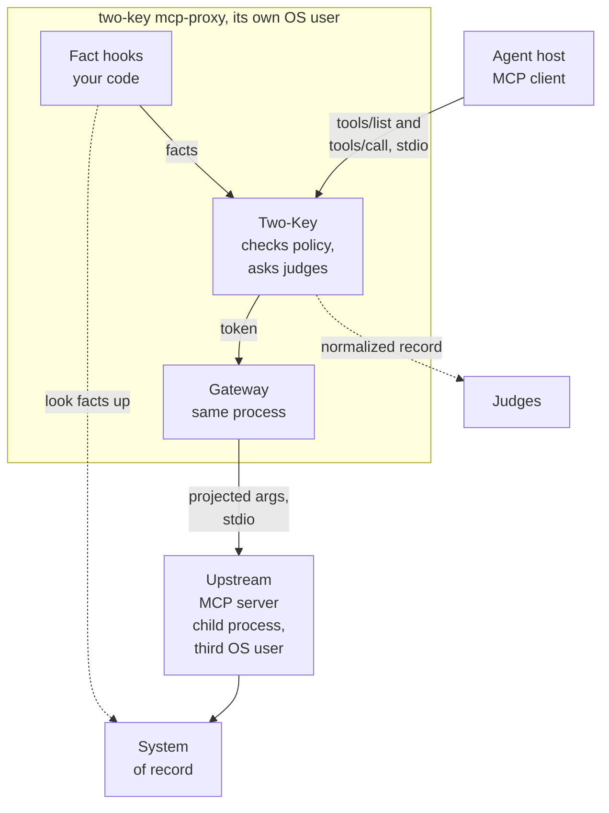
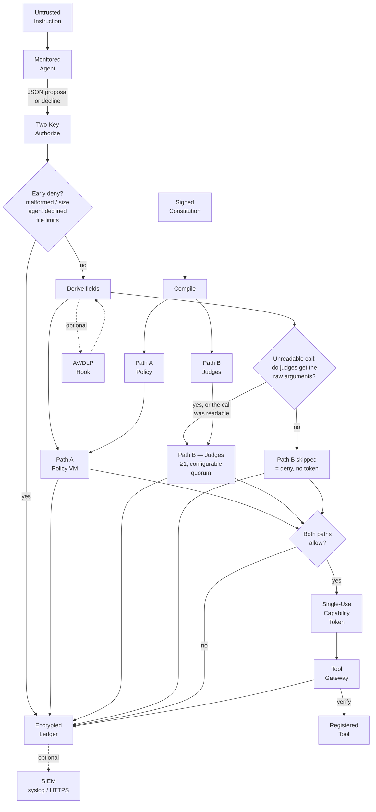
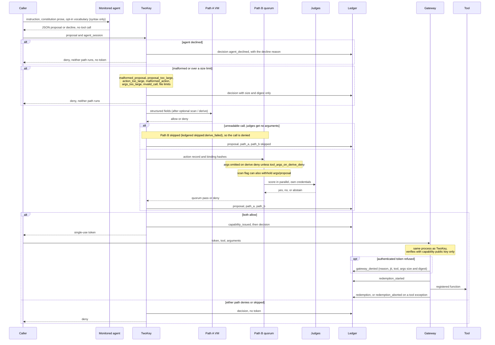
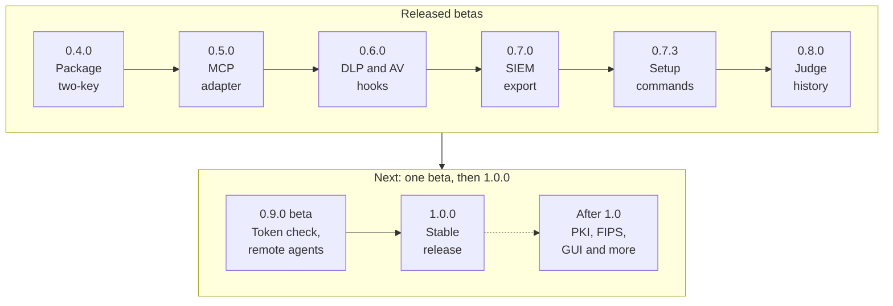

<!--
Copyright 2026 Insomniac-VibeLabs
Author: Stephan Busch
SPDX-License-Identifier: Apache-2.0
-->
<!-- mcp-name: io.github.Insomniac-VibeLabs/two-key -->

# Two-Key

**Two independent keys must turn before an AI agent can act.  No human needed.**

**AI agent authorization and MCP gateway with dual-path policy. Bytecode policy combined with AI judge approval, single-use capability tokens, and an encrypted ledger.**

<p align="center">
  
</p>

**Two independent keys must turn before an AI agent can act.**

[](https://github.com/Insomniac-VibeLabs/two-key/actions/workflows/tests.yml) [](https://github.com/Insomniac-VibeLabs/two-key/actions/workflows/build.yml) [](https://github.com/Insomniac-VibeLabs/two-key/actions/workflows/coverage.yml) [](https://github.com/Insomniac-VibeLabs/two-key/releases)
[](https://github.com/Insomniac-VibeLabs/two-key/blob/main/LICENSE) [](https://github.com/Insomniac-VibeLabs/two-key/actions/workflows/security.yml) [](https://github.com/Insomniac-VibeLabs/two-key/actions/workflows/semgrep.yml)[](https://github.com/Insomniac-VibeLabs/two-key/actions/workflows/codeql.yml) [](https://app.deepsource.com/gh/Insomniac-VibeLabs/two-key/)

**🎯 The Problem**

AI agents can be given permission to use a tool without being given
authority to perform every consequential action that tool can perform.

Traditional tool permissions answer:

> "Can this agent call this tool?"

Two-Key asks a different question:

> "Is this specific action authorized to execute?"

Two-Key is an authorization layer for AI agents that use tools. Before a consequential tool call executes, Two-Key requires independent authorization through a deterministic policy path and an independent judge path:

- **The policy key (Path A).** The rules you sign compile to bytecode. A
  small deterministic VM checks every call against fields read from the
  call's own arguments: the tool, the amount, the counterparty, the data
  class, and fields you define. It reads no prose, so no prompt can talk it
  out of a rule.
- **The judgment key (Path B).** One or more AI judges, each with its own
  credential, review the call against your written constitution. Two-Key
  refuses to start with a judge that holds the agent's own credential.

Only when both keys turn does Two-Key issue a single-use token, bound to the
exact arguments, the signed constitution, and the ledger state. The gateway
runs the tool only with that token, and every decision, allowed or denied,
is written to an encrypted, hash-chained ledger with a signed head.

What you get:

- **Works with the agent you have.** Grok, ChatGPT, Claude, Gemini, or a
  local model (i.e. Ollama) proposes the call as data; Two-Key decides.
- **Judges you choose.** xAI, OpenAI, Anthropic, Gemini, or a local model. One
  judge is enough to start; the `high_assurance` profile asks for judges
  from two makers and a yes from a local one.
- **In front of any MCP server** (0.5.0). `two-key mcp-proxy` shows the
  agent only the tools you signed and runs every call through both keys.
- **Facts from your systems, not from the agent** (0.5.0). A field such as
  "this invoice matches its purchase order" comes from your own lookup,
  and is looked up again just before the tool runs.
- **An audit trail you can check.** AES-256-GCM at rest, a hash chain, a
  head signed by the principal and a witness key, and `two-key audit`.
- **A copy in your SIEM** (0.7.0). Every decision can go to
  syslog or an HTTPS webhook as it is written, in Two-Key's own schema, ECS,
  or OCSF, with reason codes and digests but no argument values. A collector
  that is down never blocks a decision.
- **Keys you can recover.** Passphrase backup of every key, in three
  bundles.
- **Small on purpose.** Python 3.10 to 3.14, one required dependency
  (`cryptography`), Apache-2.0.

**Status:** beta. 0.8.0 is the current release: judges see a summary of
recent decisions (a repeated bill, a split payment, a burst of denied
attempts), the ledger keeps each judge's ballot, one proxy serves each agent,
and two windows arrive: a read-only ledger audit (`two-key ledger-view`) and
a constitution editor. 0.7.3 added `two-key setup` and
`two-key config set`, `get`, `undo` and `check` for setting up and changing a
deployment, a signed serial so a ledger never goes back to older rules, and
start-up checks for the upstream server's files behind a launcher. 0.7.0
added the SIEM export, a start-up check that refuses to run when the
monitored agent is Two-Key's own account, and a count of the tokens the
gateway refuses.
Maintainer-reviewed and tested with live LLM agents and judges. Read
[Known limits](#known-limits) and [docs/FIT.md](docs/FIT.md) before you rely
on it.

## Contents

<!-- toc -->
- [Quick start](#quick-start)
- [Put Two-Key in front of an MCP server](#put-two-key-in-front-of-an-mcp-server)
- [Documentation](#documentation)
- [Components](#components)
- [Dual-path authorization](#dual-path-authorization)
- [Architecture](#architecture)
- [What this repo leaves out](#what-this-repo-leaves-out)
- [Known limits](#known-limits)
- [Roadmap](#roadmap)
- [Install and versions](#install-and-versions)
- [Layout](#layout)
- [History and license](#history-and-license)
<!-- /toc -->

## Quick start

Install 0.8.0 from PyPI ([docs/PYPI.md](docs/PYPI.md)):

```bash
pip install "two-key[yaml]==0.8.0"
```

Tag `v0.8.0` on `main` is the same code.

Or run the offline demo from a clone. It uses test-double judges, so it
needs no API keys:

```bash
python3 -m venv .venv
. .venv/bin/activate
pip install -e ".[yaml]"
python -m two_key demo
python -m two_key authorize --help
```

Real judges are configured in `examples/judges.yaml`. The operator guide is
[docs/HOWTO.md](docs/HOWTO.md). Before a real agent runs, close every way
around Two-Key: [docs/CONNECTING.md](docs/CONNECTING.md).

## Put Two-Key in front of an MCP server

New in 0.5.0 ([#2](https://github.com/Insomniac-VibeLabs/two-key/issues/2)):

```bash
pip install "two-key[mcp]==0.8.0"
```

An MCP client (a desktop assistant, an IDE, an agent framework) normally
starts an MCP server and calls its tools directly. With Two-Key, the client
starts `two-key mcp-proxy` instead. The proxy starts the real server itself,
shows the agent only the tools you signed, and runs every call through both
keys before the server sees it. Facts such as a purchase-order match come
from your own hook, never from the agent. A refused call comes back to the
agent as a tool error with a reason code.



`two-key setup` writes a first deployment; `two-key config set`, `get`, and `undo` change one setting at a time, checked and recorded in the ledger, and `config key-passphrase` encrypts the principal key ([SETUP](docs/SETUP.md)). `two-key config check --config proxy.yaml` says whether the proxy would start, and `config show` prints the settings it resolves to; both are read-only (HOWTO "Look at a config without starting the proxy"). `two-key mcp-draft-specs` drafts the tool specs from the server's own
schemas for you to review and sign. The walkthrough, with a worked
example, is HOWTO
["Put Two-Key in front of an MCP server"](docs/HOWTO.md#put-two-key-in-front-of-an-mcp-server-two-key-mcp-proxy).
Run the proxy and the upstream server as separate OS users, so neither the
agent nor the server can reach the proxy's keys (HOWTO "Key custody").
The proxy speaks stdio only and does not listen on the network; an agent
on another machine starts it over SSH with a forced command
([CONNECTING](docs/CONNECTING.md#an-agent-on-another-machine-route-1-over-ssh)),
a route that still needs live testing. From 0.7.0 the proxy
refuses to start when the account that started it is Two-Key's own, is
root, or can change Two-Key's files (`on_agent_access`).

## Documentation

| Read | For |
| --- | --- |
| [docs/FIT.md](docs/FIT.md) | Whether Two-Key is the right control for you |
| [docs/HOWTO.md](docs/HOWTO.md) | Setup, configuration, the MCP proxy, and operations |
| [docs/CONNECTING.md](docs/CONNECTING.md) | Connecting the agent and every hook so it cannot go around Two-Key, with a checklist |
| [docs/SETTINGS.md](docs/SETTINGS.md) | Every setting: its file, default, what `high_assurance` does to it, and who may change it |
| [docs/SETUP.md](docs/SETUP.md) | `two-key setup` for a first deployment, `config set`, `get`, and `undo` to change one setting, and `config key-passphrase` to encrypt the principal key: who may run them, what they check, and what they refuse |
| [docs/SCANNERS.md](docs/SCANNERS.md) | Content scanning with your antivirus or DLP product (0.6.0) |
| [docs/SIEM.md](docs/SIEM.md) | Sending the ledger to a SIEM, and checking a copy against it (0.7.0) |
| [docs/JUDGES_AND_QUORUM.md](docs/JUDGES_AND_QUORUM.md) | How judges vote and how the two keys combine |
| [docs/THREAT_MODEL.md](docs/THREAT_MODEL.md) | Trust boundaries and residual risk |
| [docs/SCOPE.md](docs/SCOPE.md) | What is included, left out, and planned |
| [docs/COMPARISON.md](docs/COMPARISON.md) | What Two-Key is not a substitute for |
| [ROADMAP.md](ROADMAP.md) | The path to 1.0 |
| [CHANGES.md](CHANGES.md) | Every change, with upgrade notes |
| [SECURITY.md](SECURITY.md) | How to report a vulnerability |
| [docs/UPGRADING.md](docs/UPGRADING.md) | Upgrading to a new version and keeping your keys and ledger |
| [docs/PYPI.md](docs/PYPI.md) | Registering the package name and publishing a release |

## Components

- **Constitution**: User/admin-configurable set of signed rules (prose, hard rules, and tool specs). The principal signs it; Two-Key enforces the signed form.
- **Policy Enforcer (Path A)**: Deterministic bytecode policy VM. It evaluates structured fields derived from the argument bytes according to the signed tool specs. It does not read free text or English.
- **Judge (Path B)**: Trusted AI agent (local or cloud, preferably suited to the use case). It scores the normalized action record (and optionally the proposal). It has no direct access to any registered tool.
- **Monitored Agent**: The untrusted agent under constraint. It proposes actions; it has no direct access to any registered tool.
- **Tool Gateway**: Accepts a single-use capability token and invokes the registered tool. It runs in the `TwoKey` process on the `TwoKey` ledger object (`TwoKey.gateway()`); a gateway in another process or on another host is not supported, by design ([why](docs/HOWTO.md#deployment-boundary-the-gateway-runs-in-the-twokey-process)). Its verifier holds only the capability public key, so it cannot mint. That is an API property, not key isolation.
- **Registered Tool**: The tool protected by the dual-path authorization and the capability token.
- **MCP proxy** (0.5.0; the `mcp` extra): `two-key mcp-proxy` sits between an MCP client and one upstream MCP server. It shows the agent only the signed tools, pins their schemas, and runs every `tools/call` through both keys and the in-process gateway. `two-key mcp-draft-specs` drafts the tool specs for the principal to review and sign. See HOWTO "Put Two-Key in front of an MCP server".
- **SIEM export** (0.7.0): the ledger can copy each entry, as
  it is written, to a syslog sink or an HTTPS webhook, and `two-key siem-export`
  writes the same events to a file that `two-key siem-verify` checks back
  against the ledger. A per-kind field allowlist decides what leaves: reason
  codes, digests, sizes, the tool id, and the data class, never argument
  values or proposal text. See [docs/SIEM.md](docs/SIEM.md).
- **Caller-supplied facts and the guard** (0.5.0): a field declared `source: caller` gets its value from your integration (`facts=`), never from the agent's arguments, and is looked up again before the tool runs. `two_key.guard.Guard` does both lookups and both keys in one call for any agent loop; the MCP proxy runs on it. See HOWTO "Caller-supplied facts".

## Dual-path authorization

Every tool call needs two separate "yes" answers before it can run. Path A
is a strict rule check. Path B is a panel of AI judges. Only when both say
yes does Two-Key issue a one-time pass (a token), and only the gateway can
use that pass to run the tool.

1. **Path A: the rule check (a policy VM).**
   - Your hard rules are compiled to bytecode and run in a small virtual
     machine. It does not read English. It only reads structured fields.
   - It reads five built-in fields (`tool`, `amount_usd`, `data_class`,
     `counterparty`, and `irreversible`) plus any custom fields the
     principal declares under `fields:` (boolean, integer, enum, or string;
     up to 64; see [examples/custom_fields.yaml](examples/custom_fields.yaml)
     and HOWTO "Custom Path A fields"). A field's description is a signed
     note for people, never a rule.
   - Only the tool's name is required. A tool spec may leave out
     `irreversible` (then the tool counts as irreversible) and
     `data_class_floor` (then it is `classified`), the safe defaults.
     Amount and counterparty apply only to tools that set them.
   - If the VM faults, the answer is deny.
   - **Where the values come from.** The signed constitution must include
     `tool_specs`. Without them it will not sign and will not load. Two-Key
     reads the field values from the call's actual argument bytes, in
     [two_key/derive.py](two_key/derive.py). If the agent claims a value
     that disagrees with the bytes, the call is denied.
   - **Keys the spec does not name.** They never reach the tool.
     `deny_unmapped` is off by default, so the call can still be allowed and
     the gateway simply drops those keys. The ledger records their names
     (`dropped_keys`), never their values. Set `deny_unmapped` to true to
     deny the call instead.
   - **Payloads.** A `payload` path names a value that Two-Key passes along
     without interpreting it. It may not be the same as, contain, or sit
     under an amount, currency, or counterparty path; a spec that does that
     will not load. With no `shape`, it covers everything under that value.
     `shape` can lock it to a string, a number, or a list of strings, and
     `max_length` limits how long a string or list may be. Shape checks the
     type, not the contents. The spec does not have to list every nested
     key.
   - **Counterparties.** A counterparty path must have an `allow` list.
     Anyone not on that list is denied as `counterparty_not_allowed`. An
     entry like `@example.org` (0.5.0) allows every plain address at exactly
     that domain, and signing shows a warning. The tool receives the
     canonical form of the party, not the raw spelling the agent sent.
   - **Custom fields per tool.** For each custom field a rule reads, every
     tool must either map it or mark it `not_applicable`, or the
     constitution does not sign (0.5.0). A string field with `case: exact`
     keeps a case-sensitive id exactly as written.
   - **Errors.** A value that cannot be read (for example `10**400`) is
     denied as `derive_failed`. Any other error inside `authorize` is denied
     as `internal_error:`. Both are written to the ledger.
2. **Path B: the judges.** You configure one or more judges, and a set
   number of them must vote yes.
   - **Judges** are independent AI authorization endpoints. They can use models from xAI/Grok, OpenAI, Anthropic, Google Gemini, Ollama, or other providers. At least one judge is required. Each judge uses its own credentials and execution context and **must not be the monitored agent itself**—the agent's credentials and endpoints may never be reused as a judge.
   - A vote that is missing, malformed, errored, or timed out never counts
     as yes.
   - **How many yes votes are needed.** Two-Key does not create or choose
     judges for you; the operator must configure at least one. If
     `required_yes` is not set, the number of yes votes needed is
     `min(2, number_of_judges)`. One judge needs one yes. Two or more judges
     need two yes votes. This is not a majority rule: three judges need two,
     and four judges also need two. For a majority, unanimity, or any other
     number, set `required_yes` yourself.
   - With `required_yes: 1` and more than one judge, one judge can approve
     alone while the others are down. `TwoKey` warns about this at start,
     and `min_responding` closes that gap.
   - **Judge diversity (optional).** The default policy has no diversity
     floors. `QuorumPolicy.high_assurance()` (or `profile: high_assurance` in
     judges.yaml) needs judges from at least two model makers, at least one
     local judge, and a yes from a local judge. Use it for destructive,
     irreversible, financial, or external-send tools. A judge's maker is who
     made its model, as the operator labels it (`maker:`, default: its
     `provider`). It is not verified, and it is a rule about the judges only:
     it is never compared with the monitored agent. `require_local_yes` with
     no local judge does not start.
   - **What counts as local.** A judge is local only when it says so
     (`local_weights: true`) and its `base_url` host is on an allowlist:
     loopback, RFC 1918, or IPv6 unique-local. A `:cloud`/`-cloud` model is
     never local, for any judge class.
   - **After a Path A deny.** `require_path_a_first` is not a floor and it
     is not a skip. After a derive deny, judges do not see the argument
     bytes unless `tool_args_on_derive_deny` is set. So without that
     setting, a call that cannot be read under its spec (`derive_failed:`) goes to no judge,
     because there is nothing to judge, and the ledger records Path B as
     `skipped:derive_failed`. Other denies still go to the judges, with
     non-empty arguments attached.
3. **The one-time pass (capability token).** Two-Key issues a short-lived,
   single-use token only if both paths say yes.
   - It is signed with a capability key that lives outside the ledger
     directory. The gateway is never handed that private key.
   - It is tied to the tool, the hash of the arguments, the ledger Merkle
     root when it was issued, the constitution hashes, `spec_hash`, and the
     derived form.
   - It lives for `ttl_seconds` (default 120, at most 300).
   - When it is redeemed, an intent is written before the tool runs, so a
     crash cannot run the same token twice.
4. **The gateway runs the tool.** It checks the token with the public half
   of the capability key. It does not hold the key that creates tokens, and
   it never scans. With a content scanner configured (0.6.0), Two-Key scans
   the call before the two paths decide, and the gateway checks the verdict
   and the file digests that the token is tied to. Tool output is not
   scanned.

**Both paths always answer** once a call is well-formed, within limits, and
readable under its spec. A Path A deny does not skip Path B, so the ledger
holds both results. A call that cannot be read (`derive_failed:`) is denied
without asking the judges, unless `tool_args_on_derive_deny` lets them see
its arguments.

**Broken or oversized calls never reach either path.** A malformed or
oversized call (`malformed_proposal`, `proposal_too_large`,
`action_too_large`, `malformed_action:`, `args_too_large`, `invalid_call:`)
is denied first, and only its size and digest are written to the ledger.

`authorize_from_agent` does not run the tool. An agent is untrusted whether
it is hosted locally or in the cloud.

## Architecture

A monitored agent and a Path B judge do not call each other, and neither
calls the gateway. The caller runs the agent. Two-Key then runs both paths
once the call is well-formed and within limits.
Only the gateway runs a tool.



A call that could not be read under its signed spec (`derive_failed:`) is already
denied by Path A. Unless `tool_args_on_derive_deny` is set, the judges are not shown
its raw arguments (nor when a scan flag withholds them and `tool_args_on_scan_flag`
is not set), so they are not asked: Path B is skipped and ledgered as
`skipped:derive_failed`. A skipped Path B counts as not passing, so the call is
denied and no token is issued.

`MonitoredAgent.complete` sends the constitution prose and the instruction.
It does not receive Path A bytecode, judge credentials, or tool
credentials. It receives `tool_specs` only as the opt-in, read-only
`vocabulary=tk.agent_vocabulary(tools=[...])`: tool ids, argument paths,
value syntax, floors, and data classes, never a value (no `allow` list,
enum value, bound, or rule). The exact values a call needs, such as the
payee id, come from the instruction or the prose (HOWTO "Designing a
constitution"). Either way Path A checks every call.
Its reply is data: `tool`, `arguments`, `proposal`, and optional structured
fields, or a decline (`{"decline": "<reason>"}`), which is a ledgered
`agent_declined` deny with no token and neither path run. Omitting
`data_class` means `classified`, whatever the tool's floor is. Classes
combine as a set: `medical` or `financial` on a `personal` tool stays
`medical` or `financial`, both together are `financial+medical`, and only
`classified` is `classified` (HOWTO "Data classes"). Extra keys are rejected. `authorize_from_agent` parses that JSON,
records `agent id`, `hosting`, and `trusted: false`, and does not call the
model again. Those fields are operator/library metadata (str, at most 256
characters after strip); non-str or oversize is a deny. Hosting is local or
cloud. It is not trust, and it does not skip either path.

Path A reads only the structured fields: the five built-in ones and the
declared custom fields, all derived from the argument bytes. Path B judges see the
normalized action record. Non-empty tool arguments are attached on that
record as `tool_args`, except after a derive deny. Set
`tool_args_on_derive_deny: true` on the quorum policy to send those bytes
anyway; without it, a `derive_failed:` call is not sent to the judges at
all. A rule deny that is not a derive deny still attaches the arguments. The proposal string is not sent unless that
judge has `receives_proposal: true`, or the quorum policy is
`judge_inputs: record_and_proposal`. The code default, and
`examples/judges.yaml`, is `record_only`.

Judges are loaded into `TwoKey` from their own config and their own API
keys. The operator declares the monitored agent (`monitored_agent:` in
judges.yaml, or `TwoKey(monitored_agent=...)`): its model, `base_url`, and
credential. The agent's own report is never used. At start-up `TwoKey`
resolves every judge and the agent to a normalized model (Unicode forms
and dashes folded), the endpoint `host:port`, the upstream that serves it
and how that was found (`resolved_by`: `endpoint`, `model_prefix`, or
`declared_upstream`), scoped tenant ids (a `tenant:` mapping of
`organization`, `project`, `account`, or `deployment`, plus what the URL
shows), and a credential fingerprint under a per-install key, whitespace
stripped (HMAC-SHA256 for an API token; PBKDF2-HMAC-SHA256, 600,000
iterations, for a username and password, fingerprinted as one pair, and for
any secret that contains `:`). Every credential a side holds is fingerprinted, sent or not.

A judge may run any model from any vendor. A judge is not the monitored agent, and
`TwoKey` refuses to start (`judge_matches_agent:`), when it holds the monitored
agent's credential (the same API token, or the same username and password),
at any address: a credential identifies its holder wherever it is sent. Two
sides that send no credential are the same agent only on the same address (the
endpoint `host:port`, every alias of this machine folded to `localhost`),
where nothing tells them apart. Everything else starts. Likely accidents
are allowed with a `two-key: WARNING:` line on stderr and recorded in
`constitution_loaded` (`judge_agent_separation.warnings`): the same model
on the same address, the same model through a shared route or a local or
unrecognized proxy with no declared `upstream:`, a shared tenant id, one
side keyless on the same address, and an identity whose upstream cannot be
resolved. Addresses are compared as configured; DNS names are not
resolved. A username and password are sent as HTTP Basic over HTTPS only.
`allow_same_provider_judge` and `allow_same_model_distinct_tenant` are
accepted and have no effect. Without a declaration it refuses with
`monitored_agent_required:`. Provider labels are never compared. HOWTO has
the details.

Judges vote in parallel under one hard deadline. A missing, malformed, or
timed-out ballot is an abstention, and an abstention is not a yes. No
judge, no deadline, or two judges with the same id does not start. Each
ballot is paired with its judge by position and takes its judge id from
the judge; a ballot that names another judge abstains
(`judge_id_mismatch`). A cloud judge makes the round deny when
`agent_session` is missing. A judge is cloud when it is not on a loopback
host, or when its model name ends in `:cloud` or `-cloud`, on any host
(an Ollama cloud model served through `localhost` is still cloud). If that string equals the credential of any judge, local or
cloud, wherever it connects, the ballot abstains with
`cloud_judge_reused_agent_session` and the round denies. The credential
named for the monitored agent is compared the same way on every call, so a
placeholder does not hide that key. The key is not sent to the judge and
not written to the ledger. A session that is not that key is still yours
to pass. `X-Two-Key-Judge-Session` is a call id minted here. It is not a
session at the model host.

Without a local judge, the constitution prose, the action record, and any
attached tool arguments go to the cloud judges' vendors.

Judges do not enforce the `allow` lists or the data class; Path A does.
`judges.yaml` and `agents.yaml` are trusted operator configuration: a
`callback` auth entry imports the module it names, so whoever can write
those files can run code in the `TwoKey` process.

Every `decision` in the ledger records `policy_digest`, the digest of the
quorum policy in effect (opt-outs included, written in full once in
`constitution_loaded`), and `identities_digest`, the digest of the resolved
judge and agent identities written once in `constitution_loaded`: model,
upstream, endpoint, tenant ids, and credential fingerprint, never a key.

Every JSON and YAML input is parsed strictly: a repeated key at any depth
is refused, never last-one-wins, and so is a YAML merge key (`<<`), whose
winning value the text does not show. An integer of more than 4,300 digits
is refused or denied as `invalid_call`. Unknown top-level keys in judges.yaml or
agents.yaml are refused. Tool arguments or a proposal over 256 KiB, or
tool arguments, the action claim, or a structured proposal nested more than
62 levels, are denied before they are ledgered.

One call, in code order:



The token is signed by the capability key (`<ledger>.capability/capability.pem`,
outside the ledger directory). It is bound to the tool, the argument hash,
the ledger Merkle root and size at issuance, the constitution hashes,
`spec_hash`, and the derived form. The gateway is built with
`TwoKey.gateway()` (or `ToolGateway(tk.ledger, tk.issuer.verifier(), ...)`
in the same process); either way it keeps only the public half of the
capability key. It recomputes the form from the same bytes. It checks the
signature, expiry, a lifetime no longer than the TTL (`ttl_too_long`), an
issue time at most 5 s ahead (`issued_in_future`), and that nothing revoked
or reloaded the constitution after issuance. It writes `redemption_started` before the tool runs. It does not
scan the bytes for sensitive text. The principal key still signs the
constitution and the ledger head. A token signed with that principal key
does not redeem, and a capability key equal to the principal key is
refused. The capability key is created once, mode 0600 in a 0700
directory, and, like the witness key, is read only as a regular file that
the group and others cannot read, never through a symlink. Once a token has been issued it is never regenerated: a missing
or changed key refuses to start. Its fingerprint is recorded in
`constitution_loaded` and the gateway checks it.

The gateway runs in the `TwoKey` process, on the ledger object `TwoKey`
uses. Build it with `TwoKey.gateway()`. A gateway in another process or on
another host is not supported, by design
([why](docs/HOWTO.md#deployment-boundary-the-gateway-runs-in-the-twokey-process)):
a `Ledger` opened elsewhere does not see tokens issued after it opened, so
it refuses them, and it would hold the principal, witness, and ledger keys
anyway. A gateway built on a ledger no `TwoKey` in the process opened emits
`TwoKeyDeploymentWarning` once per process.

The gateway's verifier holds only the capability public key, so the
gateway object cannot mint. That is an API property, not key isolation.
The same process holds the capability minting key (`TwoKey.issuer`) and,
on the shared ledger object, the principal, witness, and ledger keys. The
registered tools run in that process too. Python gives no memory isolation
inside one process, so a compromised tool or dependency can read every one
of those keys. Keep tools small and trusted, or put the work they do
behind a service of their own.

## What this repo leaves out

Not in this repository:

- a scanning, antivirus, or DLP engine of its own
- a SIEM, log management, or alerting product of its own
- enterprise deployment modes and permissioned-chain anchoring
- X.509 / PKI identities and agent assertions
- seed-phrase backup
- hybrid ML-DSA-65

Some of this is planned as optional additions. See the
[roadmap](#roadmap). DLP and antivirus hooks shipped in 0.6.0 (an interface
that calls your antivirus or DLP product, not a scanning engine:
[docs/SCANNERS.md](docs/SCANNERS.md)). The SIEM export, which shipped in
0.7.0, feeds the collector you run; it does not store, search, or alert
([docs/SIEM.md](docs/SIEM.md)). After 1.0 come PKI with
certificate recovery and hybrid ML-DSA-65. Key backup shipped in 0.3.0 and is not seed-phrase
backup. Enterprise deployment modes, permissioned-chain anchoring, and seed
phrases are not planned.

The ledger is encrypted at rest.

Crypto here is Ed25519 and SHA-256 via the `cryptography` package. Ledger
entries and the signed head are AES-256-GCM at rest. The data key is wrapped
by a ledger key outside the ledger directory, not by the principal key. The
head is signed by the principal and by a witness key, also outside the ledger
directory. A stolen principal key alone cannot decrypt the log or sign a new
head. The witness public key is pinned in the ledger (the first entry,
`witness_pinned`), so a replaced `witness.pem` is refused
(`witness_key_changed`). With the ledger key as well, the principal key can
still rewrite the chain from its first entry, pin included, unless the
operator also gives the witness public key as configuration
(`Ledger(..., witness_public_key=...)` or `--witness-public-key`), kept
where whoever writes the ledger directory cannot change it. With that pin,
forging a head needs the principal, witness, and ledger keys together. The
witness key changes only by a ledgered rotation (`two-key rotate-witness`).
Status: beta (pre-1.0). It is maintainer-reviewed with live LLM testing and
automated scanners (Semgrep, DeepSource, Bandit, CodeQL), not independently
audited. It is not a FIPS 140-3 validated module.

## Known limits

- No independent review and no production deployment.
- Two-Key verifies that the call that runs is the call both keys approved.
  It does not verify facts the agent asserts: a custom field read from the
  arguments (for example `po_matched: true`) is the agent's word. The tool
  or the integration must check such facts against the system of record
  (HOWTO "What Two-Key verifies"). From 0.5.0, a `source: caller`
  field takes the fact from the integration's own lookup instead; that
  fact is as good as the lookup, which Two-Key does not check.
- No external anchor for the ledger. Someone holding the principal and
  ledger keys can rewrite a ledger that never leaves the machine, unless
  the witness public key is configured outside the ledger
  (`--witness-public-key`); then the witness key is needed too (#58).
  A head anchor outside the ledger directory
  (`<ledger>.ledger-key/head.anchor`, or `--head-anchor`) refuses a rollback
  or a wipe of the ledger directory alone (#62). It does not refuse them if
  that anchor is deleted or rolled back with the ledger. Someone who can
  write the anchor file can still do both. It is not an external anchor.
- Not FIPS 140-3 validated. A FIPS approved mode that runs on a validated
  module is on the roadmap. It would not validate this package.
- Signatures are Ed25519, which is not quantum resistant. Hybrid signatures
  are on the roadmap.
- Identities are bare keys. There is no certificate chain, expiry, or
  revocation. PKI with certificate recovery is on the roadmap.
- It is not an antivirus or DLP product. From 0.6.0 it can
  call one you run ([docs/SCANNERS.md](docs/SCANNERS.md)). Without one, a
  content leak in free text rests on the judges. Tool results are never
  scanned.
- It is not a SIEM. From 0.7.0 it can send each ledger entry
  to the collector you run, over TLS by default; a plaintext sink is
  refused under `high_assurance` and warns otherwise. Whoever can read that
  collector reads ledger metadata, a collector that is down leaves the copy
  behind until it returns, and what the collector keeps or alerts on is
  yours, not Two-Key's ([docs/SIEM.md](docs/SIEM.md)).
- Behind the MCP proxy, an agent that can reach the upstream server directly
  bypasses it, and an upstream server running as the proxy's OS user can
  read the proxy's keys. Run each as its own user (HOWTO "Key custody").
- A key backup is only as strong as its passphrase. The bundle is the keys.
  PBKDF2 slows guessing and is not memory-hard. It is not a seed phrase and
  not an external anchor. A restore onto a newer ledger fills missing key
  files and leaves a key that is already there. `--replace-ledger` can make
  a token spent after the backup look unspent, and it replaces a key file
  that differs.

The full register is [docs/THREAT_MODEL.md](docs/THREAT_MODEL.md).

## Roadmap

The MCP adapter shipped in 0.5.0; Windows support, DLP and antivirus hooks,
and judge connection reuse shipped in 0.6.0. The ledger export for a SIEM
shipped in 0.7.0, and the setup and change commands and the signed serial
in 0.7.3, and the judge history summary in 0.8.0. The last beta, 0.9.0, comes
next; a public review and the first stable release, 1.0, come next.
It states intent, not a promise: the order may change, and version numbers
are targets, not dates. The detail, and what comes after 1.0, is in
[ROADMAP.md](ROADMAP.md).



| Version | What | Status |
| --- | --- | --- |
| 0.4.0 | This repository and the package name `two-key` | Released, tag `v0.4.0` |
| 0.5.0 | MCP proxy and spec drafter, caller-supplied facts, the guard core | Released, tag `v0.5.0` |
| 0.6.0 | Windows support; DLP and antivirus hooks that call external scanners (ClamAV, ICAP products, a command, Python); judge connection reuse (#6) | Released, tag `v0.6.0` |
| 0.7.0 | Ledger export for a SIEM: live syslog or webhook delivery and a verified file export, no argument values; a count of refused tokens kept outside the ledger | Released, tag `v0.7.0` |
| 0.7.3 | `two-key setup` and `config set`, `get`, `undo`, `show` and `check`; a principal key with a passphrase; a signed serial against older rules; the upstream server's files behind a launcher (#13) | Released, tag `v0.7.3` |
| 0.8.0 | Judge history summary (#1), per-judge ballot records, one proxy per agent, a ledger audit window and a constitution editor | Released, tag `v0.8.0` |
| 0.9.0 | The last beta: an optional tool-side token check (#28), a live run with the agent on another machine, a quickstart, and formats frozen for 1.0 | Planned |
| 1.0.0 | The first stable release, after a public community review of 0.9.0. Described as community-reviewed, not audited. The first PyPI upload is 0.7.0 | Planned |
| After 1.0 | PKI and certificate recovery, hybrid Ed25519 plus ML-DSA-65 signatures, FIPS approved mode, a local GUI, an optional reputation halt, more spec field types | Not scheduled |

## Install and versions

Two-Key runs on Linux, macOS, and, from 0.6.0, Windows, with CI on all
three (HOWTO "Platforms"). Version 0.8.0 is on PyPI. It is this beta, not
the 1.0 community review. Tags are not moved.

```bash
pip install "two-key[yaml]==0.8.0"
```

`v0.8.0` gives the judges a summary of recent decisions, keeps each judge's
ballot in the ledger, lets one proxy serve each agent, and adds the ledger
audit window and the constitution editor. `@v0.7.3` adds `two-key setup` and the `config` commands, a principal key
encrypted with a passphrase, a signed serial so a ledger never goes back to
older rules, and start-up checks for the upstream server's files.
`main` holds that release and the fixes merged since; `working` is where the
next changes land. `@v0.7.0` is the ledger export for a SIEM, a start-up
check for the account the monitored agent runs as, and a count of the tokens
the gateway refuses. PyPI's `0.7.1` and `0.7.2` are the 0.7.0 code,
repackaged. For the release before, use `@v0.6.0`: Windows support,
content scanning that calls your antivirus or DLP product (ClamAV, ICAP, a
command, or Python), a start-up check for paths another account could
change, and judge connection reuse. `@v0.5.0` is the MCP proxy, the spec
drafter, caller-supplied facts, the guard core, and constitution v3.
`@v0.4.0` is the 0.3.1 code under the new package name `two-key`. Tags `v0.3.1` and earlier are in the archived
`two-key-concept` repository, where `v0.3.0` stays on `e44be56`, `v0.2.4` on
`fc836bb`, `v0.2.3` on `4a4352e`, and `v0.2.0` on `2f756ac`.

Upgrading from an older version: read the "Upgrading" notes in
[CHANGES.md](CHANGES.md) for every version you skip.

- 0.2.3 refuses the `vendor:` and `min_vendors:` keys, refuses some judges
  0.2.2 accepted (one holding the agent's credential without sending it,
  or in the other form), and pins each ledger's witness key on its first
  open: "Upgrading from 0.2.2" (and "Upgrading from 0.2.1" and "Upgrading
  from 0.1.12" from older versions).
- 0.2.4 writes a head anchor on the first open of an existing ledger and
  refuses a rolled-back ledger directory: "Upgrading from 0.2.3".
- 0.3.0 adds key backup, custom Path A fields, and `TwoKey.gateway()` ([why it stays in process](docs/HOWTO.md#deployment-boundary-the-gateway-runs-in-the-twokey-process)).
  Existing ledgers and constitutions open unchanged: "Upgrading from
  0.2.4". A constitution that declares custom fields signs as v2, which
  installs before 0.3.0 refuse: "Custom Path A fields" > "Upgrading".
- 0.3.1 changes how data classes combine and adds agent declines: "Release
  v0.3.1" > "Upgrading".
- 0.4.0 renames the package and its file formats. Key files still load;
  re-sign the constitution, start a new ledger, and export a new backup:
  "Upgrading from 0.3.1".
- 0.5.0 adds constitution v3, for caller-supplied
  facts and the run 6 follow-ups. Check before upgrading: a constitution in
  which a tool neither maps nor marks `not_applicable` a field a rule reads
  no longer loads, and an `allow` entry that starts with `@` is now a whole
  domain. A call that cannot be read under its spec is no longer sent to the
  judges. "Upgrading from 0.4.0" and the run 6 entries in CHANGES.md.
- 0.6.0 loads 0.5.0 constitutions, ledgers, keys, and `proxy.yaml` files
  unchanged. Check before upgrading: at start it names each file or folder
  it runs or reads that another account could change, and under
  `high_assurance` it refuses to start until there are none. "Release
  v0.6.0" > "Upgrading from 0.5.0" in CHANGES.md.
- 0.7.0 loads 0.6.0 constitutions, ledgers, keys, and `proxy.yaml` files
  unchanged, and sends nothing without a `siem` setting. Check before
  upgrading: under `high_assurance` a plaintext syslog sink (`udp` or `tcp`)
  refuses to start, and the proxy refuses to start when the monitored agent
  runs as Two-Key's own account or can change Two-Key's files. "Release
  v0.7.0" > "Upgrading from 0.6.0" in CHANGES.md.
- 0.7.3 loads 0.7.0 constitutions, ledgers, keys, and `proxy.yaml` files
  unchanged. Check before upgrading: the proxy now checks the upstream
  server's files named in `upstream.command` and warns (under
  `high_assurance`, refuses) when a launcher such as `sudo` or `npx` hides
  them, and once a ledger has run a constitution with a `serial` it refuses
  an older one. "Release v0.7.3" > "Upgrading from 0.7.0" in CHANGES.md.
- 0.8.0 loads 0.7.3 constitutions, keys, ledgers, and `proxy.yaml` files
  unchanged. Check before upgrading: judges now get a history summary (on by
  default), a second proxy for the same agent on one ledger refuses to start,
  and a proxy with a cloud judge needs `agent_session_env`. Keep a backup of
  the ledger from before the upgrade. "Release v0.8.0" > "Upgrading from
  0.7.3" in CHANGES.md.

A clone installed with `pip install -e` follows the ranges in
`pyproject.toml`. CI does not: it installs the versions in `uv.lock`
(cryptography, PyYAML, the MCP SDK for the `mcp` extra, and their
dependencies), wheels only. To match CI, use the uv version pinned in
`.github/requirements/uv.in`:

```bash
pip install --only-binary :all: "uv==0.13.5"
uv sync --locked --no-build --extra yaml --extra mcp --no-dev
.venv/bin/python -m unittest discover -s tests
```

## Layout

The middle column on the GitHub file list is the last commit that touched
that file, not a description of the file. This table is the description.

| Path | What |
| --- | --- |
| `two_key/core.py` | `TwoKey.authorize` and `authorize_from_agent` |
| `two_key/audit.py` | `check_decision_digests`: recompute each decision's `identities_digest` and `policy_digest` |
| `two_key/policy_vm.py`, `compiler.py` | Path A |
| `two_key/derive.py` | Tool-spec derivation for Path A's form |
| `two_key/fields.py` | Custom Path A fields: registry, types, character sets, limits |
| `two_key/quorum.py`, `two_key/judges/` | Path B and judge transport |
| `two_key/identity.py`, `netloc.py` | Judge ≠ monitored agent check; local vs. cloud host |
| `two_key/strict.py` | Strict JSON and YAML loading (duplicate keys, merge keys, and huge integers refused) |
| `two_key/agents.py` | Monitored-agent hooks |
| `two_key/ledger.py` | Encrypted ledger; ledger key and witness live outside the directory |
| `two_key/capability.py`, `gateway.py` | Tokens and redemption. The gateway verifies only. |
| `two_key/guard.py` | One guarded call through both keys, with caller-supplied fact hooks (any agent loop; the MCP proxy uses it) |
| `two_key/siem.py`, `siem_sinks.py`, `siem_export.py` | SIEM export: the per-kind field allowlist and schemas, the syslog and webhook sinks, and the file export and its offline check |
| `two_key/scan.py`, `scanners.py` | Content scanning: the core, and adapters for ClamAV, ICAP, a command, and Python |
| `two_key/_platform.py`, `writable.py` | Owner-only files, locks, and no-follow opens on POSIX and Windows; the start-up check for paths another account could change |
| `two_key/mcp_proxy/` | MCP proxy and spec drafter (`mcp` extra). `config.py` and `core.py` decide; `sdk.py` is the only module that imports the MCP SDK; `draft.py` drafts specs |
| `two_key/keys.py`, `cli.py`, `backup.py` | Key files; `two-key` command line; passphrase backup of the package's own keys |
| `two_key/action.py` | Normalized action record and its validation |
| `two_key/agent_meta.py` | Bounds on operator- or library-supplied agent identity metadata written to the ledger |
| `two_key/canonical.py` | Canonical encoding for the ledger, tokens, and judge bindings |
| `two_key/constitution.py` | Signed constitution: prose for Path B, hard rules for Path A, and tool specs |
| `two_key/testing.py` | Offline test doubles only; not real judges |
| `examples/` | Constitution, hard rules, custom fields, judges, agents, and the Elastic SIEM example |
| `pyproject.toml` | Package name `two-key`, version, dependencies, extras, and the `two-key` command |
| `MANIFEST.in` | Docs and examples included in the source distribution. The wheel is only `two_key` |
| `docs/PYPI.md` | How to register the name and publish with trusted publishing, without a token in the repo |
| `.github/workflows/pypi-publish.yml` | Build, metadata check, SBOM, and the tokenless upload. The file is on `main`; a run publishes only from branch `PyPI` or a matching version tag |

## History and license

Development moved here from the archived
[two-key-concept](https://github.com/Insomniac-VibeLabs/two-key-concept)
repository at 0.3.1; its history is preserved in this repository.

Apache License 2.0. See [LICENSE](LICENSE).
