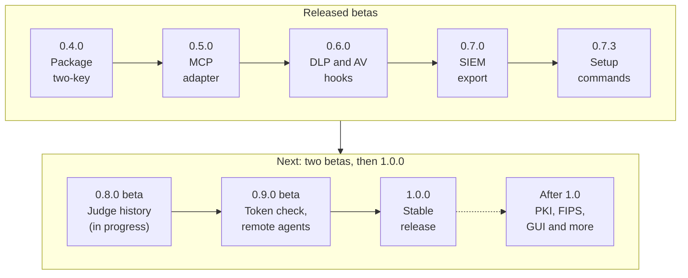

<!--
Copyright 2026 Insomniac-VibeLabs
Author: Stephan Busch
SPDX-License-Identifier: Apache-2.0
-->

# Roadmap

Where `two-key` goes from 0.5.0 to a 1.0 release. It states intent, not a
promise: the order may change, and version numbers are targets, not dates.

## Contents

<!-- toc -->
- [The path to 1.0](#the-path-to-10)
- [Where we are (2026-10-23)](#where-we-are-2026-10-23)
- [Ground rules](#ground-rules)
- [0.8.0: Judge history and ballot records](#080-judge-history-and-ballot-records)
- [0.9.0: Tool-side token check and remote agents](#090-tool-side-token-check-and-remote-agents)
- [1.0.0: First stable release](#100-first-stable-release)
- [After 1.0 (not scheduled)](#after-10-not-scheduled)
  - [PKI and certificate recovery](#pki-and-certificate-recovery)
  - [Post-quantum signatures](#post-quantum-signatures)
  - [FIPS approved mode](#fips-approved-mode)
  - [Local GUI for configuration and ledger auditing](#local-gui-for-configuration-and-ledger-auditing)
  - [Optional reputation halt](#optional-reputation-halt)
  - [More spec field types](#more-spec-field-types)
- [Not planned for this repository](#not-planned-for-this-repository)
- [Shipped](#shipped)
  - [0.7.3: Setup and change commands, signed serial](#073-setup-and-change-commands-signed-serial)
  - [0.7.0: Ledger export for SIEM](#070-ledger-export-for-siem)
  - [0.6.0: DLP and AV hooks, Windows](#060-dlp-and-av-hooks-windows)
  - [0.5.0: MCP adapter](#050-mcp-adapter)
  - [0.4.0: This repository and the package `two-key`](#040-this-repository-and-the-package-two-key)
  - [0.3.1: Live-test fixes (beta)](#031-live-test-fixes-beta)
  - [0.3.0: Key backup and recovery](#030-key-backup-and-recovery)
  - [0.2.x: Baseline](#02x-baseline)
<!-- /toc -->

## The path to 1.0

*Every release so far is a beta; 1.0.0 is the first stable one. The dashed line leads to work after 1.0.*

| Version | What | Status |
| --- | --- | --- |
| 0.4.0 | This repository and the package name `two-key` (0.3.1 under the new name) | Released, tag `v0.4.0` |
| 0.5.0 | MCP adapter: `two-key mcp-proxy`, `two-key mcp-draft-specs`, caller-supplied facts, and the guard core | Released, tag `v0.5.0` |
| 0.6.0 | Windows support; DLP and antivirus hooks that call external scanners; a start-up check for writable paths; judge connection reuse (#6) | Released, tag `v0.6.0` |
| 0.7.0 | Ledger export for a SIEM; a count of refused tokens outside the ledger; the proxy refuses an agent that shares or can change Two-Key's account | Released, tag `v0.7.0` |
| 0.7.3 | `two-key setup` and the `config` commands; a principal key with a passphrase; a signed serial against older rules; the upstream server's files behind a launcher (#13); Python 3.13 and 3.14 | Released, tag `v0.7.3` |
| 0.8.0 | Judge history summary (#1), per-judge ballot records, one proxy per agent, a read-only ledger audit window (`two-key ledger-view`), and a constitution editor window (`two-key constitution-editor`) | Built on `working`, not released |
| 0.9.0 | The last beta: an optional tool-side token check (#28), a live run with the agent on another machine, a quickstart and a real-MCP-server demo, and formats frozen for 1.0 | Planned |
| 1.0.0 | The first stable release, after a public community review of 0.9.0 | Planned |
| After 1.0 | PKI and certificate recovery, post-quantum signatures, FIPS approved mode, a local GUI, an optional reputation halt, more spec field types | Not scheduled |

On 2026-10-15 the maintainer set this order: the MCP adapter, then DLP and
antivirus hooks, then the SIEM export, then 1.0. PKI, post-quantum
signatures, FIPS approved mode, and the local GUI move after 1.0. Judge
connection reuse (#6) joins 0.6.0, and the judge history summary (#1) comes
before the 1.0 review; on 2026-10-25 it became its own release, 0.8.0. Earlier
versions of this plan numbered the phases 0.4 to 0.11 in another order;
CHANGES.md keeps that record. Released versions are under "Shipped" below.

Read [SCOPE.md](docs/SCOPE.md) and [THREAT_MODEL.md](docs/THREAT_MODEL.md)
for what the package does today. When an item below ships, both files change
in the same release.

## Where we are (2026-10-23)

- **0.7.3 is released**: tag `v0.7.3` on `main`, and on PyPI. It adds
  `two-key setup` for a first deployment and `two-key config set`, `get`,
  `undo`, `show` and `check` to change and read one (docs/SETUP.md), every
  change checked as a whole, confirmed when weaker, signed with the principal
  key when it is a rule, and recorded in the ledger as `config_changed`; a
  principal key encrypted with a passphrase; a signed `serial` so a ledger
  never goes back to an older constitution; the upstream server's files behind
  a launcher in the start-up checks (#13); `docs/SETTINGS.md`, every setting
  generated from the code; and CI on Python 3.13 and 3.14. PyPI's `0.7.1` and
  `0.7.2` were the 0.7.0 code, repackaged.
- **0.7.0** (tag `v0.7.0`) added the ledger export for a SIEM, a start-up
  check for the account the monitored agent runs as, and the gateway's count
  of refused tokens.
- **Checks**: tests, the demo, the build, and bandit run on Linux, macOS,
  and Windows; coverage, CodeQL, Semgrep, DeepSource, and SonarCloud run
  too, and all pass. CI installs are hash-pinned (OpenSSF Scorecard, #31 to
  #33).
- **Live testing**: runs 9, 9x, 9y and 9z (175 cases on one machine, with a
  second deployment, a library, and cases written by GrokBot and a security
  practitioner) covered the setup and change commands, two proxies on one
  ledger, the signed serial, and a free-play round graded on invariants. A
  sabotage pass shows the harness notices each weakening of Two-Key but one
  stated blind spot. Every Two-Key finding is fixed (CHANGES.md); run 9z, a
  regression round, found none. Results live on the `live-runs` branch,
  never on `working` or `main`.
- **0.8.0 is built on `working`** (2026-10-25), not released: the judge
  history summary (#1), per-judge ballot records, and one proxy per agent,
  from the design note the maintainer approved that day. It waits for a
  live round before release.
- **Issues**: #13 and #27 shipped in 0.7.3. #1 is built for 0.8.0, and #3
  (repository setup after the move) has maintainer settings left to confirm.
- **Next**: a live round on 0.8.0 and its release, then 0.9.0, the last
  beta, then the public review and the first stable release, 1.0.
- **Not yet tested enough: agents on another machine.** The maintainer
  expects an agent connecting from another machine to be the normal case,
  and the same machine an edge case for testing (2026-10-16). Today the
  proxy speaks stdio only, and the route for a remote agent is SSH with a
  forced command (docs/CONNECTING.md). It has been checked only in one
  container: real accounts, the sudo rule, the forced command's chain, and
  `sshd -t`; no sshd ran, and no agent connected across a network. Live
  run 8 is entirely same-machine and loopback, so it proves nothing about
  a remote agent, and run 9 stays on one machine too (maintainer's decision,
  2026-10-20). Before 1.0: a live run with the agent on another machine
  over SSH (connect, reconnect, a dropped connection, two agents at once,
  and the escape attempts `restrict` should stop: a shell, `sftp`, port
  forwarding, environment variables), the same on macOS and Windows hosts,
  and a decision on a network transport. This is planned for 0.9.0.

## Ground rules

- A finding of Medium severity or higher blocks a release. Low and Info
  findings are tracked in issues and do not.
- New features are optional modules with their own extras. The core stays
  small.
- Each phase updates [SCOPE.md](docs/SCOPE.md) and
  [THREAT_MODEL.md](docs/THREAT_MODEL.md) before it is called done.
- Tests run in CI with free tooling. No phase depends on a paid service.
- Every signed or encrypted format carries a version and an algorithm
  identifier from 0.3 onward. That lets post-quantum keys be added later
  without breaking existing ledgers or backups.
- Keep the README's "Known limits" section current: no independent review,
  no external anchor, not FIPS validated, signatures not quantum resistant.

## 0.8.0: Judge history and ballot records

Built on `working` (2026-10-25), not released. The design note, decisions
D1 to D10, was reviewed and approved by the maintainer before any code.

- The judge history summary (#1): Path B judges get a summary of recent
  allows, denies, and abstains, built by `TwoKey` from its own ledger and on
  by default (`quorum.judge_history`), so a repeated bill, a split payment,
  or a burst of denied attempts is visible to the next decision. Structured
  fields and library reason codes only: no proposal text, no rationale, and
  a counterparty or amount only when the spec signs it. A summary that
  cannot be built denies by default, and a decision whose history changed
  before the token is denied `history_changed`
  ([JUDGES_AND_QUORUM](docs/JUDGES_AND_QUORUM.md#judge-history)).
- Per-judge ballot records in the ledger (maintainer's decision after live
  run 6): each judge's id, vote, confidence, and error class, and an HMAC
  digest of its rationale, never the text, which is model output and may
  quote arguments. A pass with one judge down can now be told from the
  ledger.
- One proxy per agent on a ledger, on by default (`one_proxy_per_agent`).
- A ledger audit window, `two-key ledger-view` (maintainer's request,
  2026-10-27; [LEDGER_VIEW.md](docs/LEDGER_VIEW.md)): one row per entry,
  every field searchable, filterable, and sortable, alone and together. It
  is the ledger-auditing part of the local GUI below, brought forward and
  read-only: a tkinter window with no network port, opened the way
  `two-key audit` opens the ledger, and `--print` for the same search
  without a window.
- A constitution editor, `two-key constitution-editor` (maintainer's
  request, 2026-10-27; [CONSTITUTION_EDITOR.md](docs/CONSTITUTION_EDITOR.md)):
  the prose, tools and specs, hard rules, custom fields, and serial in one
  window, checked as they are typed, a trial call that shows Path A's
  decision and the judge prompt, and signing with the principal key. It
  signs with the same code as `sign-constitution` and adds no format.
- Before release: a live round that covers the first three, and the release
  steps in [PYPI.md](docs/PYPI.md).

## 0.9.0: Tool-side token check and remote agents

Planned, the last beta. Everything 1.0 will contain is in, tested on real deployments, and
frozen, so the public review looks at the final shape.

- An optional tool-side token check (#28): a way for a tool, or a thin
  wrapper in front of it, to check that a call was authorized. Off by
  default; the gateway stays in the `TwoKey` process and still verifies
  only. It touches tokens and the gateway, so a design note and the
  maintainer's security review come before any code.
- A live run with the agent on another machine over SSH ("Where we are"
  above), on machines the maintainer sets up. The network transport
  question is answered with the standing decision: stdio only, remote
  agents over SSH.
- A ten-minute quickstart and a demo with a real MCP server.
- A freeze for 1.0: what 1.0 keeps stable (constitution, rules and judge
  configuration shapes, the ledger and token formats, the SIEM schema, the
  CLI and its exit codes, the public Python API) is written in
  [UPGRADING.md](docs/UPGRADING.md).
- Before release: a live round across the full case list plus the new
  cases.

## 1.0.0: First stable release

- A time-boxed, public community review with a stated scope. 0.9.0 is what
  is reviewed; fixes ship as 0.9.x.
- Release only with no unresolved Medium or higher findings from that review.
- The first index upload is 0.7.0, from the `PyPI` branch, and it is not
  this review. Later releases use the same workflow (docs/PYPI.md):
  trusted publishing, signed tags, and an SBOM. That is `pyproject.toml`
  metadata, `MANIFEST.in`, and `.github/workflows/pypi-publish.yml`
  (OpenID Connect, no token in the repository, PEP 740 attestations, and
  a CycloneDX SBOM kept as a workflow artifact).
- 1.0 is described as community-reviewed, not audited, and as not FIPS
  validated itself. A paid audit and any validation of this package are
  later goals.

## After 1.0 (not scheduled)

Planned, in this order unless the maintainer changes it, with no target
version. Each was a numbered phase before 2026-10-15; the design notes
are unchanged except for cross-references.

### PKI and certificate recovery

Today identities are bare keys. The principal, witness, capability, and agent
keys have no certificate, no chain, and no expiry or revocation. This phase
adds X.509 identities for personal and enterprise use, and a way to recover
from a lost or compromised certificate. It builds on the key backup from 0.3.

- Certificate identities for the principal, the witness, the capability
  issuer, and optionally agents. A certificate binds a name and a validity
  period to a key the package already uses. Existing bare-key setups keep
  working.
- Two shapes. Personal: one operator with a small local certificate authority
  or a self-signed root, built on the X.509 support in `cryptography`.
  Enterprise: an existing CA issues the certificates, and the package
  validates the chain against configured trust anchors.
- Validation covers chain building to a trust anchor, validity period, key
  usage, and revocation. Revocation is a signed revocation list that is also
  recorded in the ledger. Online checks such as OCSP come later.
- The certificate identity is recorded with the constitution and ledger head
  signatures, so an audit shows which identity signed what.
- Issuance, renewal, revocation, and recovery are ledger events. They carry
  digests and subject names, never private keys, and they reach the SIEM
  export (0.7.0).
- Certificate recovery, personal: the 0.3 backup bundle also holds the
  certificate and chain, and a random recovery key (not a seed phrase),
  stored offline, unlocks it. Recovery restores the key and certificate, or
  re-issues from the local CA and revokes the old certificate.
- Certificate recovery, enterprise: the recovery key is split k-of-n among
  named custodians, using a vetted library rather than our own scheme.
  Recovery needs k custodians, is a ledger event, and ends with the old
  certificate revoked and a new one issued. Dual control for CA key use is
  optional.
- A lost CA key is the worst case. Document and test a root rollover: a new
  root, cross-signing, and re-issue.
- A key-provider interface, so an OS keystore or HSM can be added later.
  Direct HSM integration is not part of this phase.
- Tests: expiry, a revoked certificate, a wrong chain, wrong key usage,
  recovery with k-1 and with k shares, and a tampered bundle.

### Post-quantum signatures

Today every signature is Ed25519, which a large quantum computer could
forge. AES-256-GCM and SHA-256 are not the concern at these sizes. The
exposure is long-lived signatures: the constitution and the ledger head.
Capability tokens live at most 300 seconds, so they come last.

- Hybrid signatures for the constitution and the ledger head: Ed25519 plus
  ML-DSA-65 (FIPS 204). The signature verifies only if both halves verify.
- Use a vetted library for ML-DSA instead of writing it, and keep the work
  sized to this repository's scope.
- A verifier that expects the hybrid form refuses a classical-only one, so
  stripping the post-quantum half is a deny, not a downgrade.
- Key backup and SIEM export carry the new keys and fields, using the
  versioned formats from 0.3.
- Decide separately whether tokens go hybrid, since they add size on every
  call.
- Certificates (PKI, above) follow the same rule. Whether to issue hybrid or
  post-quantum certificates depends on the standards and library support at
  the time, and is decided then.
- Existing 0.2.x ledgers stay readable, with a documented migration.

### FIPS approved mode

The goal is to run on a validated cryptographic module, not to claim that
this package is validated. The docs say "runs on a FIPS 140-3 validated
module in approved mode", never "FIPS compliant" or "FIPS validated".

- An opt-in mode that refuses to start unless the `cryptography` library
  runs on a FIPS 140-3 validated module (an OpenSSL FIPS provider) in
  approved mode.
- An inventory of every algorithm the package uses, including certificate
  signatures and the method used to split recovery keys. In approved mode,
  anything outside the approved set is refused, for example a non-PBKDF2
  key derivation function. Whether split-key recovery is allowed in approved
  mode is an open question, decided when the mode is built.
- Ed25519 is approved under FIPS 186-5, but support depends on the validated
  module. The startup check confirms it before allowing the mode.
- The module's certificate number and version are recorded in
  `constitution_loaded`.
- Open question, decided when the mode is built: how hybrid signatures are
  treated in approved mode, since it depends on what the validated module
  supports.
- Tests run in CI against a container that ships a validated provider.
- A document on how to deploy it and what the claim does and does not
  cover.

### Local GUI for configuration and ledger auditing

A graphical front end so the package can be configured and audited without
hand-editing YAML and reading JSON. It is built last, on top of the stable
CLI and file formats, so it adds no new logic of its own.

The read-only ledger audit part came first, in 0.8.0, as `two-key ledger-view`
(above): a tkinter window, not a browser page, so it has no local port to
guard with a token, and it shows every field decrypted, because the
maintainer asked for every field to be searchable. It holds the principal
key while open, as `two-key audit` does, because opening the ledger needs it.
The constitution part came next, also in 0.8.0, as `two-key constitution-editor`, a tkinter window too.
The bullets below are still the plan for the rest.

- Runs locally only. It binds to loopback, requires a per-session token, and
  is not a hosted or multi-user service.
- Configuration: view and edit judges, quorum policy, agents, and tool
  specs, with validation that uses the same strict loaders as the core. It
  shows the effect of a change, such as `high_assurance`, before it is
  saved.
- The GUI never holds the principal key. It prepares a constitution and
  hands it to the existing signing command. Signing stays outside the GUI.
- Changes go through the engine `two-key config set` already uses
  (docs/SETUP.md, on `working` since 2026-10-20): Two-Key's own account
  only, the whole config checked before anything is written,
  `--confirm-weaker` and a typed yes for a weaker setting, and a
  `config_changed` ledger entry for each change. The GUI adds no rule of
  its own.
- Ledger auditing: browse decisions, filter by tool, reason, judge, and
  time, and show both paths' results for each call. It runs the Merkle and
  digest checks (`check_decision_digests`) and shows failures plainly.
- Filtering by judge uses the per-judge ballot records planned for 1.0
  (above): judge id, vote, confidence, error class, and a rationale digest,
  never the rationale text.
- Export from the audit view reuses the SIEM export (0.7.0), so digests and reason
  codes leave the screen, not argument values.
- Key and backup status: fingerprints, backup age, and a prompt to run the
  verify command from 0.3. It does not display key material.
- Certificate status: validity, expiry warnings, and revocation, plus a guided
  recovery workflow that runs the PKI recovery commands and never displays
  key material.
- Keep dependencies small, with static assets and no external network calls.
- It gets a public review of its own before it ships, as 1.0 does: it is
  the first component that displays decrypted ledger content.

### Optional reputation halt

Not a change to `revoke`. `revoke` ends tokens already issued. It does not
stop new approvals, and it does not survive as a stop on the agent. This is
a separate control. It does not depend on the other items and may
ship earlier, before 1.0 if it is needed.

- Off unless configured. A deployment that does not set it behaves as today.
- Count repeated triggers recorded in the ledger (denies, or the trigger the
  operator names when this is built). When the count in a window exceeds the
  configured threshold, refuse new approvals until the principal records a
  resume. The halt survives a restart because it is a ledger entry.
- A redemption already started stays spent (`already_attempted`). The halt
  does not run the tool and does not clear a spent token.
- Only the principal key can resume.
- Tests, when it is built: under the threshold, at the threshold, resume,
  restart, and the default (unset), which never halts.

### More spec field types

0.3.0 added operator-declared custom fields of type
`boolean`, `integer`, `enum`, and `string` (`fields:` in the rules file,
`deny_if_fields` in rules; see HOWTO "Custom Path A fields"). Still
planned: decimal, identifier/principal, path, URL, email, and opaque
bytes, and making `amount` and `counterparty` ordinary typed fields that
rules can name. Until then the action record keeps `amount_usd` and
`counterparty` as fields, with neutral defaults for tools that have
neither.

## Not planned for this repository

- Its own antivirus or content-classification engine.
- Running as an MCP server that offers tools of its own. The MCP proxy
  speaks MCP only to forward an upstream server's signed tools.
- A gateway in its own process or on its own host, or a gateway-only
  ledger role. This is a decision, not a gap: the gateway runs in the
  `TwoKey` process ([why](docs/HOWTO.md#deployment-boundary-the-gateway-runs-in-the-twokey-process)).
- A hosted, remote, or multi-user GUI, and a GUI that holds the signing key.
- A CMVP validation of this package, and any claim that it is "FIPS
  compliant" or "FIPS validated".
- Permissioned-chain anchoring and seed phrases.
- A general-purpose certificate authority product, and direct HSM integration.
  The personal CA is minimal, and the key-provider interface leaves room for
  an HSM later.

## Shipped

The design records of released phases, kept as written. CHANGES.md is the
record of what each release did.

### 0.7.3: Setup and change commands, signed serial

Released as tag `v0.7.3` on `main`, and on PyPI. Not planned as a phase of
its own: these came from the maintainer's request for one way into setup and
changes, from issues #13 and #27, and from live runs 9 to 9t. CHANGES.md
"Release v0.7.3" lists them; [docs/SETUP.md](docs/SETUP.md) and
[docs/SETTINGS.md](docs/SETTINGS.md) are the reference.

- Done: `two-key setup` writes a whole deployment from answers, checks it,
  and records it; `two-key config set` and `undo` change one setting through
  the same checks, a typed yes for a weaker change, the principal key for a
  signed one, and a `config_changed` ledger entry with no values;
  `config get`, `show` and `check` read a config without starting anything.
- Done: a principal key encrypted with a passphrase from an owner-only file.
- Done: a signed `serial` in the constitution; a ledger refuses an older
  serial, a reused one, or none once it has run one.
- Done: the upstream server's program, script and folders in the start-up
  checks, a warning for a launcher that hides them, and
  `upstream.check_paths` for the rest (#13).
- Done: the compiled-file check on Python 3.15 (#27); CI on 3.13 and 3.14.
- Done: only the tool's id is required in a tool spec; `irreversible` and
  `data_class_floor` default to `true` and `classified`.

### 0.7.0: Ledger export for SIEM

Released as tag `v0.7.0` on `main`. The design note is
`0.7.0-siem-export.md`, approved by the maintainer on 2026-10-16;
[docs/SIEM.md](docs/SIEM.md) is the reference.

- Done: a live copy of every ledger entry, sent after the entry is written
  and fsynced, on its own sender thread. A collector that is down, slow, or
  gone never blocks or delays an authorization; delivery resumes from a
  per-sink cursor and marks late events `replay`.
- Done: sinks. Syslog (RFC 5424) over TLS (RFC 5425, port 6514, the
  default), plain TCP (RFC 6587, port 514), or UDP (RFC 5426, port 514),
  every port configurable; and an HTTPS webhook with batched newline JSON,
  an authorization header read from an owner-only file, an optional HMAC
  signature, and no redirects followed. TLS always verifies the certificate
  and the host name. A plaintext sink is refused under `high_assurance` and
  warns at start everywhere else.
- Done: events carry digests, sizes, reason codes, the tool id, and the
  data class, never argument values. An explicit per-kind field allowlist
  leaves out the proposal text and the derived amount, counterparty, and
  custom field values, which the ledger holds today; a ledger field nobody
  has decided about fails the tests rather than leaving the box.
- Done: Two-Key's own schema (`two-key-siem-v1`, the default), ECS, and
  OCSF; JSON (the default) or CEF.
- Done: `two-key siem-export` writes the same events to a file, owner-only
  and never over an existing file, ending with a signed summary;
  `two-key siem-verify` re-derives every event from the ledger offline and
  reports changed fields, gaps, repeats, and events from another ledger.
- Done: a rate-limited count of refused tokens, by class (bad signature,
  expired, malformed, other), on stderr and as a SIEM event marked
  `ledgered: false`. A token that does not verify is still not ledgered, so
  an unauthenticated caller cannot fill the ledger, and no token text is
  kept (live run 7).
- Done: an Elastic and Kibana example in `examples/siem/elastic/` with a
  sample dashboard, and a manual, non-required workflow that runs it.
  Wazuh gets documentation only. Unit tests stay network-free (loopback).
- Remaining: live run 8, then the release. Run 8 covers the SIEM export
  against a real collector (syslog to a listener the maintainer runs, and
  the Elastic example), as well as the 0.6.0 code below.
- Done: the proxy refuses to start when the account that started it (the
  agent host's) is Two-Key's own, is root, cannot be told, or can change a
  file or folder the proxy runs or reads (`on_agent_access`, default
  `refuse`; `high_assurance` always refuses; maintainer's decision,
  2026-10-16). Processes that share a ledger read each other's entries
  under the lock instead of denying every call after the other writes.
- Remaining after run 8: a live run with the agent on another machine
  (see "Where we are"). Run 8 runs every proxy beside the simulated agent,
  so its cases for `on_agent_access` come in the next test batch.
- Run 8 also covers the code 0.6.0 changed after live run 7 (PR #12
  review): the ICAP verdicts and response reader, file arguments and
  confined path reads, the scanner's start-up checks, the Windows
  access-list check, the writable-path walk, proxy tool settings and
  start-up paths, and `sign-constitution --out` writing a new file and
  renaming it into place. The tests and CI cover them; no live run did
  (maintainer's decision, 2026-10-16).

### 0.6.0: DLP and AV hooks, Windows

Tag `v0.6.0` on `main`; CHANGES "Release v0.6.0" is the record. Every step of
the plan below shipped, and live runs 7 and 7x checked it. The scanner follows the decisions below and the approved
design note, with the maintainer's additions: Two-Key alone starts a scan
(the agent never proposes, skips, or answers one), a call can carry a file
(base64, or a path in a folder the operator declares, each with a required
`max_bytes`; an oversized or unreadable file is denied before both keys
under every stance), an encrypted file is flagged unless the principal
signs that tool `encrypted: pass`, and
[docs/SCANNERS.md](docs/SCANNERS.md) shows with diagrams how ClamAV, ICAP
products, a command, or Python code connect. The first bullets below are
the original sketch; where they differ (a deny on every error,
allow/deny/abstain, `tools.<id>.inspect`), the decisions and
docs/SCANNERS.md win.

- One interface: `inspect(args_projection)` returns allow, deny, or abstain,
  with a reason code. An error, timeout, or missing result is a deny.
- Two reference adapters that call external tools: ClamAV for file payloads
  and a secret and pattern scanner for DLP. This package does not ship its
  own scanning engine.
- The ledger records the scanner name, version, and a result digest, never
  the content.
- Design decision to settle first: run the hook before judges receive
  `tool_args`, so scanned content is not sent to cloud vendors.
- Second decision: feed the scanner's result to Path A as well as the
  ledger, so a content leak is not left to the judges alone (live run 6:
  a diagnosis, a card number, and a recovery code in free text were stopped
  only by Path B). In 0.5.0 a scanner can already do this as a
  caller-supplied fact (HOWTO "Designing a constitution", point 10); the
  hook interface may build on that.
- Tests use the EICAR test file and fake secrets.
- Also in 0.6.0: reuse judge connections (#6). Today each quorum round
  starts new threads, so the per-thread pool never reuses a connection, and
  every round opens a new TCP (and TLS) connection per judge. Move to a
  lock-guarded pool keyed by origin, or document fresh connections plainly.
  No security impact; it matters once the MCP proxy puts Two-Key on every
  tool call.

#### Plan to 0.6.0 (2026-10-15)

In order. Steps 2 to 4 change what reaches the judges and what the ledger
records, so they get the maintainer's security review before code, as
AGENTS.md requires.

1. **Housekeeping** (no behaviour change):
   - Suppress the 11 Semgrep findings line by line
     (`# nosemgrep: <rule-id>`), each with its reason, and give the
     `judges.yaml` callback hook the same `module:function` check the proxy's
     fact hooks already have.
   - Move the CodeQL action to v4 before v3's deprecation (December 2026),
     and take Dependabot's action updates.
   - Close #2 and #10 (both closed), finish #3, delete the merged `mcp-proxy` branch, and
     push the run 6 and 6z results to their test branches.
   - **Platforms.** Make macOS a required CI job once it passes. For
     Windows, the maintainer decides between full support in 0.6.0 and
     "not yet supported" in the docs. Full support means an owner-only check
     on Windows access lists instead of mode bits, Windows file locking,
     owner-only directories, and test environments that keep `SYSTEMROOT`.
     It touches key and ledger handling, so it gets the security review too.
     Either way, every hook works on Linux, macOS, and Windows, and its tests
     run on all three.
2. **Design note for the hook** (for the maintainer's review). It settles:
   - **How third-party software plugs in.** The maintainer's intent is an
     optional hook for an outside product. Proposed:
     - one `Inspector` interface in the core;
     - three ways to reach a scanner: an in-process Python hook
       (`module:function`, like a fact hook), ICAP (RFC 3507, the protocol
       most commercial DLP and antivirus products already speak), and
       ClamAV's `clamd` socket;
     - no scanning engine in this package.
   - **Fail-closed rules:** a timeout, an error, or no result is a deny.
     Superseded on 2026-10-15 by the maintainer's direction, pending their
     review of the details: the scanner is optional, and Two-Key runs without
     one. A configured scanner fails open by default after a time limit
     (proposed 15 s, configurable), which leaves both keys deciding as
     today. Fail-closed is the option for an enterprise or high-assurance
     stance. A result the scanner could not finish (size or time limits)
     counts as flagged. The stance is a signed rule on the scanner's verdict
     (`clean`, `flagged`, `unavailable`); monitor mode only records it. An
     unavailable scan is ledgered, warned about, and told to the judges.
   - **What is scanned:** the arguments the signed spec names (payload
     paths and files), before the judges see any argument text.
   - **How a result reaches Path A:** as a fact such as
     `carries_secret` or `malware_found`, so a leak is denied by rule, not
     only by the judges (live run 6).
   - **What the ledger records:** the scanner's name and version, its
     verdict, and a digest, never the content.
   - **Configuration:** where it lives (`proxy.yaml` `tools.<id>.inspect`
     and a `Guard` argument).
3. **Build the core**: the interface, the call order (after Path A can
   read the call, before Path B), the ledger entry, and the Guard and proxy
   wiring. Tests stay network-free, with fake ICAP and `clamd` servers on
   loopback.
4. **Reference adapters**: ClamAV (`clamd`), an ICAP client, and a secret
   and pattern scanner run as an external command. Tests use the EICAR
   test string and fake secrets.
5. **Judge connection reuse (#6)**: a lock-guarded pool keyed by origin,
   with a test that a second round reuses the connection.
6. **Docs in the same release**: HOWTO (a scanner section and an example),
   THREAT_MODEL (the scanner as a new boundary: its trust, timeouts, and
   what it sees), SCOPE, FIT, COMPARISON (DLP row), README, llms.txt,
   AGENTS.md, and CHANGES with upgrade notes.
7. **Live run 7** (the clinic harness plus a scanner):
   - the diagnosis and card-number cases (C35, C36) should be denied by
     Path A, not left to the judges;
   - add a file payload carrying EICAR;
   - add a scanner that is down or slow, which must deny under the strict
     stance and be ledgered and told to the judges under the default one.
8. **Release 0.6.0**: version, `uv.lock` (uv 0.13.0), a PR into `main`
   once every check passes, then the `v0.6.0` tag and release notes.

##### Decisions for 0.6.0 (maintainer, 2026-10-15)

These settle the open points above. Where they differ from an earlier line
in this plan, these win; nothing above is removed.

**Scanner (antivirus or DLP) hook**

- **Optional.** Two-Key runs fully without a scanner. A one-time note at
  start-up encourages one.
- **Fail-open by default.** A configured scanner gets a time limit (15 s by
  default, configurable). If it is unreachable, errors, or does not answer
  in time, the call goes on to the two keys exactly as today. Start-up warns
  when the scan limit plus the judge deadline exceeds 60 s, since MCP
  clients often give up on a tool call after 60 s.
- **Could not finish is flagged.** A result the scanner could not finish
  (size or time limits, such as ClamAV's `Heuristics.Limits.Exceeded`)
  counts as flagged, not unavailable.
- **The stance is signed** in the constitution. The scanner supplies a
  caller-supplied enum fact with the verdict (`clean`, `flagged`,
  `unavailable`), and a signed rule decides:
  - default: deny `flagged`;
  - strict (enterprise or high assurance, fail-closed): deny `flagged` and
    `unavailable`;
  - monitor: no rule; the verdict is only recorded.

  `high_assurance` warns at start-up unless the stance is strict.
- **Fail-open is visible.** Every unavailable scan is ledgered. One warning
  when the scanner goes down and one when it recovers, not one per call. The
  judges are told.
- **Monitor mode** exists, for tuning before enforcing.
- **What the judges get:** the scanner's decision for the call (verdict,
  finding categories, scanner label), never content. Recent scan verdicts
  also go into the judge history summary (#1, built for 0.8.0) as counts
  of each verdict over seven days.

**Platforms, CI, and docs**

- Two-Key runs on Linux, macOS, and Windows in 0.6.0. Windows support
  changes key and ledger handling, so its design note gets the security
  review before code.
- Every CI pipeline that runs code (tests, demo, build and install) runs on
  all three. CodeQL runs on all three as well; Semgrep stays on Linux, where
  its container image runs.
- HOWTO explains, with diagrams, how to hook a scanner in.
- docs/CONNECTING.md shows how to connect the agent so it cannot go around
  Two-Key, and to run Two-Key as a service account. At start, Two-Key
  names each file or folder it runs or reads that another account could
  change (`writable_path`); `on_writable_paths: refuse` makes that a
  refusal, and `high_assurance` always refuses (maintainer's decision,
  2026-10-16).

### 0.5.0: MCP adapter

Tag `v0.5.0` on `main`. Issue #2: the stdio proxy, the spec drafter,
caller-supplied facts, and the guard core. The facts design passed the
maintainer's security review before it was built. Live test run 6 and the
re-run 6z checked it; CHANGES "Release v0.5.0" is the record.

- A proxy for `tools/call` that runs `authorize` and forwards through the
  gateway, in the same process (`TwoKey.gateway()`), only with a valid
  token. It speaks MCP to the agent's host but offers no tools of its own.
  Built on the official MCP Python SDK as the optional `mcp` extra; only
  one module imports it. (Done.)
- Schema pinning: refuse to start when the signed tools' schemas change,
  unless `on_schema_change: warn`. The proxy refuses an unresolved judge or
  agent identity unless `allow_unresolved_identity: true`. (Done.)
- A helper that drafts `tool_specs` from an MCP server's tool schemas
  (`two-key mcp-draft-specs`). The output is a draft for the principal to
  review and sign, and does not sign until they decide. (Done.)
- Caller-supplied facts (`source: caller` fields, constitution v3), so a
  fact such as `po_matched` comes from the integration, not the agent, and
  is looked up again at redemption (`fact_mismatch`). A framework-neutral
  guard core (`two_key/guard.py`) for agent loops that do not use MCP; the
  proxy runs on it, with fact hooks in `proxy.yaml`. (Done.)
- From live run 6 (maintainer's decisions, done): every tool decides each
  field a rule reads (#10); `case: exact` string fields; `@domain` allow
  entries with a signing warning; no judges for a call that cannot be read;
  a start-up warning when one judge can approve alone; a drafter warning
  for an undescribed payee or amount; HOWTO guidance; and the harness's
  referee fixes and scripted quorum cases. The live re-run 6z covered them:
  34 of 36 cases passed, and the 2 inconclusive ones were case design, since
  fixed.
- Start with stdio transport and one real server. HTTP and OAuth come later.
- The proxy adds a trust boundary: an agent that can reach the MCP server
  directly bypasses it. THREAT_MODEL.md says so.

### 0.4.0: This repository and the package `two-key`

Tag `v0.4.0` on `main`. 0.3.1 under the new package name `two-key`, with
file formats renamed from `two-key-concept-...` to `two-key-...`. CHANGES
"Release v0.4.0" is the record.

### 0.3.1: Live-test fixes (beta)

Tag `v0.3.1` in the archived `two-key-concept` repository. Agent declines,
the syntax-only agent vocabulary, and data classes that combine as a set;
the status moved from prototype to beta. CHANGES "Release v0.3.1" is the
record.

### 0.3.0: Key backup and recovery

Before 0.3.0, losing a key was severe: a missing or changed capability key
refused to start, and a lost ledger key left the log unreadable.

Tag `v0.3.0` in the archived `two-key-concept` repository. CHANGES "0.3.0" is the record. The criteria
below are what shipped.

- `two-key backup-export`, `backup-verify`, and `backup-restore`.
- Three bundles. The ledger key and the witness key are not in the same
  file. The principal bundle holds the principal key and the capability key,
  and not those two, so one bundle never holds every key a head needs when
  the witness public key is pinned outside the ledger.
- The key derivation function is named in the bundle
  (`pbkdf2-sha256`, 600,000 iterations, then `aes-256-gcm`). That is the
  PBKDF2 option FIPS approved mode can keep. No other function ships in 0.3.
- `backup-verify` decrypts into a temporary ledger and checks fingerprints.
- `backup-restore` puts `head.anchor` back from the same moment as the
  ledger. An older ledger left next to the current anchor does not open
  (`ledger_rolled_back`). `--replace-ledger` writes both together. Deleting
  the anchor is not the restore procedure.
- Tests cover restore, a wrong passphrase, and a tampered bundle.
- HOWTO has the runbook and the table of what each lost key means.

0.3.0 also carries two changes that are not part of this
phase: custom Path A fields (see "After 1.0") and the gateway deployment
boundary ([why](docs/HOWTO.md#deployment-boundary-the-gateway-runs-in-the-twokey-process); see "Not planned"). CHANGES has a section for each.

Not in this version: PKI and certificate identities (see "After 1.0") and
seed-phrase backup. A weak passphrase remains a residual risk. PBKDF2 is
not memory-hard.

The list this section was written from:

- Encrypted, passphrase-protected export and restore of this package's own
  keys: principal, capability, ledger, and witness.
- The key derivation function is named in the bundle. A PBKDF2-based option
  is included so FIPS approved mode can use only approved algorithms.
- A verify command that restores into a temporary ledger and checks
  fingerprints.
- The ledger key and the witness key are kept in separate bundles.
- A recovery runbook and a table of what each lost key means.
- Tests: restore, wrong passphrase, tampered bundle.
- A restore puts back `head.anchor` from the same moment as the ledger. An
  older ledger left next to the current anchor does not open
  (`ledger_rolled_back`). Deleting the anchor is not the restore procedure.

### 0.2.x: Baseline

- 0.2.2 carries two owner decisions made after this plan was written: when a
  judge counts as the monitored agent (its credential at any address, or
  both sides keyless on one address), and HTTP Basic auth for judges and
  agents. After 0.2.2, close the remaining open issues and freeze features.

#### 0.2.3

Two changes, both breaking, both needing the maintainer security review
that AGENTS.md asks for. Both shipped in 0.2.3 as described here; the plan
is kept as the design record. CHANGES "0.2.3" lists what was built,
including the CLI (`--witness-public-key`, `two-key rotate-witness`, and
`two-key audit`, which reports both pins).

**Pin the ledger's witness public key (#58, rated Low by the owner).**
In 0.2.2 `Ledger._verify_head` read `witness_public_key` from the stored head
and checked the witness signature against that same key, and `checkpoint`
wrote whatever key `witness.pem` held. So replacing `witness.pem` was
accepted silently, and the principal key plus the ledger key were enough to
sign a head. A pin stored only inside the ledger would not change that:
whoever holds the principal key and the ledger key can rewrite the chain
from its first entry, pin included. So the plan has two pins:

1. **In the ledger:** a new ledger records its witness public key in a
   `witness_pinned` entry, the first entry after creation, checkpointed.
   `_verify_head` and `checkpoint` refuse a head signed by another witness
   key (`witness_key_changed`), and `checkpoint` refuses to sign with a
   `witness.pem` that does not match. This catches a swapped or silently
   replaced `witness.pem` on a chain that is not rewritten. It does not
   stop someone who holds the principal key and the ledger key.
2. **Outside the ledger:** the operator can give the verifier the witness
   public key as configuration, as the gateway is given the capability
   public key (`Ledger(..., witness_public_key=...)`, and a CLI option), kept
   where whoever writes the ledger directory cannot change it. With it, a
   head also needs the witness private key, so the principal key and the
   ledger key alone no longer forge one.
3. A ledger made by 0.2.2 or earlier pins the key in its current head on its
   first open under 0.2.3 (trust on first use), with a ledgered
   `witness_pinned` entry that says so. A key swapped before the upgrade
   cannot be detected; CHANGES and THREAT_MODEL say this.
4. Changing the witness key becomes an explicit, ledgered `witness_rotated`
   entry, signed by the principal and both the old and the new witness key;
   an out-of-ledger pin is updated by the operator. A lost witness key meant
   a new ledger until 0.3; 0.3.0 restores it from the witness bundle.
5. `Ledger.verify()` and `audit` report both pins. Tests cover a swapped
   `witness.pem` (refused), a head signed by a key other than the
   configured one (refused), an old ledger pinning on first open, and a
   rotation.
6. README, THREAT_MODEL, and SECURITY.md say what each pin detects. With the
   out-of-ledger pin configured, forging a head needs the principal,
   witness, and ledger keys together; without it, the principal key and the
   ledger key stay enough. Rolling the ledger back to an earlier signed
   head, or wiping it, stays undetected without an external anchor, with or
   without either pin.

**Remove the `vendor` / `min_vendors` aliases (owner's decision).** Every
`TODO(remove-vendor-alias)` site in `two_key/`: the `vendor:` and
`min_vendors:` config keys (then refused as unknown keys), the `vendor=` and
`min_vendors=` arguments, the `.vendor` and `.min_vendors` properties, the
`_vendor` fallback, `maker_from_vendor`, `rename_min_vendors`, and the
`QuorumPolicy.__init__` wrapper. The old-name tests become tests that the
old names are refused, and CHANGES gets an "Upgrading from 0.2.2" step.
The unused `extra_secrets` argument of `AgentDeclaration.resolve`, which
HMACs whatever it is given, goes in the same release.

Item 6 above is the 0.2.3 plan. 0.2.4 adds a head anchor, described next.
The witness pins themselves still do not detect a rollback.

#### 0.2.4

Tagged `v0.2.4` on `main`. CHANGES "0.2.4" is the record.

- `two-key recover` drops an uncheckpointed tail and records the ciphertext's
  digest. It does not run on open and it does not move a signed head
  backwards (#49).
- A head anchor beside the ledger key refuses a rollback or a wipe of the
  ledger directory alone (#62). Deleting that file, or rolling it back with
  the ledger, is still not detected. It is not an external anchor.
- Creating a ledger at a new path warns on stderr (#60 item 2).
- The credential named for the monitored agent is compared again on every
  call. A placeholder `agent_session` does not hide that key (#60 item 3).
  A secret that was never named still has to be passed.
- `revoke` is unchanged (#46). The optional halt is under "After 1.0".
