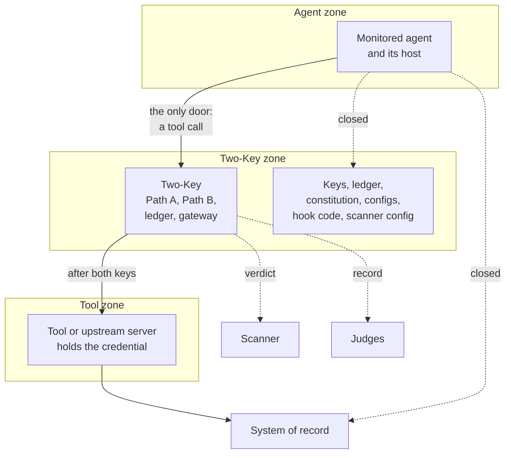
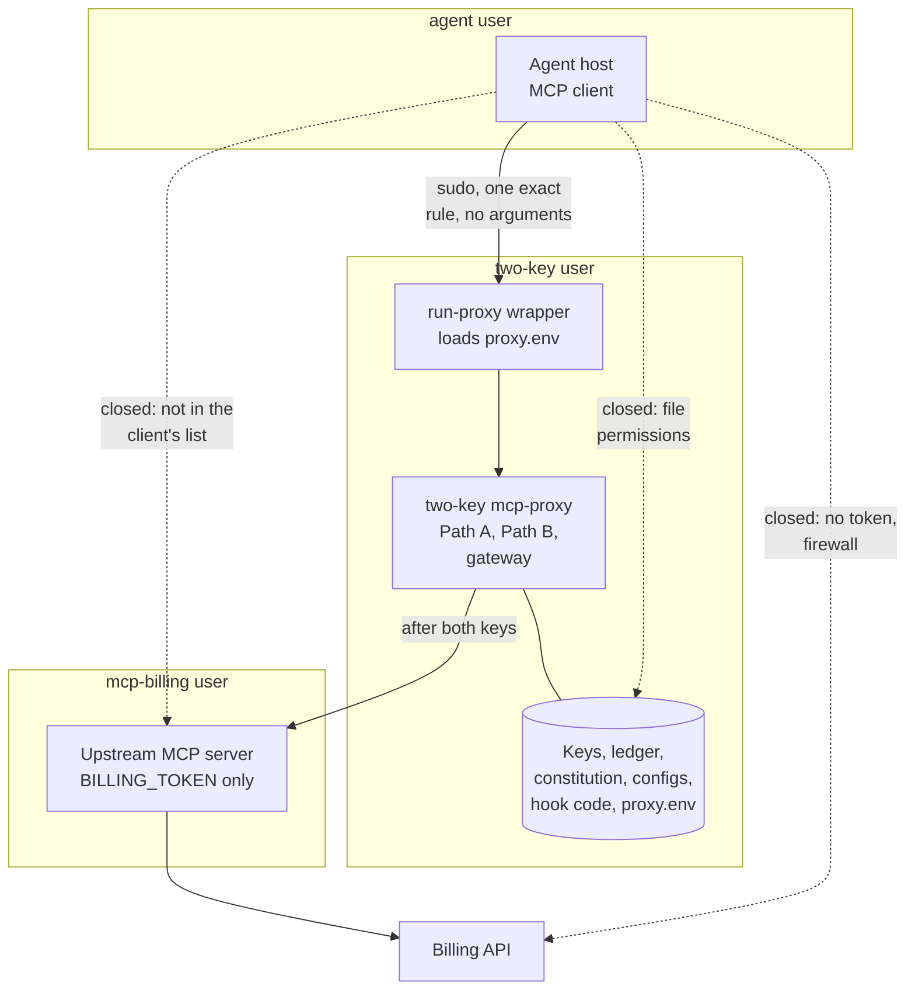
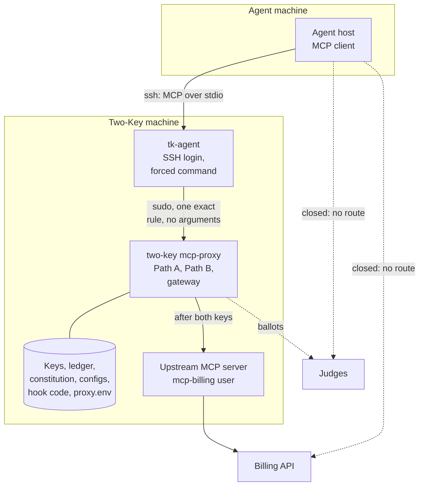
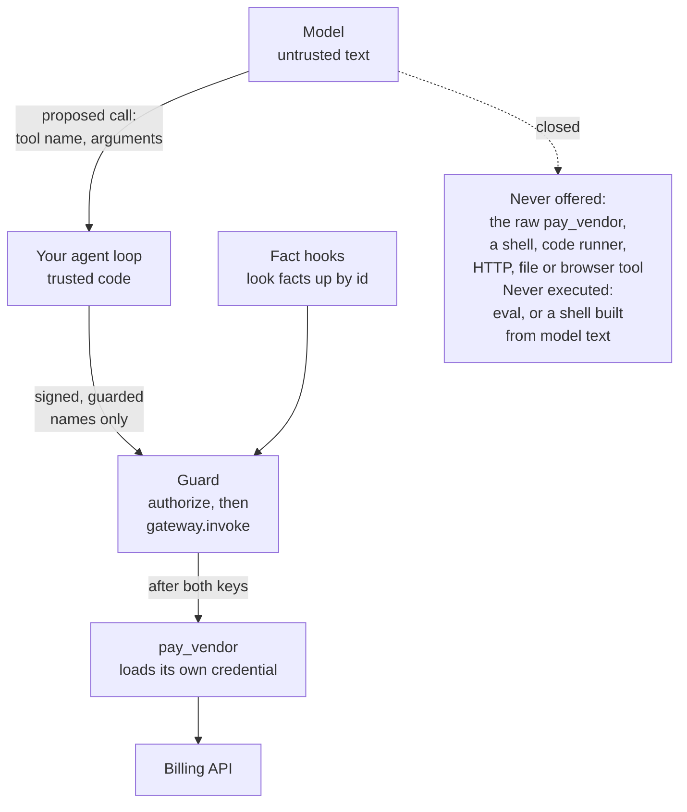
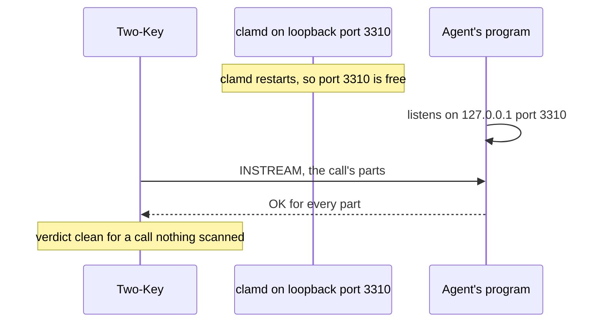

<!--
Copyright 2026 Insomniac-VibeLabs
Author: Stephan Busch
SPDX-License-Identifier: Apache-2.0
-->

# Connecting the monitored agent so it cannot go around Two-Key

Two-Key can only stop the calls that go through it. This guide covers
every connection and hook: how to wire each one, and what you have to
close so that a malicious or careless agent has no other way to the
tools, their credentials, or the files and settings Two-Key trusts.

Two-Key checks some of this itself (see
[What Two-Key checks for you](#what-two-key-checks-for-you)).
Most of it is your operating system, your network, and your agent
framework, which Two-Key cannot see. The
[checklist](#checklist-before-you-let-an-agent-run) at the end is the
short version.

## Contents

<!-- toc -->
- [In plain words](#in-plain-words)
- [Pick your route](#pick-your-route)
- [Run Two-Key as a service account](#run-two-key-as-a-service-account)
- [Route 1: an MCP client, through `two-key mcp-proxy`](#route-1-an-mcp-client-through-two-key-mcp-proxy)
- [An agent on another machine (Route 1 over SSH)](#an-agent-on-another-machine-route-1-over-ssh)
- [Route 2: your own agent loop, through the Guard or the library](#route-2-your-own-agent-loop-through-the-guard-or-the-library)
- [Every connection and hook](#every-connection-and-hook)
- [Services on the same machine](#services-on-the-same-machine)
- [What Two-Key checks for you](#what-two-key-checks-for-you)
- [Checklist before you let an agent run](#checklist-before-you-let-an-agent-run)
<!-- /toc -->

## In plain words

Two-Key is a lock on one door. It only helps if that is the only door.

The agent should be able to do exactly one thing: ask Two-Key to run a
signed tool. It should not be able to:

- reach the tool, or the system behind it, another way (its own API key,
  the network, a second tool that does the same job, a shell);
- change what Two-Key trusts (the signed constitution and its key, the
  config files, the hook code, the judges, the scanner);
- read Two-Key's keys, ledger, or the credentials it holds for the tools
  and judges.

Each of those is a way around both keys. The fix for all of them is the
same: run the agent as its own OS user (or in its own container or
machine), give everything Two-Key trusts to a separate `two-key` user, and
give each tool's real credential only to the side that calls the tool.
The examples use Linux and macOS users and `sudo`; on Windows, use a
separate account for the agent and a service account for Two-Key, with
the same rules. The `two-key` user is a service account, not a standard
user ([Run Two-Key as a service account](#run-two-key-as-a-service-account)).



*Solid lines are the only paths that exist. Dashed lines marked closed are routes the agent must not have (no credential, no network route, no file access); the other dashed lines go to the optional scanner and the judges.*

## Pick your route

| Your agent is | Use | Why |
| --- | --- | --- |
| An MCP client (a desktop assistant, an IDE, an agent framework that speaks MCP), or code you do not control, in any language | Route 1, `two-key mcp-proxy` | Two-Key runs as a separate process and OS user, so the agent cannot reach its memory, keys, or tools |
| An MCP client on another machine | Route 1 over SSH ([An agent on another machine](#an-agent-on-another-machine-route-1-over-ssh)) | The proxy speaks stdio only and does not listen on the network; SSH carries stdio, and the agent's machine holds none of Two-Key's keys |
| A model your own Python code calls, where your code decides which functions run | Route 2, `Guard` (or `authorize` and the gateway) | Two-Key runs in your process; only the model's text is untrusted |
| Untrusted code that would run inside your Python process | Route 1 | Python gives no isolation inside one process: that code could read every key and call the tool directly ([HOWTO](HOWTO.md#deployment-boundary-the-gateway-runs-in-the-twokey-process)) |

## Run Two-Key as a service account

Run Two-Key (the proxy, or the process that holds your `TwoKey`) as an
account made for it alone, not as a standard user:

- **Not a person's account, not the agent's, and not root or an
  administrator.** A person's account runs other programs, holds other
  files, and is often the one the agent's host runs as. Root or an
  administrator would hand the upstream server and every hook the whole
  machine.
- **Nobody signs in as it.** No password, no login shell, no interactive
  or remote sign-in. It is started by the Route 1 wrapper through its sudo
  rule, or by a service manager (systemd, launchd, a Windows service),
  never by hand.
- **In no group that leads to root**, such as `sudo`, `wheel`, `admin`, or
  `docker`.
- **It owns its keys, ledger, and settings.** The code it runs (the
  virtualenv, hook modules, a scanner command) is owned by it or by root,
  and nobody else can write any of it, or the folders above it.

On Linux:

```bash
sudo useradd --system --home-dir /var/lib/two-key --create-home --shell /usr/sbin/nologin two-key
```

On macOS, use a hidden role account with no login shell (a name that
starts with an underscore, such as `_twokey`), made with `dscl` or, on
recent macOS, `sysadminctl -addUser _twokey -roleAccount`. On Windows, use
a local account made for Two-Key that is not in Administrators, with "Deny
log on locally" and "Deny log on through Remote Desktop Services" set for
it in Local Security Policy.

Two-Key checks what it can see of this when it starts, and names any file
or folder another account could change
([What Two-Key checks for you](#what-two-key-checks-for-you)).

**"Billing" is only an example.** The worked examples in this guide use a
billing system (`mcp-billing`, `BILLING_TOKEN`, "Billing API") because
they need some tool to point at. Two-Key does not care what the tool does
or what kind of data it handles. Read "billing" as "whatever system your
upstream tool reaches": a ticketing system, a file store, a database, a
message service. Rename `mcp-billing` and `BILLING_TOKEN` to match, and
keep the rules the same: one OS user per upstream, and the credential
held only by that user.

## Route 1: an MCP client, through `two-key mcp-proxy`

The agent host starts the proxy instead of the real server. The proxy
starts the real server itself, as a third user, and hands it only calls
that both keys allowed. The full worked example is in
[HOWTO](HOWTO.md#put-two-key-in-front-of-an-mcp-server-two-key-mcp-proxy).



*The host starts the wrapper with `sudo -n -u two-key /opt/two-key/run-proxy` under one exact sudo rule, and the proxy starts the server with `sudo -n -u mcp-billing`. Solid lines are the call path; dashed lines are routes that stay closed.*

1. **Three OS users.** `agent` runs the agent host. `two-key` runs the
   proxy and owns its keys, ledger, config, hook code, and secrets.
   `mcp-billing` (one per upstream) runs the real server and holds only
   its credential.
2. **The agent host can start the proxy and nothing else as `two-key`.**
   In the client's MCP server list, the server's command is
   `sudo -n -u two-key /opt/two-key/run-proxy`. Most clients take JSON
   like this:

   ```json
   {"mcpServers": {"billing": {"command": "sudo",
                               "args": ["-n", "-u", "two-key", "/opt/two-key/run-proxy"]}}}
   ```

   The sudoers rule allows exactly that command, with no arguments (the
   `""`), so the agent cannot point the proxy at another config:

   ```text
   agent ALL=(two-key) NOPASSWD: /opt/two-key/run-proxy ""
   ```

   `run-proxy` is owned by root or `two-key`, not writable by `agent`,
   loads the secrets from a file only `two-key` can read, and runs the
   proxy from the `two-key` virtualenv with a fixed config path. Leave
   sudo's `env_reset` on (the default), so nothing from the agent's
   environment (`PYTHONPATH`, `LD_PRELOAD`) reaches the proxy.
   `run-proxy` also sets `umask 077`, so the ledger it creates on the
   first start is owner-only (under `sudo`, Ubuntu gives the proxy a
   umask of 002, and the start-up check then names its own ledger), and
   changes to a folder the agent cannot write (`cd
   /opt/two-key`) before it starts the proxy. sudo keeps the agent's
   working directory, and the upstream server inherits it unless
   `upstream.cwd` is set; `npx` looks for the server in that folder's
   `node_modules` and reads its `.npmrc` first, so an agent could plant a
   server that receives the tool's credential. For the same reason the
   wrapper runs the `two-key` command, not `python -m two_key`, which puts
   the working directory on the import path
   ([HOWTO, step 6](HOWTO.md#put-two-key-in-front-of-an-mcp-server-two-key-mcp-proxy)).
3. **Remove the real server from the client.** The client's MCP list must
   not also start `@example/billing-mcp` (or any other server for the
   same system). The agent must not hold `BILLING_TOKEN` in its
   environment, its files, or its prompt.
4. **Close the network route.** The agent's user, container, or machine
   must not be able to reach the billing API or the system of record. A
   firewall rule (egress by user, container network, or host) is the
   usual way. Without the token a direct call should fail anyway; the
   firewall covers a token that leaks.
5. **Check the client's other tools.** Any tool that reaches the same
   system is a second door: a shell or code runner, an HTTP fetch or
   browser tool (especially one signed in to the same service), a file
   tool that can write into a folder a tool reads (`kind: path`) or read
   `/etc/two-key`. Remove them from that agent, or confine them so they
   cannot reach any of it.
6. **Start and read the output.** The proxy prints the tools it serves,
   the scanner stance, and any warning on stderr, and writes
   `mcp_proxy_started` to the ledger. A refusal at start (schema changed,
   judge holds the agent's credential, unresolved identity, the agent's
   account is Two-Key's own or can change its files) means do not
   override it until you know why.

## An agent on another machine (Route 1 over SSH)

The proxy talks to the agent's host over stdio only (`two_key/mcp_proxy/sdk.py`):
it does not listen on a port, and Two-Key has no network transport for
the agent. An agent host on another machine starts the proxy over SSH,
which carries stdio. Everything in Route 1 stays as it is; SSH takes the
place of the agent user's local `sudo`.



*The forced command is `sudo -n -u two-key /opt/two-key/run-proxy`. The judges and the billing API sit outside both machines; the dashed lines from the agent machine to them stay closed.*

1. **A login account for the agent, not `two-key`.** Make an account on
   the Two-Key machine, such as `tk-agent`, that plays the part of the
   `agent` user in Route 1: it owns nothing Two-Key trusts, has no
   password, and its only sudo rule is the exact `run-proxy` rule
   (`tk-agent ALL=(two-key) NOPASSWD: /opt/two-key/run-proxy ""`). Do not
   let the agent sign in as `two-key`. sshd runs a forced command through
   the account's login shell, and the service account's shell is
   `nologin`, which runs nothing ("This account is currently not
   available."); giving it a shell would break
   [Run Two-Key as a service account](#run-two-key-as-a-service-account).
2. **A key that can only start the proxy.** Put the agent machine's public
   key in a file root owns, so `tk-agent` cannot change it, with
   `restrict` and the forced command:

   ```text
   # /etc/ssh/authorized_keys/tk-agent, owner root, mode 0644
   restrict,command="sudo -n -u two-key /opt/two-key/run-proxy" ssh-ed25519 AAAA... agent-machine
   ```

   and the same limits in `sshd_config`, so a key added another way
   gets them too:

   ```text
   Match User tk-agent
       AuthorizedKeysFile /etc/ssh/authorized_keys/%u
       AuthenticationMethods publickey
       ForceCommand sudo -n -u two-key /opt/two-key/run-proxy
       AllowTcpForwarding no
       AllowAgentForwarding no
       AllowStreamLocalForwarding no
       X11Forwarding no
       PermitTTY no
       PermitTunnel no
   ```

   The forced command runs in place of whatever the client asks for, a
   shell, `scp`, or `sftp` included. `sudo`
   clears the environment (`env_reset`), so nothing the client sends
   reaches the proxy.
3. **Point the agent host at it.** The server's command in the client's
   MCP list is `ssh`, with the host key pinned:

   ```json
   {"mcpServers": {"billing": {"command": "ssh",
     "args": ["-T", "-o", "BatchMode=yes", "-o", "StrictHostKeyChecking=yes",
              "-i", "/home/agent/.ssh/two_key", "tk-agent@two-key.example"]}}}
   ```

   The private key on the agent machine only starts the proxy: whoever
   holds it has what the agent has, and no more.
4. **Close the network.** From the agent machine, allow only SSH to the
   Two-Key machine. It needs no route to the tool's API, the system of
   record, the judges, the scanner, or the SIEM collector; Two-Key
   reaches those from its own machine.
5. **One login account per agent.** Each SSH session starts its own
   proxy. Proxies can share a ledger (each reads what the others wrote
   before it writes), but a login account per agent keeps one agent from
   using another's key, and lets the ledger's `agent_id` tell them apart.
6. **Record where the agent runs.** `agent_id` and `hosting` in
   `proxy.yaml` go into the ledger as metadata (not trust), for example
   `hosting: agent-machine over ssh`.

What changes when the agent is on another machine:

- **Keys.** The minting, principal, witness, and ledger keys, and the
  tool and judge credentials, stay on the Two-Key machine, in the proxy
  process. The agent machine holds none of them.
- **Judges.** Two-Key calls the judges from its own machine, with its own
  credentials. The check that no judge is the monitored agent compares the
  judge with the `monitored_agent` declaration in `judges.yaml` (its
  endpoint and credential), not with where the agent runs, so it works the
  same. A loopback judge or scanner on the Two-Key machine is out of the
  agent's reach ([Services on the same machine](#services-on-the-same-machine)
  still applies to the other accounts there, `tk-agent` included).
- **The start-up checks.** They look only at the Two-Key machine. The
  account that started the proxy is the SSH login account (`tk-agent`),
  read from the parent process (the `sudo` it went through), and the
  proxy refuses to start if that account is `two-key`, is root, or can
  change a file or folder the proxy runs or reads (`on_agent_access`).
  The writable-path check names every other local account that could.
  Neither can see the agent machine, `sshd_config`, the `authorized_keys`
  file, or the sudoers rule; check those yourself (the checklist below).

> **Not yet tested enough.** This route has been checked in one container
> only: real accounts, the sudo rule, the forced command's chain, and
> `sshd -t`. No sshd ran, and no agent connected across a network. Live
> run 8 is same-machine and loopback. A live run with the agent on another
> machine is planned before 1.0 (ROADMAP, "Where we are").

## Route 2: your own agent loop, through the Guard or the library

Your Python code calls the model, reads the tool call it proposes, and
runs it through `Guard` (or `authorize` and then `gateway.invoke`). The
model's output is data; your code is trusted. See
[HOWTO "The guard"](HOWTO.md#the-guard) and
[HOWTO "Authorize from Python"](HOWTO.md#authorize-from-python).



*The model reaches the billing API only through the guard. The dashed line is the route that stays closed.*

- **Register only guarded functions with your framework.** The model must
  be offered `pay_vendor` the guarded wrapper, never the raw function,
  and never a general tool (shell, Python execution, HTTP request, file
  write, a second client for the same API) that does the same job.
- **Never execute model output.** No `eval`, no shell built from its text,
  no dynamic import of a name it chose. A tool call is a name and
  arguments; the guard looks the name up among signed tools.
- **Keep the tool's credential out of the model's reach.** Load it inside
  the guarded function's module from a secret the agent cannot read; do
  not put it in the prompt, the instruction, or an argument.
- **The guard fixes the claim and the proposal per tool.** The model's own
  claim and reason are not used, so they cannot talk Path A down.
- **Facts come from your hooks, never from the model.** A hook looks the
  fact up by an id in the system of record and never returns an argument
  ([HOWTO "Caller-supplied facts"](HOWTO.md#caller-supplied-facts)).
- **`authorize_from_agent`** is the same route with Two-Key calling the
  model itself: the model only returns a JSON proposal and never touches a
  tool. Your code redeems the token through the gateway.
- **The process holds every key.** Keep the registered tools small and
  trusted, and do not load untrusted plug-ins into this process. If the
  agent is untrusted code rather than a model, use Route 1.

## Every connection and hook

Each row is one connection or piece of trusted input: how to connect it,
what an agent would try, and what stops it.

| Connection or hook | Connect it so | An agent might try | Stopped by |
| --- | --- | --- | --- |
| Agent host to Two-Key | Route 1: the client starts the proxy wrapper through the exact sudoers rule, from the agent's own account. Route 2: the framework is offered guarded functions only | Starting the real server, or the proxy with its own config; running the agent as Two-Key's account, or with write access to its files | Removing the real server from the client; sudoers allowing only the wrapper with no arguments; `env_reset`; the wrapper's `cd` to a folder the agent cannot write; the proxy refusing to start when its parent's account is Two-Key's own, root, unknown, or can change its files (`on_agent_access`) |
| Agent machine to the proxy over SSH | A login account that is not `two-key`, a root-owned `authorized_keys` entry with `restrict,command=` and a matching `ForceCommand`, and only SSH open from the agent machine | Running a shell or `sftp` instead of the proxy, forwarding a port to a judge or the tool's API, sending environment variables, or editing its own `authorized_keys` | The forced command and `restrict`, `sudo`'s `env_reset`, root owning the key file, and the firewall; Two-Key cannot see any of these ([An agent on another machine](#an-agent-on-another-machine-route-1-over-ssh)) |
| Two-Key to the tool (upstream server, or the registered function) | The gateway is the only caller. The upstream runs as its own user with only its credential (`upstream.command` with `sudo -u mcp-billing` or a container) | Calling the tool's API directly; reading the proxy's keys through the upstream | The agent has no tool credential and no network route; the upstream's user cannot read the `two-key` user's files or `/proc` |
| Tool credentials (`BILLING_TOKEN`, API keys) | In a file only `two-key` reads (`proxy.env`, mode 0600), passed to the upstream through `upstream.env` | Reading it from the environment, a file, a log, or the prompt | Separate users; never in the prompt, the instruction, or an argument |
| Signed constitution and principal key | Owned by `two-key`; the key mode 0600 in an owner-only directory, encrypted if you like, with `keys.passphrase_file` (mode 0600, kept away from the key) naming its passphrase | Replacing the constitution, or signing a looser one; copying the key file | The constitution's signature is checked on every load; Two-Key refuses a key or passphrase file readable by others, and one the agent can change (`on_agent_access`); the agent's user cannot write either file; an encrypted key copied on its own does not sign ([SETUP](SETUP.md#protecting-the-principal-key-with-a-passphrase)) |
| `proxy.yaml`, `judges.yaml`, `agents.yaml`, `scan:` block, declared files | Owned by `two-key`, not writable by the agent | Turning a tool's scan off (declared files are not signed), adding a looser judge, pointing the scanner at its own server | File permissions. Which tools are scanned and the stance are signed; which arguments are files is not |
| Fact hooks (`module:function`) | The module, and every directory on the proxy's `PYTHONPATH`, owned by root or `two-key` and not writable by the agent. Run the installed `two-key` command, not `python -m` from a directory the agent can write (Python imports from the current directory) | Planting a module that returns the fact it wants, or a `json.py` the proxy imports first | Two-Key names each such file or folder it finds writable at start (`writable_path`), and refuses under `high_assurance` or `on_writable_paths: refuse`; directory permissions and a fixed working directory. A hook looks facts up by id and never echoes an argument; the tool still checks |
| Judges | Their own credentials, not the agent's (`judges.yaml` auth by `env`, `keyring`, or `callback`). Cloud judges over HTTPS. A local judge's model, server, and config owned by `two-key` or root | Holding a judge's key, pointing a judge at its own account, rewriting a local judge's system prompt or model, answering on a local judge's port | Two-Key refuses a judge with the agent's credential at any address and warns on other overlaps; HTTPS is verified; the rest is permissions and [Services on the same machine](#services-on-the-same-machine) |
| Monitored agent endpoint (`authorize_from_agent`, `agent_session_env`) | Its own API key, different from every judge's | Sharing a key with a judge so its own model votes | The judge-is-not-the-agent check at start ([HOWTO](HOWTO.md#the-monitored-agent-and-the-judge-is-not-the-agent-rule)) |
| Content scanner, `clamd` | A Unix socket in clamd's own directory (`unix:/run/clamav/clamd.ctl`), with `LocalSocketMode 660` and a `LocalSocketGroup` that has `two-key` in it and not the agent; or TCP on a host the agent cannot reach | Answering "OK" in clamd's place, or flooding it so it is unavailable | The agent cannot write clamd's directory, so it cannot put its own socket there, and cannot open the socket; the strict stance denies while it is down; the agent never starts or sees a scan ([SCANNERS](SCANNERS.md)) |
| Content scanner, ICAP | `icaps://` with a certificate the host trusts, unless it is on the same host behind a port the agent cannot take | Answering clean in the product's place | TLS verification; network placement |
| Content scanner, command or Python hook | An absolute path or module owned by root or `two-key`, not writable by the agent | Replacing the scanner with one that always exits 0 | File and directory permissions; the command gets only a minimal environment and the part's bytes on stdin |
| Files sent by path (`kind: path`) | A folder only the guarded tools (and whatever legitimately produces the files) can write; not writable by the agent's user or its file tools | Swapping the file after the scan, or linking it to a secret | Two-Key refuses links, files outside the folder, and changed files (`file_changed`); a folder the agent cannot write closes the swap between the last check and the tool |
| Ledger and its key, witness, and capability directories | Owned by `two-key`; Two-Key creates them owner-only | Deleting or rewriting the history, or minting a token | AES-GCM, the hash chain, the signed and pinned head; the minting key never leaves this process; the agent cannot read the directories |
| SIEM copy, syslog (`siem:` `type: syslog`, 0.7.0) | `transport: tls` to a collector whose certificate the host trusts (port 6514). Plaintext (`tcp`, `udp`) only on a network segment the agent cannot reach | Reading the copy on the wire, forging entries into the SIEM, or dropping them | TLS with the certificate and hostname always checked, and no setting that turns that off; plaintext warns at start and is refused under `high_assurance`; every event carries `seq` and `entry_hash`, so a gap or a forged event is caught by `two-key siem-verify` ([SIEM](SIEM.md)) |
| SIEM copy, webhook (`siem:` `type: webhook`, 0.7.0) | An `https://` URL, with the token in a file only `two-key` reads (`auth_value_file`, mode 0600), and `hmac_key_file` where the collector checks a signature | Reading the token, pointing the copy at its own collector, or following a redirect to one | The token file is owner-only and its value never reaches an event, a log line, or the ledger; redirects are never followed; `siem_configured` records the destination in the ledger; the config and secret files are in the writable-path check |
| SIEM sink files (`ca_file`, `cert_file`, `key_file`, `auth_value_file`, `hmac_key_file`) and the delivery cursor | Owned by `two-key`, not writable by the agent. The cursor is `<ledger>.siem/cursor.json`, which Two-Key creates owner-only beside the ledger | Changing a CA file so a forged collector is trusted, or moving the cursor back so the SIEM is flooded or skipped | The proxy names each of those files in the start-up writable-path check; a wrong cursor can only repeat or delay the copy, never change the ledger; one ahead of the ledger, or from another ledger, is not trusted and the whole ledger is sent again, marked `replay` |
| Settings changes (`two-key setup`, `config set`, `config undo`, `config key-passphrase`) | Run from an operator's shell as Two-Key's own account, never from the agent's account or as root; Two-Key's files and folders stay its own and not writable by others | Running `config set` to switch a check to `warn`, turn `high_assurance` off, or sign a looser rule | From another account, `config set` refuses to write Two-Key's files (`config_target_unsafe`), and it refuses root; a weaker change needs `--confirm-weaker` and `yes` typed on a terminal; what `high_assurance` forbids fails the check; a signed change needs the principal key; each change is a `config_changed` ledger entry that goes to the SIEM. An account that can write the files can still edit them by hand: file permissions and the start-up checks stop that ([SETUP](SETUP.md)) |
| Tool results back to the agent | Nothing to wire | Text in a result that tells the agent to do something else | Not a way around Two-Key: each later call is judged on its own. Results are not scanned |

## Services on the same machine

On one machine, any user can listen on a free TCP port above 1024 on
127.0.0.1. If the agent runs on the same machine as a loopback judge, a
loopback scanner, or a system of record a hook reads over HTTP, it can wait
for that service to stop (a crash, a restart, an update) and take its port.
Two-Key would then ask the agent's own program for a ballot, a verdict, or
a fact.



*While clamd is down, the agent's own program takes its port and answers OK for every part. The ways to close this follow.*

Close it one of these ways:

- Run the agent in its own network namespace (a container or a VM). Its
  127.0.0.1 is then a different one.
- Use a Unix socket in a directory the agent cannot write, where the
  service supports one (`clamd`).
- Use TLS with a verified certificate (`icaps://`, `https://`).
- Run the services on a host the agent cannot reach.

A judge Two-Key reaches over HTTPS on another host, and a scanner on a
Unix socket in a directory the agent cannot write, need none of this.

## What Two-Key checks for you

At start and on every call, without any setup from you (the settings that
tune these checks, `on_agent_access` and `on_writable_paths`, are in
[SETTINGS.md](SETTINGS.md)):

- The constitution's signature, on every load; a v1 or v2 envelope that
  carries a newer feature is refused.
- Keys readable by anyone but the owner are refused (on Windows, an access
  list naming anyone but the user, SYSTEM, Administrators, or OWNER
  RIGHTS).
- A judge holding the agent's credential, at any address, is refused;
  other overlaps warn and are recorded.
- The MCP proxy: the upstream's tool schemas against the pinned digest,
  only signed tools shown, any other name `tool_not_offered`, the claim
  from `proxy.yaml` only, and `mcp_proxy_started` ledgered before serving.
- The agent cannot write a caller-supplied fact or the scan verdict
  (`caller_field_in_arguments`, `scan_fact_supplied`), and the gateway
  checks the facts and files again before the tool runs.
- With `siem:` (0.7.0): each sink is reached once at start (a TLS
  handshake, a TCP connect, or a resolved address) and a plaintext sink is
  named, or refused under `high_assurance`; the destinations are ledgered
  as `siem_configured`; and only allowlisted fields leave, never an
  argument value or the proposal text ([SIEM](SIEM.md#what-leaves-and-what-never-does)).
- The account that started the proxy (0.7.0). The proxy reads the real
  user of its parent process: the agent's host, or the `sudo` it went
  through, whose real user is still the caller. It refuses to start when
  that account is Two-Key's own (`agent_same_account`), is root
  (`agent_account_root`), cannot be told (`agent_account_unknown`), or can
  change a file or folder in the writable-path check below
  (`agent_can_write`: it owns it, everyone can write it, or it is in a
  group that can). `on_agent_access: warn` starts anyway, for a test under
  one account; `high_assurance` always refuses. On Windows the parent's
  account cannot be told yet, so the proxy refuses there unless
  `on_agent_access: warn`. The refusal comes before the ledger is opened.
  The library (Route 2) has no such check: there the agent is a model your
  code calls, not a process.
- Files and folders another account could change (0.6.0). At start,
  `TwoKey` looks at Python itself, each folder on the import path and the
  `.pth` files in it, each module already loaded (Two-Key, its libraries,
  judge callbacks, scanner hooks) with its compiled file, and every folder
  above them. The proxy adds `proxy.yaml` and the files it names, the
  ledger folder, each fact hook's module, the folders of files sent by
  path, the upstream and scanner programs, and the folder the upstream
  starts in. For the upstream server behind a launcher such as `sudo`, it
  also adds each argument of `upstream.command` after the program that is
  an absolute path to something that exists (a file with its folder, or a
  folder), and each entry of `upstream.check_paths`, which must exist
  (`check_path_missing`). Options and relative arguments are not read as
  paths, a launcher is not followed to its target, and a named folder is
  checked itself, not every file inside it. When `command[0]` is a
  launcher (`sudo`, `doas`, `env`, `npx`, `uvx`, `pipx`, `cmd`,
  `powershell`, or `pwsh`) and nothing names the server's files, the proxy
  warns `upstream_paths_unchecked`, and `high_assurance` refuses to start.
  The server's files count like Two-Key's own: owned by Two-Key's account
  or root, not by the upstream's account. Each one that an account other than Two-Key's own (or root,
  SYSTEM, Administrators, or TrustedInstaller) could change is named:
  `two-key: WARNING: writable_path: <path>: <why>`. On Linux and macOS a
  group write bit counts for any group but 0, because Two-Key cannot list
  a group's members reliably; a sticky bit on a folder above is fine.
  `on_writable_paths: refuse` in `proxy.yaml` (or
  `TwoKey(on_writable_paths="refuse")`) makes Two-Key refuse to start
  instead, and `high_assurance` always refuses. Nothing turns the check
  off.

What it cannot see: OS users and file permissions beyond the paths above
(the wrapper that started it, the upstream server's files that no absolute
argument or `upstream.check_paths` entry names, what is inside a named
folder),
the network, the client's other tools, your framework's tool list, and
whether a port it connects to is the service you meant. A start with no
`writable_path` line is not proof the setup is safe, and code that was
already changed has already run. Those are the items above and the
checklist below.

## Checklist before you let an agent run

```text
[ ] The agent runs as its own OS user, container, or machine.
[ ] Two-Key runs as a service account: no password or login shell, not a person's
    account, not root or an administrator, in no sudo, admin, or docker group.
[ ] Two-Key runs as the two-key user, which owns the keys, ledger, constitution,
    proxy.yaml, judges.yaml, agents.yaml, hook code, scanner config, and secrets.
[ ] The agent's user cannot read or write any of those, or the virtualenv and
    every directory on the proxy's PYTHONPATH.
[ ] Route 1: the client starts only the proxy wrapper, through a sudoers rule
    with no arguments; the real server is not in the client's list.
[ ] Route 1: the wrapper sets umask 077, changes to a folder the agent cannot write
    before it starts the proxy (or upstream.cwd names one), and runs the two-key command.
[ ] Route 1: the proxy starts with no agent_same_account, agent_account_root, or
    agent_can_write line, and on_agent_access is not set to warn.
[ ] Agent on another machine: it signs in as its own account (not two-key) with a
    root-owned authorized_keys entry (restrict, command=) and a matching ForceCommand,
    and its machine can reach only SSH on the Two-Key machine.
[ ] Route 2: the framework offers only guarded functions; no shell, code runner,
    HTTP, or file tool that reaches the same systems; model output is never executed.
[ ] No tool credential is in the agent's environment, files, prompt, or arguments.
[ ] The agent has no network route to the tool's API or the system of record.
[ ] Each upstream server runs as its own user with only its own credential.
[ ] Each upstream server's program, script, and package folder are given as absolute
    arguments or in upstream.check_paths, are owned by root or two-key, and the proxy
    starts with no upstream_paths_unchecked line.
[ ] Judges use their own credentials; a local judge's model and server are not
    writable by the agent.
[ ] The scanner is on a Unix socket in a directory the agent cannot write (mode 660,
    a group without the agent), behind TLS, or on a host the agent cannot reach;
    consider the strict stance.
[ ] Folders for files sent by path are not writable by the agent or its tools.
[ ] Loopback judges, scanners, and hook back ends are not on a machine where the
    agent shares 127.0.0.1 (or the agent has its own network namespace).
[ ] Start-up output read: tools served, scan stance, no writable_path line, and no
    unexplained warning. Consider on_writable_paths: refuse once it starts clean.
```
