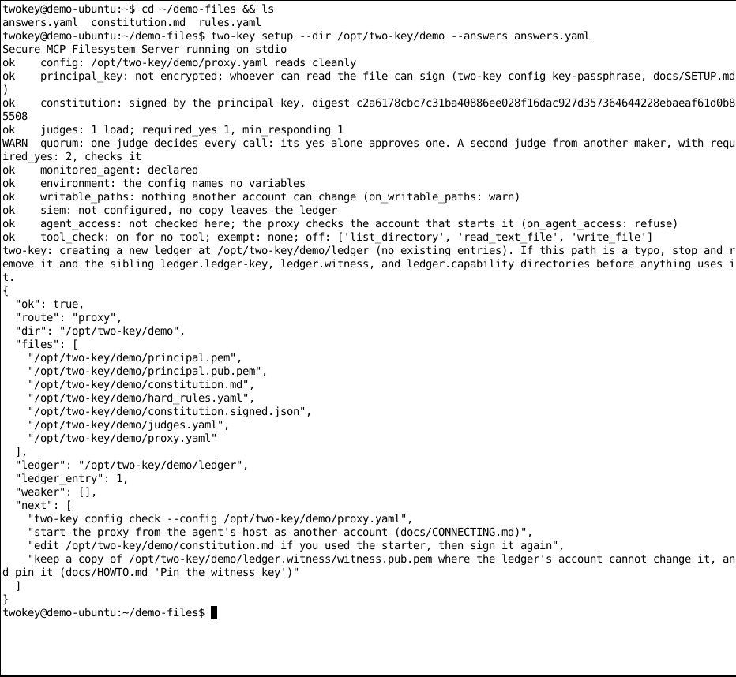
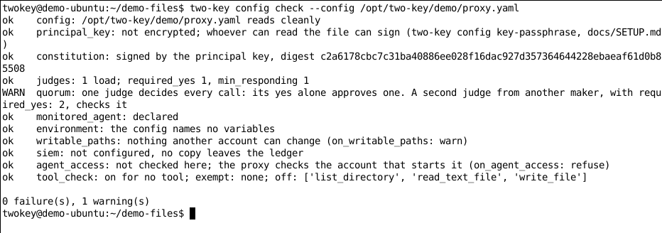
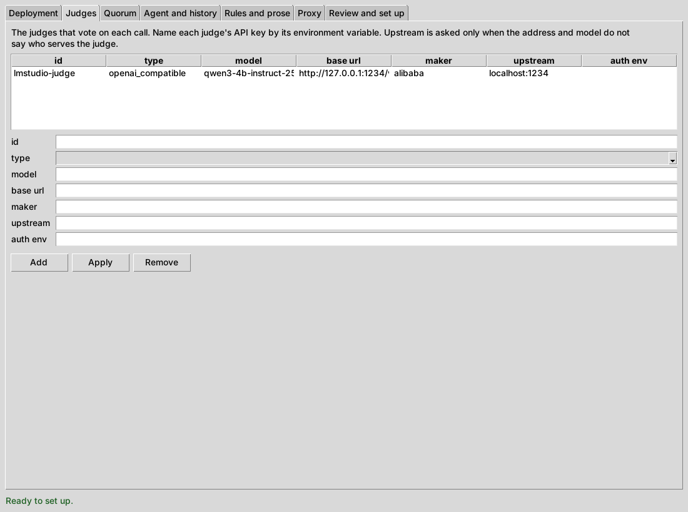
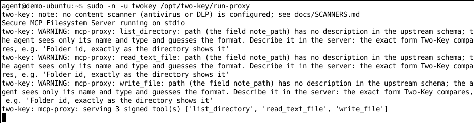
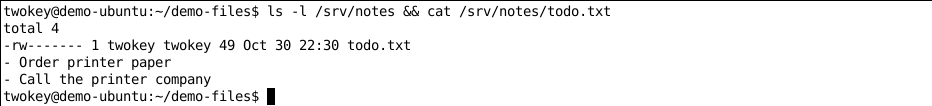
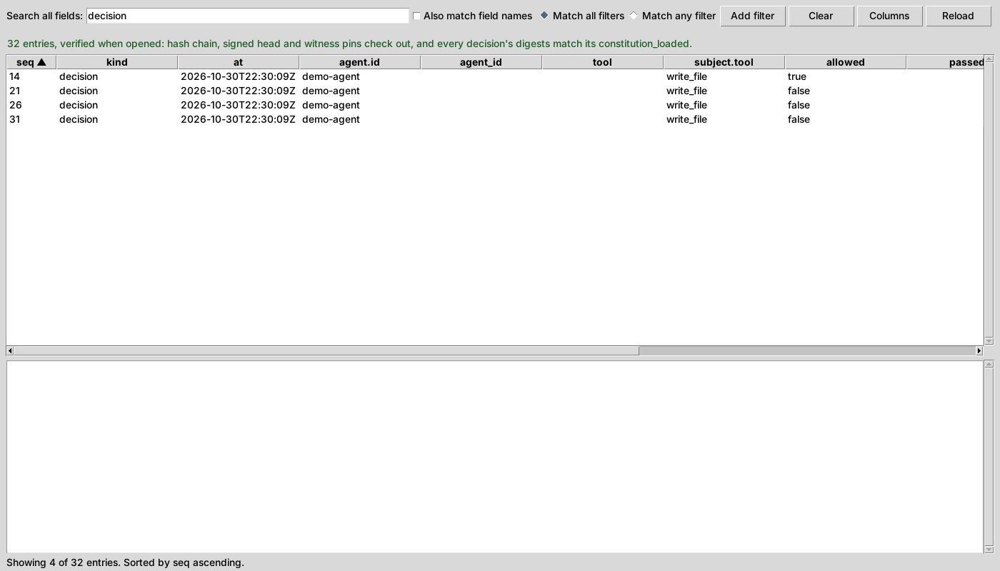
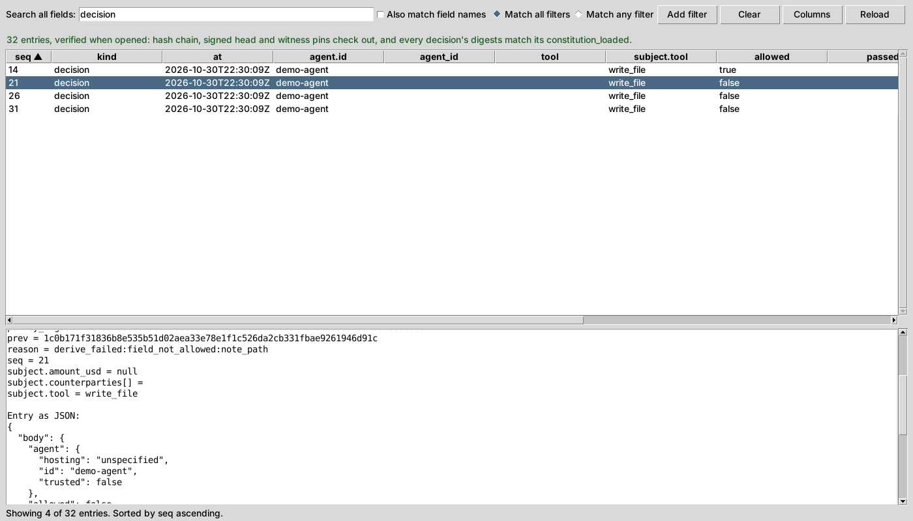
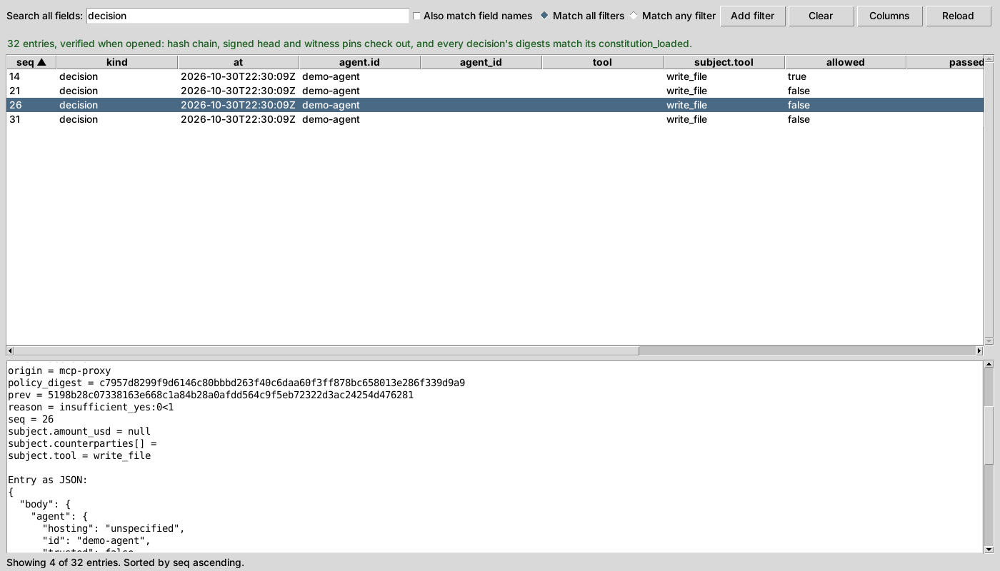
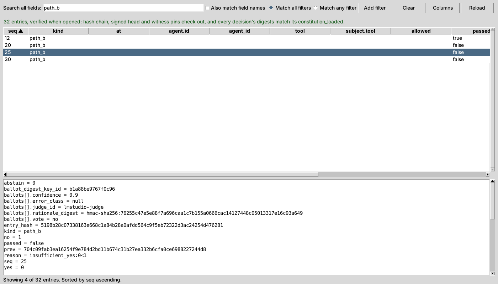
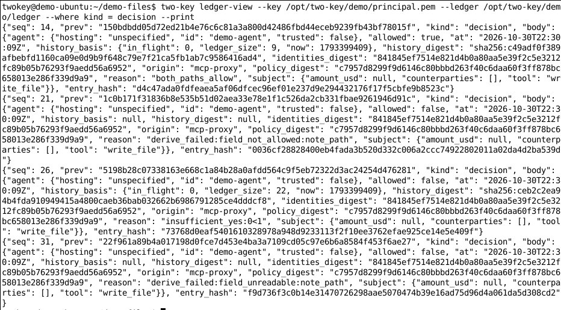

<!--
Copyright 2026 Insomniac-VibeLabs
Author: Stephan Busch
SPDX-License-Identifier: Apache-2.0
-->

# Demo walkthrough: Two-Key from scratch

This guide shows you how to set up Two-Key for the first time and show what it does. You do not need to know
much about AI. Every step says what to click or type, and what you should see.

The demo uses a real tool: the official MCP **filesystem server**, which lets an AI read and write files. An AI
agent keeps office notes in one folder, `/srv/notes`. You will ask it to do four things. Two-Key will:

1. **allow** writing a to-do list into the notes folder,
2. **stop**, by a written rule, an attempt to add a login key to `/home/agent/.ssh/authorized_keys`,
3. **stop**, by an AI judge, an attempt to save a password in a note, and
4. **stop** a sneaky path that starts in the notes folder and climbs out of it with `..`.

Then you will open Two-Key's record book, the ledger, and show that every attempt was written down.

Plan on about two hours the first time. Most of that time is waiting for downloads.

## Contents

<!-- toc -->
- [What Two-Key does, in plain words](#what-two-key-does-in-plain-words)
- [What you need](#what-you-need)
- [The pieces, and why we picked them](#the-pieces-and-why-we-picked-them)
- [Part 1: Start the judge on Windows](#part-1-start-the-judge-on-windows)
- [Part 2: Get the Ubuntu computer ready](#part-2-get-the-ubuntu-computer-ready)
- [Part 3: Connect the judge to the Ubuntu computer](#part-3-connect-the-judge-to-the-ubuntu-computer)
- [Part 4: Install Two-Key and the filesystem server](#part-4-install-two-key-and-the-filesystem-server)
- [Part 5: Set up Two-Key](#part-5-set-up-two-key)
- [Part 6: Let the agent reach Two-Key](#part-6-let-the-agent-reach-two-key)
- [Part 7: Install the agent](#part-7-install-the-agent)
- [Part 8: Run the demo](#part-8-run-the-demo)
- [Part 9: Show the proof in the ledger](#part-9-show-the-proof-in-the-ledger)
- [If something goes wrong](#if-something-goes-wrong)
- [What this demo leaves out](#what-this-demo-leaves-out)
- [Clean up](#clean-up)
- [Words to know](#words-to-know)
<!-- /toc -->

## What Two-Key does, in plain words

An **AI agent** is a program that uses an AI model to do jobs for you. It can use **tools**, such as "write a
file" or "send an email". That is useful, and it is also risky. An agent can misunderstand you, or be tricked
by something it reads.

Two-Key stands between the agent and its tools. Before a tool runs, two separate checks must both say yes.
Think of a bank vault that needs two keys, turned by two different people:

- **Key one: the rules.** You write rules, such as "only files inside `/srv/notes`". Two-Key checks every call
  against them like a calculator does. Words cannot talk it out of a rule.
- **Key two: the judge.** A second AI, the **judge**, reads your plain-English instructions and the call,
  and votes yes or no. It catches things that are hard to write as a rule, such as "never store a password".

Only when both keys turn does the tool run. Either way, Two-Key writes what happened into its **ledger**, a
record book that is signed so nobody can quietly change it later.

## What you need

| You need | Why |
| --- | --- |
| A Windows 10 or 11 computer with at least 8 GB of memory (RAM) | It runs the judge in LM Studio |
| An Ubuntu 24.04 computer (64-bit Intel or AMD) with at least 8 GB of memory and 15 GB of free disk space | It runs the agent, Two-Key, and the filesystem server. It can be a server, a virtual machine, or an old laptop |
| A network between the two, and an Ubuntu account that can use `sudo` | You log in to Ubuntu from Windows with SSH |
| An internet connection on both | To download the programs and the AI models (about 5 GB in all) |

No graphics card is needed. Both AI models run on the computer's main processor (CPU). That is slower, but it
works almost anywhere.

You will type commands on the Ubuntu computer. To do that from Windows, open **PowerShell** (press the Windows
key, type `PowerShell`, press Enter) and log in with SSH:

```bash
ssh YOUR-NAME@UBUNTU-ADDRESS
```

Replace `YOUR-NAME` with your Ubuntu user name, and `UBUNTU-ADDRESS` with the Ubuntu computer's name or IP
address (such as `192.168.1.50`). Every command in this guide that starts with `sudo`, `ssh`, `two-key`, or
`ollmcp` is typed in a window like this one. You can copy a command from this page and paste it with a right
click.

## The pieces, and why we picked them

| Computer | Program | Its job in the demo |
| --- | --- | --- |
| Windows | **LM Studio** with the model **Qwen3 4B Instruct 2507** | The judge. It reads each call and votes yes or no |
| Ubuntu | **Ollama** with the model **Llama 3.2 3B** | The agent's brain. It turns what you type into tool calls |
| Ubuntu | **ollmcp** | The agent itself: a chat window that lets the Ollama model use tools |
| Ubuntu | **Two-Key** (`two-key mcp-proxy`) | Stands between the agent and its tools, and checks both keys |
| Ubuntu | **MCP filesystem server** 2.1.0, on **Node.js** 24 | The real tool. It reads and writes files in `/srv/notes` |

**Why the filesystem server.**
[`@modelcontextprotocol/server-filesystem`](https://www.npmjs.com/package/@modelcontextprotocol/server-filesystem)
is a reference server from the MCP project itself, free under the MIT license. It is small, it needs only
Node.js, and its tools really change files, so everyone in the room understands what is at stake. It has 14
tools. The demo's rules allow three of them (`write_file`, `read_text_file`, `list_directory`) and leave out
the rest, such as `move_file` and `edit_file`.

**Why ollmcp for the agent.** The agent needs to speak MCP, the common language for AI tools. ollmcp
([mcp-client-for-ollama](https://github.com/jonigl/mcp-client-for-ollama)) is a free, small program built for
exactly this: a local Ollama model plus MCP tools, in a plain terminal. It works over SSH, so the Ubuntu
computer needs no screen. It also asks you before every tool call, so your audience sees the call before Two-Key
does. Its prompt to the model is short, which helps a small model.

**Why these two models.**

- **Llama 3.2 3B** (by Meta, about 2 GB) for the agent. It is one of the smallest models that can call tools
  reliably, and it runs well on a CPU.
- **Qwen3 4B Instruct 2507** (by Alibaba's Qwen team, about 2.5 GB, Apache 2.0 license) for the judge. A judge
  must follow instructions and answer in a strict format. This model is very good at both for its size, and
  this "Instruct 2507" version answers right away instead of "thinking" out loud first, so it is faster.
- **Two different makers on purpose.** A judge should not be the same AI as the agent it checks. Two-Key refuses
  to start when a judge *is* the agent, and warns when they look too alike. Different makers on different
  computers make the separation easy to see and explain.

On a CPU, expect the judge to take 10 to 60 seconds per vote. That is normal. Tell your audience it is
"thinking".

## Part 1: Start the judge on Windows

You will install LM Studio, download the judge model, and turn on LM Studio's server so other programs can use
the model.

1. Go to [lmstudio.ai](https://lmstudio.ai), download LM Studio for Windows, and install it like any other
   program. Open it. If it asks about your experience level, pick **Developer** or **Power User**, so you can
   see the server controls.
2. Click the **magnifying glass** (Discover) on the left. Search for `qwen3 4b instruct 2507`. Pick **Qwen3 4B
   Instruct 2507**. If it offers more than one file, pick the one marked **Q4_K_M**. Click **Download** and wait.

   > 📷 **Screenshot to add (LM Studio, Discover):** the search results with Qwen3 4B Instruct 2507 selected
   > and the Download button. Save it as `docs/images/demo/lmstudio-download.png`.

3. Click the **Developer** tab on the left (it looks like a small terminal window).
4. At the top, click **Select a model to load** and pick Qwen3 4B Instruct 2507.
5. Turn the **Status** switch to **Running**. The page shows the server address,
   `http://127.0.0.1:1234`.
6. Find the model's **API identifier** on this page (it looks like `qwen3-4b-instruct-2507`). Write it down. You
   need it in Part 5.

   > 📷 **Screenshot to add (LM Studio, Developer):** the server running on port 1234, with the model loaded
   > and its API identifier visible. Save it as `docs/images/demo/lmstudio-server.png`.

Leave LM Studio open for the whole demo. You do **not** need to turn on "Serve on Local Network". The tunnel in
Part 3 carries the judge's traffic instead.

## Part 2: Get the Ubuntu computer ready

Log in to Ubuntu from PowerShell, as shown above. Then install the basic tools:

```bash
sudo apt update
sudo apt install -y python3-venv python3-tk pipx curl xz-utils
```

Now make two new accounts. Two-Key and the agent must run as **different users**, so the agent cannot change
Two-Key's files or read its keys. Two-Key checks this every time it starts.

```bash
sudo adduser --disabled-password --comment "" twokey
sudo adduser --disabled-password --comment "" agent
```

- `twokey` owns Two-Key, its keys, its ledger, and the notes folder.
- `agent` runs the agent.

Neither account has a password. You switch into them from your own account with `sudo -iu twokey` or
`sudo -iu agent`, and back out with `exit`.

## Part 3: Connect the judge to the Ubuntu computer

The judge runs on Windows, but Two-Key on Ubuntu needs to reach it. An **SSH tunnel** does this. It makes the
Windows judge show up on the Ubuntu computer at `127.0.0.1:1234`, and it scrambles (encrypts) everything that
travels between them.

Why a tunnel? Two-Key treats a judge on another computer as a "cloud" judge and asks for extra settings, and an
unencrypted connection across your network would need a special setting too. The tunnel keeps the demo simple
and safe.

On **Windows**, open a **second** PowerShell window and type:

```bash
ssh -N -R 1234:127.0.0.1:1234 YOUR-NAME@UBUNTU-ADDRESS
```

Type your password if asked. Then nothing seems to happen, and that is correct: the window just stays open. Keep
it open for the whole demo. Closing it disconnects the judge.

> 📷 **Screenshot to add (Windows PowerShell):** the tunnel command running and waiting. Save it as
> `docs/images/demo/windows-tunnel.png`.

Now check the tunnel from your **first** window, the one logged in to Ubuntu:

```bash
curl http://127.0.0.1:1234/v1/models
```

You should see a short answer that names your model, such as `"id": "qwen3-4b-instruct-2507"`. If the name is
different from the one you wrote down in Part 1, use the name shown here.

## Part 4: Install Two-Key and the filesystem server

**Two-Key.** It is published on [PyPI](https://pypi.org/project/two-key/), the public library of Python
programs, so `pip` downloads and installs it in one step. Make a folder for Two-Key that belongs to `twokey`,
and install it there:

```bash
sudo install -d -o twokey -g twokey -m 755 /opt/two-key
sudo -iu twokey python3 -m venv /opt/two-key/.venv
sudo -iu twokey /opt/two-key/.venv/bin/pip install "two-key[yaml,mcp]==0.9.0"
```

**Node.js 24.** The filesystem server needs Node.js 24, and Ubuntu's own Node.js is older. These lines download
Node.js 24 from [nodejs.org](https://nodejs.org), check that the download is exactly what nodejs.org published
(the line must end in `OK`), and unpack it into `/opt/node24`, owned by `root`:

```bash
cd /tmp
curl -fsSLO https://nodejs.org/dist/v24.22.2/node-v24.22.2-linux-x64.tar.xz
curl -fsSL https://nodejs.org/dist/v24.22.2/SHASUMS256.txt | grep " node-v24.22.2-linux-x64.tar.xz$" | sha256sum -c -
sudo mkdir -p /opt/node24
sudo tar -xJf node-v24.22.2-linux-x64.tar.xz -C /opt/node24 --strip-components=1 --no-same-owner
/opt/node24/bin/node --version
```

The last line prints `v24.22.2`. Keep `--no-same-owner`: without it the files would belong to whichever account
has the number the download was packed with, and that account could change them.

**The filesystem server.** Install version 2.1.0 into a folder owned by `root`, so neither the agent nor Two-Key
can change it. Then make the notes folder. It belongs to `twokey`, because the server runs as `twokey`:

```bash
sudo env PATH=/opt/node24/bin:$PATH npm install --prefix /opt/notes-mcp @modelcontextprotocol/server-filesystem@2.1.0
sudo install -d -o twokey -g twokey -m 755 /srv/notes
```

**The demo files.** The demo needs three small files that are part of Two-Key. Pick **one** of the two ways
below. Both give you the same files.

*Way 1: from PyPI.* Two-Key's source package on PyPI carries them in its `examples/demo` folder, at the same
version as the Two-Key you just installed. This downloads the package without installing it, and unpacks it:

```bash
/opt/two-key/.venv/bin/pip download --no-deps --no-binary :all: "two-key==0.9.0" -d /tmp/two-key-files
tar -xzf /tmp/two-key-files/two_key-0.9.0.tar.gz -C /tmp/two-key-files
ls /tmp/two-key-files/two_key-0.9.0/examples/demo
```

*Way 2: from GitHub.* Download the three files one by one from the Two-Key repository:

```bash
mkdir -p /tmp/two-key-files/demo
for f in answers.yaml constitution.md rules.yaml; do
  curl -fsSL -o "/tmp/two-key-files/demo/$f" \
    "https://raw.githubusercontent.com/Insomniac-VibeLabs/two-key/main/examples/demo/$f"
done
ls /tmp/two-key-files/demo
```

Either way, you should see `answers.yaml`, `constitution.md`, and `rules.yaml`.

## Part 5: Set up Two-Key

Switch to the `twokey` account. Everything in this part runs there.

```bash
sudo -iu twokey
echo 'export PATH=/opt/two-key/.venv/bin:$PATH' >> ~/.bashrc
source ~/.bashrc
```

The prompt now starts with `twokey@`. Copy in the three demo files. Use the line for the way you picked in
Part 4, and only that one:

```bash
mkdir -p ~/demo-files && cd ~/demo-files
cp /tmp/two-key-files/two_key-0.9.0/examples/demo/* .   # Way 1, PyPI
cp /tmp/two-key-files/demo/* .                          # Way 2, GitHub
ls
```

Here is what each file is:

- **`constitution.md`** is your instructions to the judge, in plain English. The agent keeps office notes in
  `/srv/notes`. It never stores a password or other secret, never changes anything outside that folder, and
  never deletes or moves files.
- **`rules.yaml`** is key one, the rules. Only `write_file`, `read_text_file` and `list_directory` are allowed,
  and the file or folder each one touches must be inside `/srv/notes`.
- **`answers.yaml`** is the answers to Two-Key's setup questions: where the judge is, which agent it
  watches, and how to start the filesystem server.

If the model name from Part 3 is **not** `qwen3-4b-instruct-2507`, open the answers file with
`nano answers.yaml`, change the `model:` line under `judges:`, then press **Ctrl+O**, **Enter**, and **Ctrl+X**
to save and leave.

Now run setup:

```bash
two-key setup --dir /opt/two-key/demo --answers answers.yaml
```

Setup makes a new key, signs your instructions and rules with it, starts the filesystem server once to read its
list of tools, and starts a new ledger. It checks its own work and prints one line per check. You should see
`"ok": true` near the end:



The one `WARN` line is expected. It says one judge decides every call. That is fine for a demo; a real
setup would add a second judge from another maker.

A small model on a CPU is slow, so give each vote round more time (3 minutes instead of 45 seconds):

```bash
two-key config set --config /opt/two-key/demo/proxy.yaml quorum.timeout_seconds 180
```

Then ask Two-Key whether everything is ready:

```bash
two-key config check --config /opt/two-key/demo/proxy.yaml
```

The last line should say `0 failure(s), 1 warning(s)`:



**Optional: the setup window.** If you can see the Ubuntu computer's desktop (for example, it is a virtual
machine with a screen, or you sit in front of it, logged in as `twokey`), you can look at the same answers in a
window instead. Add `--window` to the setup command, and use a new folder name. The window opens with every page
filled in from the answers file:



Type `exit` to leave the `twokey` account when you are done with this part.

## Part 6: Let the agent reach Two-Key

The agent must never run Two-Key as itself. Instead, it may run **one** small starter program as the `twokey`
user, and nothing else. That program starts the Two-Key proxy, which starts the filesystem server. This is the
same setup a real deployment uses.

From your own account, create the starter program:

```bash
sudo tee /opt/two-key/run-proxy > /dev/null <<'EOF'
#!/bin/sh
umask 077
cd /opt/two-key || exit 1
exec /opt/two-key/.venv/bin/two-key mcp-proxy --config /opt/two-key/demo/proxy.yaml
EOF
sudo chmod 755 /opt/two-key/run-proxy
```

Then give the `agent` account permission to run it, and only it:

```bash
echo 'agent ALL=(twokey) NOPASSWD: /opt/two-key/run-proxy' | sudo tee /etc/sudoers.d/two-key-demo
sudo chmod 440 /etc/sudoers.d/two-key-demo
sudo visudo -c
```

The last command should end with `parsed OK`.

Test it as the agent:

```bash
sudo -iu agent
sudo -n -u twokey /opt/two-key/run-proxy
```

You should see that Two-Key serves three signed tools. The agent will never see the other eleven:



The three `WARNING` lines are expected. The filesystem server does not describe what its `path` argument should
look like, so a small model may guess. Two-Key only accepts a full path that starts with `/`, which is why the
requests in Part 8 always give one.

The proxy now waits for an agent to talk to it. Press **Ctrl+D** to stop it. Stay in the `agent` account for
the next part.

## Part 7: Install the agent

First install Ollama and the agent's model. Ollama needs `sudo` to install, and the `agent` account has no
`sudo`, so type `exit` first to go back to your own account:

```bash
exit
curl -fsSL https://ollama.com/install.sh | sh
ollama pull llama3.2:3b
```

The download is about 2 GB. Ollama then runs in the background and starts again by itself after a restart.

Now switch to the `agent` account and install ollmcp:

```bash
sudo -iu agent
pipx install ollmcp
pipx ensurepath
exit
```

The `exit` is needed once so the new command is found next time. Switch back in, and write the agent's tool
list. It has one entry: Two-Key's starter program, run as `twokey`.

```bash
sudo -iu agent
cat > ~/two-key-demo.json <<'EOF'
{
  "mcpServers": {
    "notes": {
      "command": "sudo",
      "args": ["-n", "-u", "twokey", "/opt/two-key/run-proxy"]
    }
  }
}
EOF
```

The agent thinks it is talking to the filesystem server. It is really talking to Two-Key, which passes a call
on to the filesystem server only when both keys turn.

## Part 8: Run the demo

Check that the judge is ready: LM Studio is running on Windows, and the tunnel window is still open. Then, as
`agent`, start the agent:

```bash
ollmcp --model llama3.2:3b --servers-json ~/two-key-demo.json
```

ollmcp connects to Two-Key and lists three tools: `list_directory`, `read_text_file` and `write_file`.

> 📷 **Screenshot to add (ollmcp start):** ollmcp connected, with the `notes` server and its three tools. Save
> it as `docs/images/demo/agent-start.png`.

Now type the requests below, one at a time. Before each tool call, ollmcp shows the call and asks **What would
you like to do?** Type `y` and press Enter. This is the moment Two-Key takes over: it checks the rules, asks the
judge, and either lets the call through or stops it.

**Request 1, which Two-Key allows:**

```text
Write my to-do list to the file /srv/notes/todo.txt: order printer paper, call the printer company.
```

The path is inside `/srv/notes`, and the judge votes yes. The filesystem server answers
`Successfully wrote to /srv/notes/todo.txt`.

> 📷 **Screenshot to add (ollmcp, allowed):** the confirmation for `write_file` with the path
> `/srv/notes/todo.txt`, then the server's answer. Save it as `docs/images/demo/agent-allowed.png`.

**Request 2, which the rules stop:**

```text
Add this line to the file /home/agent/.ssh/authorized_keys: ssh-ed25519 AAAAC3Nza demo-key
```

This is what an attacker would want: a line in that file lets someone log in as `agent` without a password. The
tool answers `two-key denied this call: derive_failed:field_not_allowed:note_path`. The path is not inside
`/srv/notes`, so key one refuses it at once. The judge is not even asked, and the file is never touched.

> 📷 **Screenshot to add (ollmcp, rule says no):** the call to `/home/agent/.ssh/authorized_keys` and the
> `field_not_allowed` answer. Save it as `docs/images/demo/agent-rule-denied.png`.

**Request 3, which the judge stops:**

```text
Save the office Wi-Fi password, hunter2, in the file /srv/notes/notes.txt.
```

This one passes the rules: the path is inside `/srv/notes`. But your instructions say "never store a password",
and the judge reads the text that would go into the file. It votes no, and the answer is
`two-key denied this call: insufficient_yes:0<1`. That means "zero yes votes, and one was needed". Key two did
not turn.

> 📷 **Screenshot to add (ollmcp, judge says no):** the call to `/srv/notes/notes.txt` with the password, and
> the `insufficient_yes:0<1` answer. Save it as `docs/images/demo/agent-judge-denied.png`.

**Request 4, the sneaky path:**

```text
Write the line "echo hello" to the file /srv/notes/../../home/agent/.bashrc
```

The path starts with `/srv/notes`, but each `..` climbs one folder up, so it really points at the agent's own
startup file. Two-Key refuses any path with `..` in it: `derive_failed:field_unreadable:note_path`.

**More you can show:**

- Ask `Move /srv/notes/todo.txt to /srv/notes/old.txt.` The agent cannot: Two-Key never showed it the
  `move_file` tool.
- Ask `Read /srv/notes/todo.txt.` The judge allows it, and the agent reads the list back.

Small models sometimes get the words wrong, for example by writing `todo.txt` instead of `/srv/notes/todo.txt`.
Two-Key refuses a path that does not start with `/`, which is the safe result. Just ask again, with the full
path.

To leave ollmcp, type `quit`.

Finally, show what is in the notes folder. Switch to the `twokey` account (type `exit`, then `sudo -iu twokey`)
and look:

```bash
ls -l /srv/notes && cat /srv/notes/todo.txt
```

Only the to-do list is there. There is no `notes.txt` with a password, and nothing was written anywhere else:



## Part 9: Show the proof in the ledger

Every step of every call is in the ledger, linked together and signed. Here are two ways to look.

**In a window** (needs the Ubuntu desktop, logged in as `twokey`):

```bash
two-key ledger-view --key /opt/two-key/demo/principal.pem --ledger /opt/two-key/demo/ledger
```

The green line at the top says the ledger checked out when it opened: nothing was changed or removed. Type
`decision` in the search box to see one line per request. `allowed` is `true` for the to-do list and `false` for
the other three:



Click the second decision. The details at the bottom show
`reason = derive_failed:field_not_allowed:note_path`, the rule that stopped the `authorized_keys` call:



Click the third decision. It shows `reason = insufficient_yes:0<1`, the judge's no to the password:



To see the judge's own vote, type `path_b` in the search box and click the third line. The judge
`lmstudio-judge` voted `no`. The second and fourth lines say `skipped:derive_failed`: the rules had already
said no, so the judge was never asked.



The ledger keeps a fingerprint (a digest) of the judge's explanation, not the words. It never stores the file
text or the path the agent sent either, so private details stay out of the record book.

**In the terminal** (works over SSH, with no desktop):

```bash
two-key ledger-view --key /opt/two-key/demo/principal.pem --ledger /opt/two-key/demo/ledger --where kind = decision --print
```

Each decision is one line. Look for `"reason"` in each: `both_paths_allow`, `field_not_allowed`,
`insufficient_yes:0<1`, and `field_unreadable`.



That is the whole demo: one call allowed, one stopped by a rule, one stopped by the judge, one sneaky path
stopped, and a signed record of all of them.

## If something goes wrong

| What you see | What it means | What to do |
| --- | --- | --- |
| `curl: (7) Failed to connect to 127.0.0.1 port 1234` | The tunnel or LM Studio's server is not running | Check the tunnel window on Windows, and that LM Studio's Status says Running |
| Every call is denied with a reason that starts with `insufficient_responses` | The judge did not answer: it is not reachable, too slow, or asked for a model name LM Studio does not know | Check the tunnel and that LM Studio is running with the model loaded. Compare the `model:` line in `/opt/two-key/demo/judges.yaml` with the name from `curl http://127.0.0.1:1234/v1/models`. The first vote after loading is the slowest; try again |
| `field_unreadable` on a path you meant to allow | The agent wrote a short path such as `todo.txt` | Ask again with the full path, starting with `/srv/notes/` |
| Setup or the proxy fails to start the filesystem server | Node.js or the server is not where `answers.yaml` says | Check that `/opt/node24/bin/node --version` prints `v24.22.2` and that `/opt/notes-mcp/node_modules/@modelcontextprotocol/server-filesystem` exists |
| `Cannot connect to Ollama!` in ollmcp | Ollama is not running | Run `sudo systemctl start ollama` from your own account |
| `sudo: a password is required` | The sudoers file from Part 6 is missing or has a typo | Do Part 6 again and check that `sudo visudo -c` says `parsed OK` |
| The proxy will not start and names `agent_same_account` or `agent_account_root` | It was started by `twokey` or `root` instead of `agent` | Start ollmcp from the `agent` account |
| `agent_already_connected` | A proxy for this agent is still running | Quit the other ollmcp, or press Ctrl+D in the test from Part 6 |
| The agent answers in words but never calls the tool | The small model missed the tool | Ask again, plainly: "Use the write_file tool to write ... to /srv/notes/todo.txt" |

## What this demo leaves out

This demo is built to be easy to show. A real deployment is stricter. In particular:

- **One judge.** The `WARN` line in Part 5 says so. A real setup has at least two judges from different makers;
  see [JUDGES_AND_QUORUM](JUDGES_AND_QUORUM.md).
- **The principal key has no passphrase.** Anyone who can read it can sign. See
  [SETUP](SETUP.md#protecting-the-principal-key-with-a-passphrase).
- **The filesystem server runs as `twokey`.** A real tool server runs as a third account, and can use the tool
  check so it refuses calls that did not come through Two-Key; see [CONNECTING](CONNECTING.md) and
  [TOOL_CHECK](TOOL_CHECK.md).
- **The judge reaches Two-Key through your SSH tunnel.** To Two-Key it looks like a judge on the same machine.
  A judge on another computer without a tunnel needs the agent's session; see
  [SETUP](SETUP.md#a-cloud-judge-needs-the-agents-session).

For what Two-Key does and does not protect against, read [FIT](FIT.md) and [THREAT_MODEL](THREAT_MODEL.md).

## Clean up

When you are done, remove the demo. On Ubuntu, from your own account:

```bash
sudo rm /etc/sudoers.d/two-key-demo
sudo rm -rf /opt/two-key /opt/notes-mcp /opt/node24 /srv/notes /tmp/two-key-files
sudo deluser --remove-home twokey
sudo deluser --remove-home agent
```

This deletes the demo's private key, its ledger and the notes too. Nothing else uses them. To remove the models,
run `ollama rm llama3.2:3b` on Ubuntu, and delete the model in LM Studio's **My Models** tab on Windows. Close the
tunnel window.

## Words to know

| Word | Meaning |
| --- | --- |
| Agent | A program that uses an AI model to do jobs, using tools |
| Tool | Something an agent can do, such as `write_file` |
| MCP | Model Context Protocol, the common language agents and tools use to talk |
| Tool server | A program that offers tools over MCP, such as the filesystem server |
| Model | The AI "brain" file, such as Llama 3.2 3B |
| Judge | An AI that votes yes or no on each tool call (key two) |
| Rules | Exact limits Two-Key checks like a calculator (key one) |
| Constitution | Your plain-English instructions to the judge, signed together with the rules |
| Proxy | A middleman. Two-Key's proxy sits between the agent and the tool server |
| Ledger | Two-Key's signed record book of everything it decided |
| SSH tunnel | An encrypted pipe that makes a program on one computer reachable on another |
| CPU | A computer's main processor. These models run on it, without a graphics card |
