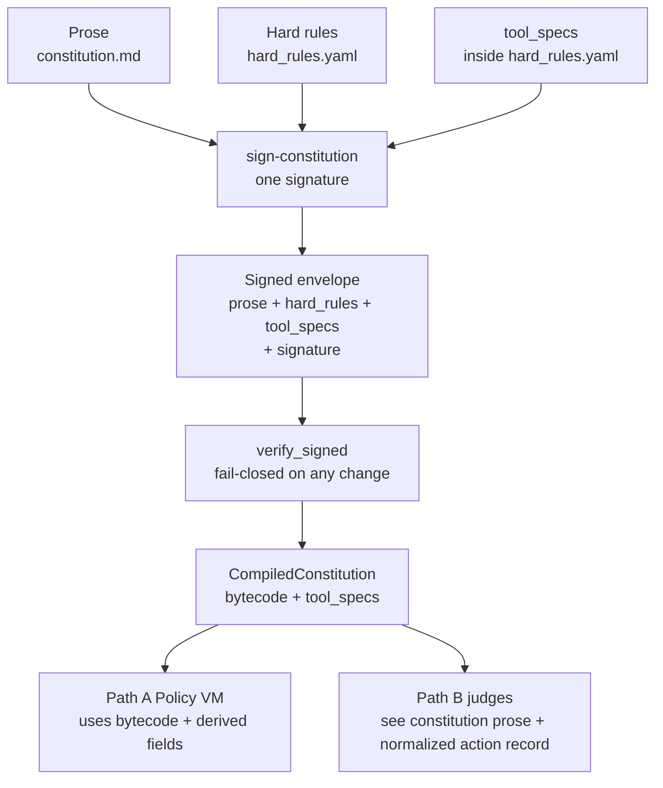
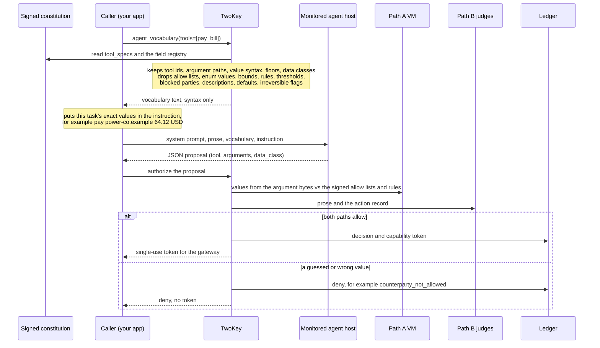

# How to run the concept

Whether this package is the right control is [FIT.md](FIT.md). What it is
not a substitute for is [COMPARISON.md](COMPARISON.md). Boundaries and
residual risk are [THREAT_MODEL.md](THREAT_MODEL.md). What this package
leaves out is [SCOPE.md](SCOPE.md).

Commands are from the repository root.

## Install

```bash
python3 -m venv .venv
. .venv/bin/activate
pip install -e ".[yaml]"
python -m unittest discover -s tests
```

That follows the ranges in `pyproject.toml`. The same checkout's `uv.lock`
is what CI installs (wheels only). To match it, install the uv version
pinned in `.github/workflows/tests.yml`, then `uv sync --locked --no-build
--extra yaml --no-dev`, and run tests with `.venv/bin/python`. When a
dependency range changes, regenerate `uv.lock` with that same uv and commit
it. The lock is not a consumer pin: a git install still uses the ranges.

## Create a principal key and sign a constitution

```bash
python -m two_key init-key ./keys
python -m two_key sign-constitution \
  --key ./keys/principal.pem \
  --prose examples/constitution.md \
  --rules examples/hard_rules.yaml \
  --out constitution.signed.json
```

`init-key` writes `principal.pem` with mode 0600 (created that way, never
chmodded afterwards) and refuses to overwrite an existing key. Commands that
take `--key` refuse a key file that the group or others can read
(`key_file_insecure`) or that is a symlink.

The signature covers the prose, the hard rules, `tool_specs`, and the
custom-field registry (`fields:`) when there is one. A modified file will
not load. `tool_specs` is required. A rules file with `fields:` signs as a
v2 constitution; see [Custom Path A fields](#custom-path-a-fields) and
`--envelope-format`.



A bare rule list, a missing
key, `null`, and an empty mapping are refused. `examples/hard_rules.yaml`
has a spec for every allow-listed tool. Amount, counterparty, and
irreversible are read from the argument bytes, and a claim that disagrees
is a deny. `data_class` combines the claim and the tool's
`data_class_floor` (see [Data classes](#data-classes)). This package does
not classify free text. A tool that
carries text the rules must treat as sensitive needs that class as its
`data_class_floor`. A missing amount path, a non-numeric amount, or a
currency other than `usd` on `pay_bill` is a deny. A value that cannot be
read at all is a `derive_failed` deny: `derive_failed:amount_unreadable`
for an amount such as `10**400`, `derive_failed:value_unreadable:<type_tag>` for
any other value (type label via `type_tag`, ≤32 chars; never raw `__name__`).

A key the spec does not name does not change the form and does not reach
the tool. The spec does not have to list every nested key. `deny_unmapped`
defaults off: the call can still allow, and the gateway drops the unnamed
key. The ledger records the names of dropped keys (`dropped_keys`), never
their values. Set it true to deny that key (`unmapped_field`). `payload`
names a value that may be present and is not interpreted. A payload path
may not equal, contain, or sit under an amount, currency, or counterparty
path, compared without regard to case (`TO.name` overlaps `to.name`);
such a spec does not load. With no `shape`, that
path covers the value and its children. `shape` is optional: `string`,
`number`, or `list` (a list of strings). `max_length` bounds a string or
a list. A nested value, a boolean, or a too-long value is
`payload_shape`. Shape does not read the contents. Classification of what
the text means is left to Path B, or to DLP outside this package.

A counterparty path must include `allow`, a non-empty list of strings. A
party that is not on that list is `counterparty_not_allowed`. The tool
receives the canonical party (trimmed, lower case), not the raw spelling.
`examples/hard_rules.yaml` allows `ada@example` on the mail tools and
`power-co.example` on `pay_bill`. Those mail tools name `subject` and
`body` as strings (`max_length` 200 and 8000). The words are not read. A
field that is neither a control path nor a payload path is dropped. A
blocked party still denies through `deny_counterparties` when one is present.

Missing `data_class` still defaults to `classified` before the floor, and
a floor never lowers that. Missing `irreversible` follows the tool spec,
so a reversible tool stays reversible. A present claim that disagrees with
the spec is a deny. Pass `--data-class public` only when that class is
allowed after the floor, and pass `--no-irreversible` only for a tool the
spec marks reversible.


## Data classes

A call's `data_class` combines the agent's claim with the tool's signed
`data_class_floor`. The order is `public` < `personal` < `financial`,
`medical` < `classified`. `financial` and `medical` are kinds of personal
data, so either one replaces `personal`. Together they are
`financial+medical`: a call that carries both, not a secret.

| Claim | Floor | `data_class` |
| --- | --- | --- |
| `medical` | `personal` (calendar) | `medical` |
| `financial` | `personal` (email) | `financial` |
| `medical` | `financial` (`pay_bill`) | `financial+medical` |
| `public` | `financial` | `financial` |
| `classified`, or omitted | any | `classified` |
| any | `classified` | `classified` |

- A rule `deny_if: {data_class_in: [...]}` denies when any class the call
  carries is listed: `[medical]` denies `financial+medical`.
- Only a claim or floor of `classified`, or an omitted claim, gives
  `classified`. Deny `classified` to refuse secrets and unlabelled calls;
  deny `medical` or `financial` to refuse those kinds.
- An agent may claim `financial+medical` itself. Any other `+` join, or an
  unknown class, is `malformed_action`.
- A floor never lowers a claim, and a claim never lowers a floor.

Before this release, two different classes among `personal`, `medical`,
and `financial` became `classified`, so an honest `medical` claim on a
`personal` tool was denied by a rule against `classified` (live test run 3).

## Designing a constitution

The commands above sign a constitution. They do not design one. The operator owns the signed constitution; Two-Key enforces only what is signed. A weak or incomplete constitution is the most common way the dual-path control fails to protect the intended actions. The points below are advisory, not a guarantee that a constitution is correct.

1. Define the tools and actions the agent is allowed to perform. Use an `allow_only_tools` rule. An allow-list is required by default so unknown tools fail closed.
2. Define the actions it must never perform. Use `deny_if`, `deny_counterparties`, or `deny_if_irreversible_over` rules for the cases that must be hard denials.
3. Specify tool arguments and their schemas in `tool_specs`. Path A derives the built-in structured fields (`tool`, `amount_usd`, `data_class`, `counterparty`, `irreversible`) from the argument bytes according to those specs. A claim that disagrees with the derived values is a deny. For facts the built-in fields do not cover (an environment, a region, a count, a flag), declare [custom fields](#custom-path-a-fields) and rules that name them.
4. Set `data_class_floor` and counterparty `allow` lists where they matter. A floor never lowers a claimed class; `medical` or `financial` on a `personal` tool stays `medical` or `financial` (see [Data classes](#data-classes)). Omitting `data_class` means `classified`, whatever the floor is: if a rule denies `classified`, every call that does not claim a class is denied. A party not on an `allow` list is `counterparty_not_allowed`. Payload paths constrain type and length only; they do not read contents. Classification of free text is left to Path B or to DLP outside this package. For a tool that sends data out (email, payments), consider `deny_unmapped: true`: a call that carries a key the spec does not name, such as a hidden `bcc`, is then a Path A deny, rather than resting on a judge's vote and the gateway dropping the key.
5. Decide how many judges are needed and what their agreement threshold should be. At least one judge must be configured. The default approval threshold is `min(2, number_of_judges)`: one affirmative vote with one judge, or two affirmative votes with two or more judges. This is not a general majority rule. Set `required_yes` explicitly if you want a different threshold, such as a majority or unanimity. Consider the `high_assurance` profile for destructive, irreversible, financial, or external-send tools. Missing, malformed, errored, or timed-out ballots never count as yes.
6. Give the monitored agent the syntax, and each call its values. The agent sees the prose and the instruction, not `tool_specs`. Pass `vocabulary=tk.agent_vocabulary()` to `MonitoredAgent.complete` to send the tool ids, argument paths, and value syntax (see [Monitored agents](#monitored-agents)); it never lists a value. Put the exact values a call needs (the counterparty id, an enum value) in the instruction, for example "pay `power-co.example` $64.12": the agent then learns one id per task, not the whole `allow` list. An agent that guesses `send_email` for `email_send`, or `Power Co` for `power-co.example`, is denied every time.
7. Use one vocabulary everywhere. Where the prose names a party, write its exact id, optionally with a display name: "the power company (`power-co.example`)". A judge that reads only a company name cannot tie it to the id in the call, and denying is correct for that judge. The same prose goes to the monitored agent, so every id in it reaches the agent's host; name in the prose only the parties you are content for the agent to know, and pass the rest in the instruction. Two-Key does not map display names to ids and does no fuzzy matching: that would let a look-alike payee pass. An agent may still repair a mistyped address to an allowed one (`ana@mailbox.exmaple` to `ana@mailbox.example`): the `allow` list keeps the result to an approved party. If you want it to decline instead, say so in the prose ("use only the exact address in my request; never correct or guess one"). Only the agent can apply that rule: judges never see the instruction, so they cannot compare the recipient with the request.
8. Test allowed, denied, ambiguous, and adversarial examples before trusting the constitution. Confirm that Path A denies the cases the hard rules are meant to catch, that Path B receives the intended context, and that the gateway drops or denies unmapped keys as configured (`deny_unmapped` defaults off).

The signed constitution remains the authority. A future GUI constitution maker (planned later) should help construct and validate choices, but the principal must still sign the resulting constitution. The GUI must not silently weaken the rules.

See `examples/hard_rules.yaml` and `examples/constitution.md` for a working starting point.

## Custom Path A fields

Path A has five built-in fields. You can declare more, up to 64, in the
rules file. Each one is a fact Path A reads from the argument bytes and
your rules can test: which environment a deploy targets, how many
replicas it starts, whether it is a dry run, which department asked.
[examples/custom_fields.yaml](../examples/custom_fields.yaml) is a working
starting point.

### Declare, map, and rule

```yaml
fields:                         # the registry: each field declared once
  environment:
    type: enum
    values: [dev, staging, prod]
    default: dev                # the value for tools that do not map this field
    description: Target environment of a deployment.
  replicas: {type: integer, min: 0, max: 1000, default: 0}
  dry_run: {type: boolean, default: true}
  ticket: {type: string, max_length: 32, default: ""}

tool_specs:
  deploy:
    irreversible: true
    data_class_floor: public
    fields:                     # this tool carries these fields at these paths
      environment: {json_path: target.env}
      replicas: {json_path: target.replicas}
      dry_run: {json_path: dry_run}

hard_rules:
  - id: tools
    allow_only_tools: [deploy]
  - id: only-dev-or-staging-unless-dry-run
    deny_if_fields:             # every condition must hold for the rule to deny
      environment: {not_in: [dev, staging]}
      dry_run: {eq: false}
```

Types and the operators each allows:

| Type | Declared with | Value read from the arguments | Operators |
| --- | --- | --- | --- |
| `boolean` | `default` | JSON `true` or `false` only | `eq` |
| `integer` | `min`, `max`, `default` | a JSON integer only (not `5.0`, `"5"`, `true`, or `null`), within `min`..`max` | `eq`, `neq`, `gt`, `gte`, `lt`, `lte` |
| `enum` | `values`, `default`, optional `charset`/`scripts` | text equal, after normalization, to one declared value | `eq`, `neq`, `in`, `not_in` |
| `string` | `max_length`, `default`, optional `charset`/`scripts` | text of at most `max_length` characters | `eq`, `neq`, `in`, `not_in` |

Every value in a rule is checked against the field when the constitution
is signed and loaded. An enum value that is not declared (`prdo`), an
integer outside `min`..`max`, a wrong type, or an operator the type does
not allow is refused, so a typo cannot become a rule that never fires.

### What happens to a call

- A field a tool maps is required. The value comes from that argument
  path, never from the agent's claim. An agent that sends `environment`
  in its claim is `malformed_action`; a value in the claim's `raw` is
  ignored.
- A tool that does not map a field gets the field's signed `default`, the
  way a tool with no amount spec has `amount_usd` 0.
- The tool receives the normalized value Path A checked (`" Staging "`
  arrives as `staging`), and the token binds the values, so the gateway
  recomputes and compares them.
- Judges see the values in the action record. They never see
  descriptions.

| Argument | Result |
| --- | --- |
| mapped path missing | `derive_failed:field_missing:<field>` |
| wrong JSON type, or a character outside the field's character set | `derive_failed:field_unreadable:<field>` |
| integer outside `min`..`max`, enum value not declared, string longer than `max_length` | `derive_failed:field_not_allowed:<field>` |

Each is a derive deny: Path B still runs, the arguments are withheld from
judges unless `tool_args_on_derive_deny` is set, and no token is issued.

Write rules as allow-lists where you can. `environment: {not_in: [dev,
staging]}` still denies when someone adds `prod2` to the field, or when a
tool that should map the field does not. `environment: {in: [prod]}` does
not. Pick each `default` as the value your rules treat most strictly.

### Descriptions

`description` is a note for the people who read and review the
constitution. It is signed with everything else, so editing it after
signing breaks the signature. It is never compiled, never sent to a judge,
never written into a deny reason, and never an authorization rule; text
such as `deny_if: ...` in a description does nothing. It may be in any
language, up to 2,000 characters, with line breaks. Control characters,
text-direction embeddings, overrides, and isolates (the characters behind
"Trojan Source" tricks), private-use and unassigned code points, and
leading or trailing whitespace are refused.

### Envelope format

A rules file without `fields:` signs exactly as before: format
`two-key-concept-constitution-v1`, with the same digest, `bytecode_hash`,
and `spec_hash`. With `fields:`, it signs as
`two-key-concept-constitution-v2`. Installs older than custom fields refuse
v2, so they cannot load it and ignore the fields. A v2 constitution
refuses any signed key other than `prose`, `hard_rules`, `tool_specs`, and
`fields`.

The format is the principal's choice at signing time:

```bash
python -m two_key sign-constitution ... --envelope-format auto   # default
python -m two_key sign-constitution ... --envelope-format v2     # always v2
```

In Python: `sign_constitution(prose, rules, key, specs, fields=fields,
envelope_format="v2")`. `auto` writes v1 unless there are fields. `v2`
writes v2 even without fields; that loads the same way, and an older
install refuses it. Loading accepts both formats. A rules file with
`fields:` is refused by `load_unsigned` (so its fields are never dropped
silently); use `load_unsigned_with_fields`, which returns them as a fourth
value.

### Using Two-Key in other languages

Field names are ASCII identifiers (`^[a-z][a-z0-9_]{0,47}$`), because
they are configuration keys. Descriptions may be in any language, so a
team can read every field's purpose in its own language.

Enum and string values have a character set:

- `charset: ascii`, the default: printable ASCII, trimmed and
  lower-cased. Most international deployments need nothing else, because
  the values tools exchange are usually codes: country codes (`jp`),
  language tags (`ja-jp`), currencies (`eur`), regions (`eu-west-1`),
  environment names, ticket ids.
- `charset: unicode` with `scripts:`: for values that are words in a
  language, such as departments (`経理`, `buchhaltung`) or place names.
  Even French or German with accents (`é`, `ü`) needs this, with
  `scripts: latin`.

```yaml
fields:
  abteilung:
    type: enum
    charset: unicode
    scripts: latin
    values: [entwicklung, buchhaltung, vertrieb]
    default: entwicklung
    description: Abteilung, die das Deployment beantragt.
  bumon:
    type: enum
    charset: unicode
    scripts: japanese
    values: [経理, 営業, 開発]
    default: 開発
    description: 申請した部門
```

`scripts` is one of: `latin`, `greek`, `cyrillic`, `armenian`,
`georgian`, `hebrew`, `arabic`, `devanagari`, `bengali`, `gurmukhi`,
`gujarati`, `tamil`, `telugu`, `kannada`, `malayalam`, `sinhala`, `thai`,
`lao`, `khmer`, `ethiopic`, `hangul`, `han`, or one combination:
`japanese` (Latin, Han, Hiragana, Katakana), `korean` (Latin, Hangul,
Han), `chinese` (Latin, Han, Bopomofo). ASCII digits, spaces, and ASCII
punctuation are allowed in every script.

How a Unicode value is read:

- It is normalized with NFKC and case-folded (NFKC_Casefold, the Unicode
  rule for comparing identifiers). `Café` written with a precomposed `é`
  and with `e` plus a combining accent compare equal; full-width
  `ｐｒｏｄ` becomes `prod`; Turkish `İ` folds to `i` plus a combining dot.
- A letter from a script the field did not declare is refused. In a
  `latin` field, `prоd` written with a Cyrillic `о` is
  `field_unreadable`, not a near-match. That is what stops lookalike
  letters.
- Control characters, invisible format characters (zero-width space, soft
  hyphen), text-direction controls, private-use and unassigned code points,
  line and paragraph separators, spaces that NFKC does not turn into an
  ASCII space, and non-ASCII punctuation or symbols that belong to no
  declared script (`€`, `‐`) are refused. ZERO WIDTH JOINER and
  NON-JOINER are allowed only in fields whose script needs them (Arabic,
  including Persian, and the Indic scripts), after a letter and never at
  the end.
- A generic combining mark (an accent) is allowed only on a letter, at
  most three in a row.

Limits of this approach:

- A field holds one script or one combination. A field cannot hold both
  Russian and English words; use two fields, or codes.
- Python's standard library has no Unicode script table, so the script is
  read from each character's Unicode name. A character no supported
  script claims is refused, never guessed.
- Each Python release ships its own Unicode version. A very new
  character may be accepted on Python 3.13 and refused on 3.10. That fails
  closed. Sign and test on the oldest Python you run.
- Characters are controlled; meaning is not. `prod` and `production` are
  different values. Prefer `enum` with `not_in` rules over `string` with
  `eq` or `in`.

### Changing a limit

The limits are constants in [two_key/fields.py](../two_key/fields.py),
enforced the same way when a constitution is signed and when it is
loaded:

| Constant | Value | Limits |
| --- | --- | --- |
| `MAX_FIELDS` | 64 | custom fields in the registry |
| `MAX_FIELDS_PER_TOOL` | 64 | fields one tool maps |
| `MAX_FIELD_NAME_CHARS` | 48 | characters in a field name |
| `MAX_DESCRIPTION_CHARS` | 2000 | characters in a description |
| `MAX_ENUM_VALUES` | 1024 | values in one enum |
| `MAX_VALUE_CHARS` / `MAX_VALUE_BYTES` | 256 / 1024 | one enum value or one string in a rule |
| `MAX_STRING_LENGTH` / `MAX_STRING_BYTES` | 1024 / 4096 | the largest `max_length`, and a string value's UTF-8 size |
| `MAX_LIST_ITEMS` | 1024 | items in one `in` or `not_in` list |
| `MAX_CONDITIONS` | 16 | conditions in one `deny_if_fields` rule |
| `MAX_SAFE_INT` | 2^53 - 1 | the largest `min` or `max` magnitude (exact as a float) |
| `MAX_PATH_SEGMENTS` / `MAX_PATH_CHARS` | 16 / 512 | a field's `json_path` |
| `MAX_COMBINING_RUN` | 3 | combining marks in a row on one letter |

The 256 KiB argument cap, the 62-level nesting cap, and the 4,096
instruction cap on the compiled program (`max_steps`) still apply; a very
large rule set is refused by that last one.

These are not configuration settings. A limit inside the signed file
could be raised by the same file it is meant to constrain. To change one:

1. Edit the constant in `two_key/fields.py`. Do not raise `MAX_SAFE_INT`:
   integers above it lose precision in the policy VM.
2. Run `python -m unittest discover -s tests`. `tests/test_custom_fields.py`
   (class `A10Limits`) tests each limit at its value and one past it.
3. Record the change in `CHANGES.md`.
4. Install the same build everywhere that signs or loads the constitution.

Raising a limit is backward compatible: every constitution that loaded
before still loads. Lowering one can make an already-signed constitution
refuse to load (fail closed) until it is edited and signed again.

## Judges

`examples/judges.yaml` is the hook list: OpenAI-compatible (OpenAI and xAI),
Anthropic, Gemini, and Ollama. No vendor SDK is used. Each thread keeps one
connection per origin and does not follow redirects.

Cloud OpenAI and xAI send a strict ballot schema. xAI also sends
`reasoning_effort: low`. A single HTTP 400 drops those knobs and retries
once. Anthropic and Gemini judges have the same one-time 400 fallback:
Anthropic drops its cache breakpoints, and Gemini drops the response schema
and keeps JSON mode. The local ballot parser does not change on that retry.

A dropped connection and HTTP 429, 502, 503, or 504 are retried at most
twice more, with a short backoff, inside the quorum deadline. A response
that was parsed is never retried. A response over 1,000,000 bytes, a
redirect, and any other HTTP error abstain.

Judges do not enforce the counterparty `allow` lists, the data class, or
the other hard rules; Path A does. A judge reads the prose and the
normalized action record and votes on whether the call fits the prose.
It can deny a call Path A would allow, and its yes cannot overturn a
Path A deny.

`judges.yaml` and `agents.yaml` are trusted operator configuration. An
`auth: {type: callback, callback: "module:function"}` entry imports that
module when the file loads, so whoever can write the file can run code in
the `TwoKey` process. Protect these files like the code itself.

## The monitored agent and the judge-is-not-the-agent rule

The minimum is one judge, and no judge may be the monitored agent. A judge
may run any model from any vendor. A judge must not be the monitored agent:
`TwoKey` refuses to start (`judge_matches_agent:`) when a judge holds the
monitored agent's credential (the same API token, or the same username and
password), at any address, or when neither side sends a credential on the
same address. You declare who the agent is; Two-Key refuses a judge that is
the agent, and makes likely accidents visible rather than blocking them.

Declare the agent yourself, never from what the agent reports: the
`monitored_agent:` block in judges.yaml (the CLI reads it), or
`TwoKey(monitored_agent=...)` with a mapping, an `AgentDeclaration`, a
`MonitoredAgent`, or a list of them. Give `model`, `provider` (a label,
recorded and never compared), `base_url`, and exactly one credential:
`credential_env` (the name of the environment variable holding the agent's
API token), `username_env` with `password_env` (the names of the two
variables holding a username and password, sent as HTTP Basic over HTTPS
only), or `credential: none` for a keyless loopback or private agent.
Optional keys are `id`, `tenant`, and `upstream`; any other key is refused.
Without a declaration, `TwoKey` refuses with `monitored_agent_required:`.

At startup each judge and agent is resolved to:

- a normalized model id: NFKC first, Unicode dashes folded to `-`,
  zero-width characters removed, lower case, then router prefixes, dated
  snapshot suffixes, `-latest`, Vertex `@` versions, Bedrock `-v2:0`,
  Ollama `:latest`, Azure's `gpt-35`, and a few aliases removed or mapped;
- the endpoint `host:port` of `base_url`. Every name or address of this
  machine is written `localhost`: loopback names and addresses (including
  `127.1`), `localhost.localdomain`, `0.0.0.0` and `::`, and the machine's
  own host name and addresses. Other hosts are compared literally by
  `host:port`;
- the upstream that serves the model, and how it was found
  (`resolved_by`): `endpoint` (a direct provider host, Azure OpenAI, or a
  known inference host), `model_prefix` (a recognized router, a local
  server, or an unknown host where the model id names its maker, such as
  `openai/gpt-4o` or `qwen2.5:7b`), or `declared_upstream` (your
  `upstream:` key). `model_prefix` is operator-attested through the model
  name and is not verified. A model id ending in `:cloud` or `-cloud`
  adds `ollama.com` and is never local;
- tenant ids, each scoped by provider family: the Azure resource and
  deployment and the Vertex project read from the URL, plus a `tenant:`
  mapping you declare with any of `organization`, `project`, `account`,
  and `deployment` (for example `tenant: {organization: org-123}`). A
  Bedrock `account` is scoped by the region in the host. Elsewhere a
  declared id is scoped by the provider family: the endpoint's (`openai`,
  `anthropic`, `ollama`, ...), or for a proxy on a local or unrecognized
  host the family of its declared `upstream:`, its Ollama cloud model, or
  its model maker, never the proxy's own address. So `project: p1` behind a
  local proxy to OpenAI is the same tenant as `project: p1` at
  api.openai.com;
- a credential fingerprint of the key with surrounding whitespace stripped,
  under a per-install key, `<ledger>.ledger-key/fingerprint.key` (32 random
  bytes, created once with O_EXCL, mode 0600): HMAC-SHA256 for an API token
  (`hmac-sha256:`), and PBKDF2-HMAC-SHA256 with the per-install key as the
  salt (600,000 iterations, about 0.15 s; `pbkdf2-sha256-600000:`) for a
  username and password, fingerprinted as one `username:password` pair with
  whitespace stripped from its two ends only. PBKDF2 is an approved
  function and is in OpenSSL's FIPS provider; scrypt, used before 0.2.3, is
  neither.
  The key sits beside the ledger key, so it does not stop someone who holds
  that directory; there a random token is safe by its length, a guessable
  token (a placeholder such as `EMPTY`) is not, and a password is protected
  only by PBKDF2's cost. A fingerprint is chosen by content: any secret that
  contains `:` is fingerprinted as a `username:password` pair with PBKDF2,
  never with HMAC, so a judge or agent holding a username and password as a
  token (`user:pass` in `credential_env`) matches the other side's Basic
  pair, and a password never gets the cheap hash. Raw keys and passwords are
  never logged.

`TwoKey` refuses with `judge_matches_agent:` only when a judge is the
monitored agent. That is either of these:

- the same credential, at any address: the same API token or the same
  username and password (as fingerprints, whitespace stripped from the ends
  of the token or of the `username:password` pair). A credential
  identifies its holder wherever it is sent, so a judge with the agent's key
  behind a pass-through proxy, under another name for the agent's server, or
  at a provider's alternate host is still the agent. Every credential either
  side holds counts, whether or not its connector sends it: a judge with
  `auth_header: none` (an Ollama judge's default) that is configured with
  the agent's key, and an `agents.yaml` `ollama` agent whose configured key
  a judge also holds, are refused. The ledger records every credential a
  side holds under `credential_fingerprint`, and whether it is sent under
  `credential_sent`. A placeholder that a
  local server ignores (`EMPTY`) counts too: give each side its own value,
  or leave it off one side (`auth: {type: none}` on a judge,
  `credential: none` on the agent). On one shared server that ignores keys,
  different placeholders only hide that both sides are keyless there: give
  the judge its own server or port instead;
- no credential on either side, on the same address: the same endpoint
  `host:port` as above, with every alias of this machine folded to
  `localhost`. Two keyless sides on one address, such as two models on one
  local Ollama daemon, have nothing to tell them apart, so they are refused
  whatever their models. Give the judge its own daemon or port, or its own
  credential. For this address rule only, a connector Two-Key drives counts
  as keyless when it sends no credential, whatever is configured: a judge
  with `auth_header: none` (an Ollama judge's default) and an `agents.yaml`
  `ollama` agent without Basic auth send none. Two-Key sees only what its
  own connectors send: a `monitored_agent:` declaration with
  `credential_env` or `username_env` counts as keyed even when its server
  ignores the key (an Ollama daemon), so a keyless judge on that address
  only warns (`same_address_one_side_keyless`). Declare such an agent with
  `credential: none`. Addresses are compared as you configure them; DNS
  names are not resolved.

Everything else starts: any model, any vendor, any route, the same provider,
the same model through another endpoint, and the same address with a
different credential. Likely accidents still start, but each prints a
`two-key: WARNING: judge '<j>' vs agent '<a>': ...` line on stderr and is
recorded in `constitution_loaded` under `judge_agent_separation.warnings`
(agent, judge, `check`, detail):

| `check` | What it means |
| --- | --- |
| `same_address_one_side_keyless` | The same address, and only one side has a credential (a daemon may ignore it) |
| `same_model_same_address` | The same normalized model on the same address, with a different credential |
| `same_model_shared_route` | The same model reaching a shared route: a declared `upstream:`, the endpoint, or `ollama.com` for a `-cloud` model |
| `same_model_unknown_proxy` | The same model through a loopback, private, or unrecognized proxy or daemon with no declared `upstream:`, which could forward to the agent's own account |
| `shared_tenant` | A shared tenant id (an Azure resource or deployment, a Vertex project, a Bedrock account and region, or a declared id) |
| `unresolved_identity` | An upstream that cannot be resolved (an unrecognized router or host, or a local proxy serving an alias model); declare `upstream:` to attest it |

`upstream:` and `tenant:` are recorded and not verified. They only change
which warnings print. `allow_same_provider_judge` and
`allow_same_model_distinct_tenant` are accepted, print a deprecation note,
are recorded in `quorum_policy` (and so in `policy_digest`), and have no
effect: nothing they used to lift is refused any more. A misspelled quorum
key is still refused as `unknown quorum keys`.

Judge and agent credentials are read at startup for this check, so a
configured key that cannot be read refuses to start, for a local agent as
well as a cloud one, and also when its connector never sends it (an
`agents.yaml` `ollama` agent without Basic auth, or a judge with
`auth_header: none`): Two-Key cannot show it differs from the agent's. The result is the `judge_agent_separation`
field of the `constitution_loaded` ledger entry: every resolved identity
(fingerprints only), the fingerprint scheme and key id, and
`identities_digest`. The entry also holds the full quorum policy
(`quorum_policy`) and its `policy_digest`. Each `decision` entry carries
`identities_digest` and `policy_digest`, not the full policy. To check
them, `two_key.audit.check_decision_digests(ledger)` recomputes both from
the latest `constitution_loaded` before each decision and returns a list of
mismatches (empty when all match). By hand: `identities_digest` is
`canonical_hash({"agents": sep["agents"], "judges": sep["judges"]})` and
`policy_digest` is `canonical_hash(quorum_policy)`, with `canonical_hash`
from `two_key.canonical` (SHA-256 of sorted-key, compact, ASCII JSON).

At call time, a judge that is not on a loopback host makes the round deny
when `authorize` gets no `agent_session` (`cloud_judge_session_required`).
A judge whose credential equals that session (whitespace stripped, a
username and password compared as their pair, a key it holds but never
sends included) abstains with
`cloud_judge_reused_agent_session`, wherever it connects, and the round
denies. This is the start-up rule again, at call time, with the session the
agent really uses: it catches a judge holding the agent's key even when
`monitored_agent:` names the wrong key or address. The credential named for
the monitored agent is read again on that call and compared the same way,
whether or not the string you passed is that key. A placeholder still
satisfies the presence check. It does not hide the named key: a judge
holding that key denies the round before anyone is called
(`cloud_judge_reused_agent_session`). The named key is not sent to the
judge and not written to the ledger. A session that is not the named key
is still yours to pass; Two-Key cannot see a secret you never named. A
keyless agent (`credential: none`) has no named key to add. If the named
key cannot be read, the round denies with `agent_credential_unreadable`
and the judges are not called.

The in-process placeholder agent `two_key.testing.TEST_AGENT` is accepted
only with `allow_test_doubles=True` and only when every judge is a test
double (`in_process_agent_refused`).

## Quorum policy

The default needs one judge and has no diversity floors: `min_makers: 1`,
`min_local_judges: 0`, `require_local_yes: false`. When `required_yes` is
not set (in `QuorumPolicy()`, the quorum block, or `TwoKey` with no policy),
it is `min(2, number of judges)`.
`QuorumPolicy.without_diversity_floors()` is **not** that default: it sets the
same floor values but defaults `required_yes` to 2. Prefer `QuorumPolicy()`
(or omit / set `required_yes` to `null`) for the one-judge default threshold.
A floor the judges can never meet refuses to start, and `convene` denies it
without calling any judge: `required_yes` or `min_responding` above the
number of judges (`too_few_judges_configured:`), and
`min_distinct_providers` above the number of distinct judge providers
(`insufficient_distinct_providers:`).

`profile: high_assurance` in the quorum block, or
`QuorumPolicy.high_assurance()`, needs judges from at least two makers
(`min_makers: 2`), at least one local judge, and a yes from a local judge.
Use it for destructive, irreversible, financial, or external-send tools.
`examples/judges.yaml` meets it with the cloud hooks plus local Qwen. Other
quorum keys still apply on top of the profile. `require_local_yes: true`
with no local judge does not start
(`require_local_yes_without_local_judge`).

A judge's maker is who made the judge's model, as the operator labels it:
the per-judge `maker:` key, or its `provider` when `maker:` is omitted. It
is not verified. It counts only the judges against each other. The
judge-is-not-the-agent check above never compares it with the monitored
agent. Maker names are compared after NFKC and case folding, so
`OpenAI` and `openai` are one maker. `min_distinct_providers` is a separate
count: the `provider` labels of the judges that returned a valid ballot.
Through 0.2.1 these keys were `vendor:` and `min_vendors:`, and 0.2.2 loaded
them as deprecated aliases. 0.2.3 refuses them as unknown keys, and the Python
names `vendor=`, `min_vendors=`, `.vendor`, and `.min_vendors` are gone.

`TwoKey` does not start with no judge, with `timeout_seconds: null` (Path B
needs a hard deadline), or with two judges that share an id
(`duplicate_judge_id`). Judges run in parallel under that deadline; a judge
that errors, abstains, times out, or returns anything but a valid ballot is
not a yes. Ballots are paired with judges by position, and the judge id and
provider on the record come from the judge, not the ballot. A ballot that
names another judge abstains (`judge_id_mismatch`).

Without a local judge, the constitution prose, the action record, and any
attached tool arguments go to the cloud judges' vendors.

`require_path_a_first` stays off unless you set it. `TwoKey.authorize` does
not read it. Both paths still run. After a derive deny, judges do not
receive the argument bytes unless the quorum block sets
`tool_args_on_derive_deny: true`. Other denies still attach non-empty
arguments. `min_distinct_providers` still defaults to 1, so that count is
not itself a floor.

## Local judges

A judge counts as local only when `local_weights` is true and its
`base_url` host is on an explicit allowlist: `localhost`, 127.0.0.0/8,
::1, the RFC 1918 ranges (10/8, 172.16/12, 192.168/16), or IPv6
unique-local fc00::/7. Documentation, benchmark (198.18/15), reserved,
CGNAT (100.64/10), link-local (including 169.254.169.254), and NAT64
(64:ff9b::/96) addresses are not local, even where Python's `is_private`
says so. A DNS name other than `localhost` is not local. Ollama defaults
`local_weights` from the host, so a remote Ollama is not local, and a
model id ending in `:cloud` or `-cloud` (an Ollama cloud model) is cloud
and never local for every judge class, including an OpenAI-compatible
judge pointed at a local Ollama `/v1`, even on loopback. Plain
HTTP to a host other than `localhost`, `127.0.0.1`, or `::1` is refused
unless the judge sets `allow_insecure_http`. A judge on a LAN address is local for the quorum
floors but not loopback, so it still needs the agent session at call time.

## Parsing and limits

Every JSON and YAML document is parsed strictly: the signed constitution,
the rules file, judges.yaml and agents.yaml (JSON or YAML), the
`monitored_agent:` block, judge ballots, provider responses, agent
proposals, `--args`, and token payloads. A key repeated in one mapping, at
any depth, is refused with `duplicate key '<k>'`; it never resolves
last-one-wins. A YAML merge key (`<<`) is refused too, because which value
wins is not visible in the text; write the keys out (plain anchors and
aliases still load). JSON `NaN` and `Infinity` are refused too (a ballot
with them is malformed and abstains), and so is an integer of more than
4,300 digits (`integer too large`; in tool arguments it denies as
`invalid_call`, at authorize and at the gateway). Unknown keys inside an
`auth:` mapping are refused. YAML still loads with a safe loader.

judges.yaml accepts only the top-level keys `judges`, `quorum`, and
`monitored_agent`; agents.yaml only `agents`. Anything else (a typo such as
`quorm`) is refused.

The action claim (the `tool`, `amount_usd`, `data_class`, ... mapping) is
measured before it is read: over 64 KiB of UTF-8 JSON it is denied
(`action_too_large`) and the ledger keeps only `action_size`,
`action_digest`, and `action_omitted: true`. A tool name is an identifier
of at most 128 characters (`a-z`, `0-9`, and `_ . : / -` after case
folding). A `malformed_action:` reason names the field, never its value or
an unknown key's name (`malformed_action:unknown action fields (2)`,
`malformed_action:data_class: not a known class`).

Tool arguments or a proposal over 256 KiB of compact UTF-8 JSON are denied
before anything reads or ledgers them (`args_too_large`, `proposal_too_large`).
The arguments are encoded once: the canonical bytes settle the cap (they are
never shorter than the UTF-8 measure), give the hash the token binds, and are
re-measured exactly only when they are over the cap. The gateway does the same.
The ledger keeps only `tool_args_size`, `tool_args_digest`, and
`tool_args_omitted: true` (or the `proposal_` equivalents). Arguments
nested too deeply to encode are denied in `authorize` and at the gateway
with `invalid_call:tool args are nested too deeply`; the ledger keeps
`tool_args_omitted: true` and `tool_args_error`. Encoding runs before the
size check, so the reason is the same on Python 3.10, 3.11, and 3.12.

Custom-field limits (field count, name, description, enum, string, and
path sizes) are listed under [Changing a limit](#changing-a-limit).

Each input (tool args, the action claim, the proposal) is first copied once
into built-in types (`canonical.to_plain`). Any Mapping becomes a dict and a
tuple becomes a list. The size cap, the token's hash, the judges, the ledger
and the tool all read that copy, never a custom type's `str()` or `repr()`.

"Too deeply" means more than 62 levels of objects and arrays
(`canonical.MAX_INPUT_DEPTH`). The encoder itself allows 64
(`canonical.MAX_DEPTH`) and counts without recursion. The two spare levels
are the ones an input gains inside a ledger entry or a judge's record
(`raw.tool_args`), so arguments at exactly 62 still encode there. The
action claim (usually `raw`) and a structured proposal have the same limit.
One level more is `malformed_action:action claim is nested too deeply` or
`malformed_proposal`, and it is ledgered.

If a ledger body still cannot be encoded, `Ledger.append_bounded` writes
the entry anyway. It keeps the body's short scalar fields (reason, jti, tool, allowed), always retains `policy_digest` and `identities_digest` when present, plus `body_size`, `body_digest`, `body_omitted: true`, and `body_error`.

The token lifetime (`TwoKey(ttl_seconds=...)`, `--ttl-seconds`) is an
integer from 1 to 300 seconds; anything else, including a float, NaN, or
infinity, refuses to start (`ttl_out_of_range:`). A token whose time fields
are not finite numbers is `malformed_token`.

### Recommended local judge: Qwen2.5-7B-Instruct

`examples/judges.yaml` sets the local judge to `qwen2.5:7b`
(Qwen2.5-7B-Instruct, Apache-2.0, Copyright 2024 Alibaba Cloud). The weights
are not in this repository. Pull them with Ollama, then leave the example
`base_url` as it is:

```bash
ollama pull qwen2.5:7b
```

The model card is <https://huggingface.co/Qwen/Qwen2.5-7B-Instruct>.

## Authorize from the command line

This runs both paths and prints the decision. It does not execute the tool.
Fill in the `model:` lines and the `monitored_agent:` block of
`examples/judges.yaml` first, and set the judge key variables.

```bash
python -m two_key authorize \
  --key ./keys/principal.pem \
  --ledger ./ledger \
  --constitution constitution.signed.json \
  --judges examples/judges.yaml \
  --tool email_draft \
  --args '{"to":"ada@example"}' \
  --proposal "draft a status note" \
  --data-class public \
  --no-irreversible \
  --agent-session-env OPENAI_AGENT_API_KEY \
  --emit-token ./token.txt
```

The bearer token is never printed. The output shows `token_jti` and
`token_digest` (the ledger's `capability_issued.token_hash`).
`--emit-token PATH` writes the token itself to a new file with mode 0600
and refuses to overwrite one. `--agent-session-env NAME` names the
environment variable that holds the agent session; the old
`--agent-session VALUE` took the secret on the command line and is
refused. `--ttl-seconds` sets the token lifetime, 1 to 300 seconds
(default 120). `--args` is parsed strictly before anything else is loaded.
The decision entry records `origin: cli`.

A flag you do not pass is left out of the claim. That is not the same as
`normalize_action` filling a missing field, and it is what lets the bytes
and the tool spec decide:

- Omit `--amount-usd` and the amount is read from the argument bytes. Pass
  it only to claim a number; a different number is `amount_mismatch`.
- Omit `--counterparty` and the party is read from the argument bytes. Pass
  it only to claim one; a different party is `counterparty_mismatch`.
- Omit `--irreversible` and the tool spec decides. `--irreversible` claims
  true and `--no-irreversible` claims false. A claim that disagrees with the
  spec is `irreversible_mismatch`. The example above passes
  `--no-irreversible` because it is showing the flag; `email_draft`'s spec
  is already reversible, so the flag can be left off.
- Omit `--data-class` and a missing class is `classified`, then the tool's
  `data_class_floor`, which never lowers it. Pass `--data-class public`
  when that class is allowed after the floor. The example above needs it:
  these rules deny `classified`.

Exit status is 0 on allow and 2 on deny. The ledger records and the head
are ciphertext. The append lock is `<ledger>.lock` next to the ledger
directory. Redemption locks are `<ledger>.redeem-locks/` there too, not
inside the ledger directory. First open writes `<ledger>.ledger-key/ledger.key` and
`<ledger>.witness/witness.pem` next to the ledger directory, not inside it.
Both are created with O_EXCL at mode 0600, `<ledger>.witness` at 0700 (and
set back to 0700 on open); a ledger key that is group- or world-readable, a
symlink, or not 32 bytes is refused (`ledger_key_insecure:` or
`ledger_key_unreadable:`), and so is a witness or capability key that is
group- or world-readable, a symlink, or not a regular file
(`witness key: key_file_insecure:`, `capability key: key_file_insecure:`;
`chmod 600` it). A principal private key that does not match the principal
public key given to `Ledger` is refused before anything is written
(`principal key mismatch`). First open also writes the ledger's first entry,
`witness_pinned`; see "Pin the witness key" below.
`--witness-public-key PEM` gives the witness pin kept outside the ledger.
The authorize command does not accept test-double judges.

## Authorize from Python


```python
from pathlib import Path
from two_key.constitution import load_envelope, verify_signed
from two_key.core import TwoKey
from two_key.judges.config import load_config_file
from two_key.identity import load_monitored_agent_file
from two_key.keys import load_private_key_file
from two_key.ledger import Ledger
import os

key = load_private_key_file("keys/principal.pem")
judges, policy = load_config_file(Path("examples/judges.yaml"))
agent = load_monitored_agent_file(Path("examples/judges.yaml"))
ledger = Ledger("ledger", key)
tk = TwoKey.load(ledger, key.public_key(), load_envelope("constitution.signed.json"),
                 judges, private_key=key, quorum=policy, monitored_agent=agent)
decision = tk.authorize(
    {"tool": "email_draft", "amount_usd": 0, "data_class": "public", "irreversible": False},
    {"to": "ada@example"},
    "draft a status note",
    agent_session=os.environ["OPENAI_AGENT_API_KEY"],
)
```

`decision.token` is set only when both paths allow and the signed ledger
head was written. `decision.to_record()` leaves the token out and gives
`token_jti` and `token_digest`, so it is safe to print or log. Any
exception inside `authorize` is a deny (`internal_error:<Type>`) written to
the ledger. The gateway is the only component that should call the tool.

`decision.reason` names one cause, in this order: a parse, limit, or
derive deny (`malformed_action`, `amount_mismatch`, `derive_failed:...`,
`counterparty_not_allowed`), then the Path A deny, then the Path B result.
A call can fail more than one way: a payee not on the `allow` list and an
omitted `data_class` (so `classified`) give `counterparty_not_allowed` as the reason while
`decision.path_a["reason"]` names the class rule. Read
`decision.path_a["reason"]` and `decision.path_b["reason"]` as well when
you fix a denied call.

## Monitored agents

`examples/agents.yaml` configures Grok, ChatGPT, Claude, Gemini, and a local
model. Hosting is recorded. It is not trust.

`MonitoredAgent.complete` sends the agent the constitution prose and the
instruction. By default it does not send `tool_specs`, so the agent learns
tool ids, argument keys, counterparty ids, and data classes only from the
prose (see [Designing a constitution](#designing-a-constitution), point 6).
The system prompt lists the five data classes and says that omitting
`data_class` means `classified`.

To send the signed vocabulary as well, opt in per call, and name the
tools the task needs:

```python
instruction = "Pay power-co.example 64.12 USD for the March bill."
prop = agent.complete(instruction, constitution_prose,
                      vocabulary=tk.agent_vocabulary(tools=["pay_bill"]))
decision = tk.authorize(prop.action, prop.tool_args, prop.proposal,
                        agent_id=prop.agent_id, hosting=prop.hosting, agent_session=session)
```

The exchange, step by step. The vocabulary carries the shape of a call; the
instruction carries this task's values; Path A checks those values against
the signed lists the agent never saw.



`tk.agent_vocabulary()` describes syntax, never values. For each signed
tool (or only those in `tools`) it gives the id, the `data_class_floor`,
the amount path, unit, and currency path, each counterparty path ("an
exact id given in the instruction or the constitution"), each payload
path with its shape and `max_length`, each custom field's path and type
(and a string field's `max_length`), and `deny_unmapped` when set. It
also lists the five data classes and tells the agent to omit
`irreversible`, `amount_usd`, and `counterparty`, which are read from the
arguments and the spec.

It never lists an `allow` list, an enum value, an integer bound, a rule
or its threshold, `deny_counterparties`, bytecode, a field description, a
default, or a tool's `irreversible` flag. An agent that probes for an
allowed payee still has to guess, and every wrong guess is a ledgered
deny (`counterparty_not_allowed`), so probing shows in the ledger. It
grants nothing: Path A and Path B check the call exactly as before. A
tool id in `tools` without a signed spec is refused (`AgentConfigError`).

`authorize_from_agent` parses the proposal (`tool`, `arguments`, `proposal`,
and optional structured fields) and runs both paths. It does not call the
tool. The structured fields are optional to send, but omitting
`data_class` means `classified`, whatever the tool's floor is. Extra keys in the proposal are rejected. Text longer than 1,048,576
characters (four times the arguments cap) is denied `proposal_too_large`
before it is parsed. Text that is not a string, is not JSON, has a repeated
or extra key, or misses a field is denied `malformed_proposal`. Both denies
are ledgered with the text's size and digest only; the reason names no key.

Use a different API key for agents than for judges. Pass the agent object
you run as `TwoKey(monitored_agent=agent)`; it is checked against every
judge at startup like the judges.yaml declaration. A proposal with a
repeated JSON key, at any depth or inside an `arguments` string, is
refused.

### Declines

An agent that refuses the instruction replies `{"decline": "<short
reason>"}` instead of a call; the system prompt tells it how. A host that
forces every key (the strict schema on OpenAI and xAI) may send the call
keys too, as long as they are empty: `"tool": ""`, `"arguments": "{}"`,
and the optional keys `null`.

- `authorize_from_agent` returns a deny with reason `agent_declined`. No
  token is issued, and neither Path A nor Path B runs: a decline is not a
  call. The ledger `decision` keeps the reason (at most 1,000 characters),
  plus the size and digest of the whole reply.
- `MonitoredAgent.complete` raises `AgentDeclined` (its `.reason` holds the
  text). It subclasses `AgentConfigError`, so code that catches only that
  still fails closed.
- A decline that also names a tool, carries arguments or a claim, has
  another key, or has an empty or over-long reason is `malformed_proposal`,
  not a decline.
- A decline can block a call, which a bad proposal could already do. It can
  never allow one. The reason is agent text: it is recorded, never used as
  the decision reason, and never sent to a judge.

## Redeem

```python
gw = tk.gateway(tools={
    "email_draft": lambda args: {"drafted": args["to"]},
})
result = gw.invoke(decision.token, "email_draft", {"to": "ada@example"})
```

`TwoKey.gateway()` builds a `ToolGateway` on `tk.ledger` with
`tk.issuer.verifier()` and `tk.compiled`. It refuses a `TwoKey` started
without `private_key=` (`no_issuer_key:`). Constructing
`ToolGateway(tk.ledger, tk.issuer.verifier(), tk.compiled, tools=...)`
directly in the same process is equivalent; passing `tk.issuer` also works.
The constructor keeps a verifier, so `gw.issuer.private_key` is `None` and
`gw.issuer.issue(...)` raises `verifier_cannot_mint`. The minting key is `<ledger>.capability/capability.pem`,
next to the ledger directory, not inside it. The public half is
`capability.pub.pem` beside it. The key is created once with mode 0600 in a
0700 directory. After a token has been issued it is never regenerated: a
missing or different key refuses to start (`capability_key_missing`,
`capability_key_changed`), and so does a ledger with issued tokens but no
pinned key fingerprint (`capability_key_unpinned`). Once a `TwoKey` with
`private_key=` has run on a ledger, a start without it is refused
(`keyless_start_refused:`): it would record no capability key and block
later keyed starts. A capability key equal to the principal key is
refused. The principal key on the ledger signs the head. A token signed
with that principal key does not redeem.

The gateway checks the signature, expiry, a lifetime no longer than the TTL
(`ttl_too_long`), an issue time no more than 5 s ahead
(`issued_in_future`), missing time or binding fields (`malformed_token`),
the tool, argument hash, constitution hashes, spec hash, the recomputed
form, the ledger prefix root, the capability key fingerprint pinned in the
ledger (`capability_key_mismatch`), and that nothing revoked or reloaded
the constitution after issuance. A token that fails its signature or
format check is refused without a ledger entry, so an unauthenticated
caller cannot write to the ledger. Any later refusal of an authenticated
token is ledgered as `gateway_denied` with the reason, the jti, the tool
name (only a short identifier; otherwise its size and digest), and
`tool_args_size` and `tool_args_digest`, never the argument values. Pass the same
argument object you authorized. The hash covers those bytes. The registered
function is called with declared paths only: unnamed keys are omitted, and
a counterparty path is the canonical party. The token is
single-use. A tool exception does not consume it, so the same token can be
retried. There is no content scanner on the way in or out.

Judge auth types are `none`, `env`, `keyring`, `callback`, and `basic`:
`{type: basic, username_env: NAME, password_env: NAME}` reads a username and
password from those two variables and sends them as HTTP Basic, over HTTPS
only (plain HTTP is refused, loopback included). A monitored agent in
agents.yaml takes the same `auth:` types. OAuth device-code auth is
rejected; bring such a token in through `env` or `callback`.

A redemption intent is checkpointed before the tool runs. A crash after that
intent, including after the tool has returned, does not run the token again.
A tool exception appends an abort and leaves the token usable. A crash before
the tool runs also blocks a retry.

### Deployment boundary: the gateway runs in the TwoKey process

The gateway runs in the same process as `TwoKey`, on the ledger object
`TwoKey` uses. Build it with `TwoKey.gateway()`. A gateway in another
process or on another host is not supported
([#45](https://github.com/Insomniac-VibeLabs/two-key-concept/issues/45)),
and this package has no gateway-only ledger role, remote gateway, or
cross-process protocol.

Why:

- A `Ledger` opened in another process is its own in-memory copy. It does
  not see tokens issued after it opened, so it refuses them
  (`ledger_size_invalid`, then `ledger_failed: ledger file changed by
  another writer` when it tries to record the refusal). Reopening before
  every redemption is not a supported mode either.
- Opening a `Ledger` loads the ledger key and the witness key, and writing
  needs the principal private key. A second process holding them is a
  second copy of those keys, not a smaller one.

What "verify only" means here. The gateway's verifier holds only the
capability public key, so the gateway object cannot mint a token. That is
an API property, not key isolation. In the supported deployment the same
process holds:

- the capability minting key (`TwoKey.issuer`, read from
  `<ledger>.capability/capability.pem`);
- on the shared `Ledger` object, the principal private key, the ledger key,
  and the witness private key;
- the registered tool functions, which the gateway calls in that process.

Python gives no memory isolation between objects in one process. A
compromised tool, or a compromised dependency it imports, can read every
one of those keys. Keep registered tools small and trusted. If a tool's
real work needs isolation, have the registered function call a separate
service with its own credentials; the keys above still stay in this
process.

`ToolGateway(ledger, ...)` with a ledger that no `TwoKey` in this process
opened emits `TwoKeyDeploymentWarning` (a `UserWarning`), at most once per
process. The warning cannot see another host; what protects a split
gateway is that it refuses tokens, as above. To silence it:
`warnings.filterwarnings("ignore", category=TwoKeyDeploymentWarning)`. To
make it an error in tests or CI:
`python -W error::two_key.gateway.TwoKeyDeploymentWarning ...` or
`warnings.simplefilter("error", TwoKeyDeploymentWarning)`.

## If the ledger will not open after a crash

A process killed between a ledger append and the next checkpoint (the OOM
killer, SIGKILL, power loss) leaves entries the signed head does not cover.
The head file is fsynced before it replaces the previous head, which narrows
that window; it does not close it. The next open refuses with `signed head does not match the chain`. A torn
last line, and only a last line, refuses with `the last record does not
decrypt`. That can be a crash or tampering; the message names both. A record
that does not decrypt in the middle of the file is still `wrong key or
tampered ciphertext`. Nothing is truncated on open.

Stop every process that uses the ledger, copy the ledger directory and its
`<ledger>.ledger-key`, `<ledger>.witness`, `<ledger>.capability`, and
`<ledger>.recovery` siblings, then:

```bash
two-key recover --key keys/principal.pem --ledger ledger
```

`recover` keeps the prefix the signed head covers, copies the dropped
ciphertext to `<ledger>.recovery/dropped-<digest>.bin` (mode 0600; anyone
with the ledger key can decrypt it), and appends `ledger_recovered` with the
byte count and digest, not the plaintext. It then checkpoints. It refuses,
and does not change the file, when a record inside the signed prefix is bad,
when the entries end before the head, or when the head is behind
`head.anchor` (that is a rollback, not a crash). A clean ledger is left
unchanged.

If `recover` refuses, the hand procedure is still:

1. Use the copy you just made. Do not delete `head.anchor`.
2. Delete `head.json.tmp` in the ledger directory if it exists.
3. Remove the last line of `entries.jsonl`, then try to open the ledger
   (`Ledger("ledger", key)`). Repeat until it opens. `authorize` writes at
   most six entries before its checkpoint, and the gateway one, so this takes
   at most six tries, or seven with a torn last line. If it still does not
   open, restore the copy and report it. If the error is `ledger_rolled_back`,
   restoring an older copy will not open while the current anchor remains.
4. Once it opens, record what you did, for example
   `ledger.append("manual_recovery", {"removed_entries": 3, "reason": "crash before checkpoint"})`
   and then `ledger.checkpoint()`. Keep the copy: the removed lines exist only
   there.

The removed entries were never covered by a signed head. `authorize`
returns a token only after its checkpoint, so no caller holds a token from a
removed entry. The gateway runs a tool only after `redemption_started` is
checkpointed, so a removed `redemption_started` means the tool never ran,
and the token can be redeemed again within its lifetime. A removed
`redemption` or `redemption_aborted` leaves the signed `redemption_started`
in place, so a retry is still refused (`already_attempted`).

Appending checks the entries file's size instead of reading it again, and
the Merkle root is extended one leaf at a time, so a long ledger does not
re-read or re-hash its whole history on every call. A redemption does not
copy or walk the entry list either: it uses the kind index built while the
ledger was read. Opening a ledger still reads every entry, because that
read is what checks the chain. There is no rotation, and there is no second
copy of the plaintext. A few thousand entries is small next to judge
latency; tens of thousands make opening the slow part. That open cost is
the ceiling.

The head anchor, `<ledger>.ledger-key/head.anchor` unless you passed
`--head-anchor`, records the newest signed head. Opening a ledger whose
signed head is older, or a wiped ledger directory, refuses with
`ledger_rolled_back`. The first open under 0.2.4 writes the anchor from the
head that verifies then. Deleting the anchor makes the next open accept the
ledger as it stands. Copy the anchor whenever you copy the ledger. Someone
who can write the anchor file can roll it back together with the ledger.
Pass the same `--head-anchor` on every command if you move the file.

## Back up the keys

Losing a key is severe. A missing capability key refuses to start once a
token has been issued. A missing ledger key leaves the log unreadable. A
missing witness key refuses to open. 0.3.0 backs up this package's own keys.
It is not a seed phrase. A lost passphrase cannot be recovered.

Back up only after TwoKey has started once, so `capability.pem` and
`fingerprint.key` exist. Export does not create them.

Use a different passphrase for each bundle. The passphrase is read from an
environment variable, never from the command line. Other users on the same
machine can read a process's environment, the same way they can read
`--agent-session-env`. Use a shell you close when you are done, and do not
put the passphrase in a world-readable file.

```bash
read -rs TWO_KEY_PRINCIPAL_PASSPHRASE; echo
read -rs TWO_KEY_LEDGER_PASSPHRASE; echo
read -rs TWO_KEY_WITNESS_PASSPHRASE; echo
export TWO_KEY_PRINCIPAL_PASSPHRASE TWO_KEY_LEDGER_PASSPHRASE TWO_KEY_WITNESS_PASSPHRASE
two-key backup-export --key keys/principal.pem --ledger ledger --out backups \
  --principal-passphrase-env TWO_KEY_PRINCIPAL_PASSPHRASE \
  --ledger-passphrase-env TWO_KEY_LEDGER_PASSPHRASE \
  --witness-passphrase-env TWO_KEY_WITNESS_PASSPHRASE
```

That writes three files, mode 0600. Store them apart. One file never holds
every key a signed head needs:

| Bundle | Holds | Does not hold |
| --- | --- | --- |
| `principal.bundle.json` | `principal.pem`, `capability.pem` | ledger key, witness key |
| `ledger.bundle.json` | `ledger.key`, `fingerprint.key`, the ledger files, and `head.anchor` from that moment | principal key, witness key |
| `witness.bundle.json` | `witness.pem` | principal key, ledger key |

The bundle names its key derivation: `pbkdf2-sha256` at 600,000 iterations,
then AES-256-GCM. Format `two-key-concept-key-backup/1`. 0.3 ships that
function only. PBKDF2 slows guessing and is not memory-hard. A short
passphrase, or two bundles that share a passphrase, is warned about. All
three sharing one passphrase is warned about too. A bundle file over 64 MiB
is refused.

Export copies the files while it holds the ledger lock, then opens that copy
in a temporary directory before it writes a bundle. A copy that would not
open (a capability key that does not match the pin, a torn ledger) is
`backup_refused` and nothing is written. `--out` must not be a symlink, and
an existing output directory must not be writable by the group or by others.
The three files are created mode 0600.

Check a backup without touching the real ledger. This decrypts into a
temporary directory and compares fingerprints:

```bash
two-key backup-verify --bundles backups \
  --principal-passphrase-env TWO_KEY_PRINCIPAL_PASSPHRASE \
  --ledger-passphrase-env TWO_KEY_LEDGER_PASSPHRASE \
  --witness-passphrase-env TWO_KEY_WITNESS_PASSPHRASE
```

A wrong passphrase and a tampered bundle both fail as
`backup_rejected: wrong passphrase or tampered bundle`. Neither writes a key.

Restore puts the keys back. Stop every process that uses the ledger first.
Pass the same `--head-anchor` and `--witness-public-key` you use on every
other command.

```bash
two-key backup-restore --key keys/principal.pem --ledger ledger --bundles backups \
  --principal-passphrase-env TWO_KEY_PRINCIPAL_PASSPHRASE \
  --ledger-passphrase-env TWO_KEY_LEDGER_PASSPHRASE \
  --witness-passphrase-env TWO_KEY_WITNESS_PASSPHRASE
```

If the ledger on disk is newer than the backup, this restores missing keys
only and leaves that ledger and its anchor alone. A key file that is already
there is left there, even when the backup has an older copy. That is what
keeps a witness rotated after the backup. The open uses the key on disk for
every file that exists, and the backup only for a file that is missing, so
the old witness is not required to open the current ledger. If a new
`fingerprint.key` was created after the old one was lost, move that new file
aside first: a file that exists is not replaced on this path. If that newer
ledger's anchor is already missing, restore still does not write the older
anchor. The next open adopts the current head. If the ledger files are
already the backup's files and the anchor is missing or different, restore
writes that backup's `head.anchor`. It does not delete the anchor. A key
file that differs while those ledger files still match the backup is
`backup_conflict` and is not overwritten.

Putting an older ledger back, over a newer one, is explicit:

```bash
two-key backup-restore --key keys/principal.pem --ledger ledger --bundles backups \
  --principal-passphrase-env TWO_KEY_PRINCIPAL_PASSPHRASE \
  --ledger-passphrase-env TWO_KEY_LEDGER_PASSPHRASE \
  --witness-passphrase-env TWO_KEY_WITNESS_PASSPHRASE \
  --replace-ledger
```

That writes the backup's ledger files and the `head.anchor` from the same
moment. An older ledger left next to the current anchor does not open
(`ledger_rolled_back`). Deleting the anchor is not the restore procedure.
`--replace-ledger` drops every checkpoint made after the backup, and a token
spent after the backup can look unspent. It also replaces a key file that
differs from the backup. The restored ledger opens only with the keys from
that same moment, so a witness key rotated after the backup is put back too.

If restore says `backup_conflict`, a file on disk is not the file in the
backup. Move that file aside and run restore again. Do not delete
`head.anchor` to get past it.

| What you lost | What you see | What to do |
| --- | --- | --- |
| `principal.pem` | the ledger will not open under that key | restore. A newer ledger keeps its other keys, including a witness rotated after the backup |
| `capability.pem` | `capability_key_missing` or `capability_key_changed` once a token was issued | restore the principal bundle. It holds this key too. Same rule after a witness rotation |
| `ledger.key` | `ledger key missing` or `wrong ledger key` | restore the ledger bundle |
| `fingerprint.key` | a later start creates a new one, and identity digests no longer match | restore the ledger bundle. If a new file was already created, move it aside first. Do not let a new key be created |
| `witness.pem` | `witness key missing` or `witness_key_changed` | restore the witness bundle. A backup from before a rotation does not hold the new witness. `--replace-ledger` puts the old ledger and the old witness back; it is not how you keep the rotated ledger |
| the ledger directory | `ledger_rolled_back` if the current anchor is still there | `backup-restore --replace-ledger`, which writes the ledger and `head.anchor` together |
| `head.anchor` only, ledger unchanged | the next open adopts the current head, and the rollback check is gone until the next checkpoint | restore. It writes the anchor from the same backup. Do not delete a newer anchor to force an older ledger open |
| one bundle file | the other two do not reconstruct it | that bundle. This is why the three files live apart |
| the passphrase | `backup_rejected` | nothing. There is no seed phrase |

Copy `head.anchor` whenever you copy the ledger by hand. Restoring an older
copy and leaving the current anchor does not open. The backup command is the
procedure that puts both back. Deleting the anchor accepts whatever ledger
is on disk; that is the hole, not the fix.

## Pin the witness key

The ledger head is signed by the principal key and by the witness key,
`<ledger>.witness/witness.pem`. The witness public key is pinned in two
places.

**In the ledger.** A new ledger's first entry is `witness_pinned`
(`source: new_ledger`). A ledger made by 0.2.2 or earlier pins the key that
signed its current head the first time 0.2.3 opens it (`source: first_use`,
trust on first use), and only if `witness.pem` is that key. Any
`Ledger(...)` or CLI command that opens the ledger does this. From then on,
a head signed by another witness key, or a `witness.pem` that does not
match, is refused with `witness_key_changed:` when the ledger opens, before
an append is written, and at checkpoint.

**Outside the ledger, if you configure it.** Copy
`<ledger>.witness/witness.pub.pem` to a place that whoever writes the ledger
directory and its sibling directories cannot change (another host, a
read-only mount, configuration management), and pass it on every open:

```bash
two-key authorize ... --witness-public-key /etc/two-key/witness.pub.pem
```

```python
from two_key.keys import load_public_key
ledger = Ledger("ledger", key, witness_public_key=load_public_key("/etc/two-key/witness.pub.pem"))
```

With it, a new ledger needs that witness key already in place
(`witness_key_missing:`). What each pin detects:

| Change to the ledger | In-ledger pin only | With the configured pin |
| --- | --- | --- |
| `witness.pem` replaced; chain not rewritten | Refused | Refused |
| Head signed by another witness key; chain not rewritten | Refused | Refused |
| Chain rewritten from its first entry with the principal key and the ledger key | Not detected once the anchor beside the ledger key is removed too | Refused |
| Witness key swapped before the first open under 0.2.3 | Not detected | Refused, if your copy is the original key |
| Rollback or wipe of the ledger directory alone (#62) | Refused by `head.anchor`, which is not this pin | Refused by `head.anchor`. Deleting the anchor, or rolling it back too, is not detected |
| Chain rewritten by someone who can also write the anchor file | Not detected | Refused, if your witness copy is unchanged |

Check both pins with:

```bash
two-key audit --key keys/principal.pem --ledger ledger --witness-public-key /etc/two-key/witness.pub.pem
```

It prints `witness.head` (the key that signed the head), `witness.in_ledger`
(the pinned key, the entry that pinned it, and how), `witness.configured`,
and `witness.history`, as `sha256:` fingerprints, plus the
`check_decision_digests` result. It exits 1 on a refusal or a digest
problem. `Ledger.verify()` returns the same `witness` report.

### Rotate the witness key

```bash
two-key rotate-witness --key keys/principal.pem --ledger ledger \
  --witness-public-key /etc/two-key/witness.pub.pem --reason "yearly rotation"
```

or `ledger.rotate_witness(reason="yearly rotation")` in Python. It writes a
`witness_rotated` entry signed by the principal key, the current witness
key, and the new one, signs a new head with the new key, and then moves the
new key into `witness.pem` and its public half into `witness.pub.pem`. Then
copy the new `witness.pub.pem` over your configured copy: the old copy no
longer opens the ledger. Outstanding tokens are not affected.

A rotation needs the old witness key's signature. A lost witness key is
restored from the witness bundle (see "Back up the keys"). Without that
bundle, start a new ledger.

An interrupted rotation leaves `witness.pem.new` beside `witness.pem`, and
the next rotation refuses until it is dealt with:

- The ledger opens: the rotation never reached the ledger. Delete
  `witness.pem.new`.
- It refuses with `witness_key_changed`: the new head was written, but the
  key was not moved. Move `witness.pem.new` to `witness.pem` (it is already
  mode 0600). The next open rewrites `witness.pub.pem` from it; copy the
  file only after that open.
- It refuses with `signed head does not match the chain`: the
  `witness_rotated` entry was written but not checkpointed. Follow "If the
  ledger will not open after a crash" above, then delete `witness.pem.new`.

## Known trade-offs by configuration

Each line is a trade-off that depends on how you configure Two-Key, and
names the setting or declaration that controls it.

- A credential configured on a judge or an `agents.yaml` agent is read at
  start-up even when its connector never sends it (`auth_header: none`, an
  Ollama agent), so a callback or keyring credential runs then, and one that
  cannot be read refuses to start. At call time it is read to compare with
  `agent_session` and with the credential named for the monitored agent.
  Remove `auth:` from a connector that does not send it.
- Privacy: every cloud judge and a cloud monitored agent receive their
  prompt in readable form at the vendor. Judges get the prose, the action
  record (including the derived counterparty), and, unless withheld, the
  tool arguments. The agent gets the prose and the instruction, and, when
  you pass `vocabulary=`, the tool ids, argument paths, and value syntax
  (no allowed values). Every id written in the prose reaches both. Put a
  private payee's id in that call's instruction rather than the prose, so
  the agent's host sees one id per task, not the whole list. Off-machine connections use HTTPS (plain
  HTTP is refused unless the host is loopback, or a judge sets
  `allow_insecure_http`), which protects the text in transit, not at the
  vendor; what the vendor logs or keeps is its policy, not this package's.
  Use a local judge or a local agent for data that must not leave the
  machine.
- A key backup uses PBKDF2-HMAC-SHA256 (600,000 iterations). It is not
  memory-hard. Three bundles with three passphrases, stored apart, are what
  keeps one stolen file from being every key a head needs. Two bundles that
  share a passphrase are weaker, and all three sharing one is weaker still.
  There is no seed phrase.
- A secret that contains `:` is fingerprinted with PBKDF2-HMAC-SHA256 at
  start-up (600,000 iterations, about 0.15 s each). PBKDF2 is not
  memory-hard: against someone who holds the key directory it slows a
  guessable password less than scrypt did, in exchange for running on a
  FIPS-only OpenSSL.
- A tool that does not map a custom field gets the field's signed
  `default`. A forgotten mapping is silent. Rules written with `not_in`,
  and defaults your rules treat strictly, fail closed in that case; `in`
  and `eq` deny-lists do not.
- A `string` field compares exact normalized text. A deny-list on it
  misses spelling variants (`prod`, `production`). Use `enum` where the
  values can be listed.
- `charset: unicode` reads characters through Python's Unicode data, whose
  version differs by Python release. A character newer than the running
  Python's data is refused.
- `--envelope-format v2` (or any `fields:`) makes the signed constitution
  unreadable to installs older than custom fields. `auto` keeps a
  constitution without fields in v1.
- The gateway runs in the `TwoKey` process (`TwoKey.gateway()`). Its
  verifier cannot mint, but the process holds the capability minting key,
  the principal, witness, and ledger keys, and the registered tools. A
  gateway in another process or host is not supported; a ledger no
  `TwoKey` here opened warns once per process (`TwoKeyDeploymentWarning`)
  and refuses newer tokens.
- Without `--witness-public-key` (`witness_public_key=`), the principal key
  and the ledger key together can rewrite the ledger under a new witness
  key. With it, the witness key is needed too, and the configured copy must
  be updated after every rotation or the ledger refuses to open.

- Declared `upstream:` labels are folded before match (NFKC, zero-width stripped,
  Unicode dashes to ASCII, casefold). Bare maker names such as `openai` map to the
  maker's API host (`api.openai.com`).
- Omit `tenant` when there is none; an empty mapping `tenant: {}` is refused.
- A judge with the agent's credential is refused at any address. Two
  local servers that both ignore their key and share a placeholder value are
  refused too; give each its own value, or leave it off one side
  (`auth: {type: none}` on a judge, `credential: none` on the agent).
- Two-Key cannot tell whether a server checks keys. Two sides with
  different placeholders on one server that ignores them start, with no
  warning, though the server cannot tell them apart.
- Two keyless sides on one address are refused whatever their models. Run
  the judge on another daemon or port, or give one side a credential.
  Addresses are compared as configured and DNS is not resolved, so two names
  for one keyless server count as two addresses.
- Declared `upstream:` and `tenant:` values are trusted as declared, not
  verified. They only change which warnings print, so a false declaration
  can hide a warning; it cannot let a judge with the agent's credential
  start.
- A maker prefix in a model id (`mistral/gpt-4o`) names the maker, not the
  host that serves it. On a host that is not a recognized vendor, router,
  or inference host (or any local alias), the same model as the agent
  starts with a `same_model_unknown_proxy` warning unless that side declares
  an `upstream:`.
- A local daemon serving its own weights warns against the same model until
  you declare its own address (`upstream: localhost:11434`).
- A private-address `base_url` (RFC 1918, fc00::/7) is treated as a local
  proxy, so it warns when it serves the agent's model without `upstream:`.
- This machine's own addresses are read once per process. After an address
  change, restart before relying on how `base_url` hosts fold to `localhost`.
- A `tenant:` on a proxy is scoped by the provider family its `upstream:`
  reaches, not by the proxy's address.
- `allow_same_model_distinct_tenant` and `allow_same_provider_judge` are
  deprecated no-ops: accepted, recorded in `quorum_policy` (so part of
  `policy_digest`), and announced on stderr.
- A judge and the agent on the same address and model with different
  credentials start, with a `same_model_same_address` warning.
- The runtime agent is not matched against `monitored_agent:` as an
  identity. The declaration is what is compared at start-up. At call time
  `agent_session` is compared with each judge's credential, at any address,
  and the named agent credential is read again and compared the same way.
  Neither value is ledgered. A placeholder satisfies the presence check. It
  does not hide the named key. It does hide a secret you never named, and a
  keyless agent has no named key.
- `agents.yaml` does not accept `tenant:` or `upstream:`. For an agent
  behind a proxy, declare it with the `monitored_agent:` block or an
  `AgentDeclaration`, which do.
- After a successful `gateway_denied` append for a given jti, further denies of that authenticated token still refuse but do not append another `gateway_denied`. The jti is remembered only after append+checkpoint succeed (so a failed ledger write can be retried); the in-memory set is LRU-capped (default 4096; `max_denied_jtis` is clamped to at least 1). Concurrent same-jti denies are single-flight: only one append runs at a time; waiters re-check and skip if already marked. Waiters use a timed wait (default 30 seconds; `deny_inflight_wait_seconds` on `ToolGateway` must be finite and positive — `inf`/`nan`/≤0 fall back to 30s): on timeout they still deny fail-closed without marking and without fail-open, so a stuck ledger append cannot hang waiters forever. `ttl_seconds` still bounds how long a token can be presented.
- The gateway pins the capability key from the latest
  `constitution_loaded`. Neither a reload nor `revoke` changes the pinned key:
  a missing or different key is refused, and only a new ledger pins a new one.
- `payload:` paths in a tool spec may overlap each other. Only overlap
  with control paths is refused.
- `dropped_keys` is checked against every declared path, so the cost grows
  with the size of a tool spec.
- `model:` ids are not length-capped before they are normalized. Keep them
  to real model names.
- `authorize(..., agent_id=, hosting=, origin=)` and `authorize_from_agent`
  treat those fields as operator/library metadata for the ledger, not
  agent-controlled claims. Each must be a `str` or omitted (`None`); after
  strip, longer than 256 characters is refused (`agent_metadata_too_large`).
  Non-str is `invalid_agent_metadata` (ledger `got: non_str`, never the raw
  type name). A non-Mapping `agent_meta` (`check_agent_meta_mapping`) is
  `invalid_agent_metadata` with `got: non_mapping` (field values stay
  `non_str`). The value is never ledgered on deny. Blank/`None` `origin`
  defaults to `library`. An agent process can still pass huge values into
  `authorize()`, which is why the cap exists. If a ledger body cannot be
  encoded on a path about to issue a token, the decision is
  `ledger_body_too_large` (fail closed).
- Quorum/judge ledger exception text and both Path A `vm_fault` paths (`VMFault` and generic `Exception`) are `type_tag: message` capped at 300 characters; oversize keeps a prefix plus a digest of the remainder (`exception_ledger_error` / `cap_ledger_text`). All `ledger_failed:` reason strings for a `LedgerError` (gateway `_record_deny`, gateway redemption, core authorize/`_deny`) cap the message the same way; non-`LedgerError` deny paths keep `type_tag` only. Canonical encoding refuses a non-JSON type with the fixed label `unsupported_type` (never raw `__name__`); authorize/gateway `invalid_call:` / `malformed_action:` suffixes from `EncodingError` also go through `cap_ledger_text`. Derive `value_unreadable:` uses `type_tag`; `derive_failed:` reasons are `cap_ledger_text`'d where stored. Ledger `omitted_body` JSON default writes `<type_tag>` for non-JSON values. LLM judge `transport:` / `malformed_response:` abstain errors use `type_tag`.
- A token's `iat`/`exp` are read with `float()`. Tokens minted here are
  always numeric, so this only matters for tokens from another issuer.
- Config errors from the CLI print a traceback. Check judges.yaml with a
  dry start.
- A `ttl_seconds` out of range is reported with the prefix
  `ttl_out_of_range:`.
- On Python 3.12, an agent reply nested past 62 levels parses and is
  `invalid_call`. On 3.10 and 3.11 it is `malformed_proposal`. Both deny.
- `agent_session` is the session you pass. The named agent key is compared
  beside it. It is not added to that string, not sent to the judge, and not
  written down.
- The ledger's own records are read with the standard JSON parser, not the
  strict one, because they are signed and hash-chained.
- `audit.check_decision_digests` on a ledger from before 0.2.0 reports the
  missing digests as mismatches. Start a new ledger, or read those as "pre-0.2.0".

Open items that no setting changes:
- Test gaps: the audit self-check, and five bare `assertRaises`.
- Each redemption leaves one empty lock file per jti under
  `<ledger>.redeem-locks/`. Nothing deletes them, because removing a file
  another process holds a `flock` on is unsafe. The gateway's in-memory
  per-jti lock is removed once no thread holds or waits on it.
- Comments that still cite design notes not in the repository.

## Revoke outstanding tokens

```python
tk.revoke("principal stop")
```

This ends every token issued before the call: the gateway refuses them
(`revoked_or_reloaded`). It is not a kill switch:

- It does not stop new approvals. The same `TwoKey` keeps running both paths,
  and a token issued after the revoke redeems normally.
- It does not survive a restart. Any new `TwoKey` writes a fresh
  `constitution_loaded` entry, which also ends every token issued before it,
  and then approves calls as usual.

To stop an agent, stop calling `authorize` (or stop the process), and revoke
to end tokens already issued. A halt that refuses new approvals is not part
of `revoke`. An optional reputation halt, off unless configured, is planned
as 0.11 in ROADMAP. It is not built.
