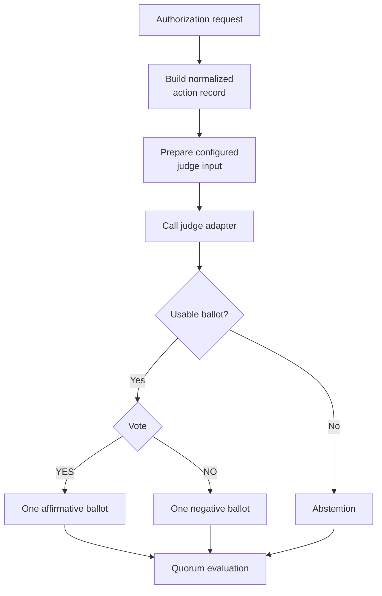
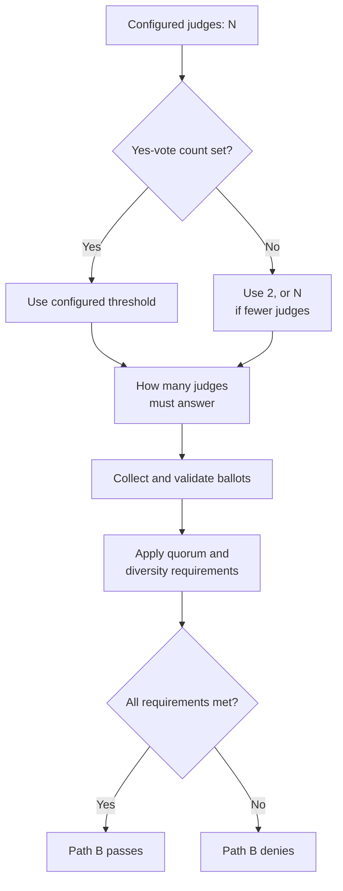
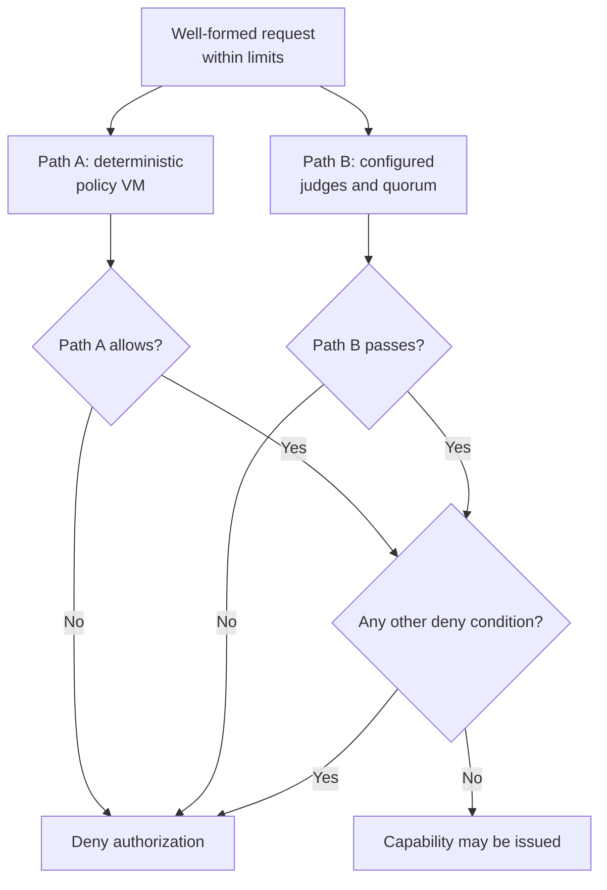
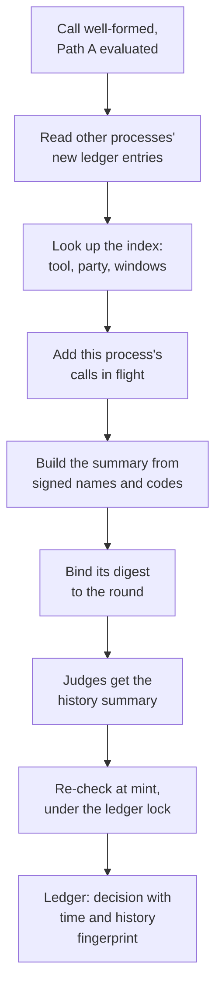

<!--
Copyright 2026 Insomniac-VibeLabs
Author: Stephan Busch
SPDX-License-Identifier: Apache-2.0
-->

# Judges and quorum

This document describes judge and quorum behavior in `two-key` 0.7.3 (tag `v0.7.3` on `main`). It is not an independent review or a claim of formal verification. If this document disagrees with the implementation, the code wins; correct the document after verifying the intended behavior.

See [THREAT_MODEL.md](THREAT_MODEL.md) for the threat register, [SCOPE.md](SCOPE.md) for the project's boundaries, and [FIT.md](FIT.md) for when this package is or is not suitable.

## Contents

<!-- toc -->
- [What a judge is](#what-a-judge-is)
- [One judge](#one-judge)
- [The quorum threshold](#the-quorum-threshold)
- [YES, NO, and ABSTAIN](#yes-no-and-abstain)
- [Diversity and local judges](#diversity-and-local-judges)
- [How Path A and Path B combine](#how-path-a-and-path-b-combine)
- [Judge history](#judge-history)
- [Ballot records](#ballot-records)
- [What a quorum pass means](#what-a-quorum-pass-means)
- [Operator checklist](#operator-checklist)
- [Implementation references](#implementation-references)
<!-- /toc -->

## What a judge is

A Path B judge is a configured evaluator that returns a ballot on an authorization attempt. A judge is not the authorization system by itself, and an affirmative ballot is not proof that an action is safe.

The operator configures the judges. Two-Key requires at least one judge and performs startup checks to prevent a judge from sharing the monitored agent's credential or qualifying as the same agent under the configured identity checks.

A ballot is affirmative, negative, or unusable. A missing, malformed, errored, mismatched, or timed-out ballot cannot count as an affirmative vote.

Each ballot is one stateless request. Two-Key's judge adapters send a system prompt and one user message (the normalized record, and the proposal text when configured) at temperature 0, with no earlier calls. So the same request gets the same answer, and two judges on one model answer word for word alike: they fail together, which is why `high_assurance` asks for two makers.

A judge endpoint that keeps its own memory across ballots (a persistent agent, or a chat with saved memory) changes this. Every earlier call's agent-written text is then in the judge's context, so an injection in one call can steer the vote on a later one, and the ledger cannot explain a vote that depends on that memory. Two-Key cannot see or detect it. The judge's identity, credential, and service can be long-lived; give it a fresh context for every ballot. A history of recent decisions is planned as a summary Two-Key builds from its own ledger, with structured fields only (#1, before 1.0; [ROADMAP.md](../ROADMAP.md)).

## One judge



*One judge's ballot becomes an affirmative, a negative or an abstention. It is not the final authorization decision.*

The convenor checks ballot identity and binding. A ballot that reports inconsistent binding hashes becomes an abstention. With `ballot_binding="echo"`, a judge must also return the required binding information itself.

By default, `judge_inputs="record_only"` gives judges the normalized action record and constitution, not the agent's proposal text. `judge_inputs="record_and_proposal"` permits the proposal to be included. After a derive deny, tool arguments are withheld unless `tool_args_on_derive_deny=True`. Path B still runs either way.

## The quorum threshold

The quorum policy separates the affirmative threshold (`required_yes`) from the minimum number of valid responses (`min_responding`).

- `required_yes` is the number of affirmative ballots needed to pass the vote threshold.
- `min_responding` is the minimum number of valid ballots required before the round can be counted.
- If `required_yes` is unset, Two-Key resolves it to `min(2, number_of_judges)`.
- If `min_responding` is unset, it follows the effective `required_yes`.



*The threshold defaults to the smaller of 2 and the number of judges when `required_yes` is not set.*

With the default policy:

| Configured judges | Required YES ballots |
| ---: | ---: |
| 1 | 1 |
| 2 | 2 |
| 3 | 2 |
| 4 | 2 |
| 5 | 2 |

This is **not a majority rule**. Two affirmative ballots can meet the default threshold with five configured judges. Operators who need a majority or unanimity must configure an appropriate `required_yes` value.

**With `required_yes: 1` and two or more judges, one judge approves a call alone whenever the others are down, time out, or abstain,** because `min_responding` then follows `required_yes` and is 1. In live run 6x a 1-of-2 deployment executed a call with judge B on a dead port. `TwoKey` prints a `two-key: WARNING: quorum: required_yes 1 with N judges and min_responding 1 ...` line at start. Set `min_responding` to the number of judges to require every judge to answer, or `required_yes: 2` for two approvals.

### Warnings about a lenient quorum

Some quorums are allowed but let a call through on little. `two-key config check` prints a `WARN` line for each,
and `two-key setup` shows them after you give the quorum numbers ([SETUP](SETUP.md#the-quorum-numbers)). None of
them refuses; each may be what you meant.

| Warning | Why it is lenient | What tightens it |
| --- | --- | --- |
| One judge decides every call | Its yes alone approves a call | A second judge from another maker, and `required_yes: 2` |
| One judge approves a call alone while the others are down | `required_yes: 1` with `min_responding: 1` (above) | `min_responding` equal to the number of judges, or `required_yes: 2` |
| `required_yes` is half the judges or fewer | A minority of the judges approves a call | `required_yes` above half the judges |
| Every judge comes from one provider | An outage or a change on that provider's side reaches every ballot | A judge from another provider, and `min_distinct_providers: 2` |
| Every judge's model comes from one maker | The judges share that maker's blind spots | A judge from another maker, and `min_makers: 2` |

The configured set must be capable of satisfying the policy. If the affirmative threshold, response floor, provider floor, or judge-set diversity requirements cannot be met, configuration may be rejected at startup. `convene` also denies when the configured policy cannot be met.

## YES, NO, and ABSTAIN

The quorum evaluator distinguishes affirmative ballots, negative ballots, and abstentions.

- **YES:** a usable affirmative ballot.
- **NO:** a usable negative ballot.
- **ABSTAIN:** a missing, malformed, errored, timed-out, identity-mismatched, binding-mismatched, or otherwise unusable ballot.

An abstention is never a YES. If fewer than `min_responding` valid ballots arrive, the round denies without counting the vote tally. The recorded result has `counted=False` and does not report a YES/NO tally.

Judges run in parallel by default, under the overall `timeout_seconds` deadline (45 seconds by default). Two-Key refuses a configuration without a positive hard deadline. A judge that does not return a usable ballot by the deadline cannot supply a YES for that round.

## Diversity and local judges

The default policy has minimal diversity requirements:

- `min_makers=1`.
- `min_local_judges=0`.
- `require_local_yes=False`.
- `min_distinct_providers=1`.

A provider floor of one does not require provider diversity. The default policy does not require a local judge or a local affirmative vote.

`QuorumPolicy.high_assurance()` opts into stronger requirements:

- At least two distinct model-maker labels.
- At least one local judge.
- An affirmative vote from a local judge.
- `required_yes=2` by default, unless the caller overrides it.
- Two-Key does not start when another account could change a file or
  folder it runs or reads (`writable_path`, docs/CONNECTING.md), and
  `on_writable_paths: warn` is refused.

`QuorumPolicy.section4()` applies those same diversity requirements and sets `require_path_a_first=True`. In the current implementation, however, `TwoKey.authorize` does not read that flag to skip Path B. Both paths run once a request is well-formed and within limits; the one exception is a call Path A cannot read under its spec (`derive_failed:`), which is not sent to the judges unless `tool_args_on_derive_deny` is set.

These requirements do not prove that judges are independent:

- A judge's maker label is operator-supplied configuration, not an independently verified claim about model ownership.
- Locality is determined by the configured judge's effective locality checks. It is not hardware or model attestation.
- Different provider names or maker labels do not establish statistical, organizational, or operational independence.
- With `heterogeneity_scope="responding"`, the diversity floor also applies to the judges that return valid ballots; the default is `"selection"`.

For high-impact tools, configure the judge set deliberately, check the actual endpoints and credentials, and choose thresholds according to the risk.

## How Path A and Path B combine

Path A evaluates deterministic policy rules against the normalized structured action record. Path B evaluates the action using the configured judge quorum. Neither path alone is sufficient for authorization.



*Both paths must allow, and no other deny condition may remain, before a capability can be issued.*

The final decision allows the action only if Path A allows, the quorum passes, and no other deny condition remains. Capability issuance can still fail, including when the issuer key is unavailable or a required ledger write fails.

A Path A deny does not skip Path B. After a derive deny, judge input omits argument bytes by default. A call that cannot be read under its spec (`derive_failed:`) is the one exception: the judges would get a form with nothing derived in it and no arguments, so they are not asked, and Path B is ledgered as `skipped:derive_failed` (0.5.0). With `tool_args_on_derive_deny: true` they see the arguments and are asked. A mismatch (`amount_mismatch` and the like) and a rule deny still go to the judges. `require_path_a_first` does not change this behavior.

With a content scanner configured (0.6.0), a scanned call reaches the judges with a trusted `<scan_result>` section (scanner label, verdict, categories) before the untrusted record, and each declared file appears in the record as its digest and size, never its content. When the verdict is flagged, the arguments and the proposal are withheld unless the quorum sets `tool_args_on_scan_flag: true`. The verdict `encrypted` (an encrypted file on a tool the principal signed `encrypted: pass`) comes with a line saying the scanner could not look inside, and the arguments are sent. A scan deny is a Path A deny, so the judges still vote. See [SCANNERS.md](SCANNERS.md).

Malformed or oversized requests can be denied before either path runs.

## Judge history

Since 0.8.0, judges no longer see each call on its own. Before they are asked, Two-Key writes a short summary of
recent decisions from its own ledger and adds it to their prompt in a `<decision_history>` section. A duplicate
bill, a payment split into small pieces, or a burst of denied attempts can then look unusual even when each call
looks normal by itself. It is on by default; `quorum.judge_history.enabled: false` turns it off, and then every
judge prompt is byte for byte what 0.7.3 sent.



*The summary is built from an in-memory index after Path A, and its digest is ledgered with the decision.*

What the summary holds:

- **For the call's tool and counterparty**: the last decisions (10 by default, newest first) with their age,
  outcome, reason code and amount; the days since the last call that was allowed **and actually ran** (its token
  was redeemed); the allowed totals over 7, 30 and 90 days; approved calls whose token has not been used yet
  (`approved_not_run`, at most five minutes old, so a duplicate approved seconds ago is not invisible); denies in
  the last hour and day by reason code; this process's other calls to the same tool and party still being decided
  (`in_flight`); and, with a content scanner, the scan verdicts of the last 7 days. This part appears only for a
  tool with a signed spec. The counterparty is shown only when it is on that tool's signed allow list: as itself
  for an exact entry, or as the signed `@domain` entry an address matched. A call with no such party is compared
  with every call to the tool (`"counterparty": null`). Amounts appear only for a tool whose spec maps one.
- **For all tools**: allowed calls, denies by reason code, abstaining ballots, declines and malformed calls over
  the last hour and the last day.
- **For the agent**: its recent *attempt episodes*, bursts of at least `burst_denies` (5) denied calls within
  `burst_minutes` (10). The agent is named only when its id is one the operator configured (`agent_id` in
  `proxy.yaml`, or a monitored agent's id); any other agent is `unnamed`. Each episode is also written to the
  ledger as `attempt_episode` and sent to the SIEM, so an operator sees it without the judges.
- `now`, and `history_starts`, the time of the oldest dated decision, so a judge can tell "nothing in 90 days" from
  "history began yesterday". A ledger upgraded from 0.7.3 shows its older decisions with `"age": "before_upgrade"`;
  they count in no window, which fill up over the next 90 days.
- The two labels answer different questions. `before_upgrade` is a decision's age: it has no time, so it shows only
  in the tool's last decisions, which list every agent's calls. `unnamed` is an agent: a dated decision or
  episode whose agent id the operator did not configure. Setting `agent_id` later never moves older decisions
  under the new id; an undated one stays `before_upgrade`, and a dated one stays `unnamed`.

**The agent's text never reaches a judge through the summary.** Tool names, counterparties, arguments, proposals,
decline text and error details are all agent-controlled, and none of them is copied in. Every string is a signed
tool id, a signed allow entry, a reason code from a fixed list (`derive_failed:<detail>` loses its detail;
`rule_denied:<id>` keeps the signed rule id), an operator-configured agent id or `unnamed`, a scan verdict, or a time
Two-Key wrote. The section is escaped like the record, and the system prompt gains one sentence saying it is
written by Two-Key and describes the past, not the principal's wishes.

**Binding.** The digest of the summary (`history_hash`) is stamped on every ballot of the round, and the decision
entry records it as `history_digest`, with the time and ledger size it was built from (`history_basis`).
`two-key audit --check-history constitution.signed.json` rebuilds every summary from the ledger and checks each
digest. On a ledger two proxies share, each loaded with its own agent ids, a decision is confirmed when the settings
of any of them rebuild its digest.

**When the summary cannot be built** (`on_failure`): `deny` (the default) denies the call with
`internal_error:history` without asking the judges; `judge_without_history` asks them without it. Either way a
`judge_history_failed` entry names the error class, and it goes to the SIEM.

**Two calls at once.** Calls still being decided in the same process count as `in_flight` for each other. Calls
decided by two processes sharing one ledger cannot see each other in flight, so just before a token is issued,
under the ledger lock and after reading what the other process wrote, Two-Key checks whether an approved call for
the same signed tool and counterparty was written after this round's summary was built. If one was, this call is
denied `history_changed` with no token, and the agent's retry is judged with the new history. The cost is a rare
extra deny when two legitimate calls to one party race. `two-key mcp-proxy` also lets only one proxy serve an agent
on a ledger at a time (`one_proxy_per_agent`, on by default): a second refuses to start with
`agent_already_connected`.

**What the judges need from you.** They decide what is normal from the constitution's prose, so say it there: "we
pay acme-supplies once a month, about $1,200"; "never pay the same invoice twice"; "at most a handful of external
emails an hour". See [HOWTO](HOWTO.md#describing-normal-activity-for-the-judges).

Cloud judges receive the summary on every call: signed tool ids, allow-listed counterparties, amounts, counts and
times. Turn it off, or use local judges, if that history should not leave your machine
([HOWTO, Known trade-offs](HOWTO.md#known-trade-offs-by-configuration)).

## Ballot records

Since 0.8.0 the `path_b` ledger entry keeps one record per judge, in the configured order, besides the tally:

```json
{"judge_id": "local-llama", "vote": "yes", "confidence": 0.82, "error_class": null,
 "rationale_digest": "hmac-sha256:5f1c..."}
```

So a pass with one judge down can be told from the ledger: `yes: 2, abstain: 1`, and the third record says
`error_class: timeout`. The error class comes from a fixed list (`timeout`, `transport`, `http` with
`http_status`, `credential`, `malformed_ballot`, `malformed_response`, `binding_mismatch`, `unbound_ballot`,
`judge_id_mismatch`, `invalid_ballot`, `ballot_mac_mismatch`, `cloud_judge_session_required`,
`cloud_judge_reused_agent_session`, `empty_constitution`, `other`), never the error text, which could quote an HTTP
body. The rationale is never stored: `rationale_digest` is an HMAC-SHA256 of it under the install's fingerprint key
(`ballot_digest_key_id` names the key), so a copy in a SIEM cannot be matched by guessing short rationales, while
you, holding the key, can match one from a judge's own logs. A Path B round that never asked the judges records
`ballots: []`.

## What a quorum pass means

A quorum pass means the configured Path B requirements were met for that authorization attempt. It does not establish that:

- The judges are correct, infallible, or independent.
- The maker labels are truthful.
- The proposal or action is safe in every relevant context.
- The payload has been scanned for malware, data loss, or sensitive information. That holds only for a tool the signed constitution marks for scanning with a content scanner configured (0.6.0), and then the judges were told the verdict, not shown the content; see [SCANNERS.md](SCANNERS.md).
- The deployment has been independently audited or formally verified.
- The package is a FIPS 140-3 validated cryptographic module.

The capability and gateway controls add restrictions but do not eliminate these limitations. The capability private key is separate from the gateway verifier's key, but the gateway shares the Two-Key process and ledger object; a gateway in another process or host is not supported, by design ([why](HOWTO.md#deployment-boundary-the-gateway-runs-in-the-twokey-process)). There is no process-level isolation between them; see [THREAT_MODEL.md](THREAT_MODEL.md).

## Operator checklist

Before relying on a deployment:

1. Configure the monitored agent and at least one judge explicitly.
2. Confirm that judge identities and credentials match the actual deployment.
3. Set `required_yes` and `min_responding` intentionally. Do not assume the default is a majority. With `required_yes: 1` and more than one judge, set `min_responding` too, or one judge decides alone while the others are down.
4. For higher-impact actions, consider `QuorumPolicy.high_assurance()` and check the configured local judge and maker labels.
5. Decide whether judges receive only the normalized record or also the proposal text.
6. Give each judge a fresh context for every ballot: turn off any memory its endpoint keeps across requests.
7. Review `tool_args_on_derive_deny`; argument bytes are withheld by default after a derive deny, and a call that cannot be read is then not sent to the judges at all. With a content scanner, review `tool_args_on_scan_flag` the same way.
8. Test timeout, malformed ballot, binding mismatch, insufficient response, and deny cases.
9. Describe normal activity in the constitution's prose (how often, how much, to whom), so the judges can use the
   decision history; decide whether cloud judges may receive it.
10. Read [THREAT_MODEL.md](THREAT_MODEL.md) and [FIT.md](FIT.md) before deployment.

## Implementation references

- [`two_key/quorum.py`](../two_key/quorum.py) — quorum policy, threshold resolution, ballot validation, response floors, and diversity requirements.
- [`two_key/core.py`](../two_key/core.py) — Path A/Path B execution and final authorization decision.
- [`two_key/history.py`](../two_key/history.py) — the judge history summary and its index.
- [THREAT_MODEL.md](THREAT_MODEL.md) — threats, assumptions, and residual risks.
- [SCOPE.md](SCOPE.md) — project boundaries.
- [FIT.md](FIT.md) — intended users and reasons not to use this package.
