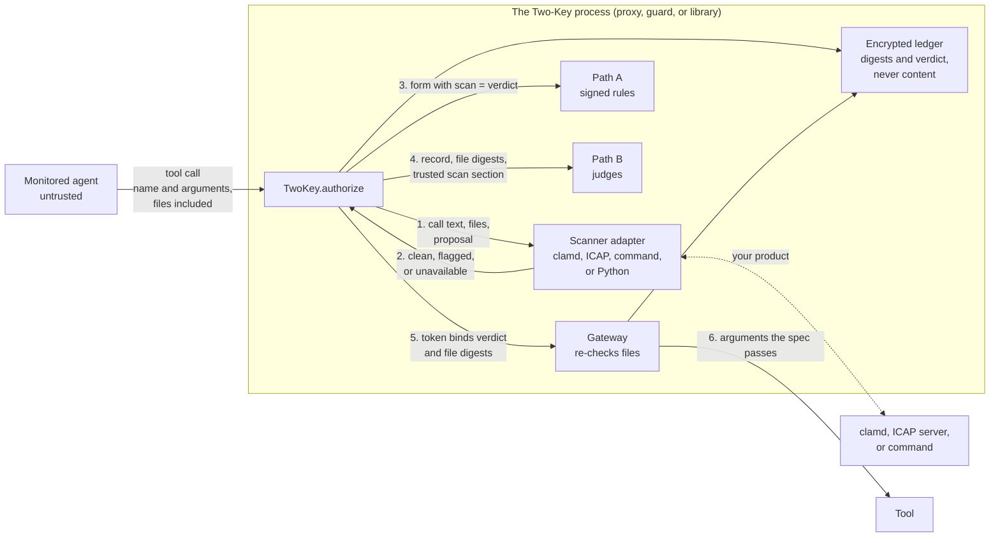
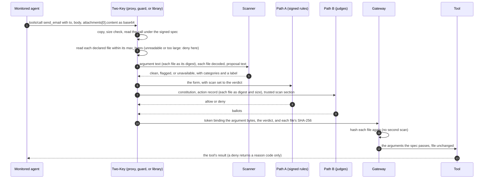
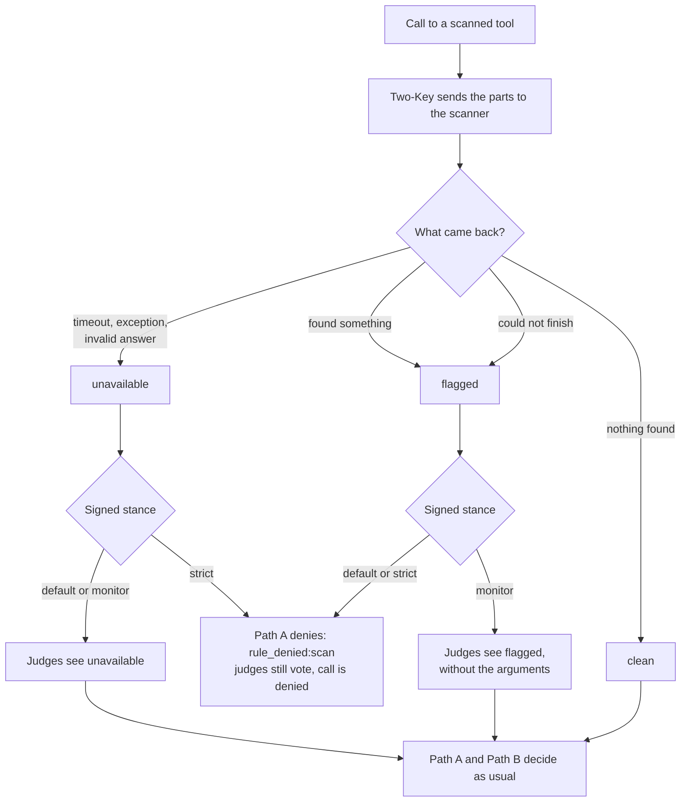
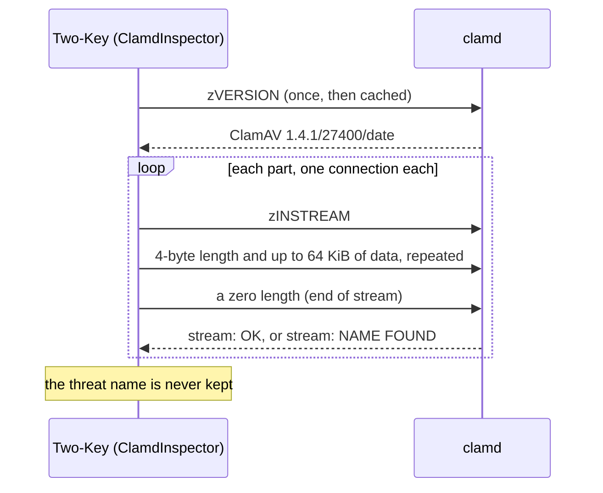
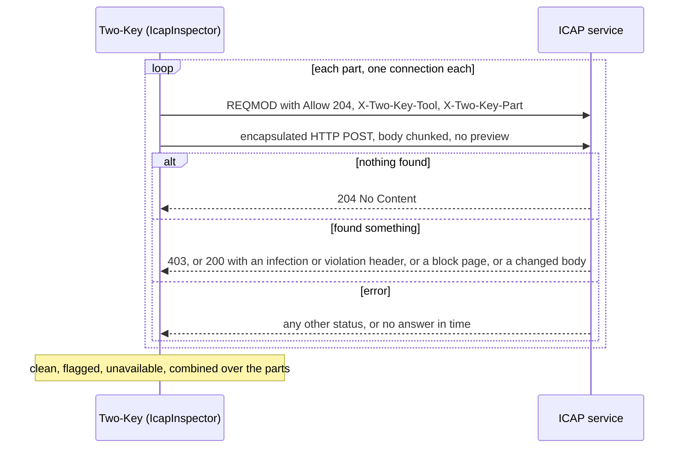

# Connect an antivirus or DLP product

This guide is for operators who want an antivirus or data loss prevention
(DLP) product to look at every tool call before Two-Key's two keys decide,
and for vendors who build that connection. It describes content scanning on
the `working` branch (0.6.0, not yet released). Two-Key is beta and not
independently audited. If this guide disagrees with the code, the code wins.

Two-Key has no scanning engine of its own. It calls a product you already
run: ClamAV's `clamd`, any product that offers an ICAP service, a command,
or your own Python code. For the steps to turn it on, see HOWTO
[Scan content with an antivirus or DLP product](HOWTO.md#scan-content-with-an-antivirus-or-dlp-product);
[examples/scanning.yaml](../examples/scanning.yaml) is a rules file to start
from.

## Contents

<!-- toc -->
- [In plain words](#in-plain-words)
- [Where the scanner sits](#where-the-scanner-sits)
- [What the agent can and cannot do](#what-the-agent-can-and-cannot-do)
- [A call with an attached file](#a-call-with-an-attached-file)
- [Verdict and stance](#verdict-and-stance)
- [Encrypted files](#encrypted-files)
- [ClamAV](#clamav)
- [ICAP products](#icap-products)
- [Command-line scanners](#command-line-scanners)
- [Your own scanner in Python](#your-own-scanner-in-python)
- [Files sent by path](#files-sent-by-path)
- [What is recorded](#what-is-recorded)
- [Warnings and troubleshooting](#warnings-and-troubleshooting)
- [What scanning does not do](#what-scanning-does-not-do)
<!-- /toc -->

## In plain words

For each call to a tool your signed constitution marks as scanned, Two-Key
sends the call's text, each attached file, and the agent's stated reason to
your scanner. The scanner answers one of three things:

- **clean**: it found nothing;
- **flagged**: it found malware, a secret, a card number, personal or health
  data, or something your product's policy blocks; or it could not finish;
- **unavailable**: it was down, errored, or ran out of time.

An encrypted file the product could not look inside is flagged, unless you
signed that tool to pass encrypted files ([Encrypted files](#encrypted-files)).

Two-Key turns that answer into a fact (`scan`) that your signed rules decide
on, tells the judges, and records it in the ledger. The scanner never
decides alone. Its findings never put content in the ledger, a reason code,
or a judge's prompt.

The agent does not ask for a scan and cannot avoid one. It sends an ordinary
tool call, with whatever file the tool needs, and never sees or sets the
result. You set the largest file each tool takes; a file that is too large,
or that Two-Key cannot read, is refused before the scan and before either
key, whatever the stance.

## Where the scanner sits



The scan runs inside `authorize`, after the call reads under its signed spec
and before Path A. A call that cannot be read is denied before any scan, and
so is a call with a declared file Two-Key cannot read or one over a size
limit ([File size limits](#file-size-limits)).

## What the agent can and cannot do

The agent may be adversarial or simply wrong, so nothing it writes decides
whether, what, or how a call is scanned.

| Decision | Made by | Where |
| --- | --- | --- |
| Which tools are scanned | The principal | Signed constitution: the tool maps the `scan` field |
| What the rules do with the verdict (the stance) | The principal | Signed constitution: the `scan` rule |
| Which arguments hold a file, and how | The operator | `proxy.yaml` `tools.<id>.files`, or `Scanner(files=...)` |
| Which scanner, and its time limit | The operator | `proxy.yaml` `scan:`, or `TwoKey(scanner=...)` |
| The largest file each file argument takes | The operator | `max_bytes` on each declared file |
| Starting the scan | Two-Key | Every call to a scanned tool, from every entry point |
| The verdict | The scanner, through Two-Key | Two-Key fills the `scan` fact itself |

- **It sends a normal call:** the tool's name and the arguments the tool's
  schema asks for, files included. Nothing in its arguments, claim, or
  proposal turns a scan on or off, picks what is scanned, or names a
  scanner.
- **It cannot write the verdict.** `scan` in the arguments is a deny
  (`derive_failed:caller_field_in_arguments:scan`). With a scanner
  configured, `scan` in an integration's `facts=` is a deny too
  (`derive_failed:scan_fact_supplied`), and so is a `scan` fact at the
  gateway (`fact_mismatch`). The MCP proxy never shows `scan` in a tool's
  `inputSchema`.
- **It cannot hide content.** Every argument is scanned, including keys the
  tool will not receive (the judges can see them), each declared file
  decoded, and the proposal text.
- **It cannot slip a file past unscanned.** A declared file that cannot be
  read is denied, not skipped, under every stance: base64 that does not
  decode, a value of the wrong type, a path outside its folder, a link, a
  missing file (`file_unreadable`).
- **It cannot fill a disk or memory through a call.** A file over its
  `max_bytes`, more than 32 files, or more than 100 MiB of files in one call
  is denied under every stance, and nothing past the limit is read.
- **It learns** the tool's result, or a reason code naming the rule (for
  example `rule_denied:scan`). Never the categories, the scanner, or any
  matched text.

## A call with an attached file

The agent never talks to Path A or Path B. It sends one tool call, and
Two-Key builds what each party receives from it.



A file travels as an ordinary argument from every entry point:

| Entry point | What the agent sends |
| --- | --- |
| MCP proxy (`two-key mcp-proxy`) | `tools/call` with `name` and `arguments`; the file is one of the arguments |
| Guard (LangChain, the OpenAI Agents SDK, your own loop) | The framework calls the guarded function with the arguments |
| `authorize_from_agent` | The proposal JSON's `arguments` |

A tool takes a file in one of two ways, fixed by the tool's own schema. You
declare which, per argument, with the largest file the tool needs:

| `kind` | The argument holds | `max_bytes` | What binds it |
| --- | --- | --- | --- |
| `base64` or `base64url` | The file's bytes, encoded | Required, at most 196,608 (the call is at most 256 KiB) | The bytes are inside the token-bound arguments |
| `path` | A path to a file in a folder you declare | Required, at most 104,857,600 (100 MiB) | Two-Key reads the file and binds its SHA-256 into the token; the gateway hashes it again just before the tool runs |

```yaml
# proxy.yaml
tools:
  send_email:
    files:
      - {path: "attachments[].content", kind: base64, max_bytes: 65536}   # [] means each item of the list
  print_document:
    files:
      - {path: file_path, kind: path, folder: /srv/print-queue, max_bytes: 20971520}
```

Where a tool offers both (the content or a path), declare and use the
content: a file inside the call cannot change after the scan and cannot
point outside a folder ([Files sent by path](#files-sent-by-path)).

A `files` path must lie under an argument the signed spec passes to the tool
(a `payload` path), and its tool must map `scan`; otherwise Two-Key refuses
to start. `two-key mcp-draft-specs` suggests these entries from the
upstream schema (a string with `contentEncoding: base64`, `format: byte` or
`binary`, a `contentMediaType`, or a file-like name such as `file_path`),
commented out for you to review, with `max_bytes: REPLACE_WITH_BYTES`. The
proxy warns at start about an input of a scanned tool that looks like a file
but is not declared: it is scanned as text, not decoded.

### File size limits

You know what size of file each tool needs, so you state it: every declared
file has a `max_bytes`, with no default, and Two-Key refuses to start
without one. Each call is also held to fixed limits:

| Limit | Value | Deny |
| --- | --- | --- |
| One file | its `max_bytes` | `file_too_large` |
| Files in one call (each item of a list counts) | 32 | `too_many_files` |
| All files in one call together | 100 MiB | `call_files_too_large` |

These are checks on the call, like the 256 KiB argument cap, not on the
verdict. A call over a limit is denied before the scanner and both keys,
under every stance (monitor too), and the judges are not asked. Two-Key
counts the files before reading any, does not open a path file whose size
is over its limit, and stops reading one that grows past it. The ledger's
`decision` entry records the file's argument path and the sizes
(`file_denied`), never content; the agent gets the reason code.

The limits hold per call. Many calls can still add up, so a tool that saves
what it receives needs its own disk quota.

Who gets what:

| Party | Gets | Never gets |
| --- | --- | --- |
| Scanner | All argument text, each declared file's bytes, the proposal text | Keys, the ledger, other calls |
| Path A | The form: tool, amount, data class, counterparty, irreversible, custom fields, and `scan` | Any text or file content |
| Path B (judges) | The constitution; the action record, each file replaced by `{"two_key_file": {"sha256": ..., "bytes": ...}}` (and the path for a path file); a trusted `<scan_result>` section with the scanner label, verdict, and categories | File content, ever. When flagged: no arguments and no proposal text, unless the quorum sets `tool_args_on_scan_flag: true`. A call with an unreadable or oversized file never reaches them |
| Ledger | Each part's size and SHA-256, the verdict, categories, scanner label and version, elapsed time | Content |
| Tool | The arguments the signed spec passes, the file as sent | The verdict, unless its spec delivers the field |
| Agent | The tool's result, or a reason code | The verdict details, the scanner, matched text |

## Verdict and stance

The stance is the rule you sign on the `scan` field. Two-Key reads it from
the signed constitution at start and prints it.

```yaml
fields:
  scan: {type: enum, values: [clean, flagged, unavailable], default: clean, source: caller}
tool_specs:
  send_email:
    # ...
    fields: {scan: {source: caller}}     # scanned
  lookup:
    # ...
    fields: {scan: not_applicable}       # not scanned, and listed at start
hard_rules:
  - {id: scan, deny_if_fields: {scan: {eq: flagged}}}                    # default stance
  # - {id: scan, deny_if_fields: {scan: {in: [flagged, unavailable]}}}   # strict stance, instead
  # monitor: no rule; the verdict is recorded and shown to the judges
```



| Verdict | default | strict | monitor |
| --- | --- | --- | --- |
| clean | both keys decide | both keys decide | both keys decide |
| flagged | deny | deny | both keys decide; judges see flagged without the arguments |
| unavailable | both keys decide; judges see unavailable | deny | both keys decide; judges see unavailable |

Two-Key, not the adapter, settles the edge cases:

- A timeout, an exception, or an answer it cannot read is `unavailable`,
  never `clean`.
- A result naming `limits_exceeded`, `unreadable`, or `encrypted` (the
  scanner could not finish, or could not look inside) is `flagged`. The one
  exception is `encrypted` alone on a tool you signed to pass it
  ([Encrypted files](#encrypted-files)).
- A declared file Two-Key itself cannot read, or one over a size limit, is
  denied before the scan under every stance; it never becomes a verdict.
- Monitor never blocks on the verdict. Use it to tune your product's
  policy, then sign default or strict.
- `high_assurance` without the strict stance prints a warning at start.

## Encrypted files

An antivirus or DLP product can't see inside an encrypted file. By default
Two-Key treats an encrypted file the product reports as `flagged`, so the
default and strict stances deny it. When a tool needs to move encrypted
files, you can sign that tool to pass them, and leave scanning to wherever
the file is decrypted.

Encrypting a file is also the easiest way past a scanner: an agent that
wants to send out patient data, or deliver malware, only has to put it in a
password-protected zip. So the pass is per tool, signed, and off by
default. Opt in where the file goes into your own systems (a vault that
decrypts and scans it), or where the tool's recipients are on its signed
allow list. Avoid it on a tool that sends files to anyone.

```yaml
fields:
  scan: {type: enum, values: [clean, flagged, unavailable, encrypted], default: clean, source: caller}
tool_specs:
  upload_to_vault:
    # ...
    fields: {scan: {source: caller, encrypted: pass}}   # encrypted files pass on this tool
  send_email:
    # ...
    fields: {scan: {source: caller}}                    # an encrypted file is flagged here
```

The fourth value, `encrypted`, is required once any tool says
`encrypted: pass`, and refused when none does. `encrypted: pass` is valid
only on the scan field. A constitution without it signs byte for byte as
before. `sign-constitution` prints a warning naming each tool that passes
encrypted files, and Two-Key lists them at start.

| What the scanner reports | Tool with `encrypted: pass` | Any other tool |
| --- | --- | --- |
| `encrypted` and nothing else | `encrypted`: no stance denies it | `flagged` |
| `encrypted` and anything else (malware, a secret, could not finish) | `flagged` | `flagged` |
| `encrypted`, and another part could not be scanned | `unavailable` (strict denies it) | `flagged` |

- The judges see the verdict `encrypted` in the trusted scan section, with
  a line saying what it means, and get the arguments: nothing was found,
  so nothing is withheld. They can still weigh who the file goes to.
- The ledger's `scan` entry has `"verdict": "encrypted"` and the category.
  The token binds the verdict, and the gateway refuses it for a tool that
  does not pass encrypted files (`scan_mismatch`).
- You can still rule on it: a rule such as
  `{deny_if_fields: {scan: {eq: encrypted}, recipient_zone: {eq: external}}}`
  denies encrypted files to outside recipients only (`recipient_zone` being
  a field of your own). A rule on `scan` alone
  that denies `encrypted` makes the pass do nothing, and Two-Key says so at
  start.
- The file limits still apply under every stance: `max_bytes`, unreadable
  files, 32 files, 100 MiB.

What each product reports as encrypted:

| Product | Encrypted when |
| --- | --- |
| `clamd` | It answers `Heuristics.Encrypted...` (needs `AlertEncrypted yes`) |
| ICAP | Every infection header names only `Heuristics.Encrypted...` (c-icap and squidclamav pass on ClamAV's names); any other name is `malware` |
| Command | Exit 1 with the first line `two-key-categories: encrypted` |
| Python | `ScanResult.flagged("encrypted")` |

Raw ciphertext (PGP, age, S/MIME, a custom format) has no structure a
scanner recognizes, so most products answer clean, and it passes on every
tool whatever this setting says. Only a container the product recognizes
as encrypted (a zip, rar, or 7z archive, a PDF or Office file with a
password) is reported as `encrypted`.

## ClamAV

ClamAV's `clamd` is free and runs on Linux, macOS, and Windows. Two-Key
streams each part to it with `INSTREAM`; nothing is written to disk.

```yaml
# proxy.yaml
scan:
  type: clamd
  address: 127.0.0.1:3310          # or unix:/run/clamav/clamd.ctl on Linux and macOS
  timeout_seconds: 15
```

In code: `Scanner(ClamdInspector("127.0.0.1:3310"), files=...)` from
`two_key.scan` and `two_key.scanners`.



### Run clamd

Linux (Debian, Ubuntu):

```bash
sudo apt install clamav-daemon clamav-freshclam    # freshclam keeps the signatures current
# /etc/clamav/clamd.conf: add TCPSocket 3310 and TCPAddr 127.0.0.1,
# or keep the default LocalSocket and use address: unix:/var/run/clamav/clamd.ctl
sudo systemctl restart clamav-daemon
```

Linux (Fedora, RHEL):

```bash
sudo dnf install clamd clamav-update
# /etc/clamd.d/scan.conf: uncomment TCPSocket 3310 and TCPAddr 127.0.0.1
sudo freshclam
sudo systemctl enable --now clamd@scan
```

macOS (Homebrew):

```bash
brew install clamav
cd "$(brew --prefix)/etc/clamav"
cp freshclam.conf.sample freshclam.conf && sed -i '' 's/^Example/#Example/' freshclam.conf
cp clamd.conf.sample clamd.conf && sed -i '' 's/^Example/#Example/' clamd.conf
# clamd.conf: add TCPSocket 3310 and TCPAddr 127.0.0.1
freshclam
"$(brew --prefix)/sbin/clamd"
```

Windows (the ClamAV installer from clamav.net, in an elevated PowerShell):

```powershell
cd "C:\Program Files\ClamAV"
copy .\conf_examples\freshclam.conf.sample .\freshclam.conf
copy .\conf_examples\clamd.conf.sample .\clamd.conf
# In both files, comment out the line "Example". In clamd.conf set TCPSocket 3310 and TCPAddr 127.0.0.1.
.\freshclam.exe
.\clamd.exe            # or run it as a service: see ClamAV's Windows documentation
```

The user that runs Two-Key must be able to reach the socket. For a unix
socket, check `LocalSocketGroup` and `LocalSocketMode` in `clamd.conf`.

### The clamd.conf lines that matter

| Line | Why |
| --- | --- |
| `TCPSocket 3310` and `TCPAddr 127.0.0.1` | `clamd` has no authentication. Listen on loopback, or on a private network only Two-Key can reach. |
| `StreamMaxLength` | The largest stream `clamd` accepts. Set it at least to your largest `max_bytes`. Over it, `clamd` replies `INSTREAM size limit exceeded`, which is `flagged` (`limits_exceeded`). |
| `MaxFileSize`, `MaxScanSize` | Past these, `clamd` stops looking inside a file. |
| `AlertExceedsMax yes` | Reports a file it stopped scanning as `Heuristics.Limits.Exceeded`, which is `flagged` (`limits_exceeded`). Without it, a partly scanned file is `OK`. Recommended. |
| `AlertEncrypted yes` | Reports an encrypted archive or document as `Heuristics.Encrypted`, which is `flagged` (`encrypted`), or passes on a tool signed `encrypted: pass`. Without it, an encrypted file is `OK` on every tool. Recommended. |
| `HeuristicScanPrecedence no` | ClamAV's default. ClamAV keeps scanning after a heuristic finding, so malware in a readable part of an encrypted archive is reported instead of `Heuristics.Encrypted`. Keep it off when a tool passes encrypted files. |

### What each reply means

| `clamd` reply | Verdict | Category |
| --- | --- | --- |
| `stream: OK` | clean | |
| `stream: <name> FOUND` | flagged | `malware` (the name is not kept) |
| `stream: Heuristics.Limits.Exceeded... FOUND` | flagged | `limits_exceeded` |
| `stream: Heuristics.Encrypted... FOUND` | flagged (or `encrypted` on a tool that passes it) | `encrypted` |
| `INSTREAM size limit exceeded. ERROR` | flagged | `limits_exceeded` |
| Anything else, no reply, refused, or out of time | unavailable | |

### Test with EICAR

EICAR is a harmless test file every antivirus product detects. The snippet
builds it from pieces so this guide is not flagged itself:

```python
import time
from two_key.scan import ScanPart, ScanRequest
from two_key.scanners import ClamdInspector

eicar = "".join(["X5O!P%@AP[4\\PZX54(P^)7CC)7}$", "EICAR-STANDARD-", "ANTIVIRUS-TEST-", "FILE!$H+H*"]).encode()
request = ScanRequest("test", (ScanPart("file:test", eicar),), time.monotonic() + 15)
print(ClamdInspector("127.0.0.1:3310").inspect(request))
# ScanResult(verdict='flagged', categories=('malware',), scanner='clamav', version='1.4.1/27400')
```

Then send the same bytes, base64-encoded, as a declared file argument
through your proxy or guard: the call is denied with `rule_denied:scan`
(default or strict stance) and the ledger has a `scan` entry with
`"verdict": "flagged"`.

## ICAP products

Most commercial antivirus and DLP products, and many web gateways, offer an
ICAP service (RFC 3507). Two-Key is an ICAP client: it sends each part of a
call as one request and reads the answer. This section is the contract a
vendor can test against.

```yaml
# proxy.yaml
scan:
  type: icap
  url: icap://127.0.0.1:1344/avscan    # the service path your product documents; icaps:// for TLS
  method: reqmod                       # or respmod, if your product scans responses
  label: Vendor DLP                    # optional; else the product's Server header
```



### What Two-Key sends

One connection per part (`arguments`, `proposal`, and `file:<path>` for each
file). No `OPTIONS` and no preview. For a 5-byte file:

```text
REQMOD icap://127.0.0.1:1344/avscan ICAP/1.0
Host: 127.0.0.1:1344
Allow: 204
Connection: close
X-Two-Key-Tool: send_email
X-Two-Key-Part: file:attachments[0].content
Encapsulated: req-hdr=0, req-body=153

POST /two-key/send_email/file%3Aattachments%5B0%5D.content HTTP/1.1
Host: two-key.invalid
Content-Type: application/octet-stream
Content-Length: 5

5
hello
0

```

With `method: respmod`, Two-Key sends a `GET` request header and an
encapsulated `HTTP/1.1 200 OK` response carrying the part as its body
(`Encapsulated: req-hdr=0, res-hdr=..., res-body=...`).
`IcapInspector.request_bytes(tool, part, data)` returns the exact bytes.

### How each answer maps

| ICAP answer | Verdict | Category |
| --- | --- | --- |
| `204 No Content` | clean | |
| `200` returning the part unchanged | clean | |
| `200` with `X-Infection-Found`, `X-Virus-ID`, or `X-Virus-Name` | flagged | `malware` |
| `200` whose infection headers name only `Heuristics.Encrypted...` | flagged (or `encrypted` on a tool that passes it) | `encrypted` (and `policy` with a violation header too) |
| `200` with `X-Violations-Found`, `X-Blocked`, `X-Block-Reason`, or `X-DLP-Violation` | flagged | `policy` |
| `200` to REQMOD that encapsulates an HTTP response (a block page) | flagged | `policy` |
| `200` to RESPMOD whose encapsulated HTTP status is 400 or more | flagged | `policy` |
| `200` whose body differs from the part (the product redacted or replaced something) | flagged | `policy` |
| `403` | flagged | `policy` |
| Any other status, a reply that cannot be read, no reply, or out of time | unavailable | |

The verdict over several parts is flagged if any part is flagged, else
unavailable if any part is, else clean. The `Server` header is the label
(when none is configured) and `ISTag` is the version; both are cut to 64
printable ASCII characters. Two-Key never keeps a threat name, a violation
detail, or the body.

### Vendor checklist

- [ ] Answers a `REQMOD` (or `RESPMOD`) that arrives with no `OPTIONS` first
      and no preview.
- [ ] Answers `204` for a clean part when the request carries `Allow: 204`,
      or `200` with the part unchanged.
- [ ] Signals a finding with one of the answers in the table above.
- [ ] Names an encrypted file it could not open `Heuristics.Encrypted...`
      in an infection header, if the operator passes encrypted files on
      some tools; any other name is read as malware.
- [ ] Answers within the operator's `timeout_seconds` (15 s by default),
      counting every part of the call.
- [ ] Accepts a body up to the operator's largest `max_bytes`, or answers a
      size problem with a block, not with `204`.
- [ ] Sends a `Server` header and an `ISTag` that identify the product and
      its signature version.
- [ ] Is reachable over `icaps://` with a certificate the host trusts, if
      it is not on the same host or a private network.

## Command-line scanners

Any scanner that reads from standard input can be a command. Two-Key runs
it once per part, without a shell.

```yaml
# proxy.yaml
scan:
  type: command
  command: [/usr/local/bin/scan-part, --strict]
  env: {SCAN_POLICY: outbound}         # optional; added to the minimal environment
```

The contract:

| | |
| --- | --- |
| Input | The part's bytes on stdin |
| Environment | `PATH`, `HOME`, the locale and temp variables (and on Windows the system ones), `TWO_KEY_TOOL`, `TWO_KEY_PART`, and `env`. Nothing else, so judge keys stay out. |
| Exit 0 | clean |
| Exit 1 | flagged. A first stdout line `two-key-categories: secret,credential` names the categories (known names only; `policy` otherwise). `two-key-categories: encrypted` reports an encrypted file. |
| Any other exit, or the time limit | unavailable |
| Other output | Ignored and never recorded |

A wrapper around a secret scanner, for example:

```python
#!/usr/bin/env python3
"""scan-part: flag a private key block. Exit 0 clean, 1 flagged."""
import re, sys

data = sys.stdin.buffer.read()
if re.search(rb"-----BEGIN [A-Z ]*PRIVATE KEY-----", data):
    print("two-key-categories: secret")
    sys.exit(1)
sys.exit(0)
```

A command starts a process for every part, so it suits light scanners. For
a heavy engine, use its daemon (`clamd`) or its ICAP service.

## Your own scanner in Python

An `Inspector` is any object with `inspect(request) -> ScanResult`.

```python
from two_key.scan import ScanRequest, ScanResult

class CardNumbers:
    """Flags a 16-digit run in any part. An example, not a DLP product."""
    label = "card-check"

    def inspect(self, request: ScanRequest) -> ScanResult:
        for part in request.parts:          # part.name: arguments, proposal, or file:<path>
            if _has_card_number(part.data):
                return ScanResult.flagged("card_number", scanner=self.label, version="1")
        return ScanResult.clean(scanner=self.label, version="1")
```

Use it in code with `TwoKey(..., scanner=Scanner(CardNumbers(), files=...))`,
or in `proxy.yaml` with `scan: {type: python, hook: mymodule:inspect}`,
where `inspect` is a function of the request or an object with `inspect`.

- **Time:** answer within `request.remaining()` seconds. Two-Key stops
  waiting at the deadline and treats the call as `unavailable`.
- **Threads:** `inspect` runs on a worker thread, possibly while an earlier
  call that ran out of time is still running. Make it thread-safe.
- **Failures:** raise, or return `ScanResult.unavailable()`, when you cannot
  answer. Use `limits_exceeded` when you could not finish, `encrypted` when
  the content is encrypted, and `unreadable` when you could not look inside
  for another reason: all are flagged (`encrypted` alone passes on a tool
  signed for it).
- **Categories:** `malware`, `secret`, `credential`, `card_number`,
  `personal_data`, `health_data`, `limits_exceeded`, `policy`,
  `unreadable`, `encrypted`. Anything else makes the answer `unavailable`.
  The verdict is `clean`, `flagged`, or `unavailable`; only Two-Key sets
  `encrypted`.
- **Never content:** a `ScanResult` carries a verdict, categories, a label,
  and a version, never matched text.

## Files sent by path

Many tools take a file as a path (a filesystem server, a printer, an
uploader). A `kind: path` file is confined to a folder you name:

- The folder is in your configuration: absolute in code, and in
  `proxy.yaml` either absolute or relative to the directory of
  `proxy.yaml`. It never comes from the agent.
- The agent's path must be absolute and inside the folder, with no `.` or
  `..` segment and no link anywhere below the folder, and must name a
  regular file. Two-Key opens it without following links, on Linux, macOS,
  and Windows. Anything else is denied under every stance
  (`file_unreadable`).
- Two-Key reads it once, up to its `max_bytes`; a larger file is denied
  under every stance (`file_too_large`). It scans those bytes and binds
  their SHA-256 into the token.
- Just before the tool runs, the gateway hashes the file again. A different
  file is `file_changed`, and the tool does not run. There is no second
  scan.

What it gives up:

- A writer outside Two-Key that changes the file after the gateway's check
  and before the tool opens it. Declare a folder that only the guarded
  tools (or the user that runs Two-Key) can write to.
- Two-Key passes the path, not the bytes. A tool with another view of the
  disk (a container, a different mount, its own working directory) could
  open a different file than the one scanned. Run the tool on the same
  host and filesystem as Two-Key.
- The agent can tell whether a file exists in the folder (the call runs or
  is denied).

## What is recorded

A `scan` ledger entry for each scanned call, after `action_normalized`:

```json
{"tool": "send_email", "scanner": "clamav", "version": "1.4.1/27400", "verdict": "clean",
 "categories": [], "stance": "default", "elapsed_ms": 12, "scanner_available": true,
 "parts": [{"part": "arguments", "bytes": 209, "sha256": "sha256:ae3b..."},
           {"part": "proposal", "bytes": 15, "sha256": "sha256:8b8a..."},
           {"part": "file:attachments[0].content", "bytes": 16, "sha256": "sha256:65c2..."}]}
```

An `error` key (`timeout`, `exception:<type>`, or `invalid_result`) is added
when the scanner did not answer. Also:

- `scanner_unavailable` (label, error, stance) the first time the scanner
  cannot answer, and `scanner_recovered` when it answers again. Never one
  per call.
- `constitution_loaded` carries the scanner configuration: field, label,
  stance, time limit, declared files with their `max_bytes`, and
  `encrypted_pass` (the tools that pass encrypted files) when there are any.
- A call denied for a file has a `decision` entry with `file_denied`: the
  file's argument path, and the sizes or why it could not be read
  (`bad_base64`, `not_a_string`, `outside_folder`, `link`, `cannot_open`,
  `not_a_file`, and the like). Never content.
- The token's `scan` claim carries the verdict and each file's digest.

Without a scanner, the ledger, the tokens, and the judge prompts are the
same as before 0.6.0.

## Warnings and troubleshooting

| Message (stderr) | Meaning | What to do |
| --- | --- | --- |
| `note: no content scanner (antivirus or DLP) is configured` | Once per process | Nothing, or configure one |
| `note: scanner <label>: stance <stance>; scans N of M tool(s)` and `not scanned (they do not map scan): ...` | Start-up summary | Check the stance and the unscanned tools |
| `WARNING: the scan limit (...) plus the judges' deadline (...) is over 60 s` | MCP clients often give up on a call after 60 s | Lower `timeout_seconds` or the quorum timeout |
| `WARNING: high_assurance with the default scan stance` | An unavailable scanner lets calls through | Sign the strict rule |
| `WARNING: mcp-proxy: <tool>: <path> looks like a file ... not declared` | That input is scanned as text, not decoded | Declare it under `tools.<id>.files`, or ignore it if it is not a file |
| `WARNING: the content scanner is unavailable (...)` | Once, when it goes down | Check the product; calls go on under the signed stance |
| `the content scanner is answering again` | Once, when it recovers | Nothing |
| `scan_field_missing` or `scan_field_invalid` at start | The constitution has no usable `scan` field | Declare the enum field with exactly `clean`, `flagged`, `unavailable` (and `encrypted` when a tool says `encrypted: pass`) and `source: caller` |
| `note: encrypted files pass without a look inside (encrypted: pass): ...` | Start-up summary | Check that each tool listed should take encrypted files |
| `note: a rule on scan alone denies encrypted, so encrypted: pass lets nothing more through` | A signed rule undoes the pass | Remove the pass, or narrow the rule |
| `encrypted: pass is only valid on the scan field` | The mark is on another field | Move it to the scan field |
| `files.<tool>: the tool does not map 'scan'` or `is not under a payload path` | A declared file would not be scanned or would not reach the tool | Map `scan` on the tool, or fix the path |
| `files.<tool>[i].max_bytes: required` | A declared file has no size limit | Set the largest file the tool needs, in bytes |
| `max_bytes: a base64 file arrives inside the call ... at most 196608 bytes` | A base64 file cannot be larger than the call | Lower it; a tool that needs larger files takes a path |
| `scan.max_file_bytes: replaced by max_bytes` | The scanner-wide limit from an early 0.6.0 build | Set `max_bytes` on each file instead |

Denies an operator sees in the ledger:

| Reason | Cause |
| --- | --- |
| `rule_denied:scan` | The signed stance denied the verdict (the rule id is yours) |
| `derive_failed:caller_field_in_arguments:scan` | The agent wrote `scan` in the arguments |
| `derive_failed:scan_fact_supplied` | An integration passed `scan` in `facts=` |
| `file_unreadable` | A declared file could not be read (see `file_denied.why`) |
| `file_too_large`, `too_many_files`, `call_files_too_large` | A call over a file limit |
| `file_changed` | A file sent by path changed between the scan and the tool |
| `scan_mismatch` | A token's scan claim is missing or does not fit the tool |

If every call is `unavailable`: check that the product is running and
reachable from the Two-Key process (address, port, firewall, socket
permissions), and that `timeout_seconds` covers every part of a call.

## What scanning does not do

- It does not download. A URL argument is scanned as text only. A tool that
  fetches content should scan what it fetches, or sit behind a scanning web
  proxy.
- Path A does not read content. It rules on the verdict. A file's size is
  held by `max_bytes`; a rule on its type needs a fact hook.
- It does not scan the tool's result, only the call.
- It cannot see inside encrypted content. A container the product
  recognizes is flagged, or passes on a tool you signed for it; raw
  ciphertext looks like noise to most products and passes as clean.
- A signature update between authorization and redemption (2 minutes by
  default) is not applied to that call: the gateway does not scan again.
- Which arguments are files is operator configuration (`proxy.yaml` or
  `Scanner(files=...)`), not signed. Which tools are scanned, and the
  stance, are signed.
- A scanner is only as good as its product and its signatures. Two-Key
  makes its answer a signed, recorded fact. It does not make it right.
