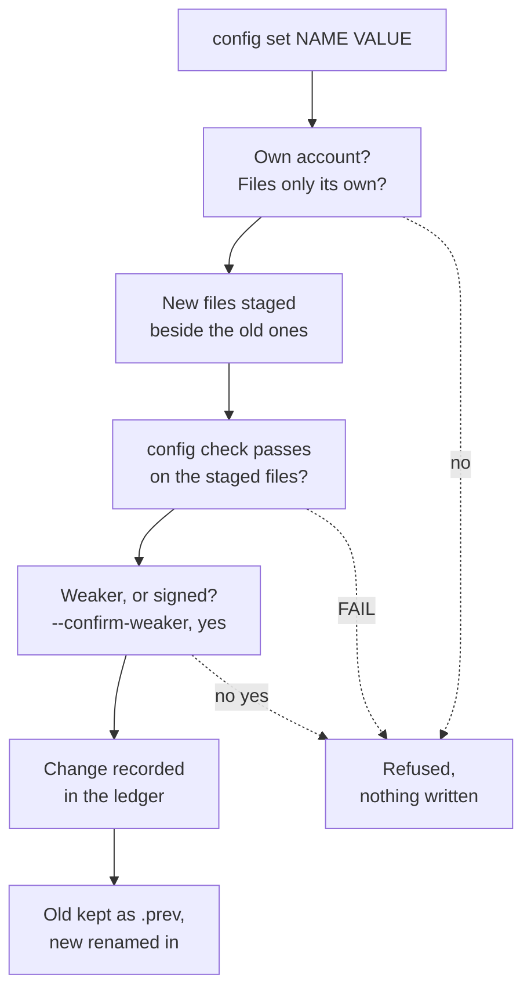

<!--
Copyright 2026 Insomniac-VibeLabs
Author: Stephan Busch
SPDX-License-Identifier: Apache-2.0
-->

# Set up and change Two-Key

Two-Key's settings stay in separate files on purpose: the signed rules, the operator's configuration, and the
secrets ([SETTINGS](SETTINGS.md) says why, and lists every setting). These commands are one way in to all of
them, so you do not have to know which file holds what:

- `two-key setup` writes a new deployment: keys, rules, judges, and the proxy's config, signed and checked.
- `two-key config set`, `get` and `undo` change one setting, read one, and put the last change back.
- `two-key config key-passphrase` encrypts the principal key with a passphrase, changes it, or removes it.
- `two-key config show` and `config check` show what a config resolves to and whether the proxy would start.

`setup` is for a new deployment, and from 0.9.0 its keys are hybrid Ed25519 + ML-DSA-65. To move a 0.8.0
deployment to 0.9.0, keep it and do not run `setup` again: the first start upgrades its keys
([UPGRADING](UPGRADING.md#from-080-to-090-step-by-step)).

Every one of them runs as **Two-Key's own account**: the account the proxy runs as, which owns Two-Key's files.
Never as root, and never as the monitored agent's account. Each part below says what that means for that
command and what it refuses.

## Contents

<!-- toc -->
- [Who may run these commands](#who-may-run-these-commands)
- [Full setup: `two-key setup`](#full-setup-two-key-setup)
  - [The questions](#the-questions)
  - [The quorum numbers](#the-quorum-numbers)
  - [A cloud judge needs the agent's session](#a-cloud-judge-needs-the-agents-session)
  - [What it writes, and where](#what-it-writes-and-where)
  - [What it refuses](#what-it-refuses)
  - [After it finishes](#after-it-finishes)
  - [The setup window: `two-key setup --window`](#the-setup-window-two-key-setup---window)
- [Changing one setting: `config set`, `get`, `undo`](#changing-one-setting-config-set-get-undo)
  - [Finding a setting's name](#finding-a-settings-name)
  - [Giving a value](#giving-a-value)
  - [What happens, in order](#what-happens-in-order)
  - [What counts as weaker, and why it needs `--confirm-weaker`](#what-counts-as-weaker-and-why-it-needs---confirm-weaker)
  - [Signed settings need the principal key](#signed-settings-need-the-principal-key)
  - [What the ledger records](#what-the-ledger-records)
  - [Why a restart is needed](#why-a-restart-is-needed)
  - [Putting a change back: `config undo`](#putting-a-change-back-config-undo)
  - [What `config set` refuses](#what-config-set-refuses)
- [Protecting the principal key with a passphrase](#protecting-the-principal-key-with-a-passphrase)
- [Showing settings: `config show`, `get`, `check`](#showing-settings-config-show-get-check)
<!-- /toc -->

## Who may run these commands

| Command | Who | What it refuses |
| --- | --- | --- |
| `setup` | Two-Key's own account, in a folder only that account can change | Root, a target that exists, a folder above it another account can change |
| `config set`, `config undo`, `config key-passphrase` | Two-Key's own account, the owner of every file it changes | Root, and any file it would write, or the folder that holds it, that another account could change, or that is a link |
| `config show`, `config get`, `config check` | Anyone who can read the files | Nothing: they write nothing and open no ledger |

How this keeps the agent out: when the agent runs as its own account, as it must (the proxy refuses to start
otherwise, `agent_same_account`), Two-Key's files belong to another account, so `config set` and `config undo`
refuse to write them (`config_target_unsafe`). Root is refused (`config_as_root`) because a file root writes
there would belong to root, and because root can change anything anyway. What these commands cannot tell is an
agent that runs as Two-Key's own account; that setup gives the agent every key whatever this command does, so
keep the agent off that account ([CONNECTING](CONNECTING.md)). On Windows there is no root refusal; the
access-list check on each file and folder still applies.

These commands are a convenience, not the only lock. An account that can write `proxy.yaml` can edit it
without them. File permissions and the start-up checks (`on_writable_paths`, `on_agent_access`) are what stop
that, as before.

## Full setup: `two-key setup`

```
two-key setup --dir /srv/two-key/billing
two-key setup --dir /srv/two-key/billing --answers answers.yaml
two-key setup --dir /srv/two-key/billing --answers answers.yaml --confirm-weaker
two-key setup --dir /srv/two-key/billing --window
```

Without `--answers`, it asks its questions on a terminal; without a terminal it refuses and asks for
`--answers`. It never asks for a secret. A judge's API key, the agent's credential, and the agent session are
named by the environment variable that will hold them; their values never go in a file.

### The questions

The same keys go in an `--answers` file (YAML or JSON). An unknown key is refused.

| Answer key | Question | Default |
| --- | --- | --- |
| `route` | `proxy` (`two-key mcp-proxy` in front of an MCP server), `guard`, or `library` | `proxy` |
| `profile` | `default` or `high_assurance` | `default` |
| `judges` | For each judge: `type`, `id`, `model`, `base_url` (for `openai_compatible` and `ollama`), `maker`, `upstream` (asked only when the address and model do not say who serves it, such as a local proxy: where that address forwards the calls; without it the proxy refuses to start with `unresolved_identity`), and `auth_env`, the name of the environment variable that holds its API key. Any other key of a judge in [SETTINGS](SETTINGS.md) can be given too | (asked) |
| `quorum` | The quorum's numbers: `required_yes`, `min_responding`, `min_distinct_providers`, `min_makers` and `min_local_judges` ([below](#the-quorum-numbers)). Any you leave out keep the profile's own | the profile's own |
| `monitored_agent` | `id`, `model`, `provider`, `base_url`, `upstream` (asked as for a judge), and `credential_env` (or `credential: none`) | (asked) |
| `rules_file` | A rules file you reviewed. For the proxy, the `rules.draft.yaml` that `two-key mcp-draft-specs` drafted from the server | none |
| `tools` | Without `rules_file`: the tools a starter allows, each with `id` and, optionally, `irreversible` (default `true`), `data_class_floor` (default `classified`) and, for the proxy route only, `tool_check`: `{key: hybrid-sha256:...}` (the fingerprint `two-key tool-key new` prints) or `exempt` ([TOOL_CHECK](TOOL_CHECK.md)). Under `high_assurance` every tool needs one or the other, and `exempt` is weaker | (asked) |
| `prose_file` | The prose the judges read. Without it, a short starter you edit later | the starter |
| `upstream` | Proxy only: `command` (a list; the wizard splits a line as a shell would, and the proxy runs it without a shell) and `schema_digest` | (asked) |
| `agent_session_env` | Proxy only: the name of the variable that holds the agent's session. Needed when a judge runs in the cloud ([below](#a-cloud-judge-needs-the-agents-session)) | none |
| `judge_history` | Whether judges get a summary of recent decisions (`enabled`), what happens when it cannot be built (`on_failure`: `deny` or `judge_without_history`), and how many denies in how many minutes are an attempt episode (`burst_denies`, `burst_minutes`). Anything less than the default is recorded as weaker ([JUDGES_AND_QUORUM](JUDGES_AND_QUORUM.md#judge-history)) | on, `deny`, 5 in 10 |
| `one_proxy_per_agent` | Proxy only: refuse a second proxy for the same agent on this ledger | `true` |
| `key_passphrase_file` | The absolute path of a file only this account can read, holding a passphrase to encrypt the principal key with ([below](#protecting-the-principal-key-with-a-passphrase)). Never the passphrase itself | none: not encrypted |

`schema_digest` is the `sha256:` digest that `two-key mcp-draft-specs --constitution` prints. Leave it blank
and `setup` reads it from the server itself after signing, the same way: it starts the server to list its tools
(this needs the `mcp` extra), and refuses if the server does not list a signed tool.

### The quorum numbers

After the judges, the wizard asks for five numbers, each offered at what the profile sets for that many
judges. Press Enter to keep one.

| Number | What it is | `default` profile | `high_assurance` |
| --- | --- | --- | --- |
| `required_yes` | Yes votes a call needs | the smaller of 2 and the number of judges | 2 |
| `min_responding` | Judges that must answer, or the call is denied without counting | `required_yes` | `required_yes` |
| `min_distinct_providers` | Different providers among those judges | 1 | 1 |
| `min_makers` | Different makers of the judges' models | 1 | 2 |
| `min_local_judges` | Judges that run on this host or its network | 0 | 1 |

The loaders check the numbers as they always do: one the judges cannot meet (`required_yes: 3` with two
judges, `min_makers: 2` with one maker) is shown at once, and you can give the numbers again; keep them, and
setup refuses at the end ([JUDGES_AND_QUORUM](JUDGES_AND_QUORUM.md#the-quorum-threshold)).

**A number lower than the profile's own is weaker**, the same as lowering it later with `config set`
([below](#what-counts-as-weaker-and-why-it-needs---confirm-weaker)). Under `high_assurance`, a `min_makers`
below 2 or a `min_local_judges` below 1 also turns the profile's floors off. The wizard names each weaker
number and keeps them only after you type `yes`; anything else asks for the numbers again. From an
`--answers` file, a weaker `quorum` needs `--confirm-weaker` and a typed `yes` on a terminal, as `config set`
does; without them setup refuses (`weaker`, `not_confirmed`) and writes nothing. The `config_changed` entry
setup records lists what was weaker and that it was confirmed.

**A quorum that could be too lenient is warned about**, not refused: one judge deciding every call, one
judge's yes approving a call while the others are down, `required_yes` at half the judges or fewer, and every
judge from one provider or one maker. The wizard shows these after the numbers, and `config check` prints
them as `WARN` lines ([JUDGES_AND_QUORUM](JUDGES_AND_QUORUM.md#warnings-about-a-lenient-quorum)).

The other quorum settings (`require_local_yes`, `judge_inputs`, `ballot_binding`, and the rest in
[SETTINGS](SETTINGS.md)) keep the profile's values; change them afterwards with `config set`.

### A cloud judge needs the agent's session

**In short:** if any judge runs somewhere other than this machine, tell the proxy where to find the
monitored agent's session (`agent_session_env`). Without it the proxy refuses to start.

**Which judges count.** For this rule, a judge counts as a cloud judge when its `base_url` is not this
machine's own address (`127.0.0.1`, `::1` or `localhost`), or when its model is a `:cloud` or `-cloud`
model. That includes a judge on another machine in your own network, such as Ollama on `192.168.1.20`, even
though such a judge still counts as local for `min_local_judges`. A judge on this machine is not a cloud
judge, and an all-local setup needs no session.

**Why.** Before a cloud judge votes, Two-Key checks that the judge is not using the agent's own credential, so
the agent cannot vote on its own calls through it. That check needs the agent's session. Without it the cloud
judge does not vote, and the call is denied (`cloud_judge_session_required`,
[HOWTO](HOWTO.md#the-monitored-agent-and-the-judge-is-not-the-agent-rule)). One such judge is enough: the whole
call is denied, even when the local judges say yes. A proxy set up that way could never approve anything.

**What happens.** The wizard names the cloud judges and asks until you give the name of the variable that holds
the session. `config check` reports a `FAIL`, and `two-key mcp-proxy` refuses to start with
`cloud_judge_session_required: judge(s) ... are not on this machine, and agent_session_env is not set`. That
catches a `proxy.yaml` edited by hand too. Until 0.8.0, a blank answer passed setup and `config check`, the
proxy started, and then every call was denied.

**To fix it**, add `agent_session_env: NAME` to `proxy.yaml` (or `two-key config set --config proxy.yaml
agent_session_env NAME`), and set `NAME` in the proxy's own environment to the agent's session.

A starter rules file allows the tools you name and maps no argument. An argument a spec does not name is
dropped before the tool sees it, so a starter is for trying Two-Key out. For a real MCP server, review and sign
what `mcp-draft-specs` drafts ([HOWTO](HOWTO.md#put-two-key-in-front-of-an-mcp-server-two-key-mcp-proxy)).

### What it writes, and where

Everything goes in the `--dir` folder. Each file is owner-only from its first byte (mode 0600, or on Windows
an access list for your account only), except the public key, which is not a secret. On Linux and macOS setup
also runs under umask 077, so nothing it creates, the ledger and its folders included, is writable by the group
or others whatever your shell's umask (until 0.8.0, Ubuntu's default 002 left the ledger group-writable, and
`config check` warned `writable_path`).

| File | What it is |
| --- | --- |
| `principal.pem` | The principal private key. Signs the constitution and the ledger head. Encrypted when `key_passphrase_file` is given, and then `proxy.yaml` names that file as `keys.passphrase_file` |
| `principal.pub.pem` | Its public half |
| `constitution.md` | The prose the judges read |
| `hard_rules.yaml` | The rules Path A runs, with the tool specs, and `serial: 1` (see below) |
| `constitution.signed.json` | Both, signed with the principal key |
| `judges.yaml` | The judges, the quorum `profile` and the numbers you gave, and the `monitored_agent` |
| `proxy.yaml` | Proxy only. `agent_id` set to the monitored agent's `id`, so the ledger names the agent in every decision and the judges' history (until 0.8.0 it was left out, and the agent showed as `unnamed`). Every scalar setting at its default, written out: `ttl_seconds: 120`, `allow_unresolved_identity: false`, `on_agent_access: refuse`, `on_writable_paths: warn` (`refuse` under `high_assurance`, which does not accept `warn`), and `upstream.on_schema_change: refuse` with `call_timeout_seconds: 60` |
| `ledger/` | The ledger, with its key and witness folders beside it (`ledger.ledger-key/`, `ledger.witness/`) |

It writes all of this into a new hidden folder beside `--dir`, checks it there, and renames that folder to
`--dir` only when the check passes. For the proxy route the check is `config check` on the new `proxy.yaml`;
for the guard and library routes it verifies the constitution and loads the judges and the monitored agent.
Then it creates the ledger and writes its first entry, `config_changed` with `command: setup`: the name and
SHA-256 digest of each file it wrote except the private key, and the digest of the signed constitution.

### What it refuses

- Root (`config_as_root`).
- A `--dir` that exists (`setup_target_exists`): it writes a new folder and never over one.
- A folder above `--dir` that another account could change (`setup_target_unsafe`).
- A `key_passphrase_file` that is not an absolute path, that another account can read
  (`passphrase_file_insecure`), or whose passphrase is shorter than 12 bytes (`key_passphrase_short`).
- A quorum number lower than the profile's own without `--confirm-weaker` (`weaker`) or without a typed `yes`
  (`not_confirmed`), and a `quorum` answer with a key other than the five numbers.
- A proxy with a cloud judge and no `agent_session_env` (`cloud_judge_session_required`, through
  `config check`).
- A starter tool with no tool check under `high_assurance`, a `tool_check` that is neither `exempt` nor a
  fingerprint, and a `tool_check` on the guard or library route (`tools: ...`). With a rules file, `config
  check` fails a `high_assurance` proxy whose tools have neither (`tool_check_required`).
- An answer the loaders refuse (an unknown judge type, a tool with no spec, a malformed digest), and anything
  `config check` fails (`config_check_failed`). `high_assurance` with fewer judges than it needs is one such
  failure. A variable the config names that is not set in your shell does not count
  (`upstream_env_missing`, `agent_session_missing`, `agent_credential_missing`), since the proxy's own
  environment may differ. A judge's key that is not set is only a warning (`judge_env_missing`).

A refused setup leaves nothing behind: the hidden folder is removed and `--dir` is never created.

### After it finishes

It prints the files and the next steps:

1. Set each variable it names (the judges' keys, the agent's credential) in the proxy's own environment.
2. Run `two-key config check --config DIR/proxy.yaml` where the proxy will run.
3. Start the proxy from the agent's host, as another account ([CONNECTING](CONNECTING.md)).
4. If you used the starter prose, edit `constitution.md` and sign again with `two-key sign-constitution --key
   DIR/principal.pem --prose DIR/constitution.md --rules DIR/hard_rules.yaml --out
   DIR/constitution.signed.json --force`. `sign-constitution` writes no `config_changed` entry; the next start
   records the new constitution's digest (`constitution_loaded`).
5. Copy `ledger.witness/witness.pub.pem` where the ledger's account cannot change it, and pin it
   ([HOWTO](HOWTO.md#pin-the-witness-key)). That setting is one `config set` does not change, so add
   `witness_public_key:` to `proxy.yaml` by hand and run `config check`.

For the guard and library routes there is no `proxy.yaml`: load the files from Python as
[HOWTO "Authorize from Python"](HOWTO.md#authorize-from-python) shows. `config set`, `get`, and `undo` work on
a proxy config; on those routes, edit the files and sign again with `sign-constitution`.

### The setup window: `two-key setup --window`

The same questions on one screen, for those who prefer a window to a terminal. It is a choice beside the
terminal interview, not a replacement: both collect the same answers and hand them to the same code, so the
files, what is refused, and the ledger entry are the same (`tests/test_setup_form.py` checks that the same
answers write the same files both ways). The window always fills in the quorum numbers, so its `judges.yaml`
and `proxy.yaml` spell out values the terminal route leaves at their defaults, in another key order; the
settings are the same, and `two-key config show` prints the same for both. It runs as Two-Key's own account, like the terminal setup, and it
uses tkinter, so it adds no dependency and opens no network port. Without tkinter (on Debian and Ubuntu:
`apt install python3-tk`) or without a display, it says so and points to the terminal or `--answers`.

```
two-key setup --dir /srv/two-key/billing --window
two-key setup --dir /srv/two-key/billing --window --answers answers.json
```

With `--answers`, the window opens filled in from that file. Its pages follow the interview:

| Page | What it asks |
| --- | --- |
| Deployment | The new folder, the route, the key's passphrase file, and the **High assurance** switch |
| Judges | Each judge: id, type, model, base URL, maker, upstream (only needed when the address does not say who serves the model), and the name of its API key's variable |
| Quorum | The five numbers, filled in with the profile's own for these judges; **Use the profile's numbers** puts them back |
| Agent and history | The monitored agent, and the judge history summary |
| Rules and prose | A reviewed rules file, or the starter tools (with each tool's check, for the proxy); the prose file, or the starter |
| Proxy | The upstream command, its schema digest (blank: read from the server), the agent session's variable, and one proxy per agent. Turned off for the guard and library routes |
| Review and set up | Every answer, every problem, warning and weaker setting, the typed `yes`, **Save answers file**, and **Set up** |

The status line under the pages always says whether setup would go ahead, and if not, the first reason. The
window sets up once: after that the status line keeps `Set up in ...`, and if you change the answers it adds
what is wrong with them now. **Set
up** stays off until nothing stops it. A weaker setting (a quorum number below the profile's own, the summary
turned off, one proxy per agent turned off) needs `yes` typed in the box beside it, as the terminal asks. When
setup finishes, the Review page shows the next steps, and two buttons open `constitution-editor` and
`ledger-view` on the new folder. The editor is given `--public-key principal.pub.pem`, so it checks the signed
constitution's signature, and the ledger view is given `--witness-public-key ledger.witness/witness.pub.pem`.
[GUI_WALKTHROUGH](GUI_WALKTHROUGH.md) shows every page of the window, then the editor and the ledger view, in
screenshots from one live run.

**The High assurance switch** sets `quorum.profile: high_assurance`, fills in the profile's quorum numbers, and
makes them minimums: each number can be raised (with three judges you can require three yes votes) but never
lowered below the profile's. It also shows, grayed out, what the profile sets that the window does not let you
change:

| Setting | Under high assurance |
| --- | --- |
| `quorum.required_yes`, `min_responding` | at least 2 |
| `quorum.min_makers` | at least 2: judges from two different model makers |
| `quorum.min_local_judges` | at least 1: a judge on this machine |
| `quorum.require_local_yes` | true: a judge on this machine must vote yes |
| `on_writable_paths` | refuse: the proxy does not start when another account can change a file it runs or reads |
| `on_agent_access` | refuse: the proxy does not start when the agent's account could reach Two-Key's files |
| `tool_specs.<tool>.tool_check` | required behind the proxy: a receipt key, or `exempt` (weaker, typed yes) ([TOOL_CHECK](TOOL_CHECK.md)) |
| a plaintext SIEM sink | refused |
| `upstream.check_paths` | required: the upstream server's files are checked, or the proxy does not start |

**Save answers file** writes the answers as JSON, owner-only, for a machine with no screen: fill them in on a
desktop, copy the file to the server, and run `two-key setup --dir DIR --answers FILE` there. The file holds
no secret, only the names of environment variables and the paths of files.

## Changing one setting: `config set`, `get`, `undo`

```
two-key config get   --config proxy.yaml siem.sinks[0].port
two-key config set   --config proxy.yaml siem.sinks[0].port 6514
two-key config set   --config proxy.yaml on_agent_access warn --confirm-weaker
two-key config set   --config proxy.yaml tool_specs.pay.irreversible true --key principal.pem --rules hard_rules.yaml
two-key config set   --config proxy.yaml upstream.env.API_TOKEN --value-file token.txt
two-key config set   --config proxy.yaml ttl_seconds --unset
two-key config undo  --config proxy.yaml
```

Each prints the change, then a JSON result. It exits 0 when the change is written and 1 when it is refused,
with one line that starts `two-key: config set: refused:` and a reason code. A refused change writes nothing.

### Finding a setting's name

A setting's name is its path in [SETTINGS](SETTINGS.md), with each list item numbered from 0 and a key that
has a dot in it in brackets:

| Name | File |
| --- | --- |
| `ttl_seconds`, `on_agent_access`, `upstream.call_timeout_seconds`, `siem.sinks[0].port`, `tools[fs.read].claim` | `proxy.yaml` |
| `quorum.profile`, `judges[1].timeout`, `monitored_agent.model` | `judges.yaml` (the `judges:` path in `proxy.yaml`) |
| `hard_rules[2].deny_if.amount_usd_gt`, `tool_specs.pay.data_class_floor`, `fields.region.default` | the signed rules |

**Every tool at once:** `[*]` in place of a tool's id changes that setting on every tool, as one change with one
confirmation, one `config_changed` entry that names each tool, and one `config undo`. In `proxy.yaml`,
`tools[*].claim` reaches every tool the constitution signs, whether `proxy.yaml` sets it yet or not. In the
signed rules, `tool_specs[*].irreversible` reaches every signed tool and signs one new constitution. With
`--unset`, a tool that does not set it is skipped. `[*]` stands only for the tool in `tools[*].<setting>` and
`tool_specs[*].<setting>`; anywhere else it is refused (`every_tool`). `config get tools[*].claim` prints the
value for each tool.

```
two-key config set --config proxy.yaml 'tools[*].claim' floor --confirm-weaker
```

The first part picks the file, so you never name one. A name that is not a setting is refused
(`unknown_setting`), and so is a typo. `config get NAME` prints the value, the file, the tier, and the default.

Not changed by `config set` (`not_settable`): `constitution`, `keys.principal`, `ledger`, `judges`,
`witness_public_key`, and `head_anchor` in `proxy.yaml`. They say which files, keys, and ledger Two-Key trusts,
so moving one is a change of deployment: edit `proxy.yaml` by hand, then run `config check`. The prose is
`constitution.md`: edit it and run `sign-constitution`. `agents.yaml`, for the library route, is not changed
here either.

### Giving a value

Exactly one of:

- `VALUE`: JSON when it reads as JSON (`true`, `120`, `["a", "b"]`, `{"env": "NAME"}`, `"120"` for the text
  120), and plain text otherwise (`warn`, `high_assurance`). A block is JSON too, not YAML:
  `two-key config set --config proxy.yaml siem '{"sinks": [{"type": "syslog", "host": "siem.example"}]}'`.
- `--value-file FILE`: the file's text, without one final newline. The file must be owner-only
  (`value_file_insecure` otherwise).
- `--prompt`: typed at a hidden prompt, on a terminal.
- `--unset`: remove the setting, so its default applies.

**Secrets never go on the command line**, where shell history and `ps` keep them. A literal for
`upstream.env.NAME` or `scan.env.NAME` can be a secret, so on the command line it is refused
(`secret_on_command_line`); give it with `--value-file` or `--prompt`, or name a variable with
`{"env": "NAME"}`. No other setting holds a secret: those that name one take the name of a variable or the path
of an owner-only file ([SETTINGS](SETTINGS.md)). Never put a secret in `upstream.command`.

### What happens, in order



*Each step must pass before the next one runs; the dashed lines are refusals, and a refusal writes nothing.*

1. **The account.** Not root, and every file it will write, and the folder that holds it, can be changed by no
   other account and is not a link. One change at a time: a lock file beside the proxy config
   (`.proxy.yaml.config.lock`) holds the next one back.
2. **The new files**, written owner-only next to the real ones under hidden names. YAML is written plainly, so
   comments are not kept; the previous version is kept as `<file>.prev`.
3. **`config check` on the whole new set**: the staged file, with every other file as it is. Any `FAIL` refuses
   the change and prints the findings (`config_check_failed`), except a variable not set in your shell. This is
   also why what `high_assurance` forbids stays forbidden: `on_agent_access: warn`, `on_writable_paths: warn`
   and a plaintext SIEM sink each fail the check under that profile.
4. **Weaker, or signed.** A weaker change without `--confirm-weaker` is refused, with the reasons
   (`weaker:`). With it, and for every signed change, it asks for `yes` typed on a terminal. Anything else, or
   no terminal (a script, a pipe, an agent), is no (`not_confirmed`).
5. **The ledger.** It opens the deployment's ledger with the proxy's own keys and appends `config_changed`.
   A ledger that is missing (`ledger_missing`) or does not open (`ledger_refused`) refuses the change, so
   nothing changes without a record.
6. **The files.** Each old version is renamed to `<file>.prev`, each new one renamed into place, and
   `proxy.yaml.undo.json` says which files the change wrote and their digests before and after.

### What counts as weaker, and why it needs `--confirm-weaker`

A weaker setting is one that lets more through, checks less, or shows judges more, so a mistyped command or a
copied snippet should not be enough for it. It is read from what the old and new configurations enforce,
loaded the way the proxy loads them, not from the key you typed. Each of these is weaker:

| What changes | Weaker when |
| --- | --- |
| The quorum profile | `high_assurance` is turned off (the two-maker, local-judge and local-yes floors no longer all hold) |
| `on_writable_paths`, `on_agent_access`, `upstream.on_schema_change` | It goes from `refuse` to `warn` |
| `allow_unresolved_identity` | It is turned on |
| `ttl_seconds` | Tokens live longer |
| `agent_session_env` | It is removed |
| `upstream.check_paths` | A path is no longer checked |
| `siem` | The copy is turned off, a sink no longer gets it, or a sink sends in the clear |
| `scan` | The content scanner is removed |
| `tools.<id>.claim` | It claims a lower data class (`classified`, the default, is the highest) |
| `tools.<id>.files` | A file is no longer declared for the scanner |
| `quorum.required_yes`, `min_responding`, `min_distinct_providers`, `min_makers`, `min_local_judges` | It is lowered |
| `quorum.require_local_yes` | It is turned off |
| `quorum.judge_inputs`, `tool_args_on_derive_deny`, `tool_args_on_scan_flag` | Judges see the proposal or the arguments |
| `quorum.judge_history` | It is turned off, its `window_days` or `max_items` is lowered, `on_failure` becomes `judge_without_history`, `burst_denies` is raised, or `burst_minutes` is shortened |
| `one_proxy_per_agent` | It is turned off |
| `quorum.ballot_binding`, `heterogeneity_scope` | `echo` becomes `stamp`, `responding` becomes `selection` |
| `judges` | A judge is added or removed, or any of its keys changes but `timeout`, `json_mode`, `max_tokens`, `response_format`, and `reasoning_effort` |
| `monitored_agent` | It is removed or changed (judges are checked against it) |
| `tool_specs.<tool>.tool_check` | It is set to `exempt`, removed, or given another key (turning it on is stronger) |
| Signed rules | Anything but adding a rule, turning `irreversible` or `deny_unmapped` on, raising a `data_class_floor`, or turning the tool check on: whether an edit to a rule allows more cannot be told in general |

An `undo` that weakens needs `--confirm-weaker` too: undoing a stricter setting is weaker. `setup` reads
its quorum numbers the same way, against the profile's own ([above](#the-quorum-numbers)).

### Signed settings need the principal key

`hard_rules`, `tool_specs`, and `fields` are signed. Changing one means signing a new constitution, so it needs:

- `--key FILE`: the principal private key, the one `keys.principal` names (`principal_key_mismatch`
  otherwise), the same file `sign-constitution` takes. Unencrypted, whoever can read it can sign anything:
  that is why it must be owner-only, why Two-Key refuses one that is not, and why the agent's account must not
  be able to read it. Encrypted ([below](#protecting-the-principal-key-with-a-passphrase)), it opens with
  `--key-passphrase-file FILE`, else `keys.passphrase_file`.
- `--rules FILE`: the rules file the constitution was signed from. It must sign to exactly what the current
  constitution signs (`rules_source_differs` otherwise), so the signature you add covers your one change and
  nothing someone else left in the file.

It shows the change and the part of the signed text that differs, asks for a typed `yes`, signs the rules with
the prose already signed, in at least the current envelope format, and verifies the new envelope with the
principal's public key before anything is written. Then `config check` verifies the staged envelope again,
as the proxy will. It writes the rules file and the envelope together, both owner-only, and records the new
constitution's digest in the ledger.

**The serial goes up by one with each signed change.** The rules file `setup` writes starts at `serial: 1`, and so
does the `rules.draft.yaml` that `mcp-draft-specs` writes. A `rules_file` you bring is signed as it is: if it has no
`serial`, `setup` warns, and its next steps say to add `serial: 1` and sign again, because until a constitution with
a serial runs, the ledger accepts any constitution signed with your key, an older one too.
Once the proxy has run a constitution, its ledger refuses any older one (a lower serial), so a copy of old rules
cannot be put back (live run 9x, C44; HOWTO "The serial"). For the same reason, `config undo` refuses to put back
a constitution the ledger has already run past (`constitution_rollback`): change the setting back with
`config set` instead, which signs the next serial.

### What the ledger records

`config_changed`, for `setup`, `set`, `undo`, and `key-passphrase`:

| Field | What it holds | Sent to the SIEM |
| --- | --- | --- |
| `command` | `setup`, `set`, `undo`, or `key-passphrase` | Yes |
| `settings` | The names of the settings changed | Yes |
| `files` | Each file's role (`proxy`, `judges`, `rules`, `constitution`, `key`), name, and SHA-256 digest before and after. The principal key file (`key`) is named with no digest | Yes |
| `signed` | Whether a constitution was signed | Yes |
| `weaker` | Why the change is weaker, if it is: setting names and a few fixed words | Yes |
| `confirmed` | Whether someone typed `yes` | Yes |
| `constitution_hash` | The digest of the new signed constitution, or none | Yes |
| `account` | The account that ran the command | No: the ledger only |

It never holds a value: not the old or new value of a setting, not a secret, not a file's content. To see what
a change was, compare the file with its `.prev`, or the digests with the files you keep.

The SIEM copy is sent by the proxy, not by this command. A running proxy sends the entry after it next writes an
entry of its own. A proxy that starts later sends it on start with `replay_from: cursor` (the default) or
`start`; with `replay_from: now` it does not, so send it with `two-key siem-export` if the proxy was not running.

### Why a restart is needed

There is no hot reload. A running proxy keeps the settings it started with, so nothing changes under a call in
progress, and every setting it enforces is the one its start-up checks passed. A change takes effect when the
proxy next starts. Each command says so in its result.

### Putting a change back: `config undo`

`config undo --config proxy.yaml` puts back the files the last `config set` (or `undo`) replaced, from their
`.prev` copies, through the same steps: the account, `config check`, `--confirm-weaker` and a typed `yes` when
it weakens, a `config_changed` entry with `command: undo`, and owner-only renames. Running it again puts the
change back, so it holds one step, not a history; the ledger is the history.

It refuses (`undo_stale`) when a file changed after the last change, or its `.prev` is not the version that
change replaced, so it never overwrites an edit made by hand. Undoing a signed change needs `--key`, and the
constitution it puts back must verify with that key. Nothing to undo is `nothing_to_undo`, and so is a last
change made by `config key-passphrase`, which keeps no copy of the key as it was.

### What `config set` refuses

| Reason code | Why |
| --- | --- |
| `config_as_root` | Run as root |
| `config_target_unsafe` | A file it would write, or its folder, could be changed by another account: run as Two-Key's own account |
| `config_target_link`, `config_target_missing` | A file it would write is a link, or not there |
| `config_invalid`, `config_current_invalid` | The new file, or the files as they are, do not load |
| `unknown_setting`, `not_settable` | Not a setting, or one this command does not change |
| `secret_on_command_line`, `value_file_insecure` | A literal that can be a secret on the command line, or a value file others can read |
| `config_check_failed` | The new set would not start, or would refuse something it starts with today |
| `weaker`, `not_confirmed` | Weaker without `--confirm-weaker`, or no typed `yes` |
| `principal_key_needed`, `principal_key_mismatch`, `rules_file_needed`, `rules_source_differs`, `rules_invalid`, `constitution_refused`, `unchanged` | A signed setting without the key or the signed rules, or a change that does not sign |
| `principal_key` (with `key_passphrase_needed`, `key_passphrase_wrong`) | The principal key, which signs the ledger entry, does not open |
| `ledger_missing`, `ledger_refused` | The change could not be recorded |
| `nothing_to_undo`, `undo_stale`, `undo_invalid` | `undo` has nothing safe to put back |

## Protecting the principal key with a passphrase

The principal key signs the constitution and the ledger. Unencrypted, a copy of `principal.pem` is a copy of
that power: a backup taken carelessly, a file sent to the wrong place, a disk image. Encrypted, the copy is
useless without the passphrase.

```
( umask 077; head -c 32 /dev/urandom | base64 > /etc/two-key/principal.pass )
two-key config key-passphrase --config proxy.yaml --new-from /etc/two-key/principal.pass
```

`--new-from FILE` encrypts the key with the passphrase in that file, or changes the passphrase of a key that
is already encrypted (opened with `keys.passphrase_file`, or `--key-passphrase-file` for the current one), and
sets `keys.passphrase_file` in `proxy.yaml` to that file, in one change. `--remove`
stores the key unencrypted again and removes the setting; that is weaker, so it needs `--confirm-weaker` and a
typed `yes`. Both are recorded as `config_changed` with `command: key-passphrase`.

**Where the passphrase comes from.** A file only its owner can read (mode 0600, or a private access list on
Windows), holding one line of 12 to 1024 bytes; one final newline is not part of it. Or, for a command you run
by hand, typed at a hidden prompt on a terminal. Never the command line, where shell history and `ps` keep it,
and never an environment variable: the proxy is started by the agent's host, so its environment is the one
place a passphrase must not come from.

**The proxy reads `keys.passphrase_file` at start.** Its stdin is the agent's channel, so it never prompts. An
encrypted key without that setting, a passphrase file another account can read, or a wrong passphrase refuses
to start (`key_passphrase_needed`, `passphrase_file_insecure`, `key_passphrase_wrong`), and `config check`
says so first. The passphrase file is one of the paths the start-up checks look at: if the agent's account can
change it, the proxy refuses to start (`on_agent_access`, `refuse` by default), and another account that can
change it is reported by `on_writable_paths`.

**Every other command that takes `--key`** (`sign-constitution`, `authorize`, `audit`, `recover`,
`rotate-witness`, `siem-export`, `siem-verify`, `backup-export`, `backup-verify`, `backup-restore`) takes
`--key-passphrase-file FILE` too, and without it asks on the terminal. `config set` and `undo` use
`--key-passphrase-file`, else `keys.passphrase_file`; an encrypted key without `keys.passphrase_file` fails
`config check`, since the proxy could not start, so they refuse until it is set. For a new key, `two-key init-key DIR --passphrase` asks
for one twice, and `--passphrase-file FILE` reads it from a file. From Python, give
`load_private_key_file(path, passphrase_source(PASSPHRASE_FILE))`.

**Backups keep it encrypted.** `backup-export` puts the key file in the principal bundle as it is, still
encrypted, and `backup-restore` writes it back that way. Opening that bundle then needs both the bundle's
passphrase and the key's.

**What it protects, and what it does not.** It protects a copy of `principal.pem` on its own: in a backup, on
another machine, sent by mistake. It does not protect against:

- An account that can read both `principal.pem` and the passphrase file. Two-Key's own account can, since the
  proxy opens the key unattended; that is why the agent must never run as that account.
- A copy of the key made before it was encrypted. `config key-passphrase` keeps no `.prev`, but an old backup,
  or the old file's blocks on the disk, stay unencrypted. If one may have leaked, a passphrase does not help:
  make a new deployment.

So keep the passphrase file away from the key: another disk, a secrets mount, or a credential that systemd
or your secret store puts in place at start, readable only by Two-Key's account. A passphrase file in the same
folder as the key protects only against a copy of the key file alone. The ledger key, the witness key, and
the capability key are not encrypted by this; they live in the ledger's own folders, owner-only, as before.

The format is Two-Key's own: the key, as PKCS8 (a hybrid key's two PKCS8 PEM blocks, format
`two-key-encrypted-key/2`), sealed with AES-256-GCM under a key from PBKDF2-SHA256 at
600,000 iterations with a random 16-byte salt, every header field bound in, the same construction as the key
backup. A file that asks for fewer iterations is refused before the derivation runs. A key encrypted by
another tool (`BEGIN ENCRYPTED PRIVATE KEY`) is refused by name; encrypt the unencrypted key with
`config key-passphrase` instead.

## Showing settings: `config show`, `get`, `check`

```
two-key config show  --config proxy.yaml       # every effective setting, as JSON
two-key config get   --config proxy.yaml NAME  # one setting
two-key config check --config proxy.yaml       # would the proxy start?
```

Anyone who can read the files may run them. They write nothing, open no ledger, start no process, and contact
no judge, scanner, collector, or upstream server.

- **`show`** prints the proxy's settings with defaults filled in: the files it names, `ttl_seconds`, the
  resolved `on_writable_paths` and `on_agent_access` (what applies after the profile: `refuse` under
  `high_assurance`, where a `warn` in the file is an error, as it is at start), `high_assurance: true` or
  `false`, the upstream, the tools, the
  scanner, the SIEM sinks, the effective quorum, and each judge: its type, address (`base_url`), model, and the
  names of the variables it reads.
- **`get`** prints one setting: `value` (`null` when the file does not set it), `set`, the `file` that holds
  it, its `tier` (`operator` or `signed`), and from [SETTINGS](SETTINGS.md) its `default`, what
  `high_assurance` does to it, and what it does. A signed setting is read from the signed constitution.
- **`check`** prints one line per finding, `ok`, `WARN`, or `FAIL`, and exits 1 on any `FAIL`: the config
  parses, the principal key opens (encrypted, with `keys.passphrase_file`, as at start) and signed the
  constitution, each `tools:` entry is signed, the judges and
  quorum load (with a `WARN` for a quorum that could be too lenient), a cloud judge has the agent's session
  (`cloud_judge_session_required` is a `FAIL`, and the proxy refuses to start;
  [above](#a-cloud-judge-needs-the-agents-session)), a monitored agent is
  declared, every variable the proxy and its judges read is set here (each
  missing one is named: an upstream or agent variable is a `FAIL`, since the proxy would not start or the
  upstream would not get it; a judge's key is a `WARN`, since that judge would abstain on every call), the writable-path
  check, the `on_agent_access` setting (a `FAIL` for `warn` under `high_assurance`), and plaintext SIEM sinks.
  It cannot see which account will start the proxy, or whether the upstream still lists the same tools; the
  proxy checks both at start.

None of them prints a secret. A key file is shown by its path, a judge's key and the agent's credential by
the name of their variable, and an `upstream.env` or `scan.env` literal as `<literal>`.
