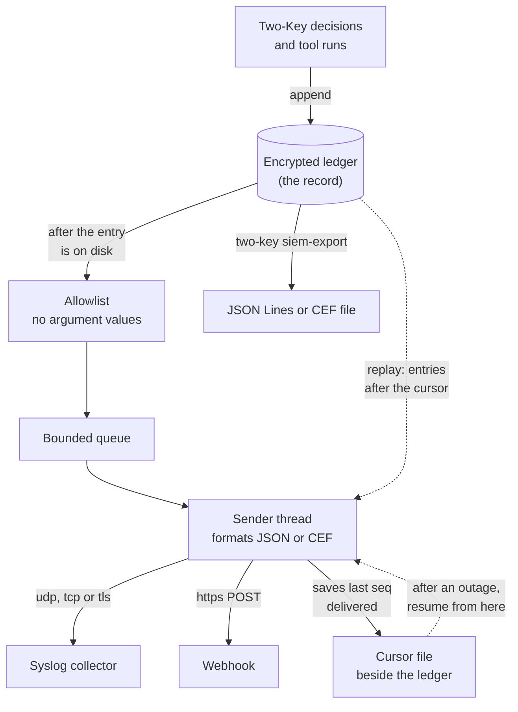

<!--
Copyright 2026 Insomniac-VibeLabs
Author: Stephan Busch
SPDX-License-Identifier: Apache-2.0
-->

# Send the ledger to a SIEM (0.7.0)

Two-Key's ledger is the record of every decision: who proposed what, which
path denied it, which token was redeemed. This guide is about getting a copy
of that record into the place your organization already watches — Splunk,
Elastic, Wazuh, Sentinel, QRadar, or anything else that takes syslog or an
HTTPS POST — without sending the content of the calls.

Two things are on offer:

- **A live copy**, sent as each entry is written: syslog over UDP, TCP, or
  TLS, or an HTTPS webhook (`siem:` in `proxy.yaml`, or `TwoKey(siem=...)`).
- **A file**, written on demand from the verified ledger:
  `two-key siem-export`, checked again later with `two-key siem-verify`.

Both carry the same allowlisted fields. Neither can change a decision.

## Contents

<!-- toc -->
- [In plain words](#in-plain-words)
- [What leaves, and what never does](#what-leaves-and-what-never-does)
- [Turn on the live copy](#turn-on-the-live-copy)
- [Sinks](#sinks)
- [Schemas and formats](#schemas-and-formats)
- [Export a file, and check it later](#export-a-file-and-check-it-later)
- [Refused tokens](#refused-tokens)
- [Elastic in Docker: a worked example](#elastic-in-docker-a-worked-example)
- [What it does not do](#what-it-does-not-do)
- [Trade-offs](#trade-offs)
- [Reason codes you will see](#reason-codes-you-will-see)
<!-- /toc -->

## In plain words

The ledger stays the record. The SIEM gets a copy.



*The live copy goes from the ledger through the sender to the collector and the webhook, as JSON or CEF. Dashed lines are the catch-up after an outage: the sender reads the cursor, then the missed entries from the ledger. The export writes a file instead.*

There are two ways to get that copy out, and they use the same event formats:

- **The live copy** runs inside the proxy all the time. As each entry is written, the sender thread pushes it
  to your collector or webhook. You turn it on in `proxy.yaml` and do nothing after that.
- **`two-key siem-export`** is a command you run when you want it. It checks the ledger, decrypts it, and
  writes the events to a file. Use it to load history from before the live copy was on (the live copy starts
  from now), to feed a SIEM that cannot take a live feed, or to make the file that `siem-verify` checks
  against the ledger. Nothing is sent: you carry the file to the SIEM yourself.

Three properties hold whatever you configure:

1. **The copy never gates a call.** The ledger calls a hook that only puts a
   sequence number on a bounded queue; a sender thread does the formatting and
   the network. A collector that is slow, down, or gone costs nothing but a
   delay in the copy (the maintainer's decision, 2026-10-16). Two-Key keeps
   authorizing.
2. **Nothing is sent that is not already in the ledger**, and every event
   carries its `seq` and `entry_hash`, so a gap is visible and any event can be
   checked against `two-key audit`.
3. **The allowlist decides what leaves**, per ledger entry kind, in
   `two_key/siem.py`. A field that is not listed there is not sent, in any
   schema and any format, and no setting adds one.

## What leaves, and what never does

Sent, where the entry has it:

| Field | What it is |
| --- | --- |
| `seq`, `entry_hash`, `prev`, `kind` | the entry's place in the chain and its kind |
| `allowed`, `reason`, `passed` | the outcome and the library's reason code |
| `path_a.allowed`, `reason`, `denied_by` | Path A's verdict and the signed rule id that denied |
| `yes`, `no`, `abstain`, `skipped` | Path B's counts (never a rationale) |
| `ballots[]`, `ballot_digest_key_id` | each judge's ballot (0.8.0): `judge_id`, `vote`, `confidence`, `error_class`, `http_status` when there was one, and `rationale_digest`, an HMAC-SHA256 of the rationale under the install's fingerprint key, which `ballot_digest_key_id` names; never the rationale |
| `tool` | the signed tool id (or `null` with a size and digest, when the caller sent something else) |
| `data_class`, `irreversible` | the data class the call carries, and the signed irreversible flag |
| `jti`, `token_hash`, `ledger_root` | the token's id and digest, and the root it was issued over |
| `agent_id`, `agent_hosting` | the operator's own agent metadata |
| `policy_digest`, `identities_digest`, `digest`, `bytecode_hash`, `nl_hash`, `spec_hash` | which policy and which identities were in effect |
| `*_size`, `*_digest` | the size and digest of an argument set, a proposal, or a revocation reason |
| `verdict`, `categories`, `scanner`, `stance`, `elapsed_ms`, `parts[]` | the content scan: its verdict and each part's size and digest |
| `witness_fingerprint`, `source` | the witness key pinned or rotated, as a fingerprint |
| `origin` | `library`, `cli`, `mcp-proxy`, or whatever the integration declared |
| `at`, `history_digest` | when a decision was made (UTC, to the second), and the digest of the judge history summary the judges saw (0.8.0; `null` when none was sent) |
| `error_class`, `on_failure` | `judge_history_failed` (0.8.0): why the summary could not be built, as a class, and whether the call was denied or judged without it |
| `started`, `denies`, `reasons` | `attempt_episode` (0.8.0): a burst of denied calls from one agent, when it started, how many, and their reason codes |
| `command`, `settings`, `files[]`, `weaker`, `confirmed`, `constitution_hash` | a configuration change (`config_changed`, from `two-key setup`, `config set`, and `config undo`): the setting names, each file's role, name, and digests before and after, and why it is weaker; never a value, and not the account ([SETUP](SETUP.md#what-the-ledger-records)) |

Never sent, and there is no setting that sends them:

- argument values, and the proposal text;
- the derived amount, the counterparty, and every custom field value;
- a decision's `subject` (its tool, counterparties, and amount, kept for the judge history) and `history_basis`;
- a judge's rationale, and the agent's decline reason;
- the operator's revocation or rotation reason (its size and digest go);
- key names the agent wrote (`dropped_keys`);
- credentials, token text, a scanner's threat name, and file content;
- a setting's value, and the account that changed it (`config_changed`);
- the ledger key, the witness key, and any signature over the head.

`tests/test_siem.py` puts a canary value in every one of those places and
fails if it appears in any schema or format. A new ledger field is not
exported until it is added to the allowlist on purpose: the same test fails
while a field is undecided.

A digest is not a secret, but it is a check: whoever can read your SIEM can
test a guess of a low-entropy argument against `tool_args_digest`. That is the
trade for being able to prove two calls carried the same arguments.

## Turn on the live copy

In `proxy.yaml` (read strictly: an unknown key refuses to start):

```yaml
siem:
  schema: native          # native (default) | ecs | ocsf
  format: json            # json (default) | cef
  replay_from: cursor     # cursor (default) | start | now
  sinks:
    - type: syslog
      host: siem.example.net
      transport: tls      # tls (default) | tcp | udp
      port: 6514          # default by transport: tls 6514, tcp 514, udp 514
      ca_file: /etc/two-key/siem-ca.pem
    - type: webhook
      url: https://siem.example.net/services/collector/raw
      auth_header: Authorization
      auth_value_file: /etc/two-key/siem-token      # mode 0600, read at start
```

From Python:

```python
from two_key.siem import SiemConfig
from two_key.siem_sinks import SyslogSink, WebhookSink

tk = TwoKey(ledger, public_key, constitution, judges, private_key=key,
            siem=SiemConfig(sinks=(
                SyslogSink("siem.example.net", ca_file="/etc/two-key/siem-ca.pem"),
                WebhookSink("https://siem.example.net/ingest",
                            auth_value_file="/etc/two-key/siem-token"),
            )))
...
tk.close()      # a last pass for the sender; what is left goes out on the next start
```

What happens at start:

- Every sink is checked once: a TLS handshake, a TCP connect, or a resolved
  address. A sink that cannot be reached is a **warning**, not a refusal.
- A plaintext sink (`udp`, `tcp`, or an `http://` webhook) warns. Under
  `high_assurance` it **refuses to start** (`siem_plaintext_refused`).
- `siem_configured` is written to the ledger: the schema, the format, and each
  sink's type, host, port, and transport. Never a secret. So the ledger itself
  records where its copy went.

`replay_from` decides where a sink starts, and the cursor
(`<ledger>.siem/cursor.json`, owner-only, beside the ledger and never inside
it) is what `cursor` reads and every sink keeps up to date:

| `replay_from` | Each start sends |
| --- | --- |
| `cursor` (default) | from the cursor; with no cursor file yet, only entries from now on, so turning the copy on does not flood a SIEM with history. Backfill with `siem-export` |
| `start` | the whole ledger, on **every** start, not only the first: it ignores the cursor, so a restart sends the history again (live run 8x). Set it to backfill once, then put it back to `cursor`, or use `siem-export` |
| `now` | only entries from now on |

The cursor keeps each sink's last sequence number and the `entry_hash` of
that entry. A cursor that points past the ledger's last entry, or at an entry
this ledger does not have (the cursor of another ledger, or one moved by
hand), is not trusted: the proxy prints a warning naming the sink and sends
the whole ledger again, every copy marked `replay`. That repeats entries
rather than skipping them silently; dedupe on `entry_hash` (live run 9x,
C140). A cursor written by an older Two-Key has no hashes and is checked by
length only.

An event sent late — a catch-up at start, or after an outage — carries
`"replay": true`, so a SIEM does not read the send time as the decision time.

**Two proxies on one ledger.** Each proxy sends every entry in the ledger,
the other proxy's too, so every entry arrives twice. The copy a proxy sends of
an entry the other proxy wrote is marked `"replay": true`; the writer's own
copy is not (live run 9y). Dedupe on `entry_hash`, or count only events
without `replay`.
Ledger entries carry no timestamp of their own (that would change the entry
format); `sent_at` is the time the copy was sent.

## Sinks

| Sink | Standard | Default port | On the network |
| --- | --- | --- | --- |
| `syslog`, `transport: tls` | RFC 5425 | 6514 | encrypted; the server certificate and the hostname are always checked |
| `syslog`, `transport: tcp` | RFC 6587 | 514 | plaintext; no silent drops while connected |
| `syslog`, `transport: udp` | RFC 5426 | 514 | plaintext; may drop or be spoofed |
| `webhook` | HTTPS POST, `application/x-ndjson` | 443 | encrypted, as above; `http://` is plaintext |

Syslog settings: `framing` (`octet`, the default octet counting, or `newline`),
`facility` (default `local0`), `app_name` (default `two-key`), `hostname`,
`max_datagram` (default 2048; an event too long for one datagram is sent with
its digests only, as `truncated`, never split), `timeout_seconds`, `ca_file`,
`cert_file` and `key_file` for mutual TLS, and `label`.

A message is RFC 5424, with the ledger kind as the MSGID and the rendered
event as the message:

```
<132>1 2026-10-16T03:04:05.678Z host1 two-key 4242 decision - {"allowed":false,"entry_hash":"...","kind":"decision","reason":"rule_denied:cap","seq":17,...}
```

Severity: an allow is informational (6), a deny, a gateway refusal, or a
refused-token count is warning (4), and a witness pin or rotation, a recovery,
or a revocation is notice (5).

Webhook settings: `auth_header` (default `Authorization` when
`auth_value_file` is set) with `auth_value_file`, `hmac_key_file` (adds
`X-Two-Key-Signature: sha256=<hmac of the body>`), `batch_max` (default 100),
`ca_file`, `cert_file`, `key_file`, `timeout_seconds`, and `label`. The secret
files are read once at start, with the same owner-only check as a key file,
and their values never reach a log line, an event, or the ledger. **Redirects
are not followed**: a 3xx is a failure, reported by status code, because a
redirect could send the copy somewhere you did not configure.

There is no setting that turns a certificate or hostname check off.

## Schemas and formats

| `schema` | What it is |
| --- | --- |
| `native` (default) | Two-Key's own names, versioned `two-key-siem-v1`. No mapping, so nothing is lost; `siem-verify` reads this one |
| `ecs` | Elastic Common Schema 8.x: `event.action` is the kind, `event.outcome` is `success`/`failure`, `event.sequence` is `seq`, `observer.product` is Two-Key, and the allowlisted fields stay under `two_key.*` |
| `ocsf` | OCSF 1.1, class Authorize Session (3003), activity Other: `status_id`, `status_detail` is the reason code, `metadata.sequence` is `seq`, and the fields stay under `unmapped` |

Both mappings are built from the allowlisted event, so neither can carry more
than `native` does.

| `format` | What it is |
| --- | --- |
| `json` (default) | one compact JSON object per line (newlines inside values are escaped, so an event is always one line) |
| `cef` | ArcSight `CEF:0|Insomniac-VibeLabs|Two-Key|<version>|<kind>|<kind> <outcome>|<severity>|`, then the fields as extensions, with `\`, `\|`, and `=` escaped. CEF maps the native schema only; another schema with `cef` refuses to start |

## Export a file, and check it later

```bash
# Verify the ledger, decrypt it locally, and write every event
two-key siem-export --key principal.pem --ledger ./ledger --out events.jsonl

# A range, in ECS, for a SIEM that wants it
two-key siem-export --key principal.pem --ledger ./ledger \
  --schema ecs --from-seq 1200 --to-seq 1400 --out backfill.jsonl

# Check events (exported, or pulled back out of the SIEM) against the ledger
two-key siem-verify --key principal.pem --ledger ./ledger \
  --events events.jsonl --require-complete
```

`--schema` and `--format` take the same values as in `proxy.yaml` (`--format cef` maps the native schema only).

`siem-export` opens the ledger the way `two-key audit` does, so the chain, the
signed head, and both witness pins are checked first; a ledger that does not
verify is not exported. `--out` creates a new owner-only file and refuses an
existing one; `-` (the default) writes to stdout and keeps the report on
stderr. The last line is a summary:

```json
{"format":"two-key-siem-export-v1","kind":"siem_export_summary","count":1402,
 "first_seq":0,"last_seq":1401,"ledger_size":1402,"merkle_root":"...","tip":"...",
 "signature":"...","witness_signature":"..."}
```

`siem-verify` reads native JSON events, with or without that summary line, and
for each one checks that the sequence number exists, the entry hash matches,
and the fields are the ones the ledger would produce — so an event edited after
export, or one with a field added to it, is caught. It reports gaps, repeats,
events that are not in this ledger, and, with `--require-complete`, a file that
does not cover the ledger from 0 to the current head. It exits 0 only when
there is nothing to report.

This is how you tell "the SIEM is missing events" from "the SIEM has events the
ledger never wrote".

## Refused tokens

A token that does not verify — forged, expired, or malformed — is refused
before anything is written, so an unauthenticated caller cannot fill the
ledger. Until 0.7.0 that refusal left no trace at all.

Now the gateway counts them in memory by class (`bad_signature`, `expired`,
`malformed`, `other`) and reports the counts at most once per interval
(`refused_token_interval_seconds`, default 60): one line on stderr, and, when
`siem:` is configured, one `gateway_token_refused` event (warning) carrying the
counts and the length of the interval. The first refusal after a quiet interval
is reported at once, so a single probe is seen promptly, and a flood folds into
one report per interval.

That event has `"ledgered": false` and `"seq": -1`: it is a count, not a ledger
entry. There is still no ledger entry, and no token text, token digest, or jti
is kept — an unverified jti is caller text. `Gateway.refused_token_counts()`
returns what has not been reported yet.

## Elastic in Docker: a worked example

`examples/siem/elastic/` has a `docker-compose.yml` (Elasticsearch and Kibana),
a syslog-over-TLS receiver, an ingest pipeline, and `dashboard.ndjson` for
Kibana. Its README walks through generating a test certificate, starting the
stack, running `python -m two_key demo` with a `siem:` block, and importing the
dashboard. A separate GitHub workflow (`siem-integration.yml`, manual and
weekly, not a required check) runs the same thing end to end and then checks
the events with `siem-verify`. The unit tests stay network-free: every
collector in them runs on 127.0.0.1 inside the test.

Wazuh takes the same messages on its syslog listener (`<ossec_config>` →
`<remote>` with `connection: syslog`), with `schema: native`; it is documented
but not tested in CI.

## What it does not do

- It does not read anything back from the SIEM, and nothing a SIEM says can
  change a decision.
- It is not a log shipper for anything but the Two-Key ledger and the
  refused-token count.
- It does not add a timestamp to a ledger entry.
- It does not run a gateway, a judge, or a scan anywhere else: the copy is one
  way out of this process.

## Trade-offs

- **Plaintext (`udp`, `tcp`, `http://`)**: anyone on the path can read the tool
  names, outcomes, and reason codes, and can forge or drop messages. Allowed
  with a start-up warning; refused under `high_assurance`. UDP also drops
  silently, and caps one event at `max_datagram`.
- **A collector that is down** never blocks a call, so for as long as it is
  down your SIEM is behind. The ledger keeps everything, the cursor remembers
  where the copy stopped, and the catch-up is marked `replay`. If your SIEM is
  the thing you alert on, alert on the gap in `seq`, not on silence.
- **A shared ledger sends each entry twice**, once from each proxy; the second
  copy is marked `replay`. Dedupe on `entry_hash`.
- **`replay_from: start`** on a large ledger sends every entry on the next
  start; prefer `siem-export` for a backfill.
- **Argument digests** let whoever reads the SIEM test a guess of a
  low-entropy argument. The alternative is not being able to tie two calls
  together.
- **Whoever can read the SIEM** becomes a new audience for the metadata above:
  tool names, outcomes, agent ids, and digests. That is a new boundary, in
  [THREAT_MODEL](THREAT_MODEL.md).
- **Whoever can change `siem:`, a CA file, or a secret file** can redirect the
  copy. Those files join the 0.6.0 writable-path check, `siem_configured`
  records the destinations in the ledger, and `siem-verify` shows a SIEM copy
  that does not match the ledger.

## Reason codes you will see

These are the start-up refusals and warnings this feature adds, and the WARNING kinds that 0.8.0 adds.

| Code or line | What it means |
| --- | --- |
| `siem_plaintext_refused` | `high_assurance` with a plaintext sink; use TLS or an `https://` webhook |
| `siem_invalid` | `siem=` was not a `two_key.siem.SiemConfig` |
| `siem.<key>: ...` | a `siem:` block Two-Key refuses to start with (an unknown key, a bad port, `cef` with another schema) |
| `two-key: WARNING: the SIEM copy goes out in the clear to [...]` | a plaintext sink outside `high_assurance` |
| `two-key: WARNING: siem: <label>: <why>` | the start-up check could not reach that collector; entries wait in the ledger |
| `two-key: siem: <label>: unreachable: <why> (N entries behind)` | delivery is failing; the sender backs off and retries |
| `two-key: siem: <label>: delivering again (N entries behind)` | the collector answers again; the catch-up is marked `replay` |
| `judge_history_failed` | the judge history summary could not be built; with `on_failure: deny` (the default) the call was denied `internal_error:history` |
| `attempt_episode` | one agent reached `burst_denies` denies within `burst_minutes`; the agent id is the operator's, or `unnamed` |
| `agent_already_connected` | a second MCP proxy for an agent already connected to this ledger refused to start (`one_proxy_per_agent`) |
| `two-key: gateway refused N token(s) that did not verify in T s: ...` | the refused-token count, also sent as `gateway_token_refused` |
