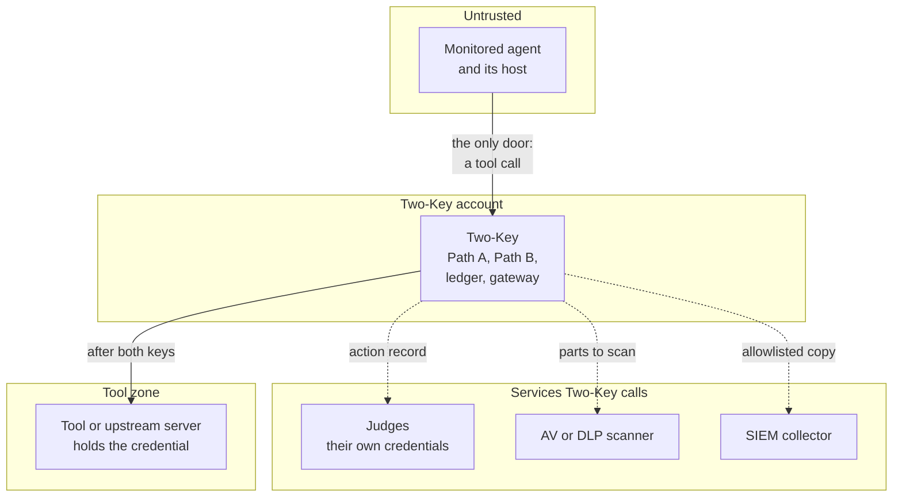

<!--
Copyright 2026 Insomniac-VibeLabs
Author: Stephan Busch
SPDX-License-Identifier: Apache-2.0
-->

# Threat model

This is the design model for `two-key` 0.8.0 (tag `v0.8.0` on `main`), the latest release, and for the
0.9.0 work on `working`, marked 0.9.0 where it applies. What each
release added to the model is under [Changes by release](#changes-by-release) at the end of
this page. Tags and branches are in [AGENTS.md](../AGENTS.md), and the full history is
[CHANGES.md](../CHANGES.md).

It is not a penetration test and it is not an independent review. The package is
beta (pre-1.0): maintainer-reviewed with live LLM testing and automated
scanners, not independently audited. It is not a FIPS 140-3 validated module. Crypto is hybrid
Ed25519 + ML-DSA-65 signatures (0.9.0), SHA-256, and AES-256-GCM from the `cryptography` package.

How to report a vulnerability is [SECURITY.md](../SECURITY.md). The longer
narrative is the README. This file is the register. If the two disagree,
the code wins, then this file should be corrected.

## Contents

<!-- toc -->
- [Assets](#assets)
- [Actors](#actors)
- [Trust boundaries](#trust-boundaries)
- [What this design is meant to stop](#what-this-design-is-meant-to-stop)
- [Assumptions](#assumptions)
- [Residual risks](#residual-risks)
- [Out of scope](#out-of-scope)
- [Planned changes to this model](#planned-changes-to-this-model)
- [What to re-check when the code changes](#what-to-re-check-when-the-code-changes)
- [Changes by release](#changes-by-release)
<!-- /toc -->

## Assets

- The signed constitution and the two compilation hashes (bytecode and prose).
- The principal signing key. It signs the constitution and the ledger head.
  It does not sign capability tokens. It may be encrypted with a passphrase
  (`two-key config key-passphrase`): then a copy of `principal.pem` alone
  does not sign, but Two-Key's own account, which reads both the key and
  `keys.passphrase_file` so the proxy can start unattended, still can.
- The capability private key, outside the ledger directory
  (`<ledger>.capability/capability.pem`). `TwoKey` mints with it. The
  gateway's verifier holds only the public half. This is key separation
  at the API, not process isolation: the gateway runs in the `TwoKey`
  process on the `TwoKey` ledger object (`TwoKey.gateway()`), which holds
  the principal, witness, and ledger keys, and the minting key is in the
  same process. A gateway in another process or on another host is not
  supported, by design ([why](HOWTO.md#deployment-boundary-the-gateway-runs-in-the-twokey-process)).
- The ledger key and the witness key, both outside the ledger directory
  (`<ledger>.ledger-key` and `<ledger>.witness`).
- The witness public key the operator keeps outside the ledger
  (`witness_public_key=`, `--witness-public-key`), when one is configured. It
  is not secret, but whoever can change it can make a forged head pass.
- The head anchor (`<ledger>.ledger-key/head.anchor`, or `anchor_path=` /
  `--head-anchor`). It is not secret. Whoever can change or delete it can
  make a rolled-back ledger pass. It is not an external anchor.
- The per-install fingerprint key (`<ledger>.ledger-key/fingerprint.key`),
  which keys credential fingerprints. It sits beside the ledger key, so it
  protects fingerprints only from someone without that directory. Against
  someone with it, a random API token is safe by its length, a guessable
  token (a placeholder such as `EMPTY`, or a short key chosen for a local
  server) is not, and a password is protected only by PBKDF2's cost
  (600,000 iterations), which slows guessing but does not stop it for a
  guessable password. PBKDF2 is not memory-hard, so dedicated hardware
  guesses faster against it than against scrypt; it is used because it is
  an approved function and scrypt is not (ROADMAP 0.9).
- The wrapped data key stored inside the ledger directory.
- Judge credentials and monitored-agent credentials. They are not the same secret.
- The capability token and the argument bytes it is bound to.
- Tool credentials, which only the gateway should hold. Behind the MCP
  proxy, the upstream server's credential (`upstream.env`), which only the
  proxy and its upstream child should hold.
- The MCP proxy's `proxy.yaml`, above all `upstream.schema_digest`,
  `upstream.command`, `tools.<id>.facts`, and `allow_unresolved_identity`.
  Whoever can change it can accept a changed tool schema, run another
  server, point a fact hook at other code, or start beside an unresolved
  judge identity. It is policy, like the constitution, but it is not signed.
- Fact hooks and the system of record they read. A `source: caller` field
  is whatever the hook returns; whoever can change the hook or the record
  decides that fact.
- The SIEM configuration and the files it names (0.7.0): the webhook's
  authorization header file, the HMAC key file, and a syslog sink's client
  certificate, client key, and CA file. Whoever can read the header or HMAC
  file holds the collector's credential; whoever can change the CA file or
  the configuration can point the copy at another collector. They live
  outside the ledger directory, are read owner-only, and are named to the
  start-up writable-path check.
- The SIEM cursor (`<ledger>.siem/cursor.json`, or `cursor_path=`), outside
  the ledger directory. It is not secret and it is not part of the hash
  chain. Whoever can change or delete it decides which entries are copied
  again or, by deleting it, not at all; a repeated or missing copy is still caught by `two-key siem-verify`
  against the ledger. A cursor past the ledger's last entry, or one that
  names an entry this ledger does not have, is not trusted: the proxy warns
  and sends the whole ledger again, marked `replay` (live run 9x, C140).
- An exported event file (`two-key siem-export --out`). It is decrypted
  ledger metadata, written as a new owner-only file. It holds no argument
  value, no proposal text, and no key.
- The ledger head and the hash chain.

## Actors

- The principal, who holds the signing key and writes the constitution.
- An untrusted agent, local or cloud. Hosting is not trust.
- Path B judges, each with its own credential. A judge can be wrong.
- The caller that invokes authorize, then the gateway, and supplies
  caller facts (`facts=`) from its own system of record. Trusted, like the
  operator: a fact hook is operator code.
- The upstream MCP server behind the proxy: third-party code, often
  fetched fresh. Its tool descriptions, hints, and results are untrusted
  text.
- Anyone who can read or write the ledger directory, the ledger key, or the
  witness key.
- The log collector or SIEM, and whoever can read it (0.7.0). It receives
  ledger metadata. It is trusted to store it, never to decide anything: no
  answer from it changes an authorization.

## Trust boundaries

The picture shows who sits on which side of a boundary. The bullets below take each crossing in turn.

*In a correct deployment the agent reaches Two-Key and nothing else. The solid lines are what the agent's call sets in motion; the dashed lines are Two-Key's own calls to the judges, the scanner and the SIEM, which the agent must not be able to reach.*

- Caller to the monitored agent. The agent gets the system prompt, the
  constitution prose, the instruction, and, only when the caller passes
  it, the syntax-only `agent_vocabulary()`. It never gets bytecode, an
  `allow` list, a rule, a threshold, or a credential. Ids written in the
  prose or the instruction do reach it and its host.
- Agent to `authorize_from_agent`. The reply is a proposal or a decline. The
  method does not execute a tool. A decline (`agent_declined`) runs neither
  path and issues no token; a decline mixed with a call is
  `malformed_proposal`. A hostile agent can decline to deny service, as it
  already could with a bad proposal; it cannot turn a decline into an allow. A cloud judge must not reuse an agent credential.
  A missing session is a deny (`cloud_judge_session_required`).
- Caller to Path A. The VM sees the normalized action record, not the proposal.
- Caller facts to Path A. A `source: caller` field (constitution v3) takes
  its value from `facts=` only, never from the arguments, the claim, or
  `Action.raw`. Arguments that write it deny (`caller_field_in_arguments`),
  a missing fact denies (`field_missing`), and a fact the tool does not map
  denies (`fact_not_mapped`). The record names these fields in
  `fact_fields`. The gateway takes the facts again at redemption; a value
  that differs from the token's form is `fact_mismatch`.
- Caller to Path B. Judges see the constitution prose and the normalized
  record. Non-empty tool arguments are attached on that record as
  `tool_args`, except after a derive deny (`derive_failed:*`,
  `amount_mismatch`, `counterparty_mismatch`, `irreversible_mismatch`).
  `tool_args_on_derive_deny` defaults false. Set it true to send those
  bytes. Without it, a `derive_failed:` call reaches no judge (Path B is
  ledgered as `skipped:derive_failed`); mismatches and other denies still
  go to the judges, which attach the arguments. The proposal is withheld unless that judge sets
  `receives_proposal` or the quorum policy is `judge_inputs: record_and_proposal`.
  The default is record-only.
- Both paths run once the call is well-formed and within limits; a malformed or oversized
  call is denied before either path (size and digest only). A call that cannot be read under its
  spec (`derive_failed:`) skips the judges unless `tool_args_on_derive_deny` is set: Path A has denied
  it, and the judges would get an empty form. `require_path_a_first` is stored on the policy and
  copied into `to_record`. `TwoKey.authorize` does not read it. There is no
  `short_circuit_path_b` setting on `TwoKey`.
- Gateway to the tool. The token is checked against the caller's argument
  bytes, then `redemption_started` is checkpointed, then the registered
  function is called with declared paths only. Unnamed keys are not passed
  in. A counterparty path is the canonical party, not the raw spelling.
  The gateway never scans: with a content scanner configured, it takes the
  verdict from the token and hashes each file sent by path again
  (`file_changed`).
- Two-Key to the content scanner (0.6.0; docs/SCANNERS.md).
  Optional. For each call to a tool the signed constitution marks (it maps
  the `scan` field), Two-Key sends the scanner every argument (keys the
  tool will not receive included), each declared file decoded or read from
  its folder, and the proposal text, after the call reads under its spec
  and before Path A. The agent cannot start, skip, or answer a scan: `scan`
  in its arguments is `caller_field_in_arguments`, and in `facts=` it is
  `scan_fact_supplied`. The scanner is trusted to answer, not to decide: a
  timeout, an exception, or an answer Two-Key cannot read is
  `unavailable`; a result it could not finish, or content it could not
  look inside (`encrypted`), is `flagged`. The signed rule on the verdict
  decides. Only a tool whose signed spec says `encrypted: pass` turns an
  `encrypted` finding into the verdict `encrypted`, and only when it is the
  sole finding; the gateway refuses that verdict for any other tool
  (`scan_mismatch`). A declared file Two-Key cannot read (bad base64,
  a path outside its folder, a link, a missing file), or a call over a file
  limit (each file's required `max_bytes`, 32 files, 100 MiB together), is
  denied before the scanner and both paths under every stance, and nothing
  past a limit is read.
  The scanner sees content, so it is a new audience for it, as cloud judges
  are; its adapters get no keys, and a command scanner gets a minimal
  environment. Judges get the verdict in a trusted section, file digests in
  place of files, and, when flagged, no arguments or proposal unless
  `tool_args_on_scan_flag`. The ledger gets digests, sizes, the verdict,
  categories, and the scanner's label and version, never content.
- Agent host to the MCP proxy (stdio). The host sees the signed tools only,
  under their signed ids, with the pinned fields (`name`, `title`,
  `description`, `inputSchema`, `outputSchema`, `annotations`). Each
  `tools/call` is authorized with a fixed claim and proposal from
  `proxy.yaml`; the agent writes only the arguments. Caller-supplied
  paths are removed from the `inputSchema` the host sees; their values
  come from the `tools.<id>.facts` hooks, which run in the proxy. A name
  the proxy does not show is refused and ledgered (`tool_not_offered`). A
  refusal returns a reason code, never a value. The proxy does not listen
  on the network: an agent host on another machine starts it over SSH, as
  a login account whose forced command is the `run-proxy` sudo rule
  (CONNECTING, "An agent on another machine"). The forced command,
  `restrict`, and the firewall are the operator's; Two-Key cannot see
  them, and its start-up checks cover only its own machine. The proxy
  refuses to start when the account that started it (the agent host's, or
  the SSH login account's, read from the parent process) is Two-Key's own,
  is root, cannot be told, or can change a path the proxy runs or reads
  (`on_agent_access`, default `refuse`). It reads the parent's real user,
  so it is not fooled by an environment variable, but it cannot see an
  agent that reaches Two-Key's files another way (a second login, a shared
  folder, a tool running as another account). Proxies that share a ledger
  read and verify each other's entries under the lock before they write.
  Remote agents have had little testing (ROADMAP, "Where we are").
- MCP proxy to the upstream server (stdio, a child process). The server
  receives only the projected arguments of a redeemed token, and only the
  variables in `upstream.env` plus the SDK's minimal set. It gets no
  sampling, elicitation, or roots callbacks, and its resources, prompts,
  and instructions are not forwarded. Its tool list is read once, at start,
  and checked against `upstream.schema_digest`: a mismatch refuses to start
  unless `on_schema_change: warn`.
- Ledger to the SIEM (0.7.0; [SIEM.md](SIEM.md)). Optional. Each entry is
  copied after it is written and fsynced, by sequence number only: the
  projection, the formatting, and the send happen on a sender thread,
  never under the ledger lock and never on the authorization path. An
  explicit per-kind field allowlist decides what leaves: reason codes,
  digests, sizes, the tool id, the data class, the quorum counts, the
  scanner verdict, and the entry's own hash. Argument values, proposal and
  decline text, the derived amount, counterparties, and custom field
  values, scanner threat names and matched text, and every credential are
  excluded, and a ledger field nobody has decided about does not leave
  (`tests/test_siem.py` fails while one is undecided). The collector is a
  new audience for that metadata. It cannot answer back: a sink that is
  down, slow, or hostile delays copies and nothing else. TLS verifies the
  certificate and the host name, with no setting that turns either off, and
  `high_assurance` refuses a plaintext sink (`siem_plaintext_refused`).
  `two-key siem-export` is the same projection written to a file, and
  `two-key siem-verify` re-derives every exported event from the ledger.
- Gateway to the refused-token count (0.7.0). A token that does not verify
  is refused with no ledger entry, as before, so an unauthenticated caller
  still cannot make the ledger grow. The gateway counts the refusal by
  class (bad signature, expired, malformed, other) in memory and reports
  the counts at most once an interval, on stderr and, when a SIEM is
  configured, as an event marked `ledgered: false` with `seq: -1`. No token
  text, digest, or id is kept, and nothing is written to the ledger.
- Process to the ledger. Appends and checkpoints take a POSIX `flock` on
  `<ledger>.lock` next to the ledger directory. If the file changed since
  this process loaded it, the write is refused. Redemption also takes a
  `flock` under `<ledger>.redeem-locks/`, outside the ledger directory.
  Where `fcntl` is absent, only the in-process lock remains.

## What this design is meant to stop

- A tool execution inside `authorize_from_agent`.
- A call that looks normal alone but is not (0.8.0): a duplicate bill, a split payment, a burst of denied
  attempts. The judges get a summary of recent decisions for the same signed tool and counterparty, and the
  agent's bursts of denies, built by Two-Key from its ledger and bound to the round (`history_digest`). Agent
  text never reaches the summary. Two duplicates decided at once on one ledger do not both get a token
  (`history_changed`).
- An allow when either path denies or does not answer. A missing, malformed,
  or timed-out ballot is an abstention, not a yes. A ballot that names
  another judge abstains (`judge_id_mismatch`). At least one judge must
  be configured. With `required_yes` unset, the affirmative threshold is
  `min(2, number_of_judges)`; this is not a majority rule. The default
  has no diversity floors. `QuorumPolicy.high_assurance()` needs judges
  from two model makers (the operator's `maker:` labels, not verified),
  one local judge, and a yes from a local judge;
  `QuorumPolicy.section4()` is that plus `require_path_a_first`. The flag
  is still not a skip. `min_distinct_providers` still defaults to 1.
- An older constitution put back. A constitution signed by the principal
  stays valid forever, so a copy of an older one (with fewer rules) would
  start. With a signed `serial` in the rules file, a ledger that has run
  serial N refuses a lower serial, N again with other rules, and a
  constitution with no serial (live run 9x, C44), also when two proxies
  start at once on one ledger (run 9y, S6c). It does not help a
  deployment that has never signed a serial, nor an attacker who holds the
  principal key, who can sign anything.
- A judge is not the monitored agent: `TwoKey` refuses to start when a
  judge holds the agent's credential (the same API token, or the same
  username and password) at any address, whether or not either side sends
  it and whether it is held as a token or as a Basic pair, or when both
  sides send no credential on one address, compared as configured
  (`host:port`, local aliases folded, no DNS). Any model and any
  vendor is allowed otherwise. The likely accidents (one side keyless on
  the agent's address, the agent's model on its address or through a
  shared or undeclared proxy, a shared tenant id, an unresolved upstream)
  start with a warning on stderr and in `constitution_loaded`. The agent
  is declared by the operator, never by the agent. A judge that presents
  the runtime agent's session abstains, wherever it connects.
- A value read twice: every JSON and YAML input refuses a repeated key and
  a YAML merge key (`<<`).
  Oversized or too-deeply nested arguments are a deny before the ledger.
  Inputs stop at 62 levels, two under the encoder's 64, so the ledger and
  judge wrappers always encode.
- A token replay, a token used for different argument bytes, a token used
  after expiry (120 seconds unless you change it, at most 300), a token
  whose lifetime exceeds the TTL or whose issue time is in the future, and
  a token issued before a revocation or a constitution reload and used after
  it. `revoke` ends earlier tokens only: it does not stop new approvals and it
  does not survive a restart (see HOWTO, "Revoke outstanding tokens").
- A second run of a token after `redemption_started` has been checkpointed.
  A tool exception writes `redemption_aborted`, and from 0.9.0 the token
  stays spent (`already_attempted`): a tool that acted and then failed does
  not run twice on one token. The agent asks again.
- A silent edit of a ledger record that still verifies, and opening the log
  with only the principal key. The head needs a witness signature as well.
- A replaced `witness.pem`, or a head signed by another witness key, on a
  chain that was not rewritten (#58). The witness public key is pinned in
  the ledger: the first entry of a new ledger is `witness_pinned`, and a
  ledger from 0.2.2 or earlier pins the key that signed its head on its
  first open under 0.2.3. A head or a `witness.pem` that does not match is
  refused (`witness_key_changed`) on open, append, and checkpoint. The key
  changes only by a `witness_rotated` entry signed by the principal and the
  old and new witness keys.
- With the witness public key also configured outside the ledger
  (`witness_public_key=`, `--witness-public-key`), a head forged with the
  principal key and the ledger key but without the witness private key,
  even on a chain rewritten from its first entry.
- An edited, short, or padded copy of the ledger in a SIEM (0.7.0).
  `two-key siem-verify` verifies the ledger, re-derives each exported
  event from it, and names every field that differs, every sequence number
  that is missing or repeated, and every event that is not in this ledger.
  It does not need the SIEM to be trusted.

## Assumptions

- Behind the MCP proxy: the agent host cannot reach the upstream server or
  its credential by another path, cannot read the proxy's keys,
  environment, or `proxy.yaml`, and the upstream server runs as an OS user
  that cannot read them either (HOWTO "Key custody").
- The gateway is the only holder of tool credentials. This package cannot
  stop an agent that can call the tool by another path, unless the tool
  checks each call itself (docs/TOOL_CHECK.md, MCP proxy only).
- The principal key and the ledger key are not both in the attacker's
  hands, unless the witness public key is configured outside the ledger.
  With that pin, the assumption is that the principal, witness, and ledger
  keys are not all in the attacker's hands, and that the attacker cannot
  change the configured copy of the witness public key.
- The action record describes the real call only for fields the tool spec
  names. Every loaded constitution has `tool_specs`. A tool with no spec
  does not redeem. A counterparty path requires `allow`. A party off that
  list does not authorize (`counterparty_not_allowed`), unless a blocked
  party is also present, in which case the block rule still denies. A
  domain entry (`@example.org`, v3) admits a plain address at exactly that
  ASCII domain, never a subdomain or an address with a non-plain local
  part; block lists stay exact.
  `deny_unmapped` defaults off. An unnamed key does not reach the tool.
  Setting the flag denies the call instead (`unmapped_field`). Custom
  fields (`fields:`, `deny_if_fields`) are read the same way: from the
  argument path the signed spec names, never from the agent's claim, or,
  for a `source: caller` field, from `facts=` only. Every tool maps each
  field a rule reads or marks it `not_applicable`; a marked tool gets the
  field's signed default. A forgotten decision does not sign or load.
- Two-Key does not verify facts about the world. The agent writes the
  arguments, so a custom field such as `po_matched` is the agent's
  assertion; a rule on it checks consistency, not truth (live run 5c, C05:
  `po_matched: true` on a mismatched invoice was paid). The tool, or the
  integration calling Two-Key, must check such facts against the system of
  record. A `source: caller` field moves that check into the integration's
  fact hook: Two-Key then checks that the agent did not write the fact and
  that it did not change between authorize and redemption, not that the
  hook is right.
- Judges are one key of two. The quorum does not prove the models are
  independent. The diversity floors are off by default; `high_assurance`
  turns them on. A judge that is not the same agent may still share a
  provider and its blind spots with the agent, or run the agent's model
  under another key (allowed; warned on the same address or through a
  shared or undeclared route, silent through a recognized router). A declared `upstream:` and a
  `model_prefix` resolution are operator-attested and not verified; they
  change which warnings print, not what is refused. Two names for one
  server (a CNAME, or a host name and its IP) are two addresses.
- Each judge answers a ballot from that request alone. Two-Key sends no
  earlier calls, at temperature 0; since 0.8.0 it sends a summary of past
  decisions that it writes itself from its ledger (`<decision_history>`),
  never the agent's text from them. A judge endpoint that keeps memory across
  ballots (a persistent agent, a chat with saved memory) lets text the agent
  wrote in one call reach the vote on another, outside what the ledger
  records. Two-Key cannot detect it; give each judge a fresh context per
  ballot (JUDGES_AND_QUORUM "What a judge is").
- Without a local judge, the constitution prose, the action record, and any
  attached tool arguments go to the cloud judges' vendors. Since 0.8.0 so
  does the judge history summary on every call: signed tool ids,
  allow-listed counterparties, amounts, counts, and times
  (`quorum.judge_history.enabled: false` or local judges avoid it).
- The host clock is right. Decision times (`at`) and the history windows
  come from it. Changing it needs Two-Key's account or root, which the agent
  account check keeps from the agent; a clock that goes back makes the
  summary show more, not less (`clock_went_back`).
- With a SIEM configured (0.7.0), the collector and everyone who can read
  it are an audience for ledger metadata, and the operator's own network
  carries it. Two-Key assumes the collector stores what it is sent; it
  never asks the collector anything, so a wrong or hostile answer cannot
  change a decision.

## Residual risks

These are accepted or still open. They are not bugs the design already
claims to close.

- No independent review, and no production deployment.
- Any route around Two-Key is outside what it can see: a tool
  credential the agent holds, a network route to the system of record, a
  second tool on the agent host that reaches the same system (a shell, an
  HTTP or browser tool, a file tool that writes into a `kind: path`
  folder), or write access to what Two-Key trusts (config files, hook
  modules or anything on its `PYTHONPATH`, a local judge's model). On one
  machine, an agent can also take a loopback port a judge, scanner, or
  hook back end left free (after a crash or restart) and answer in its
  place. docs/CONNECTING.md lists each connection and how to close it.
  Two-Key names, at start, each file or folder it runs or reads that
  another account could change (`writable_path`), and refuses under
  `high_assurance` or `on_writable_paths: refuse`. That catches a setup
  mistake; it cannot see the wrapper that started it, the upstream's
  files that no absolute argument of `upstream.command` or
  `upstream.check_paths` names, or what is inside a named folder, and code
  already changed has already run. A launcher (`sudo`, `npx`, and the like)
  with nothing named warns `upstream_paths_unchecked`, and refuses under
  `high_assurance`.
- MCP proxy (0.5.0):
  - An agent that can reach the upstream server directly, or holds its
    credential, bypasses the proxy entirely. The proxy cannot see or stop
    that. From 0.9.0 a tool with the tool check on (docs/TOOL_CHECK.md)
    refuses such a call itself: it runs only with a spent token and a redeem
    stamp, and signs a receipt the gateway checks and ledgers. A tool
    without the check, or a server that runs the tool after the check
    refuses, is still bypassed.
  - An upstream server run as the proxy's OS user can read every key the
    proxy holds (principal, ledger, witness, capability), the judge keys,
    and the proxy's environment through `/proc`. The proxy does not change
    users itself; `upstream.command` must (HOWTO "Key custody").
  - The schema pin covers what the agent is shown, not what the server
    does. A server can change its behavior, or read an argument
    differently, without changing a schema.
  - `on_schema_change: warn` starts with a changed, possibly poisoned,
    description; the warning goes to stderr only.
  - An upstream result reaches the agent unread. Injected text in a result
    is not scanned; each later call is still authorized on its own.
  - A call that times out (`call_timeout_seconds`) is recorded as
    `redemption_aborted`, but the server may still have done the work.
  - A fact-like argument still mapped by `json_path` alone is the agent's
    assertion; the drafter leaves such properties out of the spec, but a
    principal who maps one back accepts the agent's word (run 5c, C05).
    Declare it `source: caller` instead.
  - Deny reasons show the agent the rule id that denied
    (`rule_denied:<id>`). A rule id that encodes a threshold tells the agent
    that threshold.
  - One call runs at a time; a slow judge round delays the next call.
  - The proxy does not verify the upstream server's identity beyond the
    command it runs. A changed package behind an unpinned `npx -y` shows
    up only if its schema changes.
- Judge history (0.8.0, `two_key/history.py`). New read during
  authorization: an in-memory index of the ledger. A bug there can change
  what judges see, never Path A or the token; a summary that cannot be
  built is a deny (`internal_error:history`) unless the operator sets
  `on_failure: judge_without_history`, and either way a
  `judge_history_failed` entry is ledgered and sent to the SIEM. What stays
  open:
  - Slow drip: an agent can send many small allowed calls so a pattern
    looks normal. The 90-day totals make it visible to the judges; whether
    they act on it depends on the prose. The fallback named in #1, one
    optional ceiling per tool, is built only if live runs show judges miss it.
  - Deny floods push older decisions out of `last_decisions`, but allowed
    totals and `days_since_last_allowed` are counted apart, so a flood
    cannot hide an allowed duplicate.
  - Two processes on one ledger deciding duplicates at the same moment:
    neither sees the other in flight. The re-check at mint, under the ledger
    lock, denies the second (`history_changed`), so both cannot get a token;
    an honest race between two calls to one party costs one extra deny.
  - History before 0.8.0 has no times: it shows as `before_upgrade` and the
    windows fill up over 90 days.
  - The summary carries no agent text, but it does carry the agent id when
    the operator configured it; any other id is shown as `unnamed`.
- Ledger audit window (0.8.0, `two-key ledger-view`, `two_key/ledger_view.py`,
  `two_key/ledger_gui.py`). New audience: whoever can see the screen. It
  shows every field of every entry decrypted, including proposal text,
  derived amounts and counterparties, and custom field values, which the SIEM
  export leaves out; a judge's rationale is not in the ledger, so it cannot
  show that. It opens the ledger as `two-key audit` does (chain, signed head,
  witness pins, head anchor) and refuses one that does not verify, and it
  holds the principal private key in memory while the window is open, so
  Reload can open the ledger again. No new boundary: it is a tkinter window
  of the operator's own process, with no network port, no server, and no
  export; `--print` writes to standard output only. It never appends to the
  ledger (`tests/test_ledger_view.py` checks every file is unchanged). A
  regular expression in a filter runs on the operator's own machine against
  their own ledger, capped at 500 characters.
- Constitution editor (0.8.0, `two-key constitution-editor`,
  `two_key/constitution_editor.py`, `two_key/constitution_gui.py`). No new
  boundary and no new signed format: it is a tkinter window of the
  principal's own process, with no network port, and it signs with
  `sign_constitution` and verifies with `verify_signed`, unchanged. It reads
  the principal key only when Sign and save is pressed, and empties the
  passphrase box after each try. It writes the prose and rules owner-only and
  the signed file last, after the written rules read back as the same body,
  and refuses to write over a file unless told to. A trial call signs the
  draft with a throwaway key and runs on a temporary ledger with a stand-in
  test-double judge, so it can never reach a real judge, ledger, or tool.
  Residual: whoever can see the screen sees the draft; signing a new
  constitution into a deployment folder is not a `config_changed` entry,
  exactly as with `sign-constitution --force` (the next start records
  `constitution_loaded`, and the serial still refuses an older one).
- Setup window (0.9.0, `two-key setup --window`, `two_key/setup_form.py`,
  `two_key/setup_gui.py`). No new boundary: a tkinter window of the
  operator's own process, with no network port, that collects the same
  answers as the terminal interview and calls the same `setup_cmd.build`,
  so it refuses what `setup --answers` refuses (root, an existing folder, an
  unsafe parent, a failing `config check`) and writes the same files. It
  creates the principal key in that call, as the terminal setup does, and
  never shows it; it never asks for a secret or a typed passphrase (the
  passphrase is a file path). A weaker answer needs the typed `yes`. Under
  `high_assurance` the window lets the quorum numbers go up only. Save
  answers file writes owner-only JSON with variable names and paths, no
  values. Residual: whoever can see the screen sees the answers.
- One proxy per agent (0.8.0, `one_proxy_per_agent`, on by default). A
  second proxy for an agent already connected to the ledger refuses
  (`agent_already_connected`). A proxy whose client died but whose process
  lives on (a dead SSH session) holds the lock until it ends; sshd's
  `ClientAliveInterval` ends it. Turned off, several proxies may serve one
  agent, and only the re-check at mint keeps their histories in step.
- Judges not asked about an unreadable call (0.5.0). A `derive_failed:`
  call is denied without a judge opinion in the ledger, unless
  `tool_args_on_derive_deny` sends the arguments to the judges; Path B is
  recorded as `skipped:derive_failed`. The call was already denied, so no
  allow is possible; the ledger simply has one opinion fewer.
- Caller-supplied facts (0.5.0):
  - A fact hook is trusted code that receives agent-written arguments. A
    hook that returns an argument (`arguments["po_matched"]`) turns the
    fact back into the agent's assertion. A hook that looks a record up by
    an id the agent wrote must also compare the record to the call (payee,
    amount); otherwise the agent can cite a matched invoice for another
    payment.
  - Facts are looked up before authorize and again just before the tool
    runs. A value that changes after the second lookup is not seen: the
    window is narrowed, not closed.
  - A hand-written integration that passes facts to `authorize` and not to
    `invoke` gets `fact_mismatch` (closed). One that passes facts it took
    from the agent defeats the field; the library cannot tell.
  - Judges see the fact values in the record, as they see other fields.
- Domain allow entries (0.5.0). `@example.org` admits every plain address
  at that domain, including mailboxes created later and ones an attacker
  controls inside it. Path A then checks the domain, not the person; when
  the tool carries free text, only the judges check the content (run 6x,
  X31). It is the principal's signed choice, and signing warns.
- Custom Path A fields (0.3.0). A tool marked `not_applicable` for a field
  gets the field's signed default, as a tool with no amount spec has
  `amount_usd` 0. Since 0.5.0 a forgotten mapping is refused at signing and
  on load, but a wrong mark is still the principal's error. Rules written as
  allow-lists (`not_in`) and restrictive defaults fail closed in that case;
  rules written as deny-lists (`in`, `eq`) do not. A deny-list on a
  `string` field also misses spelling variants (`prod` and `production`),
  and on a `case: exact` field it misses case variants (`FLD-A`, `fld-a`),
  which is wrong when the tool itself ignores case; signing warns.
  Characters are controlled, meaning is not: lookalike letters from another
  script, invisible characters, and direction controls deny, but this
  package does not know that two words mean the same thing. A field
  declares one script or one approved combination (`japanese`, `korean`,
  `chinese`), so one field cannot hold words from two unrelated scripts.
  Script detection uses Unicode character names from Python's
  `unicodedata`, whose Unicode version differs by Python release; a
  character newer than the running Python's data is refused. Derived field
  values are written to the encrypted ledger and sent to judges, including
  cloud judges; descriptions are not. A description is shown to people
  only, and direction controls are refused in it, but its wording can still
  mislead a reviewer; it is signed with the rest of the constitution.
- Trusting the agent's claimed fields instead of reading them from the
  argument bytes is closed for loaded constitutions. `tool_specs` is required to
  sign and to load. `two_key/derive.py` reads amount and counterparties by
  JSON path. It does not read English. A present claim that disagrees with
  the bytes is a deny (`amount_mismatch`, `counterparty_mismatch`,
  `irreversible_mismatch`). An omitted amount or counterparty is filled from
  the bytes. A missing amount path, a non-numeric amount, or a currency path
  that is not `usd` denies. `data_class` combines the claim and
  `data_class_floor`: `public` < `personal` < `financial`, `medical` <
  `classified`; `financial` and `medical` together are `financial+medical`,
  which a `data_class_in` rule naming either matches. Only a claim or floor
  of `classified`, or an omitted claim, is `classified`. The token binds `spec_hash` and that
  form. The gateway recomputes the form from the same bytes and refuses a
  mismatch. Changing a spec changes `spec_hash`, so outstanding tokens fail
  at the gateway. This package does not classify free text and does not
  track per-value information flow. A counterparty the spec copies must be
  on that path's `allow` list. The tool receives the canonical value
  (`strip`, casefold), not the raw spelling. A party that is not listed is
  `counterparty_not_allowed`, unless a blocked party is also present, in
  which case the block rule denies. A currency path is delivered as `usd`.
  A path the spec does not declare does not
  change the form and is not passed to the tool. With `deny_unmapped` left
  off (the default), the call can still allow. With `deny_unmapped` set,
  the unnamed key is `unmapped_field`. Neither mode interprets the value.
  `payload` names a value that may be present. With no `shape`, the path
  covers that value and its children, and the value is not classified.
  `shape` of `string`, `number`, or `list` (strings only) refuses a
  different kind. `max_length` bounds a string or a list. A boolean is not
  a number. `payload_shape` is a derive deny. Shape does not read contents.
  Meaning stays with Path B, or, from 0.6.0, with a content scanner the
  operator connects (see "Trust boundaries"). The token still binds
  the caller's original argument bytes. Redeem with those same bytes. The
  function is called with the projection. Missing `data_class` still becomes
  `classified` before the floor, and the floor cannot lower that default.
  Missing `irreversible` is taken from the spec, so a tool signed as
  reversible stays reversible. A present `irreversible` claim that differs
  is `irreversible_mismatch`. The policy VM has one counterparty string. A
  list is reduced to one party, preferring any party on
  `deny_counterparties`, so a blocked party is not hidden behind an allowed
  one. A derived amount that is not finite or above the action sanity cap
  is `amount_unreadable`.
- A derive mismatch (`amount_mismatch`, `counterparty_mismatch`,
  `irreversible_mismatch`) does not skip Path B. Judges still receive the
  normalized action record, without `tool_args` unless
  `tool_args_on_derive_deny` is true. A `derive_failed:` call skips the
  judges unless that flag is true, since they would get a form with nothing
  derived in it. A deny that is not a derive deny still attaches non-empty
  arguments. The tool still does not run on a deny.
- The gateway's verifier has no capability-minting private key. The minting
  key is the capability key outside the ledger directory. The principal
  key remains on the shared ledger object because the ledger head needs it.
  A token signed with the principal key fails `bad_signature`. The gateway
  is not a separate process or host, and a split gateway is not supported
  by design ([why](HOWTO.md#deployment-boundary-the-gateway-runs-in-the-twokey-process)): it shares the `TwoKey` process and ledger object. Registered tools
  run in that process, so a compromised tool or dependency can read the
  minting key and the principal, witness, and ledger keys. Do not treat the
  implementation as providing process-level isolation. A gateway built on a
  ledger no `TwoKey` in the process opened warns once
  (`TwoKeyDeploymentWarning`) and refuses tokens issued after that ledger
  last read the file: the check fails as `ledger_size_invalid`, before the
  gateway catches up on the other process's entries to record the refusal.
- Stealing the ledger key decrypts the log. Stealing the principal key does
  not, and it does not mint a token the gateway will accept. Stealing the
  capability private key does. Stealing the principal key and the ledger
  key is still enough to forge a head when no witness public key is
  configured outside the ledger: the in-ledger pin is part of the chain, and
  those two keys can rewrite the chain from its first entry, pin included,
  under a new witness key. With the out-of-ledger pin, forging a head needs
  the principal, witness, and ledger keys together (#58). An encrypted
  principal key adds its passphrase to that list for a stolen copy of the
  file, not for an attacker on Two-Key's account. There is no
  external anchor, so those keys are enough to rewrite a ledger that never
  leaves the machine.
- Trust on first use: a ledger from 0.2.2 or earlier pins the witness key
  that signed its current head on its first open under 0.2.3. A witness key
  swapped before the upgrade, and the heads it signed, cannot be detected.
  A configured out-of-ledger pin, if the operator kept a copy of the
  original witness public key, does detect it.
- A rollback or wipe that also deletes `head.anchor`, or replaces it with an
  older copy. The anchor sits outside the ledger directory
  (`<ledger>.ledger-key/head.anchor`, or `--head-anchor`). A ledger-directory
  writer who cannot touch that file is refused (`ledger_rolled_back`). The
  file is adopted when it is missing, so deleting it and opening accepts the
  ledger as it stands. With the principal key and write access to
  `<ledger>.ledger-key` and `<ledger>.witness`, a whole replacement ledger
  under a new ledger key verifies once that attacker also removes the
  anchor, unless the witness public key is configured outside the ledger.
  Neither witness pin, by itself, detects a rollback. There is still no
  external anchor (#62).
- A rotation interrupted after its head is written and before the new key
  is moved into place leaves `witness.pem.new` beside `witness.pem`, and the
  ledger refuses to open (`witness_key_changed`) until it is moved. A lost
  witness key is restored from the witness bundle (0.3.0). Without that
  bundle it means a new ledger.
- Key backup bundles (0.3.0). A bundle is equal to the keys it holds.
  `principal.bundle.json` holds the principal key and the capability key.
  `ledger.bundle.json` holds the ledger key, the fingerprint key, the ledger
  ciphertext, and `head.anchor` from that moment. `witness.bundle.json` holds
  the witness key. One bundle never holds every key a signed head needs.
  Guessing a bundle's passphrase opens that bundle. PBKDF2-HMAC-SHA256
  (600,000 iterations) slows guessing and is not memory-hard. The same
  passphrase on two bundles, or on all three, stored together, is one guess.
  Export holds the ledger lock while it copies, and it does not write a
  bundle set that would not open. It refuses a symlink output directory and
  a directory the group or others can write.
  A restore onto a newer ledger fills missing key files only. A key already
  on disk stays, including a witness rotated after the backup, so that
  restore does not roll the witness back. `--replace-ledger` is what writes
  the older ledger, its anchor, and the keys from that moment.
  `backup-restore --replace-ledger` writes an older ledger and its anchor
  together, and replaces a key file that differs, which can make a token
  spent after the backup look unspent and undoes a later witness rotation.
  Deleting `head.anchor` is still not detected, and restore does not do it.
  The backup is not an external anchor.
- What the ledger holds today: the agent's proposal text in full (the
  `proposal` entry), the derived form (`action_normalized.form`: the amount,
  counterparty, counterparties, and custom field values read from the
  argument bytes), reasons,
  digests, and sizes. It never holds the raw argument bytes of an oversized
  or dropped value, only its size, digest, or key name. It never holds keys.
  Anyone who can decrypt the log can read the proposal text and the derived
  amount, counterparties, and custom field values.
- A crash after `redemption_started` and before the tool runs refuses a
  retry, even if the tool did not run. Exactly-once execution is not claimed.
- Cross-process exclusion (the append lock and the redemption locks) is
  `flock` on Linux and macOS and `LockFileEx` on Windows (0.6.0;
  `two_key/_platform.py`). The Windows lock is mandatory, not advisory, but
  it sits on byte 0 of a separate lock file, so it blocks only another
  Two-Key process taking the same lock, never a reader of the ledger. Both
  are released when the process ends. On a platform with neither, taking
  the lock raises, so nothing is appended.
- **Owner-only on Windows** (0.6.0) means: the key file's owner, and every
  entry in its access list that grants more than metadata access, is the
  current user, SYSTEM, or the local Administrators group (or OWNER RIGHTS
  when the owner is one of those). SYSTEM and Administrators can read the
  key, as they can read any file on the machine, and as root can on Linux
  and macOS; backup software reads through the backup privilege either way
  (maintainer's decision, 2026-10-15). Two-Key creates a key with an access
  list for the current user only, set when the file is created. Another
  ordinary user cannot read it. Files open with
  `FILE_FLAG_OPEN_REPARSE_POINT`, so a symlink or junction as the last part
  of the path is refused, as `O_NOFOLLOW` does on POSIX; a link earlier in
  the path is followed on every platform.
- **Content scanning** (0.6.0) is only as good as the
  operator's product and its signatures. Under the default stance a
  scanner that is down lets calls through to the two keys (ledgered once,
  told to the judges); only the strict stance denies them. Monitor blocks
  nothing on the verdict (an unreadable or oversized file is still denied).
  The file limits hold per call, not over time: many calls can still fill
  a disk a tool writes to. Which arguments are files
  is operator configuration (`proxy.yaml` or `Scanner(files=...)`), not
  signed: an undeclared file is scanned as text, not decoded (the proxy
  warns at start about inputs that look like files). A URL is scanned as
  text; Two-Key does not download it. Tool results are not scanned. A file
  sent by path is hashed again just before the tool runs, but a writer
  outside Two-Key can swap it between that check and the tool opening it;
  declare a folder only the guarded tools can write to. Two-Key passes the
  path, not the bytes, so a tool with another view of the disk (a
  container, another mount) could open a different file than the one
  scanned; run it on the same host and filesystem. The gateway does
  not scan again, so a signature update between authorization and
  redemption (at most 300 s) does not apply to that call. A scanner that
  is still running when its time limit passes is abandoned, not stopped.
  A scanner cannot see inside encrypted content. On a tool signed
  `encrypted: pass`, an encrypted container passes unscanned, so an agent
  can carry anything it can encrypt through that tool; only the receiving
  side, the tool's signed allow lists, and the judges check it. Raw
  ciphertext (PGP, age, a custom format) looks like noise to most
  products and was never flagged on any tool. With ClamAV's
  `HeuristicScanPrecedence yes`, malware in a readable part of an
  encrypted archive can be reported as `Heuristics.Encrypted` only.
- **SIEM export** (0.7.0). The copy is not a second ledger:
  - Whoever can read the collector reads ledger metadata: which tool, which
    data class, which reason code, which digests and sizes, and when. That
    is less than the ledger holds (no argument values, no proposal text, no
    derived amount or counterparty), and more than the ledger shows anyone
    without its keys.
  - The copy leaves encryption at rest. An exported file and a sink's
    payload are plain metadata; the ledger stays encrypted.
  - A plaintext sink (`udp`, `tcp`) sends that metadata unauthenticated and
    unencrypted over the network, and anyone who can reach the port can
    forge events into the collector. It is refused under `high_assurance`
    and warns at start everywhere else. `tls` is the default.
  - `udp` loses events silently and has no delivery acknowledgement. An
    event over `max_datagram` is replaced by a minimal one (kind, seq, hash),
    marked `truncated`.
  - A collector that is down never blocks a decision, so the copy can be
    minutes or hours behind, and an operator watching only the SIEM is
    watching a stale view. Delivery resumes from the cursor and marks late
    events `replay`. A deleted cursor file starts from `replay_from`; a cursor
    ahead of the ledger, or from another ledger, re-sends it all; a full queue
    drops the oldest and says so on stderr.
  - The refused-token counts are in memory. A restart loses the current
    window, and the counts are a volume signal only: no source address, no
    token, nothing to correlate a single attempt with.
  - The collector's own storage, access control, retention, and alerting
    are the operator's, not Two-Key's.
- There is no TEE. OAuth device-code judge auth is rejected. A username and
  password is accepted only as HTTP Basic over HTTPS (`type: basic`). Use
  `env`, `keyring`, `callback`, or `basic`.
- `judges.yaml` and `agents.yaml` are trusted operator configuration. A
  `callback` auth entry names `module:function`, and that module is
  imported when the file loads. An attacker who can write either file can
  run code in the `TwoKey` process, which holds every key. Protect them
  like the code.
- By default the monitored agent is not given `tool_specs`. It learns
  tool ids, argument keys, counterparty ids, and data classes only from
  the signed prose. An agent that guesses them is denied, which is
  fail-closed but makes legitimate calls fail when the prose leaves them
  out. The opt-in `TwoKey.agent_vocabulary()` sends tool ids, argument
  paths, value syntax, floors, and data classes, and grants nothing. It
  never lists a value (no `allow` list, enum value, integer bound, rule,
  threshold, `deny_counterparties`, description, default, or
  `irreversible` flag), so an agent doing reconnaissance learns the shape
  of a call, not which payee or amount would pass; each wrong guess is a
  ledgered deny. Ids written in the prose do reach the agent and its
  host. Two-Key does not map display names to ids and does no fuzzy
  matching.
- Signatures are hybrid from 0.9.0: every key is an Ed25519 key and an
  ML-DSA-65 (FIPS 204) key, and a signature is both, over the same labelled
  message (`two-key-hybrid/1`, the suite name, the message), so it verifies
  only when both halves do. A forger has to break Ed25519 and ML-DSA-65; a
  quantum computer that breaks Ed25519 alone does not suffice. The
  constitution, the ledger head and anchor, witness rotations, capability
  tokens (`tk2`, with `alg` signed in), and the tool check's stamps and
  receipts are all hybrid. A hybrid key refuses an Ed25519-only signature,
  and neither half of a hybrid signature is an Ed25519 signature over the
  plain message, so stripping the ML-DSA half is a refusal, not a downgrade.
  ML-DSA-65 is OpenSSL's, through `cryptography` 48 or later; where it is
  missing Two-Key refuses (`ml_dsa_unavailable`) and never signs with
  Ed25519 alone. AES-256-GCM and SHA-256 are not the concern at these sizes.
  Residual risks:
  - Entries are hash-chained, not signed one by one; what a ledger made by
    0.8.0 held before the upgrade is protected by the chain and by today's
    hybrid head, not by its old Ed25519 signatures.
  - The key upgrade (`keys_upgraded`) keeps each Ed25519 key and adds an
    ML-DSA-65 key. It is signed by the old and new principal and witness
    keys, and the ledger accepts it once, from the pinned witness, for the
    principal it is opened with. An anchor signed by the old Ed25519 key is
    accepted only while the upgrade is pending, or when the upgrade stopped
    between its head and its anchor and nothing has been written since;
    otherwise an Ed25519 forger could pass off an old anchor and roll the
    ledger back.
  - A backup from before the upgrade holds the 0.8.0 keys. Restoring it
    restores the old, Ed25519-only deployment; the head anchor refuses it
    while the anchor is newer. Every start says "back up now" until a new
    backup is made.

## Out of scope

- The lack of an independent audit, and missing FIPS validation. A planned
  approved mode (see [ROADMAP.md](../ROADMAP.md)) would run on a validated
  module. It would not validate this package.
- Prompt injection that Path A denies because the structured record tripped
  a rule.
- A vulnerability in a judge vendor's API.
- Being a log management product, a SIEM, or an alerting system. The 0.7.0
  export hands ledger metadata to the operator's collector; what that
  collector stores, who can read it, how long it keeps it, and what it
  alerts on are the operator's.
- Using this package as an MCP server, as user login, or as a DLP or
  antivirus product. It is none of those. The MCP proxy (0.5.0) sits in
  front of the gateway, and the scanner hooks (0.6.0) call
  the operator's own product; neither makes this package a server or a
  scanner. What a connected product detects or misses is out of scope.
- Full per-value information-flow tracking, and a content classifier. A
  tool-spec floor is not a taint label. Scanning engines, external or
  permissioned-chain anchoring, and seed phrases are not here and are not
  planned. Scanner hooks that call an external product shipped in 0.6.0. PKI with
  certificate recovery is in [ROADMAP.md](../ROADMAP.md). Key backup
  shipped in 0.3.0, hybrid signatures in 0.9.0. See [SCOPE.md](SCOPE.md).

## Planned changes to this model

These come from [ROADMAP.md](../ROADMAP.md), in its order: 1.0, then the
rest after 1.0. None of what follows is built yet. Each item is
added to the sections above in the release that ships it. Key backup and
custom Path A fields (0.3.0), the MCP adapter (0.5.0), the DLP and
antivirus hooks (0.6.0), the SIEM export with the refused-token count
(0.7.0), and hybrid signatures (0.9.0) shipped and are described above, not
here.

- 1.0.0:
  - FIPS approved mode. New boundary: the cryptographic provider.
    The mode is meant to refuse to start unless the library runs on a FIPS
    140-3 validated module in approved mode, and to refuse algorithms outside
    the approved set. The module's certificate and version are meant to be
    recorded in `constitution_loaded`. The claim is limited to "runs on a
    validated module". This package stays unvalidated, and the mode does not
    cover the rest of the host. It never drops ML-DSA-65: signatures stay
    hybrid, so it needs a validated module that covers ML-DSA-65.
- After 1.0, not scheduled:
  - PKI and certificate recovery. New assets: the certificate
    authority key (a personal local CA or an enterprise CA), issued
    certificates, the revocation list, and recovery material (a backup bundle,
    a recovery key, or key shares). New boundary: certificate validation, meaning
    chain building to a configured trust anchor, validity period, key usage, and
    revocation. A stolen CA key lets an attacker mint identities the package
    accepts, so it is treated as equal to the principal key or higher. Recovery
    is itself an attack path: a stolen recovery key, enough colluding or
    coerced custodians, or a social-engineered recovery request can replace an
    identity. Recovery is meant to be a ledger event and to end with the old
    certificate revoked. Validity checks depend on a correct clock. Existing
    bare-key setups stay valid.
  - Local GUI. The read-only audit view shipped in 0.8.0 as a tkinter
    window instead (`two-key ledger-view`, under "Residual risks"), with no
    local server, and so did the constitution editor (0.8.0) and the setup
    window (0.9.0); what follows is the plan for the rest of the
    configuration part. New
    boundary: browser to a local server. It is
    meant to bind to loopback only and to require a per-session token, which
    is meant to address other local pages, cross-site requests, and DNS
    rebinding. It is the first place decrypted ledger content is displayed, so
    anyone who can see the screen or reach the local port is a new audience. It
    is meant to show digests, sizes, and reason codes, not argument values.
    Filtering by judge uses the per-judge ballot records the ledger holds
    since 0.8.0: judge id, vote, confidence, error class, and a keyed
    rationale digest, never the rationale text, which is model output and
    may quote arguments.
    Configuration edits change policy, so they go through the same checks
    and signing code as the terminal commands; the constitution editor
    already signs with the principal key in its window, as
    `sign-constitution` does. A GUI that is reachable from another machine
    is out of scope.
  - More spec field types. Custom `boolean`,
    `integer`, `enum`, and `string` fields shipped in 0.3.0 and are described
    above. Decimal, URL, path, email, and opaque-bytes kinds are not built,
    and `amount` and `counterparty` remain special kinds.

## What to re-check when the code changes

- `two_key/core.py`: both paths run once the call is well-formed and within limits, except that a `derive_failed:` call skips the judges unless `tool_args_on_derive_deny` is set (ledgered `skipped:derive_failed`), and `authorize_from_agent` does not call a tool. A spec disagreement denies after both paths answer.
- `two_key/fields.py` and `two_key/policy_vm.py`: custom field values come from argument paths only; `LOAD` never reads `Action.raw` or a custom name, and custom fields load with `LOAD_FIELD` from the derived mapping only. A mapped field is required. Enum and string values are normalized (ASCII, or NFKC_Casefold with declared scripts) and a character outside the declared scripts denies; a `case: exact` ASCII string is compared and passed on as written, and signs only as v3. A description is never compiled, sent to a judge, or used in a reason.
- `two_key/derive.py`: JSON paths only. `party_allowed`: an exact entry, or an `@domain` entry for an address whose domain equals it (ASCII host name, no subdomain) and whose local part is plain (atext and dots); `@domain` itself is not a party. A claim can raise a data class and cannot lower one. Disagreement denies. `deny_unmapped` defaults off and drops unnamed keys at the tool. A counterparty path requires `allow`. Payload `shape` checks kind only. A declared path with no shape covers its children. A `source: caller` field takes its value from `facts=` only: written in the arguments it denies (`caller_field_in_arguments`), missing it denies (`field_missing`), and a fact the tool does not map denies (`fact_not_mapped`). Its path, if any, is where the tool receives the fact.
- `two_key/constitution.py`: a caller field, a `case: exact` field, a `not_applicable` mark, or an `@domain` allow entry signs only as v3; a v1 or v2 envelope with one is refused. A constitution without them keeps its v1 or v2 bytes. Every tool maps each field a `deny_if_fields` rule reads or marks it `not_applicable`, at signing and on load. An allow entry with `*`, or a domain entry that is not an ASCII host name, does not sign; `deny_counterparties` refuses domain entries.
- `two_key/history.py`: every string in a summary is a signed tool id, an exact signed allow entry or the `@domain` entry an address matched (never one on `deny_counterparties`), a reason code from `REASON_CODES` (detail dropped; `rule_denied:<id>` keeps the signed id), an operator-configured agent id or `unnamed`, a scan verdict, or a time Two-Key formatted. It is written with `untrusted_json`, and with `enabled: false` no section and no system-prompt sentence are added (`tests/test_judge_history.py`). Approved totals count calls whose token ran (D6).
- `two_key/core.py` (0.8.0): the summary is built under the ledger lock after catch-up; a failure is `internal_error:history` without judges unless `on_failure: judge_without_history`, and `judge_history_failed` is written in the decision's hold. Just before a token is minted, an approved decision for the same signed tool and party written after the summary was built is `history_changed`, no token. Every decision carries `at`, `subject`, `history_digest`, and `history_basis`; every `path_b` carries `ballots` with an error class and a keyed rationale digest, never text.
- `two_key/quorum.py`: `lone_judge_warning` warns, never refuses, when one judge can approve alone (required_yes 1, min_responding 1, two or more judges). An abstention is not a yes, ballots pair with judges by position, the default has no diversity floors (high_assurance has them), maker names compare case-insensitively, and `require_path_a_first` is not a skip. `tool_args_on_derive_deny` defaults false. Path B still runs.
- `two_key/gateway.py`: argument hash of the caller's bytes, spec hash, recomputed form (with the facts given to `invoke`; a changed caller field is `fact_mismatch`), then `redemption_started`, then the tool with declared paths only. The verifier has no private key. No scanner. A token that does not verify is still not ledgered; it only increments a class counter (`refused_tokens`), which keeps no token text.
- `two_key/siem.py`: every ledger kind has a `KindSpec`, and every body key of every kind is `sent`, `hashed`, `excluded`, or extracted; a key nobody decided fails the tests. The excluded set keeps argument values, proposal and decline text, derived amounts, counterparties, custom field values, scanner threat names, and credentials out, and canary values in the tests prove it. The ledger observer only enqueues a sequence number; projecting, formatting, and sending happen on the sender thread, a full queue drops rather than blocks, and nothing a sink returns reaches the caller. An unledgered event (the refused-token count) carries `ledgered: false` and `seq: -1`.
- `two_key/siem_sinks.py`: TLS sets `minimum_version` to TLS 1.2, verifies the certificate, and checks the host name, with no option to disable either; a webhook never follows a redirect and reads its authorization header and HMAC key from owner-only files; a plaintext sink warns at start and is refused under `high_assurance`.
- `two_key/siem_export.py`: the export verifies the ledger first, writes a new owner-only file and refuses to overwrite, marks every event a `replay`, and ends with a signed summary. `verify` re-derives each event from the ledger and reports changed fields, gaps, repeats, and events from another ledger.
- `two_key/ledger.py` observers: `observe()` callbacks run after the entry is written and fsynced, inside the append path; one that raises prints a line and does not stop the append or reach the caller.
- `two_key/guard.py`: a fixed claim and proposal per tool, never the agent's. Facts are looked up before `authorize` and again before `invoke`, under one lock. A hook that raises or returns None leaves its fact out (deny). Every caller field of a guarded tool has a hook, and no other field does.
- `two_key/capability.py`: the token fields are tool, args hash, ledger root, ledger size, the two constitution hashes, `spec_hash`, and, when issued, `form` and `claimed_data_class`. The signing key is the capability key, not the principal key. TTL default is 120 seconds, at most 300.
- `two_key/identity.py`, `netloc.py`: judge versus monitored agent from operator configuration only; refuse on the same credential at any address, or both keyless on one address; everything else warns and is recorded; credential fingerprints under the per-install key: HMAC-SHA256 for API tokens, PBKDF2-HMAC-SHA256 (600,000 iterations) for a username and password as one pair and for any secret containing `:`; addresses as configured, no DNS; local means the loopback, RFC 1918, or fc00::/7 allowlist.
- `two_key/strict.py`: every JSON and YAML input refuses duplicate keys, YAML merge keys, and integers over 4,300 digits.
- `two_key/ledger.py`: the ledger key, the witness key, the capability key, the head anchor, the append lock, and the redemption locks stay outside the directory. The ledger does not load the capability private key. The principal key is not a decryption key and not the minting key. A stale in-memory ledger refuses to append. The witness public key is pinned (`witness_pinned`, first entry or first open) and checked against the head and `witness.pem` on open, append, and checkpoint, and against the configured pin when one is given; it changes only by `witness_rotated` with three signatures, or once by the 0.9.0 key upgrade, `keys_upgraded` with four (old and new principal and witness); `append` refuses all three kinds, and a ledger whose key files are hybrid before `keys_upgraded` refuses every write (`keys_upgrade_pending`). The head anchor moves only forward; a missing file is adopted; `recover_tail` drops only an uncheckpointed tail and does not run on open.
- `two_key/mcp_proxy/`: only `sdk.py` imports the MCP SDK. Each `tools/call` runs `authorize`, then `gateway.invoke` in the same process; the upstream call is the gateway's registered tool, with projected arguments. Only signed tools are shown, under their signed ids; any other name is `tool_not_offered`, ledgered. Caller-supplied paths are removed from the `inputSchema` shown. `mcp_proxy_started` is ledgered before serving; if that fails, the proxy does not start. Fact hooks load at start; one that does not import refuses to start. The schema digest covers exactly the fields shown, as the upstream lists them (before caller paths are removed); a mismatch refuses unless `on_schema_change: warn`. `unresolved_identity` refuses unless `allow_unresolved_identity: true`. The claim is the per-tool policy only (`floor`, a class, or none = classified). The child gets `upstream.env` plus the SDK's minimal set. Nothing but MCP goes to stdout. `draft.py`: placeholders that signing refuses, fact-like properties left out, server text in ASCII comments only. `undescribed_inputs` warns, never refuses, for each input Path A reads that the upstream schema does not describe.
- `two_key/_platform.py`: POSIX does exactly what it did before 0.6.0 (mode 0600 and 0700, `O_NOFOLLOW`, `flock`, the same messages). On Windows a key is created with a protected access list for the current user only, in `CreateFileW` itself; a key is accepted only when its owner and every allow entry with more than metadata access are the current user, SYSTEM, Administrators, or OWNER RIGHTS; a reparse point as the last part is refused; locks are `LockFileEx`; descriptors are binary. Every key read and write in the package goes through it, and every text file Two-Key writes uses `newline="\n"` and a named encoding (`tests/test_text_io.py`).
- `two_key/config_set.py`, `two_key/setup_cmd.py`: a change is refused as root, and when a file it writes or its folder can be changed by another account or is a link; the whole changed config passes `config check` before anything is written, so what `high_assurance` forbids stays forbidden; a weaker change needs `--confirm-weaker` and a typed yes on a terminal; a signed change needs the principal key and the exact signed rules file, and the new envelope is verified; `config_changed` (names and digests, never values) is ledgered before the files are renamed in. `config key-passphrase` keeps no plain copy of the key, and removing the passphrase counts as weaker.
- `two_key/keys.py`: an encrypted principal key is PKCS8 under AES-256-GCM, its key from PBKDF2-SHA256 at 600,000 iterations (a file asking for fewer is refused), the header bound in as associated data. A passphrase comes from an owner-only file or a terminal prompt, never argv or the environment, and the proxy never prompts. PBKDF2 is not memory-hard, so a passphrase is only as good as its length: 12 bytes is the floor, and a generated one is advised. It does not stop an account that can write the files from editing them by hand, and it cannot tell an agent that runs as Two-Key's own account from the operator.
- `two_key/backup.py`: three bundles; the ledger key and the witness key are never in one file; a wrong passphrase or a tampered bundle is a refusal; restore writes `head.anchor` from the same moment as the ledger and does not delete it. `--replace-ledger` is the only path that overwrites a different ledger, and it also overwrites a key file that differs. A missing anchor on a newer ledger is left missing; the next open adopts that head.

## Changes by release

What each release added to the model, newest first. Each is described where it applies below.

- 0.9.0 (on `working`, not released yet): hybrid Ed25519 + ML-DSA-65 signatures for every key
  (`two_key/keys.py`) and the one-time key upgrade of a 0.8.0 deployment (`two_key/upgrade.py`,
  `keys_upgraded`); the tool check (`two_key/toolcheck.py`): redeem stamps signed by a stamp-only key,
  tool receipts ledgered, and a held tool under `high_assurance`; a tool error spends the token; the
  setup window (`two-key setup --window`), which runs the same `build` as the terminal setup.
- 0.8.0: the judge history summary (`two_key/history.py`), bound to each ballot and rebuilt by
  `two-key audit --check-history`; per-judge ballot records with an HMAC digest of the rationale, never
  its text; attempt episodes; one proxy per agent on a ledger (`agent_already_connected`); the proxy's
  refusal to start with a cloud judge and no agent session; and two local windows with no network port,
  `two-key ledger-view` (read-only) and `two-key constitution-editor` (signs as `sign-constitution`).
- 0.7.3: `two-key setup` and `two-key config set`, `get`, `undo`, `show` and `check`
  (`two_key/setup_cmd.py`, `two_key/config_set.py`, `two_key/config_cmd.py`), with the
  `config_changed` ledger entry; a principal key encrypted with a passphrase
  (`two_key/keys.py`); a signed constitution `serial` and the start-up check that refuses an
  older one (`check_constitution_order`, run again under the ledger's write lock); one hold of
  that lock for each write and the checkpoint that signs it, on a shared ledger; and the
  upstream server's files in the start-up checks (`upstream.check_paths`, #13).
- 0.7.0: the SIEM export (`two_key/siem.py`, `two_key/siem_sinks.py`, `two_key/siem_export.py`),
  an optional live copy of each ledger entry to a syslog or webhook collector, the
  `two-key siem-export` and `two-key siem-verify` commands, and a rate-limited count of tokens
  the gateway refuses without a ledger entry. Also a start-up check
  (`two_key/agent_access.py`) that refuses to start when the monitored agent runs as
  Two-Key's own account or can write its files.
- 0.6.0: Windows support (`two_key/_platform.py`), optional content scanning through the
  operator's antivirus or DLP product (`two_key/scan.py`), a start-up check for paths another
  account could change (`two_key/writable.py`), and judge connection reuse.
- 0.5.0: the MCP proxy (`two-key mcp-proxy`), the spec drafter (`two-key mcp-draft-specs`),
  caller-supplied facts (`source: caller`, constitution v3), and the guard core
  (`two_key/guard.py`). The run 6 follow-ups: every tool decides each field a rule reads
  (`not_applicable`), `case: exact` fields, `@domain` allow entries, no judges for a call that
  cannot be read, and warnings for one judge that can approve alone and for an undescribed
  payee or amount in a draft.
- 0.4.0: renamed the package and its formats.
- 0.3.1: agent declines, a syntax-only agent vocabulary, and data classes that combine as a set.
- 0.3.0: passphrase backup of this package's own keys, in three bundles.
- 0.2.4: a head anchor outside the ledger directory (#62) and `two-key recover` for an
  uncheckpointed tail (#49).
- 0.2.3: pins the ledger's witness public key in the ledger and, optionally, outside it (#58),
  refuses a judge that holds the monitored agent's credential whether or not it is sent and in
  either form (token or username and password), and removes the `vendor` / `min_vendors`
  aliases. Password fingerprints use PBKDF2-HMAC-SHA256, an approved function, instead of scrypt.
- 0.2.2: changed when a judge counts as the monitored agent and added HTTP Basic auth.

Tags: `v0.8.0`, `v0.7.3`, `v0.7.0`, `v0.6.0` and `v0.5.0` are on `main`, with `v0.4.0` before them. Tags `v0.3.1` and
earlier are in the archived `two-key-concept` repository. There, `v0.3.0` stays on `e44be56`,
`v0.2.4` on `fc836bb`, `v0.2.3` on `4a4352e` and `v0.2.0` on `2f756ac`.
